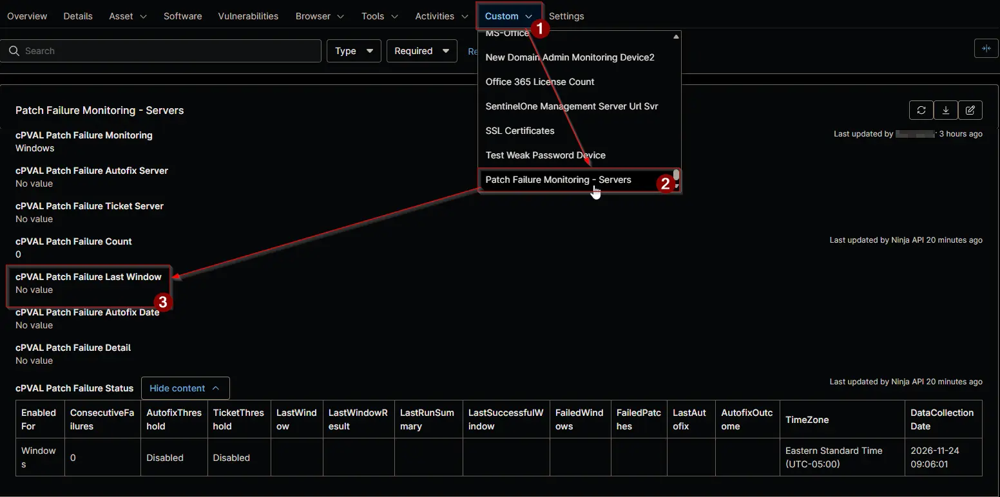

## Summary

Shows when the latest failed patch window on the device started. The [Patch Failure Monitoring](/docs/28302386-1560-4468-be5c-c9d683b99e65) automation writes it once a day. The autofix and ticket compound conditions run only on devices where it has a value, and [Patch Failure Monitoring - Detection](/docs/97aa8bfb-f376-4acf-8241-782c364d3d18) compares it with [cPVAL Patch Failure Autofix Date](/docs/6a454795-0de4-40c9-ab25-d016b42ccd7a) so the repair runs once per failed patch window.

:::note

- It's cleared when a successful patch window resets [cPVAL Patch Failure Count](/docs/02b8e35f-c8dd-4685-a00b-412fd0112c7c), and when the device is no longer monitored. Clearing it resets the ticket compound condition, which closes its ticket.
- The field is script-managed and read only for technicians.

:::

## Details

| Label | Field Name | Example | Definition Scope | Type | Required | Default Value | Dropdown Options | Editable | Custom Field Tab |
| ----- | ---------- | ------- | ---------------- | ---- | -------- | ------------- | ---------------- | -------- | ---------------- |
| cPVAL Patch Failure Last Window | cpvalPatchFailureLastWindow | `2026-11-23 02:05` | `Device` | Date/Time | No | |  | No | <ul><li>`Patch Failure Monitoring - Servers`</li><li>`Patch Failure Monitoring - Workstations`</li></ul> |

## Dependencies

- [Automation: Patch Failure Monitoring](/docs/28302386-1560-4468-be5c-c9d683b99e65)
- [Automation: Patch Failure Monitoring - Detection](/docs/97aa8bfb-f376-4acf-8241-782c364d3d18)
- [Compound Condition: Patch Failure Monitoring - Autofix [Windows Servers]](/docs/ae7d3fd7-d4b4-4e0e-88a4-ed917a5dd402)
- [Compound Condition: Patch Failure Monitoring - Autofix [Windows Workstations]](/docs/6da0c83e-d6bd-4b4a-985b-6b7b6b2d7774)
- [Compound Condition: Patch Failure Monitoring - Ticket [Windows Servers]](/docs/fafe75cc-3caa-4713-9f78-507ad9eec3b5)
- [Compound Condition: Patch Failure Monitoring - Ticket [Windows Workstations]](/docs/d4488df1-2292-4886-ab7a-46207ec6f856)
- [Solution: Patch Failure Monitoring - NinjaOne](/docs/020ff3c5-06a6-4f98-9eaa-7f7392b2257a)

## Custom Field Creation

- [Custom Field Configuration](https://github.com/ProVal-Tech/ninjarmm/blob/main/custom-fields/cpval-patch-failure-last-window.toml)

## Sample Screenshot

## Changelog

### 2026-11-23

- Initial version of the document
