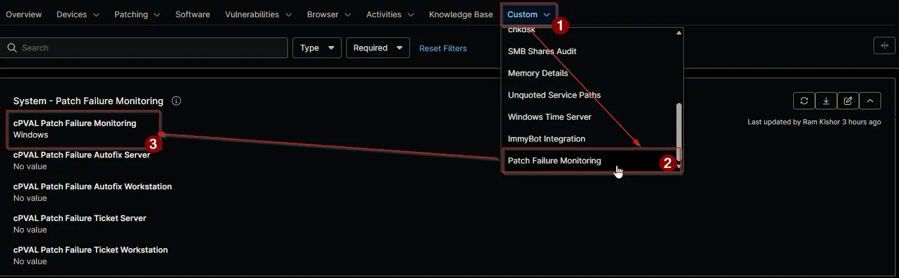

## Summary

Selects which Windows devices the [Patch Failure Monitoring - NinjaOne](/docs/020ff3c5-06a6-4f98-9eaa-7f7392b2257a) solution monitors for consecutive failed patch windows. It's the switch that turns the solution on for every client, a client, a location or a single device.

| Option | Workstations | Servers |
| ------ | ------------ | ------- |
| `Windows` | Monitored | Monitored |
| `Windows Workstations` | Monitored | Not monitored |
| `Windows Servers` | Not monitored | Monitored |
| `Disabled` | Not monitored | Not monitored |

- Set `Disabled` on a device to exclude it, whatever the levels above hold.
- Set `Windows` on a device to include it, whatever the levels above hold.
- A device that stops being monitored has its patch failure fields cleared, so its compound conditions reset and an open ticket closes.

:::note

- Set the field at the system level to monitor every client, or at the organization level for one client, and change it at a location or on a device where needed. The most specific value wins.
- A blank value inherits from the level above. Blank at every level means no device is monitored.
- A change takes effect at the next run of the [Patch Failure Monitoring](/docs/ffc02ba6-8c07-4075-9844-2e7327723023) scheduled task, once a day. A newly monitored device only counts the patch windows of the last 24 hours.

:::

## Details

| Label | Field Name | Example | Definition Scope | Type | Required | Default Value | Dropdown Options | Editable | Custom Field Tab |
| ----- | ---------- | ------- | ---------------- | ---- | -------- | ------------- | ---------------- | -------- | ---------------- |
| cPVAL Patch Failure Monitoring | cpvalPatchFailureMonitoring | `Windows Servers` | `System`, `Organization`, `Location`, `Device` | Drop-down | No | | `Windows`, `Windows Workstations`, `Windows Servers`, `Disabled` | Yes | <ul><li>`Patch Failure Monitoring` (System)</li><li>`Patch Failure Monitoring` (Organization and Location)</li><li>`Patch Failure Monitoring - Servers`</li><li>`Patch Failure Monitoring - Workstations`</li></ul> |

## Dependencies

- [Automation: Patch Failure Monitoring](/docs/28302386-1560-4468-be5c-c9d683b99e65)
- [Automation: Patch Failure Monitoring - Detection](/docs/97aa8bfb-f376-4acf-8241-782c364d3d18)
- [Custom Field: cPVAL Patch Failure Autofix Server](/docs/62bf3875-c734-48e8-b518-b53373a9137e)
- [Custom Field: cPVAL Patch Failure Autofix Workstation](/docs/04f87a60-2857-4253-bca8-f4addd2f71fe)
- [Custom Field: cPVAL Patch Failure Ticket Server](/docs/3c54b72d-8fb2-49bd-a2a2-5c6b08833b12)
- [Custom Field: cPVAL Patch Failure Ticket Workstation](/docs/4e93e558-3a43-4d58-b60b-e6391fb79e46)
- [Solution: Patch Failure Monitoring - NinjaOne](/docs/020ff3c5-06a6-4f98-9eaa-7f7392b2257a)

## Custom Field Creation

- [Custom Field Configuration](https://github.com/ProVal-Tech/ninjarmm/blob/main/custom-fields/cpval-patch-failure-monitoring.toml)

## Sample Screenshot

## Changelog

### 2026-11-23

- Initial version of the document
