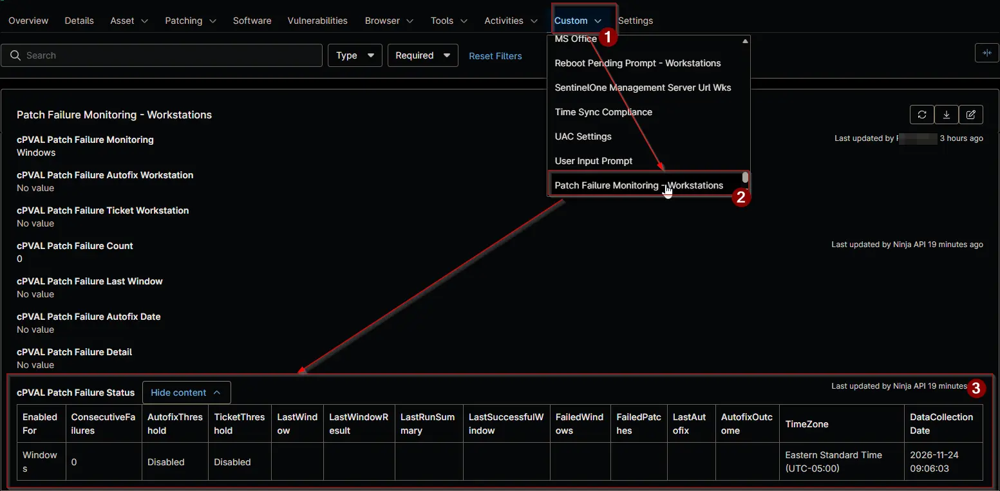

## Summary

Shows the [Patch Failure Monitoring - NinjaOne](/docs/020ff3c5-06a6-4f98-9eaa-7f7392b2257a) status of the device as a one row table. The [Patch Failure Monitoring](/docs/28302386-1560-4468-be5c-c9d683b99e65) automation writes it on every monitored device, and the [Patch Failure Monitoring Status](/docs/e475c21b-05a9-40a5-bea2-efd7e0515930) report combines it across devices.

| Column | Shows |
| ------ | ----- |
| EnabledFor | The value of [cPVAL Patch Failure Monitoring](/docs/b3797751-cb85-4d82-b943-3bde379d6481) that applies to the device. |
| ConsecutiveFailures | The number of consecutive failed patch windows. |
| AutofixThreshold | The autofix threshold that applies to the device, or `Disabled`. |
| TicketThreshold | The ticket threshold that applies to the device, or `Disabled`. A raised threshold shows the value set, for example `3 (set to 1, raised to autofix + 1)`. |
| LastWindow | The start of the latest patch window counted. |
| LastWindowResult | `Failed` or `Succeeded`. |
| LastRunSummary | The number of patch runs in the latest window, and how many updates the last run installed and failed. |
| LastSuccessfulWindow | The start of the latest successful patch window. |
| FailedWindows | The start of each failed patch window of the current run of failures. |
| FailedPatches | The KB number and name of each update that failed in the latest failed window. |
| LastAutofix | When [Repair Windows Update](/docs/d7bb77e6-e7b8-45d2-9fa7-f109574aa887) was last requested. |
| AutofixOutcome | The result of the last repair. See below. |
| TimeZone | The time zone of all times in the table, which is the time zone of the primary machine that runs [Patch Failure Monitoring](/docs/28302386-1560-4468-be5c-c9d683b99e65), for example `Eastern Standard Time (UTC-05:00)`. |
| DataCollectionDate | When the row last changed. |

| AutofixOutcome | Meaning |
| -------------- | ------- |
| `Awaiting Window` | The repair ran and no patch window has finished since. |
| `Failed Again` | A patch window after the repair still failed. |
| `Resolved` | A patch window after the repair succeeded and the count was reset. |

:::note

- All times in the table are in the time zone shown in TimeZone, not the device's own time zone.
- The table is rewritten only when a value other than DataCollectionDate changes.
- It keeps the last repair and its outcome after the count resets, and is cleared when the device is no longer monitored.
- The field is script-managed and read only for technicians.

:::

## Details

| Label | Field Name | Example | Definition Scope | Type | Required | Default Value | Dropdown Options | Editable | Custom Field Tab |
| ----- | ---------- | ------- | ---------------- | ---- | -------- | ------------- | ---------------- | -------- | ---------------- |
| cPVAL Patch Failure Status | cpvalPatchFailureStatus | *HTML table* | `Device` | WYSIWYG | No | |  | No | <ul><li>`Patch Failure Monitoring - Servers`</li><li>`Patch Failure Monitoring - Workstations`</li></ul> |

## Dependencies

- [Automation: Patch Failure Monitoring](/docs/28302386-1560-4468-be5c-c9d683b99e65)
- [Audit Report: Patch Failure Monitoring Status](/docs/e475c21b-05a9-40a5-bea2-efd7e0515930)
- [Automation: WYSIWYG Custom Field Report - Organization and Global KB](/docs/67df14cd-3c20-4a40-bb7a-80caae242687)
- [Scheduled Task: Patch Failure Monitoring](/docs/ffc02ba6-8c07-4075-9844-2e7327723023)
- [Solution: Patch Failure Monitoring - NinjaOne](/docs/020ff3c5-06a6-4f98-9eaa-7f7392b2257a)

## Custom Field Creation

- [Custom Field Configuration](https://github.com/ProVal-Tech/ninjarmm/blob/main/custom-fields/cpval-patch-failure-status.toml)

## Sample Screenshot

## Changelog

### 2026-11-23

- Initial version of the document
