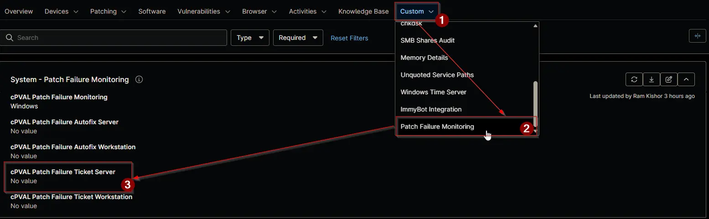

## Summary

Sets the number of consecutive failed patch windows at which a ConnectWise Manage ticket is created for servers. When [cPVAL Patch Failure Count](/docs/02b8e35f-c8dd-4685-a00b-412fd0112c7c) reaches this number, the [Patch Failure Monitoring - Ticket [Windows Servers]](/docs/fafe75cc-3caa-4713-9f78-507ad9eec3b5) compound condition creates a ticket with the [Consecutive Patch Failures](/docs/d5aaffa6-061b-4349-86f3-cf30b9a3cd14) template, listing the failed patch windows and updates and when the repair ran.

| Value | Result |
| ----- | ------ |
| Blank | Inherits from the level above. Blank at every level means no ticket. |
| `0` | No ticket at this level, even if a level above sets a threshold. |
| `1` or more | A ticket is created once the count reaches this number. |

Keep the value above the autofix threshold in [cPVAL Patch Failure Autofix Server](/docs/62bf3875-c734-48e8-b518-b53373a9137e). A value equal to or lower than the autofix threshold is treated as the autofix threshold + 1, so the repair always runs first. For example, an autofix threshold of `2` with a ticket threshold of `1` creates the ticket at `3`. To get a ticket without the repair, set the autofix threshold to `0`.

:::note

- The field applies to servers only and is ignored on workstations.
- The ticket closes when a successful patch window resets the count.
- A change takes effect at the next check of the ticket compound condition, within an hour.

:::

## Details

| Label | Field Name | Example | Definition Scope | Type | Required | Default Value | Dropdown Options | Editable | Custom Field Tab |
| ----- | ---------- | ------- | ---------------- | ---- | -------- | ------------- | ---------------- | -------- | ---------------- |
| cPVAL Patch Failure Ticket Server | cpvalPatchFailureTicketServer | `2` | `System`, `Organization`, `Location`, `Device` | Integer | No | |  | Yes | <ul><li>`Patch Failure Monitoring` (System)</li><li>`Patch Failure Monitoring` (Organization and Location)</li><li>`Patch Failure Monitoring - Servers`</li></ul> |

## Dependencies

- [Automation: Patch Failure Monitoring - Detection](/docs/97aa8bfb-f376-4acf-8241-782c364d3d18)
- [Compound Condition: Patch Failure Monitoring - Ticket [Windows Servers]](/docs/fafe75cc-3caa-4713-9f78-507ad9eec3b5)
- [Ticket Template: Consecutive Patch Failures](/docs/d5aaffa6-061b-4349-86f3-cf30b9a3cd14)
- [Custom Field: cPVAL Patch Failure Autofix Server](/docs/62bf3875-c734-48e8-b518-b53373a9137e)
- [Solution: Patch Failure Monitoring - NinjaOne](/docs/020ff3c5-06a6-4f98-9eaa-7f7392b2257a)

## Custom Field Creation

- [Custom Field Configuration](https://github.com/ProVal-Tech/ninjarmm/blob/main/custom-fields/cpval-patch-failure-ticket-server.toml)

## Sample Screenshot

## Changelog

### 2026-11-23

- Initial version of the document
