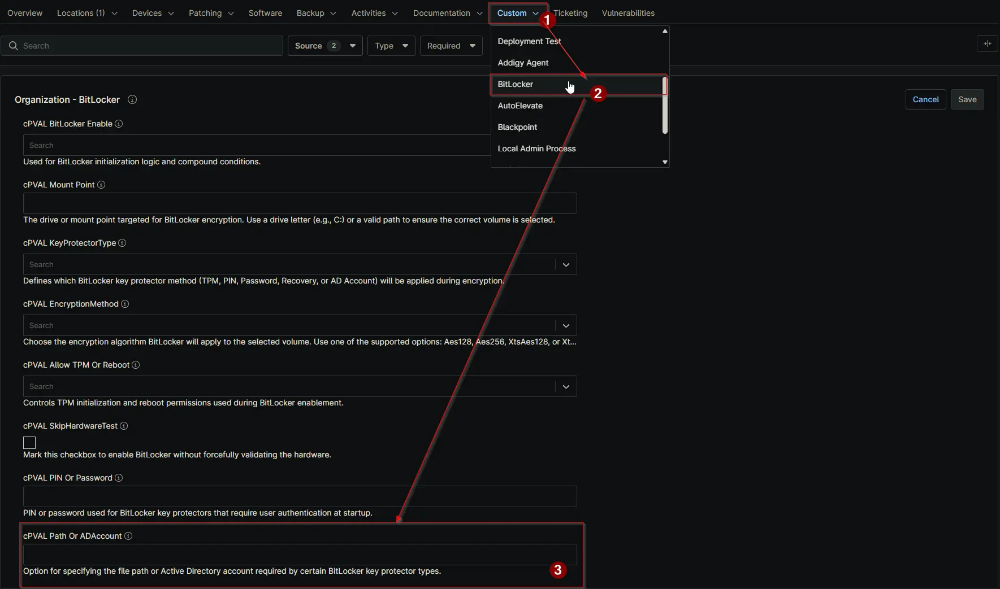

## Summary

Holds the folder or Active Directory account the [cPVAL KeyProtectorType](/docs/3378eace-ffba-4f7d-8e93-3cc37510a4ea) protector needs.

| Key protector | Value |
| ------------- | ----- |
| `TpmStartup`, `TpmPinStartup`, `Startup` | The folder to save the startup key file to, usually on a USB drive, for example `F:\`. The key must be connected at every startup. |
| `RecoveryKey` | The folder to save the recovery key file to, for example `F:\Recovery`. |
| `AdAccount` | The domain account or group allowed to unlock the drive, for example `CONTOSO\ContosoGroup`. |

## Details

| Label | Field Name | Example | Definition Scope | Type | Required | Default Value | Dropdown Options | Editable | Custom Field Tab |
| ----- | ---------- | ------- | ---------------- | ---- | -------- | ------------- | ---------------- | -------- | ---------------- |
| cPVAL Path Or ADAccount | cpvalPathOrAdaccount | `CONTOSO\ContosoGroup` | `Organization`, `Location`, `Device` | `Text` | `False` | - | - | `Yes` | BitLocker |

## Dependencies

- [Custom Field: cPVAL KeyProtectorType](/docs/3378eace-ffba-4f7d-8e93-3cc37510a4ea)
- [Automation: BitLocker Initialization - Detection](/docs/87d7a413-4bd4-4629-9475-35db91cb1320)
- [Automation: Initialize and Audit BitLocker](/docs/e3a24552-f347-4117-82f5-7afaaa3fc198)
- [Solution: BitLocker Initialize - NinjaOne](/docs/2ebfabd5-05cf-4175-a513-2aa290eb26e8)

## Custom Field Creation

- [Custom Field Configuration](https://github.com/ProVal-Tech/ninjarmm/blob/main/custom-fields/cpval-path-or-ad-account.toml)

## Sample Screenshot

## Changelog

### 2026-10-26

- Documented the value each key protector expects.
- Updated the document to the standard format.

### 2025-12-16

- Initial version of the document
