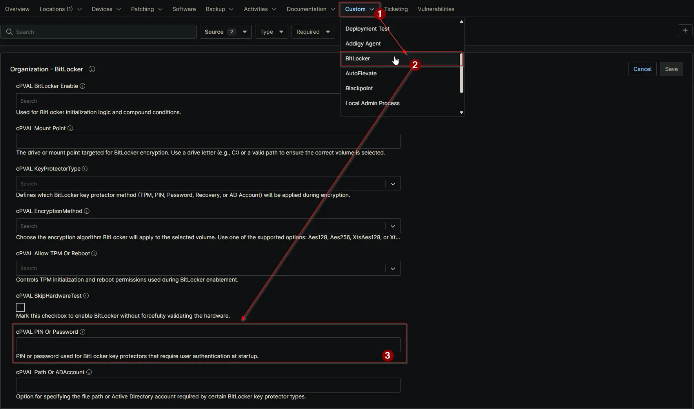

## Summary

Holds the value the [cPVAL KeyProtectorType](/docs/3378eace-ffba-4f7d-8e93-3cc37510a4ea) protector needs.

| Key protector | Value |
| ------------- | ----- |
| `TpmPin`, `TpmPinStartup` | The startup PIN, for example `246810`. It must meet the minimum PIN length set for the device. |
| `Password` | The password typed at startup. |
| `RecoveryPassword` | Optional. A 48-digit recovery password in the format `000000-000000-000000-000000-000000-000000-000000-000000`. Leave it blank to have a unique recovery password generated for each drive. Any other value stops the solution for that device. |

:::note
This is a text field, so anyone who can see the device's custom fields can read it. Set it at the narrowest level that works. A recovery password set at the organization or location level is shared by every drive there, so leave the field blank when the key protector is `RecoveryPassword`.
:::

## Details

| Label | Field Name | Example | Definition Scope | Type | Required | Default Value | Dropdown Options | Editable | Custom Field Tab |
| ----- | ---------- | ------- | ---------------- | ---- | -------- | ------------- | ---------------- | -------- | ---------------- |
| cPVAL PIN Or Password | cpvalPinOrPassword | `246810` | `Organization`, `Location`, `Device` | `Text` | `False` | - | - | `Yes` | BitLocker |

## Dependencies

- [Custom Field: cPVAL KeyProtectorType](/docs/3378eace-ffba-4f7d-8e93-3cc37510a4ea)
- [Automation: BitLocker Initialization - Detection](/docs/87d7a413-4bd4-4629-9475-35db91cb1320)
- [Automation: Initialize and Audit BitLocker](/docs/e3a24552-f347-4117-82f5-7afaaa3fc198)
- [Solution: BitLocker Initialize - NinjaOne](/docs/2ebfabd5-05cf-4175-a513-2aa290eb26e8)

## Custom Field Creation

- [Custom Field Configuration](https://github.com/ProVal-Tech/ninjarmm/blob/main/custom-fields/cpval-pin-or-password.toml)

## Sample Screenshot

## Changelog

### 2026-10-26

- Documented the value each key protector expects, including the recovery password format.
- Added a note about who can read the field and shared recovery passwords.
- Updated the document to the standard format.

### 2025-12-16

- Initial version of the document
