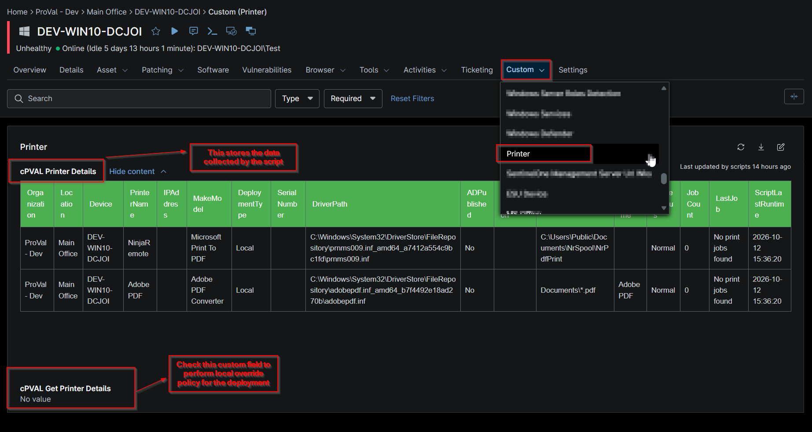

## Summary

This custom field stores the information of the printers fetched using the script [Get Printer Details](/docs/b97ba03c-ce1a-4337-a42b-d07dabc59412).

## Details

| Label | Field Name | Example | Definition Scope | Type | Required | Default Value | Dropdown Options | Editable | Custom Field Tab |
| ----- | ---------- | ------- | ---------------- | ---- | -------- | ------------- | ---------------- | -------- | ---------------- |
| cPVAL Printer Details | cpvalPrinterDetails | Tabular format data | `Device` | WYSIWYG | false |  |  | No | Printer |

## Table Columns

| Column Name | Description |
|-------------|-------------|
| Organization | The organization to which the device is assigned. |
| Location | The location associated with the device. |
| Device | The name of the device where the printer was detected. |
| PrinterName | The name of the installed or detected printer. |
| IPAddress | The IP address assigned to the printer. |
| MakeModel | The printer manufacturer and model information. |
| DeploymentType | Indicates how the printer was deployed (for example, local, network, or managed deployment). |
| SerialNumber | The printer's serial number, as reported by the device or printer management interface. |
| DriverPath | The local file system path of the printer driver installed on the device. |
| ADPublished | Indicates whether the printer is published and discoverable in Active Directory. |
| SupportInformation | Contact details or support information used for vendor assistance and troubleshooting. |
| PortName | The printer port configuration used for communication with the printer. |
| ShareName | The shared name assigned to the printer for network access. |
| PrinterStatus | The current operational status of the printer, such as Ready, Offline, Error, or Warning. |
| JobCount | The total number of print jobs currently queued for the printer. |
| LastJob | The date and time when the most recent print job was processed. |
| ScriptLastRunTime | The date and time when the [Script - Get Printer Details](/docs/b97ba03c-ce1a-4337-a42b-d07dabc59412) last collected and reported printer information. |

## Dependencies

- [Solution - Get Printer Details](/docs/b5c871cf-f8fc-4fde-b20c-5aabd7341ade)

## Custom Field Creation

- [Custom Field Configuration](https://github.com/ProVal-Tech/ninjarmm/blob/main/custom-fields/cpval-printer-details.toml)

## Sample Screenshot

## Changelog

### 2026-10-13

- Initial version of the document
