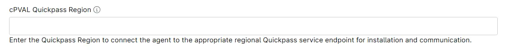

## Summary
Custom field to enter the QuickPass Region to connect the agent to the appropriate regional QuickPass service endpoint for installation and communication.

## Details

| Label | Field Name | Example | Definition Scope | Type | Required | Default Value | Editable | Custom Field Tab |
| ----- | ---------- | ------- | ---------------- | ---- | -------- | ------------- | -------- | ---------------- |
| cPVAL QuickPass Region | cpvalQuickpassRegion | `US` | `Organization`, `Location`, `Device` | Text | False | | True | QuickPass |

## Dependencies

* [Solution - Deploy QuickPass Agent](/docs/a68fa93c-45c7-4491-80d1-5e7543016b7f)

## Custom Field Creation

- [Custom Field Configuration](https://github.com/ProVal-Tech/ninjarmm/blob/main/custom-fields/cpval-quickpass-region.toml)

## Sample Screenshot

## Changelog

### 2026-10-21

- Initial version of the document
