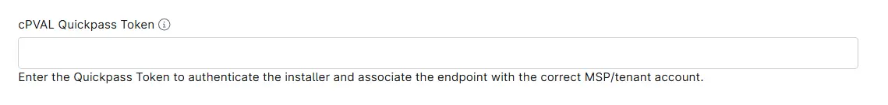

## Summary

Custom Field to enter the QuickPass Token to authenticate the installer and associate the endpoint with the correct MSP/tenant account.

## Details

| Label | Field Name | Example | Definition Scope | Type | Required | Default Value | Editable | Custom Field Tab |
| ----- | ---------- | ------- | ---------------- | ---- | -------- | ------------- | -------- | ---------------- |
| cPVAL QuickPass Token | cpvalQuickpassToken | `3233d5-4eee-8d65-eddededed` | `Organization`, `Location`, `Device` | Text | False | | True | QuickPass |

## Dependencies

* [Solution - Deploy QuickPass Agent](/docs/a68fa93c-45c7-4491-80d1-5e7543016b7f)

## Custom Field Creation

- [Custom Field Configuration](https://github.com/ProVal-Tech/ninjarmm/blob/main/custom-fields/cpval-quickpass-token.toml)

## Sample Screenshot

## Changelog

### 2026-10-21

- Initial version of the document
