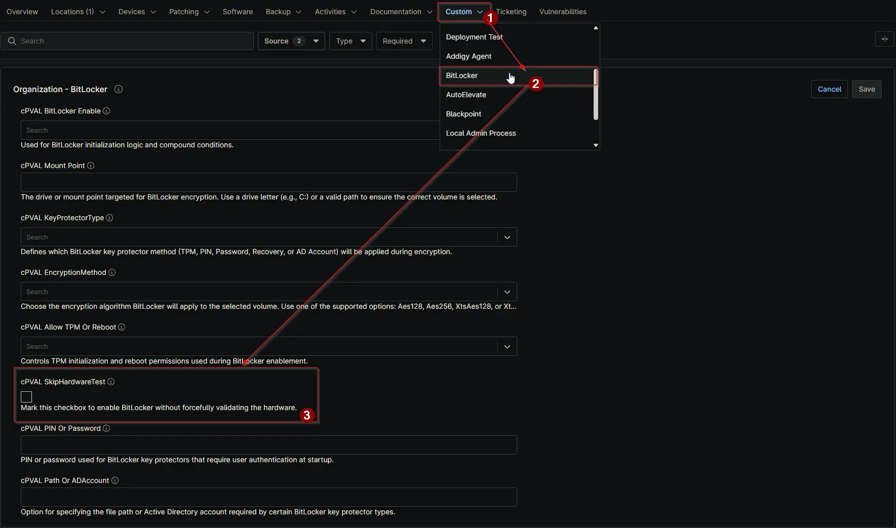

## Summary

Before encrypting, BitLocker normally tests at the next restart that the device can unlock the drive, and starts encryption only after the test passes. Check this field to skip the test and start encryption right away.

When the hardware test fails on a device, the [BitLocker Initialize - NinjaOne](/docs/2ebfabd5-05cf-4175-a513-2aa290eb26e8) solution stops for that device until you fix the cause or check this field.

## Details

| Label | Field Name | Example | Definition Scope | Type | Required | Default Value | Dropdown Options | Editable | Custom Field Tab |
| ----- | ---------- | ------- | ---------------- | ---- | -------- | ------------- | ---------------- | -------- | ---------------- |
| cPVAL SkipHardwareTest | cpvalSkiphardwaretest | `Checked` | `Organization`, `Location`, `Device` | `Checkbox` | `False` | Unchecked | - | `Yes` | BitLocker |

## Dependencies

- [Automation: BitLocker Initialization - Detection](/docs/87d7a413-4bd4-4629-9475-35db91cb1320)
- [Automation: Initialize and Audit BitLocker](/docs/e3a24552-f347-4117-82f5-7afaaa3fc198)
- [Solution: BitLocker Initialize - NinjaOne](/docs/2ebfabd5-05cf-4175-a513-2aa290eb26e8)

## Custom Field Creation

- [Custom Field Configuration](https://github.com/ProVal-Tech/ninjarmm/blob/main/custom-fields/cpval-skip-hardware-test.toml)

## Sample Screenshot

## Changelog

### 2026-10-26

- Documented when the hardware test runs and what happens when it fails.
- Updated the document to the standard format.

### 2025-12-16

- Initial version of the document
