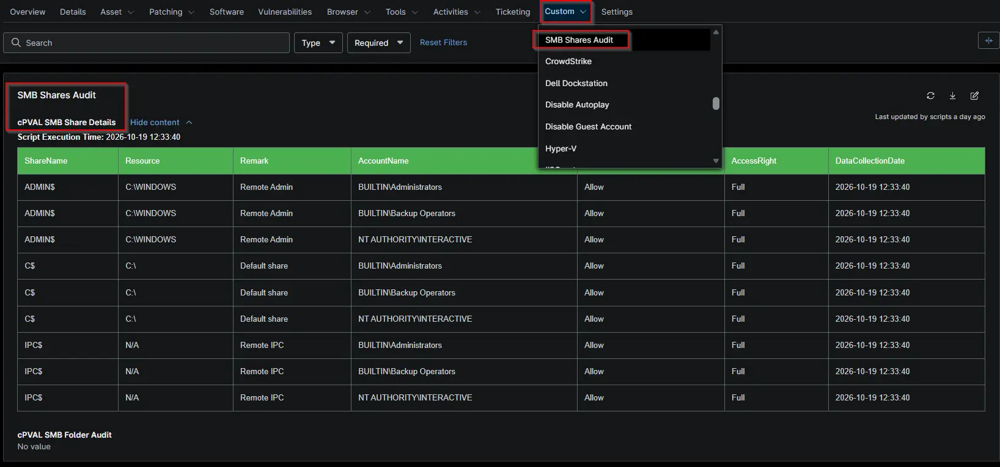

## Summary

Displays SMB share audit data in HTML format for easy viewing.

## Details

| Label | Field Name | Example | Definition Scope | Type | Required | Default Value | Dropdown Options | Editable | Custom Field Tab |
| `cPVAL SMB Share Details` | `cpvalSmbShareDetailss` | `HTML table` | `Organization`, `Location`, `Device`, `System` | `WYSIWYG` | `False` | - | - | `Yes` | Drives Report |

## Dependencies

* [Automation - SMB Share Permissions Audit](/docs/1e4a0ce1-e3a0-47b1-8574-4be31b24bc2a)
* [Solution: SMB Share Permission Audit - NinjaOne](/docs/a1a0fea8-a255-45e3-98c6-1bbe094f5693)

## Custom Field Creation

- [Custom Field Configuration](https://github.com/ProVal-Tech/ninjarmm/blob/main/custom-fields/cpval-smb-share-details.toml)

## Sample Screenshot

## Changelog

### 2026-10-21

- Initial version of the document
