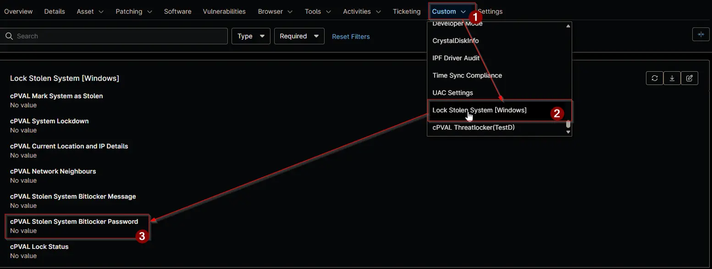

## Summary

The lockdown password used by the [Lock Stolen System](/docs/13b4df99-df9b-4a57-bc0f-8675c68be028) solution. On Windows, it becomes the BitLocker password of the system drive, so the locked computer only starts with it. On a Mac, it becomes the new password of every locked user account, and users sign in with it after the Mac is unlocked. Use a strong password that meets your password rules, keep it somewhere safe, and preferably set a different one on each device. It's required for lockdown. The field is on the **Lock Stolen System [Windows]** tab of Windows devices and the **Lock Stolen System [Macintosh]** tab of Macs.

## Details

| Label | Field Name | Example | Definition Scope | Type | Required | Default Value | Dropdown Options | Editable | Custom Field Tab |
| ----- | ---------- | ------- | ---------------- | ---- | -------- | ------------- | ---------------- | -------- | ---------------- |
| cPVAL Stolen System BitLocker Password | cpvalStolenSystemBitlockerPassword | A strong password of up to 200 characters | `Device` | Secure | No |  | | Yes | <ul><li>`Lock Stolen System [Windows]`</li><li>`Lock Stolen System [Macintosh]`</li></ul> |

## Dependencies

- [Automation: Lock Stolen System [Windows]](/docs/0f78be64-557a-4c0e-b7cf-e2ba41e71374)
- [Automation: Lock Stolen System [Macintosh]](/docs/08b38e83-0836-49de-b185-dbfc97a0f249)
- [Solution: Lock Stolen System](/docs/13b4df99-df9b-4a57-bc0f-8675c68be028)

## Custom Field Creation

- [Custom Field Configuration](https://github.com/ProVal-Tech/ninjarmm/blob/main/custom-fields/cpval-stolen-system-bitlocker-password.toml)

## Sample Screenshot

## Changelog

### 2026-11-12

- Added the field to Mac devices on the Lock Stolen System [Macintosh] tab, where it becomes the password of the locked user accounts, and moved it to the Lock Stolen System [Windows] tab on Windows devices.

### 2026-02-25

- Initial version of the document
