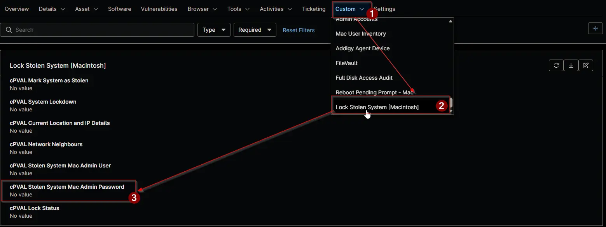

## Summary

The password of the account in [cPVAL Stolen System Mac Admin User](/docs/35966a9e-1a07-45c8-99e0-e51961543784). The [Lock Stolen System](/docs/13b4df99-df9b-4a57-bc0f-8675c68be028) solution uses it to change the users' passwords during a Mac lockdown. Set it on the Mac, together with the admin account, before you check [cPVAL System Lockdown](/docs/4b18c9bf-8aea-41a5-8242-77dfcfd0042a). It's required for Mac lockdown. The field is on the **Lock Stolen System [Macintosh]** tab of Mac devices.

## Details

| Label | Field Name | Example | Definition Scope | Type | Required | Default Value | Dropdown Options | Editable | Custom Field Tab |
| ----- | ---------- | ------- | ---------------- | ---- | -------- | ------------- | ---------------- | -------- | ---------------- |
| cPVAL Stolen System Mac Admin Password | cpvalStolenSystemMacAdminPassword | The admin account password, up to 200 characters | `Device` | Secure | No |  | | Yes | `Lock Stolen System [Macintosh]` |

## Dependencies

- [Custom Field: cPVAL Stolen System Mac Admin User](/docs/35966a9e-1a07-45c8-99e0-e51961543784)
- [Automation: Lock Stolen System [Macintosh]](/docs/08b38e83-0836-49de-b185-dbfc97a0f249)
- [Solution: Lock Stolen System](/docs/13b4df99-df9b-4a57-bc0f-8675c68be028)

## Custom Field Creation

- [Custom Field Configuration](https://github.com/ProVal-Tech/ninjarmm/blob/main/custom-fields/cpval-stolen-system-mac-admin-password.toml)

## Sample Screenshot

## Changelog

### 2026-11-05

- Initial version of the document
