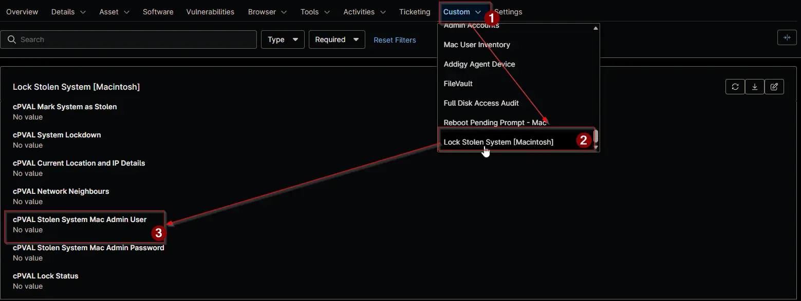

## Summary

The short name of the local IT admin account on your Macs, such as `itadmin`. During a Mac lockdown, the [Lock Stolen System](/docs/13b4df99-df9b-4a57-bc0f-8675c68be028) solution uses this account to change the users' passwords. It's the only account that isn't locked, so you can use it to unlock the FileVault screen when the Mac is recovered. The account needs a Secure Token, and the first admin account created on a Mac usually has one. Don't use the end user's own account. Set the field on the organization so every Mac inherits it, and on a device only when that Mac uses a different account. It's required for Mac lockdown. The field is on the **Lock Stolen System [Macintosh]** tab of Mac devices.

## Details

| Label | Field Name | Example | Definition Scope | Type | Required | Default Value | Dropdown Options | Editable | Custom Field Tab |
| ----- | ---------- | ------- | ---------------- | ---- | -------- | ------------- | ---------------- | -------- | ---------------- |
| cPVAL Stolen System Mac Admin User | cpvalStolenSystemMacAdminUser | itadmin | `Organization`, `Device` | Text | No |  | | Yes | `Lock Stolen System [Macintosh]` |

## Dependencies

- [Custom Field: cPVAL Stolen System Mac Admin Password](/docs/d527c77e-88b5-48f0-8ae8-364e909da96f)
- [Automation: Lock Stolen System [Macintosh]](/docs/08b38e83-0836-49de-b185-dbfc97a0f249)
- [Solution: Lock Stolen System](/docs/13b4df99-df9b-4a57-bc0f-8675c68be028)

## Custom Field Creation

- [Custom Field Configuration](https://github.com/ProVal-Tech/ninjarmm/blob/main/custom-fields/cpval-stolen-system-mac-admin-user.toml)

## Sample Screenshot

## Changelog

### 2026-11-05

- Initial version of the document
