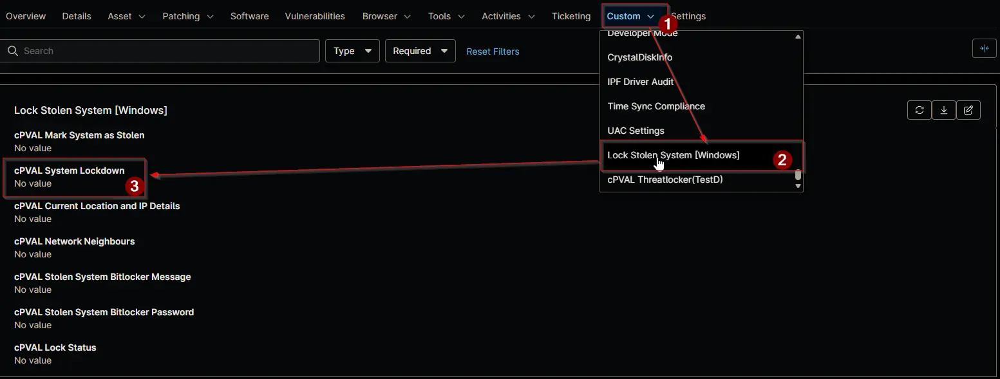

## Summary

Check this field to lock down a device marked as stolen the next time it's online. On Windows, the [Lock Stolen System](/docs/13b4df99-df9b-4a57-bc0f-8675c68be028) solution locks the system drive with the BitLocker password in [cPVAL Stolen System BitLocker Password](/docs/92779b41-3331-480c-a72d-402c0f328af3). On a Mac, every local user account except the IT admin account gets that password and is disabled. The device then shuts down. When this field is unchecked, the solution only tracks the device and the device stays online. Set the lockdown password before you check this field. The field is on the **Lock Stolen System [Windows]** tab of Windows devices and the **Lock Stolen System [Macintosh]** tab of Macs.

## Details

| Label | Field Name | Example | Definition Scope | Type | Required | Default Value | Dropdown Options | Editable | Custom Field Tab |
| ----- | ---------- | ------- | ---------------- | ---- | -------- | ------------- | ---------------- | -------- | ---------------- |
| cPVAL System Lockdown | cpvalSystemLockdown | Checked | `Device` | Checkbox | No | Unchecked | | Yes | <ul><li>`Lock Stolen System [Windows]`</li><li>`Lock Stolen System [Macintosh]`</li></ul> |

## Dependencies

- [Automation: Lock Stolen System [Windows]](/docs/0f78be64-557a-4c0e-b7cf-e2ba41e71374)
- [Automation: Lock Stolen System [Macintosh]](/docs/08b38e83-0836-49de-b185-dbfc97a0f249)
- [Solution: Lock Stolen System](/docs/13b4df99-df9b-4a57-bc0f-8675c68be028)

## Custom Field Creation

- [Custom Field Configuration](https://github.com/ProVal-Tech/ninjarmm/blob/main/custom-fields/cpval-system-lockdown.toml)

## Sample Screenshot

## Changelog

### 2026-11-12

- Added the field to Mac devices on the Lock Stolen System [Macintosh] tab, moved it to the Lock Stolen System [Windows] tab on Windows devices, and described the Mac lockdown. Devices are now shut down only when this field is checked.

### 2026-02-10

- Initial version of the document
