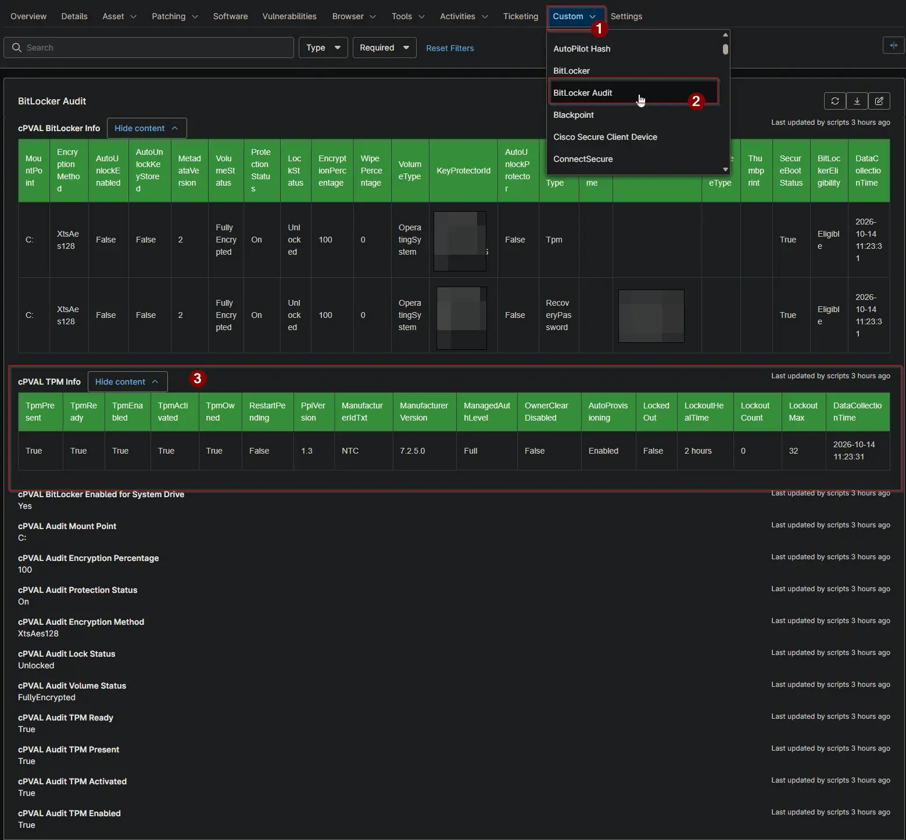

## Summary

Shows the Trusted Platform Module (TPM) status of the device. The TPM is the security chip BitLocker uses to protect encryption keys. Use it to check whether a device has a working TPM before you enable BitLocker. The [BitLocker and TPM Audit](/docs/2d104874-ec69-4d95-b912-7fcd240bf592) automation fills this field, and the [TPM Status](/docs/3127d0f3-0fd7-4a89-8eb5-4c30a37dabba) report collects it from every client.

## Details

| Label | Field Name | Example | Definition Scope | Type | Required | Default Value | Dropdown Options | Editable | Custom Field Tab |
| ----- | ---------- | ------- | ---------------- | ---- | -------- | ------------- | ---------------- | -------- | ---------------- |
| cPVAL TPM Info | cpvalTpmInfo | HTML table | `Device` | `WYSIWYG` | `False` | - | - | `Yes` | BitLocker Audit |

## Table Columns

The field holds a table with one row for the TPM of the device.

| Column | Description |
| ------ | ----------- |
| TpmPresent | `True` when the device has a TPM. |
| TpmReady | `True` when the TPM is ready for use. |
| TpmEnabled | `True` when the TPM is enabled in the BIOS or UEFI. |
| TpmActivated | `True` when the TPM is activated. Applies mainly to TPM 1.2. |
| TpmOwned | `True` when Windows has taken ownership of the TPM. |
| RestartPending | `True` when a restart is needed to finish a TPM change. |
| PpiVersion | The Physical Presence Interface version. |
| ManufacturerIdTxt | The TPM manufacturer. |
| ManufacturerVersion | The TPM firmware version. |
| ManagedAuthLevel | How much of the TPM authorization Windows manages. |
| OwnerClearDisabled | `True` when clearing the TPM is blocked by policy. |
| AutoProvisioning | Whether Windows sets up the TPM automatically. |
| LockedOut | `True` when the TPM is locked after too many failed attempts. |
| LockoutHealTime | How long until the failed-attempt counter goes down. |
| LockoutCount | The current number of failed attempts. |
| LockoutMax | The number of failed attempts allowed before lockout. |
| DataCollectionTime | When the data was collected. |

## Dependencies

* [Automation: BitLocker and TPM Audit](/docs/2d104874-ec69-4d95-b912-7fcd240bf592)
* [Audit Report: TPM Status](/docs/3127d0f3-0fd7-4a89-8eb5-4c30a37dabba)
* [Solution: BitLocker and TPM Audit](/docs/57c787ad-8d22-4ae4-b5e5-dac34fc600fc)

## Custom Field Creation

- [Custom Field Configuration](https://github.com/ProVal-Tech/ninjarmm/blob/main/custom-fields/cpval-tpm-info.toml)

## Sample Screenshot

## Changelog

### 2026-10-14

- Added the [TPM Status](/docs/3127d0f3-0fd7-4a89-8eb5-4c30a37dabba) report to the dependencies.
- Updated the Details table to the standard format.

### 2026-01-08

- Initial version of the document
