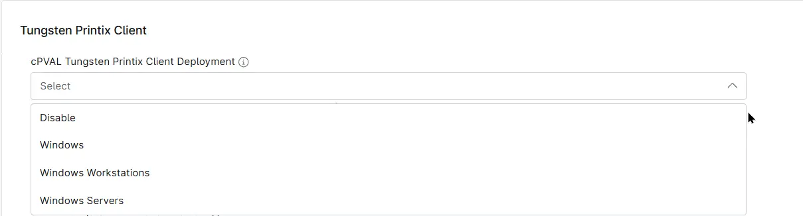

## Summary

Choose the Windows devices that the Tungsten Printix Client is deployed to automatically. The option you choose turns on one or both compound conditions, which run the [Install/Update Tungsten Printix Client](/docs/0c5963fc-ac9d-44ff-8fad-8ae2fd267547) automation on devices that don't have the client:

| Option | Deploys to |
| ------ | ---------- |
| `Disable` | No devices |
| `Windows` | Windows workstations and servers |
| `Windows Workstations` | Windows workstations only, through [Deploy Tungsten Printix Client - Workstations](/docs/96795ceb-d3c7-4d36-b424-d2979140e036) |
| `Windows Servers` | Windows servers only, through [Deploy Tungsten Printix Client - Servers](/docs/aad200d0-6423-4b95-80c8-0e8cbae219fa) |

When the field is empty, nothing is deployed. Set [cPVAL Tungsten PrintixClientID](/docs/ac1c2105-bc81-4dca-9786-1991d00e5155) and [cPVAL Tungsten PrintixClientDomain](/docs/4e5a88c2-1f5a-41fd-bd22-fd3d7ea2fb9b) before you choose an option. Otherwise the automation fails on every device it runs on.

Set the field at the organization level to cover all of the client's devices. A location or device value overrides it, so you can choose `Disable` for a single location or device.

`Disable` only stops new deployments. It doesn't remove the client from devices that already have it. To remove the client, run [Uninstall Tungsten Printix Client](/docs/0e415b7e-4132-45ff-a495-5320a42bf0c3).

## Details

| Label | Field Name | Example | Definition Scope | Type | Required | Default Value | Dropdown Options | Editable | Custom Field Tab |
| ----- | ---------- | ------- | ---------------- | ---- | -------- | ------------- | ---------------- | -------- | ---------------- |
| cPVAL Tungsten Printix Client Deployment | cpvalTungstenPrintixClientDeployment | Windows | `Organization`, `Location`, `Device` | Drop-down | No |  | <ul><li>`Disable`</li><li>`Windows`</li><li>`Windows Workstations`</li><li>`Windows Servers`</li></ul> | Yes | `Tungsten Printix Client` |

## Dependencies

- [Custom Field: cPVAL Tungsten PrintixClientID](/docs/ac1c2105-bc81-4dca-9786-1991d00e5155)
- [Custom Field: cPVAL Tungsten PrintixClientDomain](/docs/4e5a88c2-1f5a-41fd-bd22-fd3d7ea2fb9b)
- [Compound Condition: Deploy Tungsten Printix Client - Workstations](/docs/96795ceb-d3c7-4d36-b424-d2979140e036)
- [Compound Condition: Deploy Tungsten Printix Client - Servers](/docs/aad200d0-6423-4b95-80c8-0e8cbae219fa)
- [Automation: Install/Update Tungsten Printix Client](/docs/0c5963fc-ac9d-44ff-8fad-8ae2fd267547)
- [Automation: Uninstall Tungsten Printix Client](/docs/0e415b7e-4132-45ff-a495-5320a42bf0c3)
- [Solution: Deploy Tungsten Printix Client - NinjaOne](/docs/9424b17b-b55f-417d-9d2d-a953bed8575e)

## Custom Field Creation

- [Custom Field Configuration](https://github.com/ProVal-Tech/ninjarmm/blob/main/custom-fields/cpval-tungsten-printix-client-deployment.toml)

## Sample Screenshot

## Changelog

### 2026-11-16

- Initial version of the document
