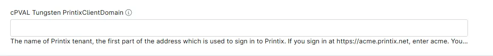

## Summary

The name of the client's Printix tenant: the part of the Printix sign-in address before `.printix.net`. If the client signs in at `https://acme.printix.net`, enter `acme`. `acme.printix.net` and `https://acme.printix.net` also work. The [Install/Update Tungsten Printix Client](/docs/0c5963fc-ac9d-44ff-8fad-8ae2fd267547) automation uses it in the name of the installer it downloads, which is how the installer knows which tenant to register the client to.

Set this field together with [cPVAL Tungsten PrintixClientID](/docs/ac1c2105-bc81-4dca-9786-1991d00e5155), usually at the organization level. A location or device value overrides it. If the field is empty, or the name has characters other than letters, numbers and hyphens, the automation fails without making changes.

## Details

| Label | Field Name | Example | Definition Scope | Type | Required | Default Value | Dropdown Options | Editable | Custom Field Tab |
| ----- | ---------- | ------- | ---------------- | ---- | -------- | ------------- | ---------------- | -------- | ---------------- |
| cPVAL Tungsten PrintixClientDomain | cpvalTungstenPrintixclientdomain | acme | `Organization`, `Location`, `Device` | Text | No |  |  | Yes | `Tungsten Printix Client` |

## Dependencies

- [Custom Field: cPVAL Tungsten PrintixClientID](/docs/ac1c2105-bc81-4dca-9786-1991d00e5155)
- [Custom Field: cPVAL Tungsten Printix Client Deployment](/docs/d53a9981-9c39-4392-bf02-9d069b529f2f)
- [Automation: Install/Update Tungsten Printix Client](/docs/0c5963fc-ac9d-44ff-8fad-8ae2fd267547)
- [Compound Condition: Deploy Tungsten Printix Client - Workstations](/docs/96795ceb-d3c7-4d36-b424-d2979140e036)
- [Compound Condition: Deploy Tungsten Printix Client - Servers](/docs/aad200d0-6423-4b95-80c8-0e8cbae219fa)
- [Solution: Deploy Tungsten Printix Client - NinjaOne](/docs/9424b17b-b55f-417d-9d2d-a953bed8575e)

## Custom Field Creation

- [Custom Field Configuration](https://github.com/ProVal-Tech/ninjarmm/blob/main/custom-fields/cpval-tungsten-printixclientdomain.toml)

## Sample Screenshot

## Changelog

### 2026-11-16

- Initial version of the document
