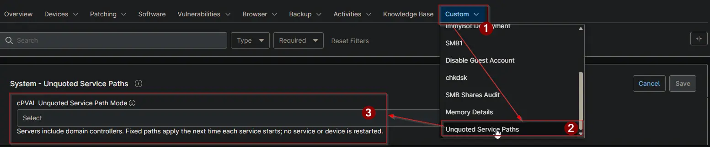

## Summary

Selects, per device type, whether the [Unquoted Service Paths - NinjaOne](/docs/463a9e42-df91-406d-b53c-285f4cbdabac) solution skips, audits or fixes Windows services whose executable path contains a space and is not enclosed in quotation marks. The solution's compound conditions read this field before they run the [Unquoted Service Paths - Detection](/docs/73387129-5472-4b0e-945e-f7822c57185d) script.

| Option | Workstations | Servers |
| ------ | ------------ | ------- |
| `Disabled` | Skipped | Skipped |
| `Audit All` | Audit | Audit |
| `Audit Workstations Only` | Audit | Skipped |
| `Audit Servers Only` | Skipped | Audit |
| `Autofix All` | Fix | Fix |
| `Autofix Workstations Only` | Fix | Skipped |
| `Autofix Servers Only` | Skipped | Fix |
| `Autofix Workstations and Audit Servers` | Fix | Audit |
| `Autofix Servers and Audit Workstations` | Audit | Fix |

- **Audit:** the services are listed in [cPVAL Unquoted Service Paths](/docs/b3d517ef-c7e4-4dc7-aa10-1e52b6edb196). Nothing is changed.
- **Fix:** the services are listed, and [Unquoted Service Paths - Autofix](/docs/2b0fa58e-fc89-45fd-a1d5-7e7e64096e30) encloses their paths in quotation marks.
- **Skipped:** the device is not checked, and its cPVAL Unquoted Service Paths field is not changed.

:::note

- Servers include domain controllers.
- A blank value works like `Disabled`.
- Fixed paths are used the next time each service starts. No service or device is restarted.

:::

## Details

| Label | Field Name | Example | Definition Scope | Type | Required | Default Value | Dropdown Options | Editable | Custom Field Tab |
| ----- | ---------- | ------- | ---------------- | ---- | -------- | ------------- | ---------------- | -------- | ---------------- |
| cPVAL Unquoted Service Path Mode | cpvalUnquotedServicePathMode | `Autofix Workstations Only` | `System`, `Organization`, `Location`, `Device` | `Drop-down` | `False` | - | `Disabled`, `Audit All`, `Audit Workstations Only`, `Audit Servers Only`, `Autofix All`, `Autofix Workstations Only`, `Autofix Servers Only`, `Autofix Workstations and Audit Servers`, `Autofix Servers and Audit Workstations` | `Yes` | Unquoted Service Paths |

## Dependencies

- [Compound Condition: Unquoted Service Paths - Workstations](/docs/ed45bd74-48ec-4463-b012-1dfac05e9a1c)
- [Compound Condition: Unquoted Service Paths - Servers](/docs/2d18a56f-bbec-46ef-84c7-229643a76c4b)
- [Automation: Unquoted Service Paths - Detection](/docs/73387129-5472-4b0e-945e-f7822c57185d)
- [Solution: Unquoted Service Paths - NinjaOne](/docs/463a9e42-df91-406d-b53c-285f4cbdabac)

## Custom Field Creation

- [Custom Field Configuration](https://github.com/ProVal-Tech/ninjarmm/blob/main/custom-fields/cpval-unquoted-service-path-mode.toml)

## Sample Screenshot

## Changelog

### 2026-10-27

- Initial version of the document
