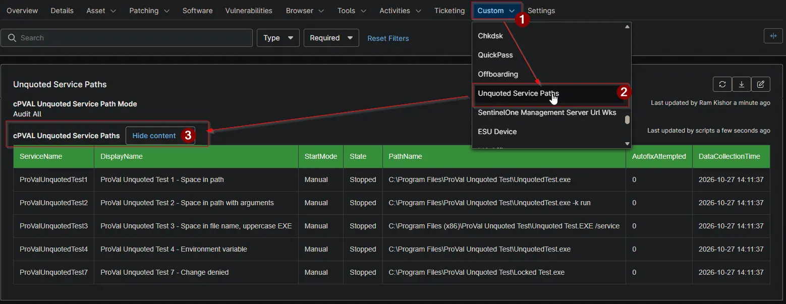

## Summary

Lists the Windows services on the device whose executable path contains a space and is not enclosed in quotation marks. Windows can start an earlier part of such a path, so security scans report these services as a privilege escalation risk. The [Unquoted Service Paths - Detection](/docs/73387129-5472-4b0e-945e-f7822c57185d) automation fills this field, [Unquoted Service Paths - Autofix](/docs/2b0fa58e-fc89-45fd-a1d5-7e7e64096e30) updates it after every fix, and the [Unquoted Service Paths](/docs/cfc2e3ef-c8f1-4182-ada3-f4e55b7f0d1e) report collects it from every client.

:::note

- The field is cleared when no service has an unquoted path, so it only holds data for devices that need attention.
- When [cPVAL Unquoted Service Path Mode](/docs/624406be-6c89-4ed4-a47c-14749752b387) skips the device, the field keeps the data recorded before.

:::

## Details

| Label | Field Name | Example | Definition Scope | Type | Required | Default Value | Dropdown Options | Editable | Custom Field Tab |
| ----- | ---------- | ------- | ---------------- | ---- | -------- | ------------- | ---------------- | -------- | ---------------- |
| cPVAL Unquoted Service Paths | cpvalUnquotedServicePaths | HTML table | `Device` | `WYSIWYG` | `False` | - | - | `No` | Unquoted Service Paths |

## Table Columns

The field holds a table with one row per service.

| Column | Description |
| ------ | ----------- |
| ServiceName | The name of the service. |
| DisplayName | The display name of the service. |
| StartMode | How the service starts, for example `Auto`, `Manual` or `Disabled`. |
| State | The state of the service when the data was collected, for example `Running` or `Stopped`. |
| PathName | The path and arguments of the service. |
| AutofixAttempted | `0` when the detection script recorded the service. `1` when the path is still unquoted after the autofix ran; the activity log of that run gives the reason. |
| DataCollectionTime | When the data was collected. |

## Dependencies

- [Automation: Unquoted Service Paths - Detection](/docs/73387129-5472-4b0e-945e-f7822c57185d)
- [Automation: Unquoted Service Paths - Autofix](/docs/2b0fa58e-fc89-45fd-a1d5-7e7e64096e30)
- [Audit Report: Unquoted Service Paths](/docs/cfc2e3ef-c8f1-4182-ada3-f4e55b7f0d1e)
- [Solution: Unquoted Service Paths - NinjaOne](/docs/463a9e42-df91-406d-b53c-285f4cbdabac)

## Custom Field Creation

- [Custom Field Configuration](https://github.com/ProVal-Tech/ninjarmm/blob/main/custom-fields/cpval-unquoted-service-paths.toml)

## Sample Screenshot

## Changelog

### 2026-10-27

- Initial version of the document
