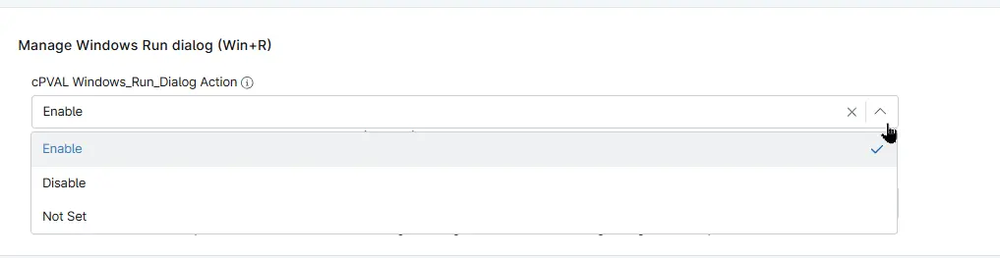

## Summary

Choose whether users can open the Windows Run dialog (Windows key + R). The option you choose decides whether the compound conditions run the [Manage Windows Run Dialog](/docs/b88497c1-454b-42e7-ba9f-32e61dd4b858) automation on the device, and what the automation does:

| Option | Result |
| ------ | ------ |
| `Disable` | Blocks the Run dialog for every user on the device, except the users in [cPVAL Windows_Run_Dialog Exclude Users](/docs/6f5d07d7-7f29-45b8-ab1c-eab34a1dbe86). Users who sign in for the first time later are blocked too. |
| `Enable` | Makes the Run dialog available again for every user on the device, except excluded users. |
| `Not Set` | Not managed. The automation doesn't run, and the device keeps its current setting. |

An empty field works like `Not Set`.

Set the field at the organization level to cover all of the client's Windows devices. A location or device value overrides it, so you can choose `Not Set` or the opposite option for a single location or device.

`Not Set` doesn't turn the Run dialog back on. To give users the Run dialog again, choose `Enable`.

While the field is `Enable` or `Disable`, the compound conditions run the automation again every 24 hours, so the setting is reapplied to any profile where it was changed. Users get the change the next time they sign in.

The automation also reads this field when you run it manually with its **Action** parameter left empty.

## Details

| Label | Field Name | Example | Definition Scope | Type | Required | Default Value | Dropdown Options | Editable | Custom Field Tab |
| ----- | ---------- | ------- | ---------------- | ---- | -------- | ------------- | ---------------- | -------- | ---------------- |
| cPVAL Windows_Run_Dialog Action | cpvalWindowsrundialogAction | Disable | `System`, `Organization`, `Location`, `Device` | Drop-down | No |  | <ul><li>`Disable`</li><li>`Enable`</li><li>`Not Set`</li></ul> | Yes | `Manage Windows Run Dialog (Win+R)` |

## Dependencies

- [Custom Field: cPVAL Windows_Run_Dialog Exclude Users](/docs/6f5d07d7-7f29-45b8-ab1c-eab34a1dbe86)
- [Automation: Manage Windows Run Dialog](/docs/b88497c1-454b-42e7-ba9f-32e61dd4b858)
- [Compound Condition: Manage Windows Run Dialog - Workstations](/docs/0e2876ac-75e1-498b-a163-2a5d26fe2c1c)
- [Compound Condition: Manage Windows Run Dialog - Servers](/docs/b181197e-2971-4df6-b485-e5d8818978d8)
- [Solution: Manage Windows Run Dialog - NinjaOne](/docs/8668290e-01bb-4501-be78-f2c2b626f3b7)

## Custom Field Creation

- [Custom Field Configuration](https://github.com/ProVal-Tech/ninjarmm/blob/main/custom-fields/cpval-windowsrundialog-action.toml)

## Sample Screenshot

## Changelog

### 2026-11-24

- Initial version of the document
