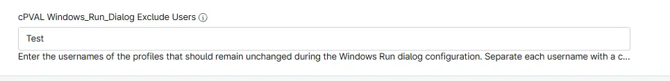

## Summary

Lists the users whose profiles the [Manage Windows Run Dialog](/docs/b88497c1-454b-42e7-ba9f-32e61dd4b858) automation leaves unchanged. Use it to keep the Run dialog (Windows key + R) for IT or administrator accounts when [cPVAL Windows_Run_Dialog Action](/docs/689ce4ff-e5ed-4f07-b9a8-3e1dd3738795) is set to `Disable`. Excluded profiles keep whatever setting they already have.

When the field is empty, every user profile on the device is changed.

## Entering User Names

- Separate names with commas, for example `Administrator,jdoe`. Semicolons also work.
- Matching isn't case-sensitive. Wildcards aren't supported.
- Each name is compared with both the account name and the profile folder name, the `<name>` in `C:\Users\<name>`.
- A domain prefix is ignored, so `CONTOSO\jdoe` and `AzureAD\jdoe` both match `jdoe`.

| Entry | Profiles left unchanged |
| ----- | ----------------------- |
| `Administrator` | The local Administrator account. |
| `Administrator,it.support` | The local Administrator account and the `it.support` account. |
| `jdoe,jdoe.CONTOSO` | The `jdoe` account, including its profile in `C:\Users\jdoe.CONTOSO`. |

If a profile folder name differs from the user name, as in the last example, enter both. The automation can match the account name only when it can look the account up, which can fail on a device that can't reach the domain.

The field can be set at the organization, location or device level. A value set at a lower level replaces the inherited value instead of adding to it. Names entered in the automation's **Exclude Users** parameter are added to the names in this field.

**Note:** The Default User profile, which new profiles are copied from, is always changed and can't be excluded. An excluded user who signs in to a device for the first time after the Run dialog was disabled starts with it blocked, and the automation then leaves that profile alone. Have excluded users sign in to the device once before you choose `Disable`.

## Details

| Label | Field Name | Example | Definition Scope | Type | Required | Default Value | Dropdown Options | Editable | Custom Field Tab |
| ----- | ---------- | ------- | ---------------- | ---- | -------- | ------------- | ---------------- | -------- | ---------------- |
| cPVAL Windows_Run_Dialog Exclude Users | cpvalWindowsrundialogExcludeUsers | `Administrator,jdoe` | `Organization`, `Location`, `Device` | Text | No |  |  | Yes | `Manage Windows Run dialog (Win+R)` |

## Dependencies

- [Custom Field: cPVAL Windows_Run_Dialog Action](/docs/689ce4ff-e5ed-4f07-b9a8-3e1dd3738795)
- [Automation: Manage Windows Run Dialog](/docs/b88497c1-454b-42e7-ba9f-32e61dd4b858)
- [Compound Condition: Manage Windows Run Dialog - Workstations](/docs/0e2876ac-75e1-498b-a163-2a5d26fe2c1c)
- [Compound Condition: Manage Windows Run Dialog - Servers](/docs/b181197e-2971-4df6-b485-e5d8818978d8)
- [Solution: Manage Windows Run Dialog - NinjaOne](/docs/8668290e-01bb-4501-be78-f2c2b626f3b7)

## Custom Field Creation

- [Custom Field Configuration](https://github.com/ProVal-Tech/ninjarmm/blob/main/custom-fields/cpval-windowsrundialog-exclude-users.toml)

## Sample Screenshot

## Changelog

### 2026-11-20

- Initial version of the document
