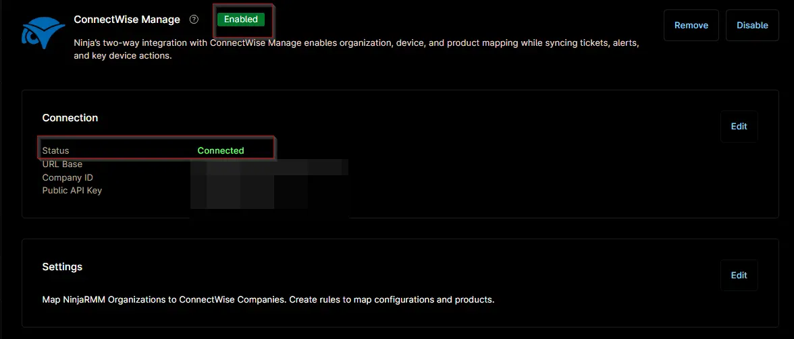

## Overview

This ticket template sets how the ConnectWise Manage ticket is created when a scheduled restart fails. Both the [Auto Reboot Management - Reboot Failure [Windows Servers]](/docs/f458ca84-e7c2-44d1-ad9c-15421c77d5d4) and [Auto Reboot Management - Reboot Failure [Windows Workstations]](/docs/76d88457-ec23-4b6b-81e2-af0a13583aa0) compound conditions use it. The ticket title shows `Scheduled Reboot Failed` and the device name, and the ticket includes the failure recorded in [cPVAL Auto Reboot Failure](/docs/3b31f3bd-c1b1-4f43-bce9-ea6f669f783a). While the ticket is open, a repeated failure on the same device is added to it. The ticket is closed when the compound condition resets, which happens when the failure field is cleared by a later confirmed restart or by a technician. Set the board, ticket type and other ticket settings to match your ConnectWise Manage setup.

## Requirement

Ensure that the ConnectWise Manage app is enabled and connected.  

## Dependencies

- [Compound Condition: Auto Reboot Management - Reboot Failure [Windows Servers]](/docs/f458ca84-e7c2-44d1-ad9c-15421c77d5d4)
- [Compound Condition: Auto Reboot Management - Reboot Failure [Windows Workstations]](/docs/76d88457-ec23-4b6b-81e2-af0a13583aa0)
- [Custom Field: cPVAL Auto Reboot Failure](/docs/3b31f3bd-c1b1-4f43-bce9-ea6f669f783a)
- [Solution: Auto Reboot Management - NinjaOne](/docs/52091463-99b7-4a21-8ad0-7ade5b8212e7)

## Template Creation

[CW Manage Ticket Template Configuration](https://github.com/ProVal-Tech/ninjarmm/blob/main/cw-manage-ticket-templates/auto-reboot-failure.toml)

## Changelog

### 2026-11-11

- Initial version of the document
