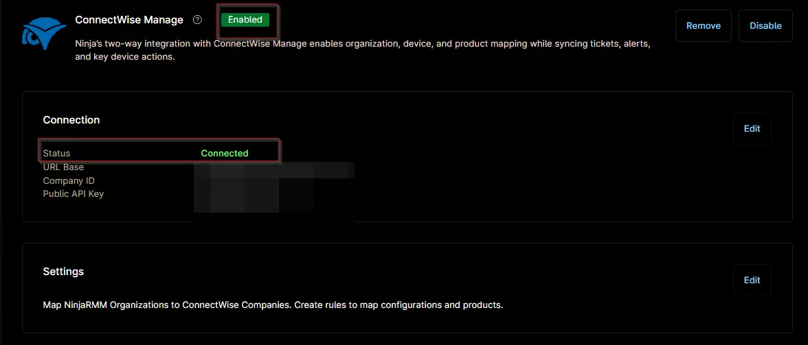

## Overview

This ticket template sets how the ConnectWise Manage ticket is created when NinjaOne patching keeps failing on a Windows device. Both the [Patch Failure Monitoring - Ticket [Windows Servers]](/docs/fafe75cc-3caa-4713-9f78-507ad9eec3b5) and [Patch Failure Monitoring - Ticket [Windows Workstations]](/docs/d4488df1-2292-4886-ab7a-46207ec6f856) compound conditions use it. The ticket title shows `Consecutive Patch Window Failures` and the device name.

The ticket includes the number of consecutive failed patch windows and the threshold, every failed window of the current run of failures with the KB number and name of each failed update from [cPVAL Patch Failure Detail](/docs/b23a6da2-148f-4649-9233-c02170b5e72f), when [Repair Windows Update](/docs/d7bb77e6-e7b8-45d2-9fa7-f109574aa887) was requested and whether the window after it still failed, and what to try next. Patch window times are in the time zone of the primary machine that runs [Patch Failure Monitoring](/docs/28302386-1560-4468-be5c-c9d683b99e65), and the repair time is in the device's own time zone. Each time shows its time zone.

While the ticket is open, further failures on the same device don't create a new ticket. The ticket is closed when the compound condition resets, which happens when a successful patch window resets the count or the device stops being monitored. Set the board, ticket type and other ticket settings to match your ConnectWise Manage setup.

## Requirement

Ensure that the ConnectWise Manage app is enabled and connected.  

## Dependencies

- [Compound Condition: Patch Failure Monitoring - Ticket [Windows Servers]](/docs/fafe75cc-3caa-4713-9f78-507ad9eec3b5)
- [Compound Condition: Patch Failure Monitoring - Ticket [Windows Workstations]](/docs/d4488df1-2292-4886-ab7a-46207ec6f856)
- [Automation: Patch Failure Monitoring - Detection](/docs/97aa8bfb-f376-4acf-8241-782c364d3d18)
- [Custom Field: cPVAL Patch Failure Detail](/docs/b23a6da2-148f-4649-9233-c02170b5e72f)
- [Solution: Patch Failure Monitoring - NinjaOne](/docs/020ff3c5-06a6-4f98-9eaa-7f7392b2257a)

## Template Creation

[CW Manage Ticket Template Configuration](https://github.com/ProVal-Tech/ninjarmm/blob/main/cw-manage-ticket-templates/consecutive-patch-failures.toml)

## Changelog

### 2026-11-23

- Initial version of the document
