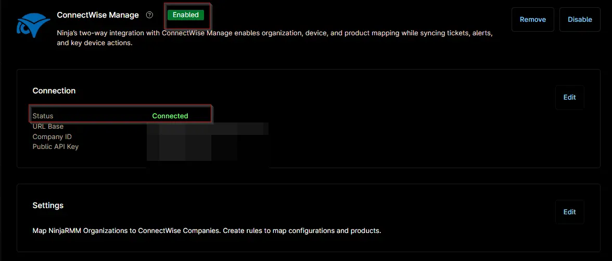

## Overview

This ticket template configures how a ConnectWise Manage ticket will be generated in response to the [Monitor - Excessive Logon Attempts](/docs/e15874f0-0d01-409e-9131-b84494dadf29) condition.

## Requirement

Ensure that the ConnectWise Manage app is enabled and connected.  

## Dependencies

- [Solution - Excessive Logon Attempts](/docs/e99ec890-ae05-4ad5-bdbc-6b0599be67e9)
- [Automation - Excessive Logon Attempts](/docs/3b52c821-6c63-4da6-87e8-8bd5c96e78de)
- [Monitor - Excessive Logon Attempts](/docs/e15874f0-0d01-409e-9131-b84494dadf29)

## Template Creation

[CW Manage Ticket Template Configuration](https://github.com/ProVal-Tech/ninjarmm/blob/main/cw-manage-ticket-templates/excessive-logon-failures.toml)

## Changelog

### 2026-11-11

- Replaced the manual template creation steps with the CW Manage Ticket Template Configuration file, as per the standard template.

### 2025-07-07

- Initial version of the document
