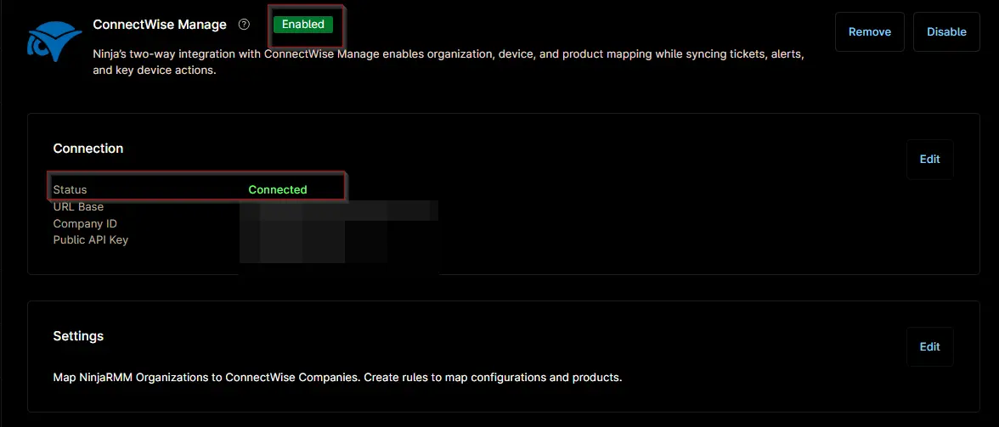

## Overview

This ticket template sets how the ConnectWise Manage ticket is created when the [ISP Connection Monitoring](/docs/9f23f871-6125-47ab-8a46-429893104702) compound condition finds an ISP line that's down or has failed over. The ticket title shows `ISP Line Down or Failed Over`, the organization name and the name of the device that ran the checks. The ticket includes the automation's output, which lists each failed line with the reason or the IP that came back. New failures are added to the open ticket, and the ticket closes when every line passes again. Set the board, ticket type and other ticket settings to match your ConnectWise Manage setup. The ticket type must be changed before you save the template.

## Requirement

Ensure that the ConnectWise Manage app is enabled and connected.  

## Dependencies

- [Compound Condition: ISP Connection Monitoring](/docs/9f23f871-6125-47ab-8a46-429893104702)
- [Solution: ISP Connection Monitoring](/docs/fad08ef4-122c-4df2-8cb3-aad1b285a473)

## Template Creation

[CW Manage Ticket Template Configuration](https://github.com/ProVal-Tech/ninjarmm/blob/main/cw-manage-ticket-templates/isp-connection-monitoring.toml)

## Changelog

### 2026-11-06

- Initial version of the document
