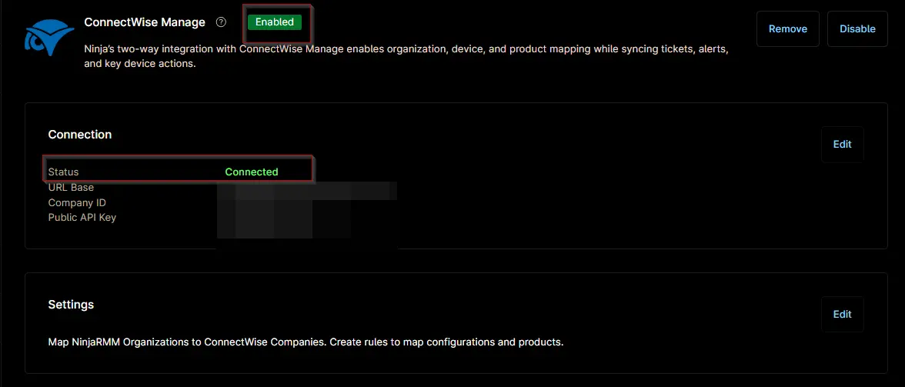

## Overview

This ticket template sets how the ConnectWise Manage ticket is created when a device marked as stolen comes online. Both the [Lock Stolen Systems [Windows]](/docs/705b400b-28fc-4c01-95a6-edbf43960122) and [Lock Stolen Systems [Macintosh]](/docs/e2669c99-0a79-4456-9923-b63345bf9a3c) compound conditions use it. The ticket title shows the organization name, the device name and a note that the stolen device has come online, and the ticket closes when the condition resets. Set the board, ticket type and other ticket settings to match your ConnectWise Manage setup.

## Requirement

Ensure that the ConnectWise Manage app is enabled and connected.  

## Dependencies

- [Compound Condition: Lock Stolen Systems [Windows]](/docs/705b400b-28fc-4c01-95a6-edbf43960122)
- [Compound Condition: Lock Stolen Systems [Macintosh]](/docs/e2669c99-0a79-4456-9923-b63345bf9a3c)
- [Solution: Lock Stolen System](/docs/13b4df99-df9b-4a57-bc0f-8675c68be028)

## Template Creation

[CW Manage Ticket Template Configuration](https://github.com/ProVal-Tech/ninjarmm/blob/main/cw-manage-ticket-templates/lock-stolen-system.toml)

## Changelog

### 2026-11-05

- The ticket template is now used by both the Windows and Macintosh compound conditions.

### 2026-02-10

- Initial version of the document
