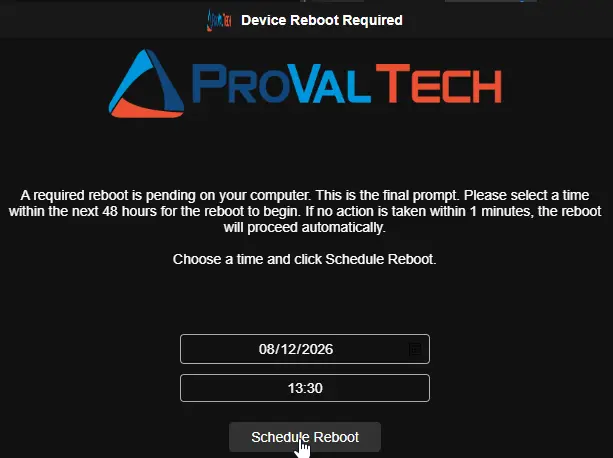
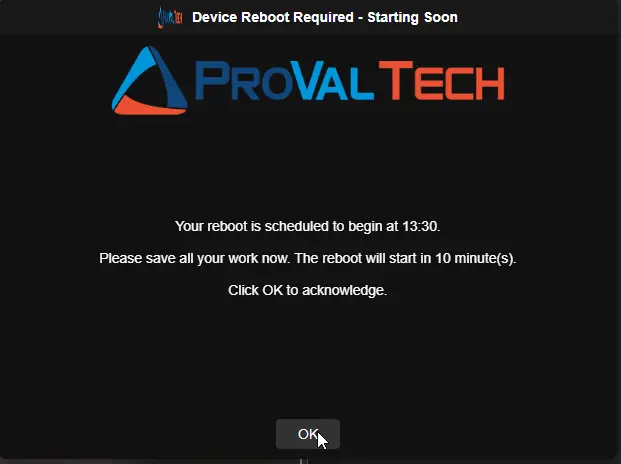
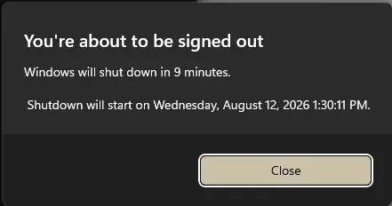

## Description

Prompts end users to reboot their Windows 10/11 device with postponement and scheduling logic.

The script runs under SYSTEM via your RMM platform and manages itself automatically after the first execution — no recurring jobs or repeating scheduled tasks need to be configured in your RMM. It creates its own one-time scheduled tasks to handle retries, postponements, and reminders until the machine is rebooted.

> Prompts switch to Dutch automatically when the user's display language is nl-NL or nl-BE — button labels and the built-in message wording. Set the title and message text in your implementation script parameters to use your own wording.
>
> Times are shown on a 24-hour clock by default. Use `-TimeFormat` to switch the final prompt's date/time picker and `%ScheduledRebootTime%` to a 12-hour clock or to the user's own Windows setting.

---

## How It Works

### Default Prompt Flow (4 prompts, 4 hours apart)

1. **Prompt 1–3 (Regular):** The user sees a prompt with two buttons — `Postpone` and `Reboot Now`.
   - If the user clicks **Postpone**, the script reschedules itself to try again in 4 hours (default).
   - If the user clicks **Reboot Now**, the machine reboots immediately.
   - If the prompt times out (default 10 minutes), the script treats it as a postpone.
2. **Prompt 4 (Final/Scheduling):** The user sees a date/time picker — a 24-hour clock by default, see `-TimeFormat` — and must select a reboot time within the next 48 hours.
   - If the user picks a time 10+ minutes in the future, the reboot is scheduled and a reminder appears 10 minutes before.
   - If the user picks a time less than 10 minutes away, the reminder is shown immediately and the machine reboots at the selected time.
   - If the user picks a time that is invalid or already passed, the machine reboots immediately.
   - If the prompt times out (default 15 minutes), a reminder appears and the machine reboots `DelayAfterFinalPrompt` seconds later (default 15 minutes; `0` reboots immediately).

### Automatic Behaviors

| Scenario | What Happens |
|----------|--------------|
| User reboots on their own | On the next scheduled run the script detects either fresh uptime OR that `LastBootUpTime` is newer than the last prompt timestamp, cleans up all tasks and state, and exits. No further prompts. |
| User reboots after reminder / during shutdown countdown | Windows automatically cancels the pending `shutdown /r` timer. All tasks and state were already cleaned up when the shutdown was scheduled, so nothing remains to trigger a second reboot. |
| Reboot scheduled on the final prompt | Runs at the selected time even during suppress windows or weekends, and even while the machine is locked; the reminder is only shown when a user is active at an unlocked desktop. If the machine is rebooted manually first, the pending restart is cancelled and the cycle is cleaned up. |
| Machine is locked | Prompt is skipped; script reschedules for the next interval. If `MaxMissedPromptsBeforeForce` is set, skipped prompts increment a counter until a forced reboot is triggered. |
| No user logged in | Prompt is skipped and rescheduled — unless `IfNotLoggedIn` is enabled, in which case the machine reboots directly. |
| No user logged in + install in progress | Even with `IfNotLoggedIn` enabled, the script defers the reboot if it detects an active installation (Windows Update, MSI, BITS, etc.) and reschedules. |
| Weekend / Suppress time window active | Prompt is skipped; script reschedules. If `RebootDuringSuppress` is enabled, unattended or forced reboots will bypass this restriction and proceed. A reboot scheduled on the final prompt is exempt. |
| Prompt fails to display | The prompt is retried automatically (`PromptDisplayRetryCount` extra attempts, `PromptDisplayRetryDelay` seconds apart). Stored state is preserved and no postponement or missed prompt is counted; if every attempt fails, the script reschedules itself for the next interval. |
| No internet | Script reschedules itself rather than failing; components already on disk are used when the download source is unreachable. |
| Script already running (tasks exist) | Exits immediately without changes unless `-Force` is used. |

---

## Requirements

- Windows 10 or Windows 11
- PowerShell 5.0+
- Administrative context (SYSTEM via RMM recommended)
- Internet access (to download OmniPrompt, SilentLauncher, and the Strapper module when they are missing; components already on disk are used when the source is unreachable)

---

## Dependencies

- [OmniPrompt](/docs/8ead1ffd-dade-4e17-9958-3313da9a7aa8)
- [SilentLauncher](/docs/b0b9f423-eee3-4148-b8a0-e99400c45698)

---

## Parameters

| Parameter | Default | Type | Description |
|-----------|---------|------|-------------|
| `MaxPostpone` | `4` | Int | Total number of prompts in the cycle (regular + final). Regular prompts = MaxPostpone - 1. Default gives 3 regular + 1 final. |
| `IntervalMinutes` | `240` | Int | Minutes between prompt attempts (regular and rescheduled). |
| `RegularPromptTimeout` | `600` | Int | Seconds before a regular prompt auto-closes (treated as postpone). |
| `FinalPromptTimeout` | `900` | Int | Seconds before the final prompt auto-closes (triggers forced reboot). |
| `DelayAfterFinalPrompt` | `900` | Int | Seconds between the final prompt timing out and the forced restart. A reminder with the restart time is shown for that period so the user can save their work. `0` restarts as soon as the final prompt times out. |
| `SuppressPopupTimeWindows` | *(none)* | String | Time window to suppress prompts, format `HHmm-HHmm` (e.g. `1800-0900`). Does not apply to a reboot scheduled on the final prompt. |
| `SkipWeekends` | `False` | Switch | Skip prompting on Saturdays and Sundays. Does not apply to a reboot scheduled on the final prompt. |
| `IfNotLoggedIn` | `False` | Switch | Reboot immediately if no user is logged in (guarded by install-in-progress check). |
| `MaxMissedPromptsBeforeForce` | `0` | Int | Number of consecutive skipped prompts (e.g. locked screen) before forcing a reboot without the GUI. `0` disables forcing. The counter resets when a user is active at an unlocked desktop; a prompt that failed to display does not count. |
| `RebootDuringSuppress` | `False` | Switch | Allows unattended or forced reboots to proceed during suppress windows or weekends. Interactive prompts are still suppressed. |
| `Force` | `False` | Switch | Reset all stored state and scheduled tasks, restarting the prompt cycle. |
| `Icon` | *(none)* | String | Path or URL to an icon file for the prompt window. Copied into the prompt's working folder and verified as an image before use. |
| `HeaderImage` | *(none)* | String | Path or URL to a header image for the prompt window. Copied and verified the same way as `Icon`. |
| `Title` | `Device Reboot Required` | String | Title bar text for all prompt windows. Empty uses the built-in English or Dutch default. |
| `RegularPromptMessage` | *(see below)* | String | Body text for regular prompts. Supports substitution variables and `\n`. Empty uses the built-in English or Dutch default. |
| `FinalPromptMessage` | *(see below)* | String | Body text for the final scheduling prompt. Supports substitution variables and `\n`. Empty uses the built-in English or Dutch default. |
| `ReminderPromptTitle` | `Device Reboot Required - Starting Soon` | String | Title for the pre-reboot reminder. Empty uses the built-in English or Dutch default. |
| `ReminderPromptMessage` | *(see below)* | String | Body text for the reminder prompt. Supports substitution variables and `\n`. Empty uses the built-in English or Dutch default. |
| `Theme` | `Dark` | String | Prompt window theme. Valid values: `Dark`, `Light`. |
| `PromptDisplayRetryCount` | `1` | Int | Extra attempts to display the prompt when it fails to appear or returns unusable output. `0` gives up after the first failure. |
| `PromptDisplayRetryDelay` | `30` | Int | Seconds to wait between prompt display attempts. |
| `TimeFormat` | `24Hour` | String | Clock format for the final prompt's date/time picker and `%ScheduledRebootTime%`. `24Hour` (14:30), `12Hour` (2:30 PM), or `Auto`, which follows the logged-on user's Windows short-time format and falls back to 24-hour time when it cannot be read. Log entries always use 24-hour time. |

---

## Substitution Variables

Use these in any message parameter. They are replaced with live values at display time.

| Variable | Description | Example Value |
|----------|-------------|---------------|
| `%PromptsToSend%` | Total prompts the user will receive | `5` |
| `%PromptsSent%` | Number of prompts already shown | `2` |
| `%PromptsLeft%` | Remaining prompts before the final one | `3` |
| `%PromptIntervalMinutes%` | Interval between prompts in minutes | `240` |
| `%PromptIntervalHours%` | Same interval in hours | `4` |
| `%RegularTimeoutSeconds%` | Regular prompt timeout in seconds | `600` |
| `%RegularTimeoutMinutes%` | Same timeout in minutes | `10` |
| `%FinalTimeoutSeconds%` | Final prompt timeout in seconds | `900` |
| `%FinalTimeoutMinutes%` | Same timeout in minutes | `15` |
| `%DelayAfterFinalSeconds%` | Delay after final prompt in seconds | `900` |
| `%DelayAfterFinalMinutes%` | Same delay in minutes | `15` |
| `%ScheduledRebootTime%` | User-selected reboot time, in the format set by `-TimeFormat` | `14:30` |
| `%MinutesUntilReboot%` | Minutes until scheduled reboot | `10` |
| `%ComputerName%` | Machine name | `PC-OFFICE-01` |
| `%UserName%` | Logged-in username | `jsmith` |

Variables that don't apply in a given context (e.g. `%ScheduledRebootTime%` during a regular prompt) are replaced with an empty string.

Use `\n` in any message to insert a line break.

---

## Default Messages

When the message parameters are left empty, users see the built-in wording in their own display language: Dutch when it is nl-NL or nl-BE, English otherwise. Text supplied on the command line is shown as-is in every language.

**Regular Prompt (English):**

> A required reboot is pending for your computer. Please save your work before continuing. You will receive %PromptsLeft% more prompt(s) with an interval of %PromptIntervalMinutes% minutes. After the last prompt the reboot will proceed automatically.
>
> Please save your work and click Reboot Now to proceed.

**Final Prompt (English):**

> A required reboot is pending on your computer. This is the final prompt. Please select a time within the next 48 hours for the reboot to begin. If no action is taken within %FinalTimeoutMinutes% minutes, the reboot will proceed automatically.
>
> Choose a time and click Schedule Reboot.

**Reminder (English):**

> Your reboot is scheduled to begin at %ScheduledRebootTime%.
>
> Please save all your work now. The reboot will start in %MinutesUntilReboot% minute(s).
>
> Click OK to acknowledge.

**Regular Prompt (Dutch):**

> Er staat een vereiste herstart klaar voor uw computer. Sla uw werk op voordat u verdergaat. U ontvangt nog %PromptsLeft% herinnering(en) met een interval van %PromptIntervalMinutes% minuten. Na de laatste herinnering wordt de computer automatisch opnieuw opgestart.
>
> Sla uw werk op en klik op Nu opnieuw opstarten om door te gaan.

**Final Prompt (Dutch):**

> Er staat een vereiste herstart klaar op uw computer. Dit is de laatste herinnering. Selecteer een tijdstip binnen de komende 48 uur waarop de herstart moet beginnen. Als er binnen %FinalTimeoutMinutes% minuten geen actie wordt ondernomen, wordt de computer automatisch opnieuw opgestart.
>
> Kies een tijdstip en klik op Herstart plannen.

**Reminder (Dutch):**

> De herstart van uw computer staat gepland om %ScheduledRebootTime%.
>
> Sla nu al uw werk op. De herstart begint over %MinutesUntilReboot% minuten.
>
> Klik op OK om te bevestigen.

Button labels follow the same language: Postpone → `Uitstellen`, Reboot Now → `Nu opnieuw opstarten`, Schedule Reboot → `Herstart plannen`.

---

## Usage Examples

### Example 1: Run with all defaults

```powershell
.\Invoke-RebootWithPrompt.ps1
```

**What happens:**

- Prompt 1 appears. User clicks Postpone.
- 4 hours later, Prompt 2 appears. User clicks Postpone.
- 4 hours later, Prompt 3 appears. User clicks Postpone.
- 4 hours later, Prompt 4 (final) appears with a date/time picker (24-hour clock by default).
- User selects 15:00 tomorrow → reboot is scheduled. Reminder appears at 14:50. Machine reboots at 15:00.

### Example 2: Shorter cycle with hourly prompts

```powershell
.\Invoke-RebootWithPrompt.ps1 -MaxPostpone 2 -IntervalMinutes 60
```

**What happens:**

- Prompt 1 at 9:00 AM. User postpones.
- Prompt 2 (final) at 10:00 AM with date/time picker.
- If ignored for 15 minutes, a reminder appears and the machine reboots 15 minutes later (`DelayAfterFinalPrompt`), at 10:30 AM.

### Example 3: Suppress prompts overnight and on weekends

```powershell
.\Invoke-RebootWithPrompt.ps1 -SuppressPopupTimeWindows '1800-0800' -SkipWeekends
```

**What happens:**

- Prompts only appear between 8:00 AM and 6:00 PM, Monday through Friday.
- If a prompt is due at 7:00 PM Friday, it is skipped and rescheduled to Monday morning.

### Example 4: Auto-reboot unattended machines

```powershell
.\Invoke-RebootWithPrompt.ps1 -IfNotLoggedIn -IntervalMinutes 120
```

**What happens:**

- If no user is logged in when the script runs, the machine reboots immediately.
- Exception: If Windows Update, an MSI installer, BITS transfer, or similar is running, the reboot is deferred by 2 hours and checked again.
- If a user IS logged in, the normal prompt flow is used.

### Example 5: Custom messages with substitution variables

```powershell
.\Invoke-RebootWithPrompt.ps1 -RegularPromptMessage 'Hi %UserName%, your PC %ComputerName% needs a reboot.\n\nYou have %PromptsLeft% reminders left before this becomes mandatory.\n\nNext reminder in %PromptIntervalHours% hours.'
```

**What happens:**

- The user sees a personalized message with their name, computer name, remaining prompts, and the next interval.

### Example 6: Reset an existing prompt cycle

```powershell
.\Invoke-RebootWithPrompt.ps1 -Force
```

**What happens:**

- All existing scheduled tasks and stored state are removed.
- The prompt cycle restarts from Prompt 1 as if the script had never run before.

### Example 7: All parameters set

```powershell
.\Invoke-RebootWithPrompt.ps1 `
    -MaxPostpone 3 `
    -IntervalMinutes 120 `
    -RegularPromptTimeout 300 `
    -FinalPromptTimeout 600 `
    -DelayAfterFinalPrompt 900 `
    -SuppressPopupTimeWindows '1800-0800' `
    -SkipWeekends `
    -IfNotLoggedIn `
    -MaxMissedPromptsBeforeForce 5 `
    -RebootDuringSuppress `
    -Icon 'C:\Company\Assets\logo.ico' `
    -HeaderImage 'https://intranet.company.com/assets/reboot-banner.png' `
    -Title 'IT Maintenance - Restart Required' `
    -RegularPromptMessage 'Hi %UserName%, your PC %ComputerName% needs a restart to finish installing updates.\n\nYou have %PromptsLeft% reminder(s) left before the restart becomes mandatory.\nPrompts are sent every %PromptIntervalHours% hours.\n\nPlease save your work and click Reboot Now, or click Postpone to be reminded later.' `
    -FinalPromptMessage 'This is your final reminder. Please choose a restart time within the next 48 hours.\n\nIf you do not respond within %FinalTimeoutMinutes% minutes, your PC will restart automatically.\n\nSelect a time and click Schedule Reboot.' `
    -ReminderPromptTitle 'Scheduled Restart - %MinutesUntilReboot% Minutes Away' `
    -ReminderPromptMessage 'Your restart is scheduled for %ScheduledRebootTime%.\n\nPlease save all open work now. The restart will begin in %MinutesUntilReboot% minute(s).\n\nClick OK to dismiss this reminder.'
```

**What happens:**

- Prompts appear only between 8:00 AM and 6:00 PM, Monday through Friday.
- If no user is logged in, the machine reboots automatically (unless an install is running).
- Up to 2 regular prompts are shown, 2 hours apart, each timing out after 5 minutes.
- The 3rd prompt is the final scheduling prompt (10-minute timeout).
- All prompts display the company icon and header image with personalized messages.
- If the final prompt is ignored for 10 minutes, a reminder appears and the machine reboots 15 minutes later.
- Unattended or forced reboots (e.g. from missed prompts) will bypass the suppress window and weekend restrictions.

### Example 8: User reboots on their own mid-cycle

```powershell
.\Invoke-RebootWithPrompt.ps1 -MaxPostpone 4 -IntervalMinutes 240
```

**What happens:**

- Prompt 1 at 10:00 AM. User postpones.
- User manually restarts at 1:00 PM.
- Scheduled task fires at 2:00 PM. Script detects uptime (1 hour) is less than the interval (4 hours), concludes the machine was rebooted, cleans up everything, and exits silently. No prompt shown.

### Example 9: Full visual walkthrough (fast cycle for testing)

```powershell
.\Invoke-RebootWithPrompt.ps1 `
    -MaxPostpone 3 `
    -IntervalMinutes 3 `
    -RegularPromptTimeout 30 `
    -FinalPromptTimeout 60 `
    -DelayAfterFinalPrompt 30 `
    -Icon 'https://www.provaltech.com/wp-content/uploads/2015/07/logo_r4.png' `
    -HeaderImage 'https://www.provaltech.com/wp-content/uploads/2015/07/logo_r4.png' `
    -Title 'Device Reboot Required' `
    -RegularPromptMessage 'A required reboot is pending for your computer. Please save your work before continuing. You will receive %PromptsLeft% more prompt(s) with an interval of %PromptIntervalMinutes% minutes. After the last prompt the reboot will proceed automatically.\n\nPlease save your work and click Reboot Now to proceed.' `
    -FinalPromptMessage 'A required reboot is pending on your computer. This is the final prompt. Please select a time within the next 48 hours for the reboot to begin. If no action is taken within %FinalTimeoutMinutes% minutes, the reboot will proceed automatically.\n\nChoose a time and click Schedule Reboot.' `
    -ReminderPromptTitle 'Device Reboot Required - Starting Soon' `
    -ReminderPromptMessage 'Your reboot is scheduled to begin at %ScheduledRebootTime%.\n\nPlease save all your work now. The reboot will start in %MinutesUntilReboot% minute(s).\n\nClick OK to acknowledge.'
```

**What happens:**

1. **Prompt 1 (Regular):** Appears immediately. User clicks Postpone. Script reschedules for 3 minutes later.

   

2. **Prompt 2 (Regular):** Appears 3 minutes later. User clicks Postpone. Script reschedules for 3 minutes later.

   

3. **Prompt 3 (Final/Scheduling):** Appears 3 minutes later with a date/time picker, shown in the clock format set by `-TimeFormat`. User selects a time within the next 48 hours and clicks Schedule Reboot. If ignored for 60 seconds, a reminder appears for 30 seconds (`DelayAfterFinalPrompt`) and the machine restarts.

   

4. **Reminder Prompt:** Appears 10 minutes before the scheduled reboot time (or immediately if the selected time is less than 10 minutes away, or after the final prompt times out). Informational only — clicking OK dismisses it.

   

5. **Windows Shutdown Warning:** When the reminder displays, the script schedules the restart for the exact remaining time with `shutdown /r /f /t <seconds>`. Windows shows its built-in shutdown notification to the user for the rest of the countdown.

   

> **Note:** The Windows shutdown warning says **"shut down"** — this is standard Windows behavior. Despite the wording, the machine will **restart** (not power off) because the script uses `shutdown /r` (restart flag). This is a cosmetic quirk of the Windows notification and does not affect functionality.

### Example 10: Use a 12-hour clock on the final prompt

```powershell
.\Invoke-RebootWithPrompt.ps1 -TimeFormat 12Hour
```

**What happens:**

- The final prompt's date/time picker and the reminder's `%ScheduledRebootTime%` use 12-hour time (e.g. `2:30 PM`).
- Use `-TimeFormat Auto` instead to follow each user's Windows short-time setting.
- Log files always use the 24-hour clock.

### Example 11: Allow extra prompt display retries

```powershell
.\Invoke-RebootWithPrompt.ps1 -PromptDisplayRetryCount 2 -PromptDisplayRetryDelay 60
```

**What happens:**

- A prompt that fails to appear (the task never started, or the prompt app never showed) is retried twice more, one minute apart.
- Failed display attempts never consume a postponement or count as missed prompts.

---

## Output Artifacts

| Artifact | Path |
|----------|------|
| OmniPrompt application | `C:\ProgramData\_Automation\App\OmniPrompt\OmniPrompt.exe` |
| SilentLauncher | `C:\ProgramData\_Automation\App\SilentLauncher\SilentLauncher.exe` (shared with `Invoke-OEMUpdateWithPrompt`; the older copy under `App\OmniPrompt\` is left in place for tasks registered by earlier versions) |
| Persisted script | `C:\ProgramData\_Automation\Script\Invoke-RebootPrompt\Invoke-RebootWithPrompt.ps1` |
| Scheduled task (main) | `Scheduled_Task_Invoke-RebootPrompt` |
| Scheduled task (reschedule) | `Scheduled_Task_Invoke-RebootPrompt_Reschedule` |
| Scheduled task (reminder) | `Scheduled_Task_Invoke-RebootPrompt_Reminder` |

---

## Changelog

### 2026-10-23

- Added `-TimeFormat` to choose the clock format of the final prompt's date/time picker and `%ScheduledRebootTime%`: `24Hour` (default), `12Hour`, or `Auto`, which follows the logged-on user's Windows short-time setting. The setting is carried across rescheduled runs; log entries always use the 24-hour clock.
- Added `-PromptDisplayRetryCount` and `-PromptDisplayRetryDelay`. A prompt that fails to display — the task never started, the prompt app never appeared, or the output was unreadable — is retried automatically. Failed attempts never consume a postponement or count as missed prompts; when every attempt fails, the script reschedules itself with all state preserved.
- **Behavior change:** when the final prompt times out, a reminder is now shown and the restart is scheduled `DelayAfterFinalPrompt` seconds later with `shutdown /r /f /t` (default 900 seconds; `0` restarts immediately) instead of rebooting the machine directly.
- SilentLauncher now deploys to `C:\ProgramData\_Automation\App\SilentLauncher\`, the same location `Invoke-OEMUpdateWithPrompt` uses, so both scripts share a single copy. The previous location under `App\OmniPrompt\` is left in place for tasks registered by earlier versions.
- Published SHA256 digests are now read in memory — no hash files are written to disk — and downloads are staged and verified before anything is replaced. OmniPrompt is extracted with `Expand-Archive`, and a run is no longer failed when the download source is unreachable but the binaries are already on disk.
- The built-in message text is now shown in Dutch as well as the button labels when the display language is `nl-NL` or `nl-BE`. Custom text is shown as-is in every language.
- **Bug fix:** rescheduled runs now read the title, messages, images, theme, and time format back from stored state instead of the reschedule task arguments, fixing unresolved `%UserName%` in rescheduled prompts.
- **Bug fix:** a reboot scheduled on the final prompt is now handled before the weekend and suppress-window checks, so it always proceeds at the selected time.
- Scheduled tasks are registered with `-AllowStartIfOnBatteries -DontStopIfGoingOnBatteries -StartWhenAvailable`; the prompt and reminder tasks carry a 10-minute end boundary so they never appear late; a fallback reschedule task is registered before every prompt so an interrupted pass never ends the cycle; cleanup only stops OmniPrompt instances that belong to this script; a working-folder creation failure reschedules instead of aborting.
- Working folders no longer grant write access to standard users: only the specific files the prompt needs to write (binary logs, prompt output, and exit files) are writable by the local Users group, and Everyone entries from earlier versions are removed.
- Failure logging now records the failure category, the prompt task's `LastRunTime` and `LastTaskResult`, and the latest binary log lines. The binaries are re-checked on disk before each attempt — so a file quarantined by security software is identified as such — and the result saved by the prompt app itself is used when the captured output is unreadable.

### 2026-08-13

- Replaced the .NET-based prompter with **OmniPrompt**, a native binary that requires no desktop runtime.
- Replaced legacy VBScript/PowerShell wrappers with **SilentLauncher** to eliminate console window flashing and bypass modern EDR/Antivirus blocks.
- Added `MaxMissedPromptsBeforeForce` to automatically force a reboot if a machine repeatedly misses prompts (e.g., stays locked).
- Added `RebootDuringSuppress` to allow unattended or forced reboots to bypass weekend and after-hours suppress windows.

### 2026-06-15

- Added `LastPromptSentTime` timestamp field to all stored data writes (postpone, timer elapsed, schedule reboot, initial store, and pre-reminder)
- Enhanced `#region post-reboot detection` to compare `LastBootUpTime` against stored `LastPromptSentTime` (if system was rebooted after the last prompt/action → cleanup and exit, regardless of uptime vs interval)
- Added reboot-already-occurred guard at the top of `#region scheduled reboot check` (compares `LastBootUpTime` > `LastPromptSentTime` before showing the reminder or initiating the reboot → cancels and cleans up if machine was already rebooted)
- Replaced `Start-Sleep` + `Invoke-DeviceReboot` in both reminder paths (scheduled reboot check and immediate reminder) with `shutdown /r /f /t <seconds>` followed by immediate cleanup and exit (eliminates the script holding state during a 10-minute sleep; Windows automatically cancels the pending shutdown if the machine is rebooted manually before the countdown expires, making double-reboot impossible without any additional detection logic)
- Scheduled reboot reminder path now waits 60 seconds for the Prompter task to display the reminder prompt, then issues `shutdown /r /f /t 540` (9-minute countdown, ~10 minutes total from reminder display), then immediately cleans up all tasks/state and exits

### 2026-06-12

- Added post-reboot detection: script now checks system uptime on rescheduled runs and cleans up automatically if the machine was already rebooted
- Added install-in-progress guard: when no user is logged in and auto-reboot is enabled, the script checks for active installations (Windows Update, MSI, BITS, winget, etc.) and defers the reboot if one is found
- Added `Test-InstallInProgress` function to detect TiWorker, wusa, SetupHost, setup, MoUsoCoreWorker, Windows10Upgrader, winget, BITS transfers, and MSI mutex
- Added `%Variable%` substitution system for all message parameters
- Added `Resolve-MessageVariable` function for token replacement
- Added unit conversion variables (`%PromptIntervalHours%`, `%RegularTimeoutMinutes%`, `%FinalTimeoutMinutes%`, `%DelayAfterFinalMinutes%`)
- Added `\n` support for line breaks in all message strings
- Updated default messages to use substitution variables instead of hardcoded values

### 2026-06-10

- Initial version of the document
