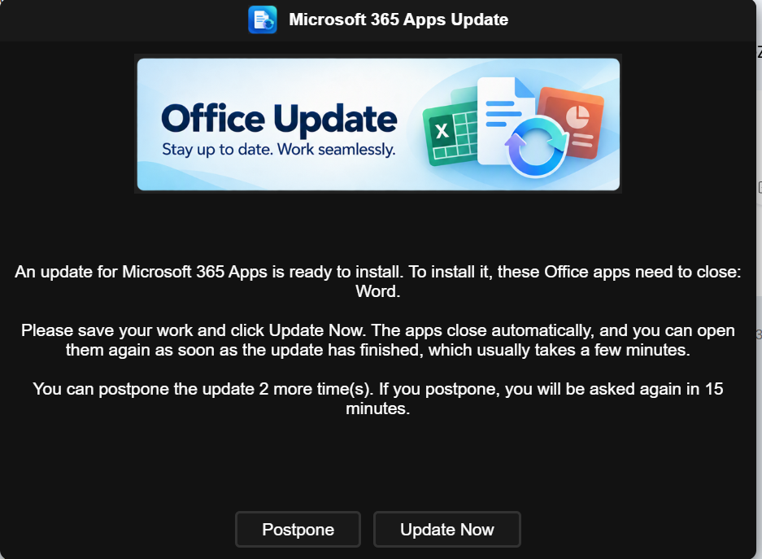
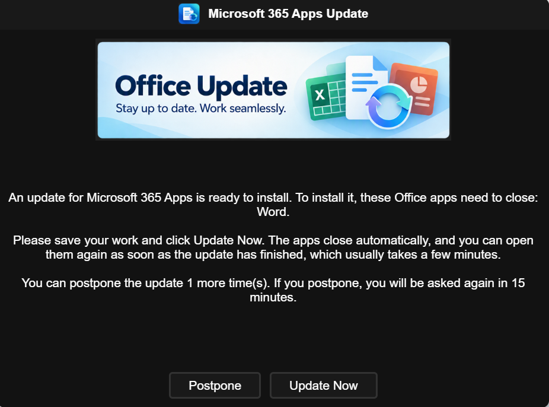
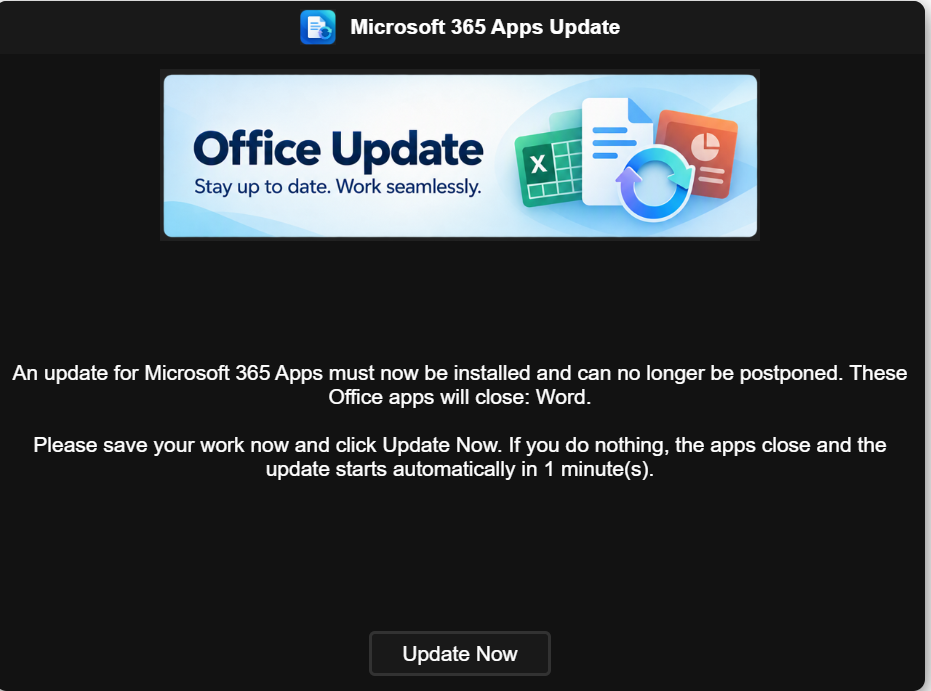

## Description

Updates Microsoft 365 Apps (Click-to-Run) with the Office Click-to-Run client.

The optional `-PromptUser` switch asks the signed-in user to save their work and close Office before the update, instead of closing their apps without warning. This matters most when the update runs silently in the background and the user never sees the Click-to-Run client.

Without `-PromptUser`, the script behaves as it always has: it starts the update with `forceappshutdown=true`, so any open Office app closes without warning, and returns the new version. Existing implementations that run the script without parameters are not affected by the prompt feature.

With `-PromptUser`, the script runs under SYSTEM via your RMM platform and manages itself after the first run. It creates its own one-time scheduled tasks for postponements, so no recurring RMM job is needed.

## How It Works

### Without -PromptUser

1. Checks that the Click-to-Run configuration key exists and reads `VersionToReport`.
2. Runs `OfficeC2RClient.exe /update user displaylevel=false forceappshutdown=true updatepromptuser=false`.
3. Checks `VersionToReport` every 10 seconds for up to 5 minutes, then once more after a further 60 seconds.
4. Logs and returns the new version, or logs a warning that the version did not increase.
5. After a successful update, removes any prompt cycle an earlier `-PromptUser` run left pending.

### With -PromptUser

Every run, whether started by the RMM or by the script's own scheduled task, works through these checks in order. The first one that applies decides what happens.

1. **A cycle is already pending.** If an earlier run's next pass is scheduled, or its prompt is on screen, a run started by the RMM logs the cycle state and exits. `-Force` discards the old cycle and starts again. A reschedule task whose run time has passed without a new one being registered does not count, so a stale task cannot block later runs.
2. **Already current.** The script reads the update channel (the `updatebranch` policy, then the `UpdateChannel` value, then `CDNBaseUrl`) and looks up the latest build for that channel in Microsoft's release feed. When the installed build is the same or newer, it exits without updating or prompting. When the channel or the latest build cannot be determined, it carries on as if an update is available. `-SkipVersionCheck` skips this check.
3. **More than one user signed in.** Logs a warning and exits without updating, because closing Office could cost other users unsaved work. Update such machines, for example terminal servers, in a maintenance window without `-PromptUser`.
4. **Nobody signed in.** Updates straight away.
5. **No Office app open.** Updates straight away. The apps checked are Word, Excel, PowerPoint, Outlook, OneNote, Access, Publisher, Visio, Project and Skype for Business.
6. **Screen locked.** The user cannot be asked, so the update is deferred to the next pass. When `MaxMissedPromptsBeforeForce` is above zero, the update is forced after that many locked passes in a row.
7. **Prompt the user** (see [Sample Prompts](#sample-prompts)).
   - **Regular prompt**, while postponements remain, offers **Postpone** and **Update Now**.
     - **Update Now** runs the update; Office apps that are still open are closed.
     - **Postpone**, or no answer within `PromptTimeout`, uses one postponement and schedules the next pass `IntervalMinutes` later.
   - **Final prompt**, once `MaxPostpone` postponements are used (or on the first prompt when `MaxPostpone` is `0`), offers **Update Now** only. With no answer within `FinalPromptTimeout`, the update runs anyway, as the prompt says.
   - A prompt that cannot be displayed is retried once. When it still fails, no postponement is used and the next pass is scheduled.
8. **Completion notice.** After a prompted update that raised the version, a notice tells the user they can reopen Office. It has an **OK** button and closes on its own after 120 seconds.

Prompts are shown in English, or in Dutch when the signed-in user's display language is `nl-NL` or `nl-BE`. Every title and message can be replaced with a parameter.

### How the Prompt Reaches the User

The script runs as SYSTEM, which cannot show a window on the user's desktop. For each prompt it writes a `.cmd` file to the `Prompt` folder and registers a one-time scheduled task for `BUILTIN\Users`. That task runs the `.cmd` in the signed-in user's session through SilentLauncher, so no console window appears. The `.cmd` runs OmniPrompt and writes the button the user clicked to `Prompt.txt`, which the script then reads.

The script only closes or waits on OmniPrompt windows it launched itself, so prompts from other scripts, such as `Invoke-OEMUpdateWithPrompt` or `Invoke-RebootWithPrompt`, are not affected.

### Self-Rescheduling

- The script copies itself to `C:\ProgramData\_Automation\Script\Update-Office\Scheduled\`.
- It registers `Scheduled_Task_Update-Office_Reschedule`, a one-time SYSTEM task that runs that copy with `powershell.exe` and the same parameters, except `-Force`, after `IntervalMinutes`. If the machine is off at that time, the task starts as soon as it can afterwards.
- The number of postponements used and of consecutive locked-screen passes is stored with Strapper in the table `UpdateOfficePromptInfo`.
- Before any update starts, and whenever the machine is found already current, the script closes its prompts, removes all of its scheduled tasks and resets the stored state.
- If the script is not run from a `.ps1` file, or a safety check below fails, it does not schedule itself, and postponed prompts wait for the next RMM run instead.

### Folder Permissions

No folder the script uses is writable by standard users.

- Folders the script creates (`Scheduled`, `Prompt` and, when they do not exist yet, the OmniPrompt and SilentLauncher folders) are owned by Administrators. Only SYSTEM and Administrators can change them; Users can read and run what is in them.
- Existing OmniPrompt and SilentLauncher folders keep whatever permissions they already have. Other ProVal scripts run `SilentLauncher.exe` from there as SYSTEM, so this script never loosens them.
- The prompt runs as the signed-in user and only writes five files. Each is created in advance and given its own Users write entry: `Prompt.txt`, `Prompt-exit.txt` and `Completion.txt` in the `Prompt` folder, plus `OmniPrompt.log` and `SilentLauncher.log` next to those tools. The answer files are emptied before each prompt rather than deleted, so they keep that entry.
- Before it schedules anything, the script checks every parent of the `Scheduled` folder up to `ProgramData`. Each must be a real folder rather than a junction, must be owned by SYSTEM, Administrators or TrustedInstaller, and must not let any other account delete, rename or re-permission it. Otherwise a standard user could move the folder aside and put their own script at the same path for the SYSTEM task to run. A junction at the `Scheduled` path itself is removed and replaced with a real folder.

## Requirements

- Windows with Microsoft 365 Apps (Click-to-Run) installed.
- Windows PowerShell 5.1 or later, running as SYSTEM or as an administrator. SYSTEM via your RMM is recommended.
- Internet access to:
  - `contentrepo.net` and the PowerShell Gallery, for the Strapper module, and with `-PromptUser` for OmniPrompt and SilentLauncher
  - the Office CDN, for the update itself
  - `clients.config.office.net`, for the latest-build check (`-PromptUser` only). If it cannot be reached, the script prompts anyway.
- With `-PromptUser`:
  - Run the script from a `.ps1` file, not as a script block, so it can copy itself and schedule its next pass.
  - Allow at least 45 minutes on the RMM step. The first run waits for the user's answer, for the update (up to 11 minutes) and for the 2-minute completion notice.
  - Only one user may be signed in. Machines with more than one interactive session are skipped without updating.

## Dependencies

With `-PromptUser` only, downloaded when a prompt is actually needed and verified against their published SHA256:

- [OmniPrompt](/docs/8ead1ffd-dade-4e17-9958-3313da9a7aa8)
- [SilentLauncher](/docs/b0b9f423-eee3-4148-b8a0-e99400c45698)

Both are stored in `C:\ProgramData\_Automation\App\`, the same folders `Invoke-OEMUpdateWithPrompt` and `Invoke-RebootWithPrompt` use, and are only downloaded again when the local copy no longer matches the published hash.

## Parameters

| Parameter | Alias | Required | Default | Type | Description |
| --- | --- | --- | --- | --- | --- |
| `PromptUser` | `Prompt`, `WithPrompt` | False | `False` | Switch | Asks the signed-in user to save their work and close Office before the update. Without it the script runs as it always has, and every other parameter except `RemainingArgument` is ignored. |
| `MaxPostpone` | `MaxDefer` | False | `3` | Int | Times the user can postpone before the final prompt (0-10). A prompt left unanswered also uses one. `0` shows the final prompt straight away. |
| `IntervalMinutes` | `Interval` | False | `120` | Int | Minutes between passes after a postponement, an unanswered prompt, a locked screen or a prompt that failed to display (15-1440). |
| `PromptTimeout` | `Timeout` | False | `600` | Int | Seconds a regular prompt stays open before it counts as a postponement (60-3600). |
| `FinalPromptTimeout` | `FinalTimeout` | False | `600` | Int | Seconds the final prompt stays open before Office is closed and updated anyway (60-3600). |
| `MaxMissedPromptsBeforeForce` | `MaxMissed` | False | `0` | Int | Consecutive passes that find the screen locked with Office open before the update is forced (0-50). `0` never forces. The count resets when the user is found at an unlocked screen. |
| `SkipVersionCheck` | `NoVersionCheck` | False | `False` | Switch | Skips the latest-build check, so the user is prompted even when the machine may already be current. Use it for machines that update from a network share or Configuration Manager instead of the Office CDN. |
| `Force` | `Recreate` | False | `False` | Switch | Discards the tasks and stored state of an earlier prompt cycle and starts again from the first prompt. Ignored without `-PromptUser`. |
| `Title` | `PromptTitle` | False | | String | Title of the regular and final prompts, also used for the completion notice. Empty uses the built-in title. |
| `RegularPromptMessage` | `RegularMessage` | False | | String | Message of the regular prompt. Empty uses the built-in message. |
| `FinalPromptMessage` | `FinalMessage` | False | | String | Message of the final prompt. Empty uses the built-in message. |
| `CompletionPromptMessage` | `CompletionMessage` | False | | String | Message of the completion notice. Empty uses the built-in message. |
| `Theme` | | False | `Dark` | String | Prompt window theme: `Dark` or `Light`. |
| `Icon` | `IconUrl`, `IconPath` | False | | String | URL, local path or UNC path of the icon shown in the prompt. A copy is staged in the `Prompt` folder, so the user does not need access to the source. |
| `HeaderImage` | `HeaderUrl`, `HeaderPath` | False | | String | URL, local path or UNC path of the header image shown at the top of the prompt. Staged the same way as `Icon`. |
| `RemainingArgument` | | False | | Object[] | Not for direct use. Collects arguments the script does not recognize, so an existing wrapper that passes an old argument does not fail. They are logged as a warning. |

## Substitution Variables

Write these names as plain words in any title or message. They are replaced with live values before the prompt is shown, so avoid using them as ordinary words. Use `\n` for a line break. Keep custom text to plain ASCII, because it passes through a `.cmd` file, where other characters can be garbled.

| Variable | Replaced with |
| --- | --- |
| `OpenApplications` | Office apps open right now, for example `Word, Excel, Outlook` |
| `PostponesLeft` | Postponements the user still has, counting this prompt |
| `PostponesUsed` | Postponements already used in this cycle |
| `MaxPostpone` | Value of `MaxPostpone` |
| `PromptIntervalMinutes` | Value of `IntervalMinutes` |
| `PromptIntervalHours` | `IntervalMinutes` expressed in hours |
| `PromptTimeoutMinutes` | `PromptTimeout` expressed in minutes |
| `FinalTimeoutMinutes` | `FinalPromptTimeout` expressed in minutes |
| `CurrentVersion` | Installed version before the update |
| `NewVersion` | Installed version after the update (completion notice only) |
| `ComputerName` | Computer name |
| `UserName` | Signed-in user name |

## Default Messages

The built-in text is shown in Dutch when the signed-in user's display language is `nl-NL` or `nl-BE`, and in English otherwise. Custom text is shown as-is in every language.

### Titles and Buttons

| Element | English | Dutch |
| --- | --- | --- |
| Prompt title | `Microsoft 365 Apps Update` | `Microsoft 365 Apps-update` |
| Completion title | `Microsoft 365 Apps Update - Complete` | `Microsoft 365 Apps-update - Voltooid` |
| Regular prompt buttons | `Postpone`, `Update Now` | `Uitstellen`, `Nu bijwerken` |
| Final prompt button | `Update Now` | `Nu bijwerken` |
| Completion button | `OK` | `OK` |

### Messages

**Regular prompt (English)**

```text
An update for Microsoft 365 Apps is ready to install. To install it, these Office apps need to close: OpenApplications.\n\nPlease save your work and click Update Now. The apps close automatically, and you can open them again as soon as the update has finished, which usually takes a few minutes.\n\nYou can postpone the update PostponesLeft more time(s). If you postpone, you will be asked again in PromptIntervalMinutes minutes.
```

**Final prompt (English)**

```text
An update for Microsoft 365 Apps must now be installed and can no longer be postponed. These Office apps will close: OpenApplications.\n\nPlease save your work now and click Update Now. If you do nothing, the apps close and the update starts automatically in FinalTimeoutMinutes minute(s).
```

**Completion notice (English)**

```text
Microsoft 365 Apps has been updated to version NewVersion.\n\nYou can open your Office apps again.\n\nClick OK to close this message.
```

**Regular prompt (Dutch)**

```text
Er staat een update voor Microsoft 365 Apps klaar. Om de update te installeren, moeten deze Office-apps worden gesloten: OpenApplications.\n\nSla uw werk op en klik op Nu bijwerken. De apps worden automatisch gesloten en u kunt ze weer openen zodra de update klaar is. Dit duurt meestal enkele minuten.\n\nU kunt de update nog PostponesLeft keer uitstellen. Als u uitstelt, krijgt u over PromptIntervalMinutes minuten opnieuw een melding.
```

**Final prompt (Dutch)**

```text
Er moet nu een update voor Microsoft 365 Apps worden uitgevoerd. De update kan niet langer worden uitgesteld. Deze Office-apps worden gesloten: OpenApplications.\n\nSla uw werk nu op en klik op Nu bijwerken. Als u niets doet, worden de apps over FinalTimeoutMinutes minuten automatisch gesloten en start de update.
```

**Completion notice (Dutch)**

```text
Microsoft 365 Apps is bijgewerkt naar versie NewVersion.\n\nU kunt uw Office-apps weer openen.\n\nKlik op OK om dit bericht te sluiten.
```

## Usage Examples

### Example 1: Update without prompting

Updates Microsoft 365 Apps straight away and closes any open Office app, as the script always has.

```powershell
.\Update-Office.ps1
```

### Example 2: Prompt with the defaults

Up to 3 postponements, 2 hours apart, with 10-minute prompt timeouts. Updates without a prompt when nobody is signed in or no Office app is open, and does nothing when the machine is already on the latest build of its channel.

```powershell
.\Update-Office.ps1 -PromptUser
```

### Example 3: Single warning before the update

Gives the user one 15-minute warning with an **Update Now** button, then closes Office and updates.

```powershell
.\Update-Office.ps1 -PromptUser -MaxPostpone 0 -FinalPromptTimeout 900
```

### Example 4: Force the update on machines left locked

Checks every hour, and forces the update once the screen has been found locked with Office open on four passes in a row.

```powershell
.\Update-Office.ps1 -PromptUser -IntervalMinutes 60 -MaxMissedPromptsBeforeForce 4
```

### Example 5: Restart an existing prompt cycle

Discards an earlier prompt cycle and starts again from the first prompt.

```powershell
.\Update-Office.ps1 -PromptUser -Force
```

### Example 6: Prompt without the latest-build check

Prompts even if the machine may already be current. Use this on machines that update from a network share or Configuration Manager instead of the Office CDN.

```powershell
.\Update-Office.ps1 -PromptUser -SkipVersionCheck
```

### Example 7: Custom wording and branding

Replaces the prompt title and the regular message, uses the light theme and adds a company icon. The final prompt and completion notice keep their built-in wording.

```powershell
.\Update-Office.ps1 -PromptUser -Title 'Contoso IT - Office update' -RegularPromptMessage 'Hi UserName, Office needs to update. Please save your work in OpenApplications and click Update Now.\n\nYou can postpone PostponesLeft more time(s).' -Theme Light -Icon 'https://contoso.com/icon.png'
```

### Example 8: Fast cycle for testing

Two postponements 15 minutes apart and a 1-minute final prompt, with a header image. `-SkipVersionCheck` makes the prompt appear on a test machine that is already current. These settings produce the prompts shown in [Sample Prompts](#sample-prompts).

```powershell
.\Update-Office.ps1 -PromptUser -SkipVersionCheck -MaxPostpone 2 -IntervalMinutes 15 -FinalPromptTimeout 60 -HeaderImage 'https://contoso.com/office-update-header.png'
```

To show the next prompt without waiting for the interval, start the reschedule task by hand:

```powershell
Start-ScheduledTask -TaskName 'Scheduled_Task_Update-Office_Reschedule'
```

## Sample Prompts

The prompts below use the built-in English text, the dark theme and a custom header image, with Word open.

1. **Regular prompt:** lists the open Office apps and says how many postponements are left. The user clicks **Postpone**, and the next pass is scheduled `IntervalMinutes` later.

   

2. **Regular prompt, one postponement left:** shown at the next pass. Clicking **Postpone** uses the last postponement.

   

3. **Final prompt:** the update can no longer be postponed and only **Update Now** is offered. If the user does nothing, the apps close and the update starts when `FinalPromptTimeout` runs out.

   

## Output

Logs are written next to the copy of the script that ran:

- `.\Update-Office-log.txt`
- `.\Update-Office-error.txt`

Runs started by the script's own scheduled task write their logs to:

- `C:\ProgramData\_Automation\Script\Update-Office\Scheduled\Update-Office-log.txt`
- `C:\ProgramData\_Automation\Script\Update-Office\Scheduled\Update-Office-error.txt`

The script returns the new Office version when an update raised it, and nothing otherwise.

### Artifacts With -PromptUser

| Artifact | Path or name |
| --- | --- |
| Copy of the script run by the reschedule task | `C:\ProgramData\_Automation\Script\Update-Office\Scheduled\Update-Office.ps1` |
| Prompt command and answer files | `C:\ProgramData\_Automation\Script\Update-Office-Prompt\Prompt.cmd`, `Prompt.txt`, `Prompt-exit.txt` |
| Completion notice command and output | `C:\ProgramData\_Automation\Script\Update-Office-Prompt\Completion.cmd`, `Completion.txt` |
| Staged icon and header image | `C:\ProgramData\_Automation\Script\Update-Office-Prompt\icon.<extension>`, `header.<extension>` |
| OmniPrompt | `C:\ProgramData\_Automation\App\OmniPrompt\OmniPrompt.exe` (shared with `Invoke-OEMUpdateWithPrompt` and `Invoke-RebootWithPrompt`) |
| SilentLauncher | `C:\ProgramData\_Automation\App\SilentLauncher\SilentLauncher.exe` (shared with `Invoke-OEMUpdateWithPrompt` and `Invoke-RebootWithPrompt`) |
| Scheduled task (next pass, runs as SYSTEM) | `Scheduled_Task_Update-Office_Reschedule` |
| Scheduled task (prompt, runs in the user's session) | `Scheduled_Task_Update-Office_Prompt` |
| Scheduled task (completion notice, runs in the user's session) | `Scheduled_Task_Update-Office_Completion` |
| Stored state (Strapper) | Table `UpdateOfficePromptInfo` with `PostponesUsed` and `ConsecutiveMissedPrompts` |

## Changelog

### 2026-11-19

- Added the optional `-PromptUser` switch. When it is set, the script asks the signed-in user to save their work and close Office before the update, with **Postpone** and **Update Now**, and a final prompt with **Update Now** only once the postponements are used. Without it the script runs exactly as before, so existing implementations are unaffected.
- With `-PromptUser`, the update runs straight away without a prompt when nobody is signed in or no Office app is open, and nothing happens when the machine is already on the latest build of its update channel.
- With `-PromptUser`, machines with more than one interactive session are skipped, and a locked screen defers the update. `-MaxMissedPromptsBeforeForce` can force it after a number of locked passes.
- With `-PromptUser`, the script schedules its own next pass after a postponement, so the RMM only needs to run it once per update.
- Added a completion notice after a prompted update, Dutch text for `nl-NL` and `nl-BE`, and parameters for custom titles, messages, theme, icon and header image.
- Added `-MaxPostpone`, `-IntervalMinutes`, `-PromptTimeout`, `-FinalPromptTimeout`, `-MaxMissedPromptsBeforeForce`, `-SkipVersionCheck`, `-Force`, `-Title`, `-RegularPromptMessage`, `-FinalPromptMessage`, `-CompletionPromptMessage`, `-Theme`, `-Icon` and `-HeaderImage`.
- Unrecognized arguments are still ignored, as before, and are now logged as a warning.
- Corrected the documentation: the script does not run a repair when the installed version cannot be read. It logs a warning and treats any version reported after the update as an increase.

### 2025-04-10

- Initial version of the document