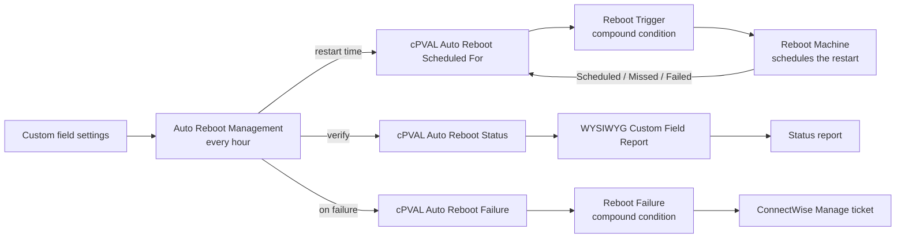
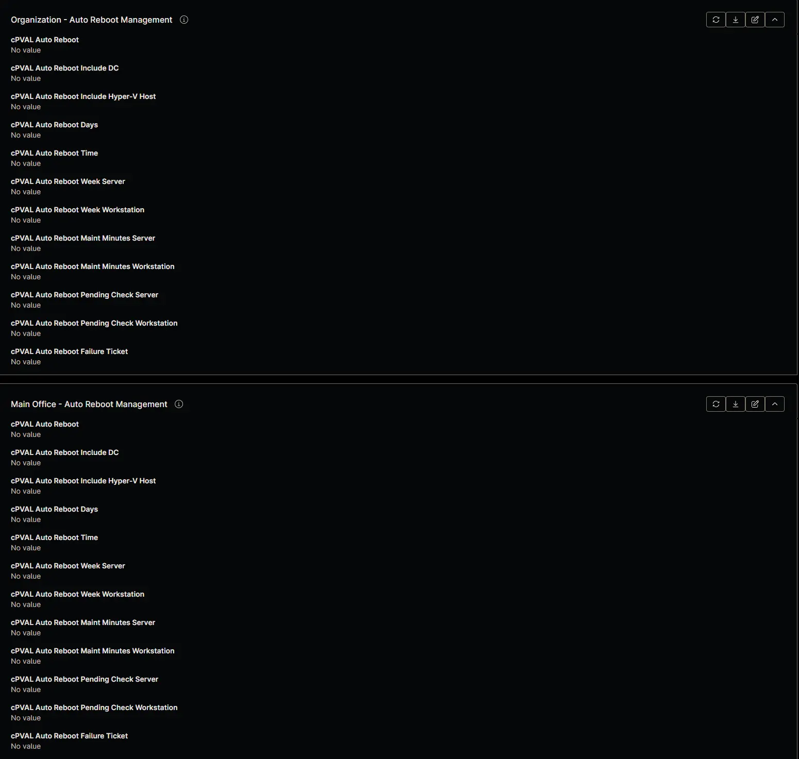
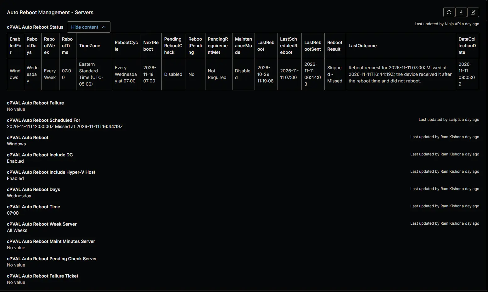
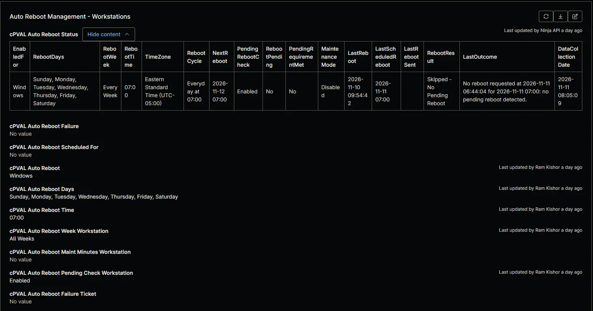
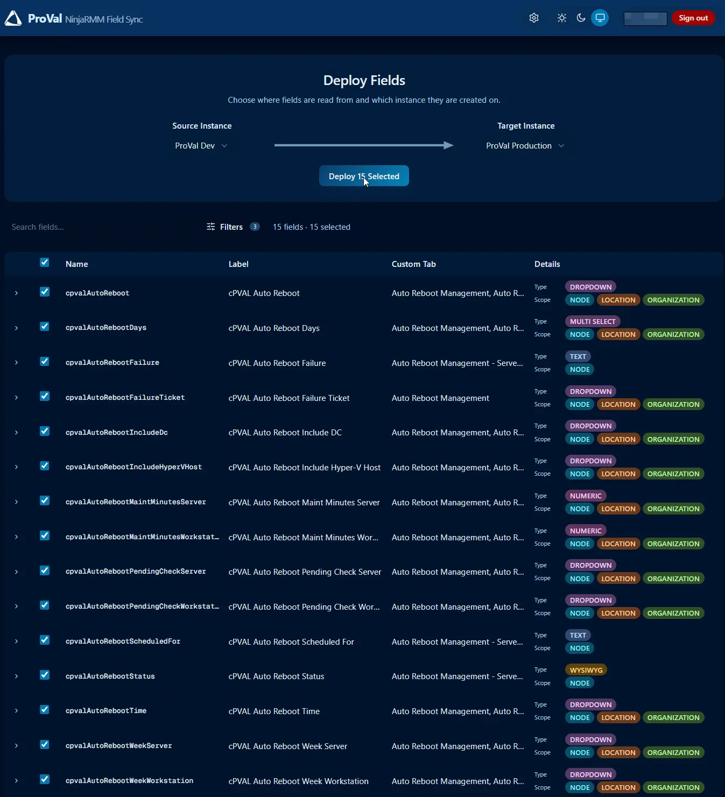

## Purpose

Auto Reboot Management restarts Windows workstations and servers managed in NinjaOne on a regular schedule, so updates finish installing and devices don't run for weeks without a restart. You choose the days, time and week of the month once for a client, and change it for a location or a single device where needed. It's the NinjaOne version of the ConnectWise Automate [Auto Reboot Management](/docs/69b28e39-89c4-498a-8c45-3d18459d39a0) solution.

The [Auto Reboot Management](/docs/33d689db-0f80-4f9d-928a-eb76fe283ff5) scheduled task runs on one device every hour. Its first automation, [Auto Reboot Management](/docs/15697579-8f51-4c51-9812-d909edebfc8b), works out the schedule that applies to each device and writes a restart request to the devices due to restart before the next run. A compound condition on each device picks up the request and schedules the restart, so the signed-in user sees a restart notice well ahead of it. The automation then confirms each restart from the device's last boot time, records the result in a status table, and can open a ConnectWise Manage ticket when a restart fails. The task's second automation turns the status of every device into a report per client and for all clients.

**Platform:** `NinjaOne`

### Key Capabilities

- **Inherited schedules** – Set the schedule at the organization, location or device level. The most specific value wins, so one setting covers a whole client and exceptions take seconds.
- **Separate server and workstation rules** – Servers and workstations each have their own week of the month, maintenance mode and pending reboot settings, and can be enabled separately.
- **Monthly schedules** – Restart every week, or in one week of the month only, such as the second Tuesday.
- **Protected roles** – Domain controllers and Hyper-V hosts are left alone unless you include them.
- **Pending reboot check** – Optionally restart only devices that NinjaOne reports as waiting for a reboot.
- **Maintenance mode** – Suppress alerts and tasks around each restart, from 5 minutes before it.
- **Restart verification** – Every restart is checked against the device's last boot time, and failures are recorded on the device.
- **Failure tickets** – Optionally open a ConnectWise Manage ticket when a restart fails, per device type.
- **Cross-client report** – A Knowledge Base article or CSV file per client and for all clients, the equivalent of the Automate dataview.

### Important Caveats & Behavior

- **Restarts are forced** – Windows closes open applications at the restart time, and unsaved work is lost. Users see a notice about 50 minutes ahead of a restart on the hour and about 20 minutes ahead of one on the half hour, but can't postpone it.
- **Times follow the primary machine** – Every restart day and time you select, and every time shown in the status field, the report, the failure field and failure tickets, is in the time zone of the primary machine that runs [Auto Reboot Management](/docs/15697579-8f51-4c51-9812-d909edebfc8b). For a device in another time zone, convert its restart time first. See [Time Zones](#time-zones).
- **On the hour or half hour only** – NinjaOne can't schedule a task more often than every hour, so the task runs at 5 minutes past each hour. Restart times are offered on the hour and the half hour only, so every restart is requested at least 25 minutes ahead.
- **One primary machine** – The [Auto Reboot Management](/docs/33d689db-0f80-4f9d-928a-eb76fe283ff5) scheduled task must target one always-on device. If that device is offline when a run is due, the restarts due in the next hour are not requested.
- **Offline devices are skipped** – A device that's offline when its restart is requested, 25 to 55 minutes ahead, gets no request and isn't restarted. The status shows `Skipped - Offline`, and the device restarts at its next scheduled time.
- **Late devices don't restart** – A device that goes offline after receiving its request and comes back after the restart time records the restart as missed instead of restarting without notice. It restarts at its next scheduled time.
- **Domain controllers and Hyper-V hosts are excluded by default** – Include them with [cPVAL Auto Reboot Include DC](/docs/4f0f00f5-6c67-4a73-b278-43e6560c9f63) and [cPVAL Auto Reboot Include Hyper-V Host](/docs/e351778e-b498-48ba-a674-7e8f4d783b15).
- **Windows only** – Macs and Linux devices are not restarted.

## How It Works

1. **Settings:** a technician sets [cPVAL Auto Reboot](/docs/cab41cb1-87d8-4d37-bbe2-3faa67516831), [cPVAL Auto Reboot Days](/docs/56684cc0-aa4b-4d81-b03b-272db16cb1e7), [cPVAL Auto Reboot Time](/docs/bf65ebff-8d3b-463b-a97f-90dd19ff45fc) and the optional fields at the organization, location or device level.
2. **Request:** every hour, at 5 minutes past the hour, the [Auto Reboot Management](/docs/33d689db-0f80-4f9d-928a-eb76fe283ff5) scheduled task runs [Auto Reboot Management](/docs/15697579-8f51-4c51-9812-d909edebfc8b), which works out the next restart of every enabled device. For each device due before the next run, it writes the restart time to [cPVAL Auto Reboot Scheduled For](/docs/e66d4978-0402-4f68-bc8d-af7d32dafce6) and schedules maintenance mode around it. A restart on the hour is requested about 55 minutes ahead, and one on the half hour about 25 minutes ahead.
3. **Restart:** the [Reboot Trigger](/docs/41ccbc86-b7f0-4674-9c7c-f765a0e0df01) compound condition checks the field every 6 minutes and runs [Auto Reboot Management - Reboot Machine](/docs/585400cb-52f4-4432-84b7-a57569a3dc39), which schedules a forced restart for the requested time and records `Scheduled` in the field. The user sees the Windows restart notice until the restart.
4. **Verify:** at later runs, [Auto Reboot Management](/docs/15697579-8f51-4c51-9812-d909edebfc8b) compares the device's last boot time with the request and records the result in [cPVAL Auto Reboot Status](/docs/1c29d754-ec90-4f42-88f1-4ac335657fbc). A failed restart is written to [cPVAL Auto Reboot Failure](/docs/3b31f3bd-c1b1-4f43-bce9-ea6f669f783a).
5. **Ticket (optional):** the [Reboot Failure](/docs/f458ca84-e7c2-44d1-ad9c-15421c77d5d4) compound condition opens a ConnectWise Manage ticket when a failure is recorded and [cPVAL Auto Reboot Failure Ticket](/docs/4c0f96e5-8387-4cb6-8426-d267ec01b0f9) covers the device type. The ticket closes when the failure is cleared.
6. **Report:** the same scheduled task then runs [WYSIWYG Custom Field Report - Organization and Global KB](/docs/67df14cd-3c20-4a40-bb7a-80caae242687), which publishes [cPVAL Auto Reboot Status](/docs/1c29d754-ec90-4f42-88f1-4ac335657fbc) as the [Auto Reboot Management Status](/docs/413d9e77-6f09-457a-9ff1-f9142b0e38e9) report.

## Time Zones

NinjaOne runs [Auto Reboot Management](/docs/15697579-8f51-4c51-9812-d909edebfc8b) on the primary machine, so the solution works in that machine's time zone:

- **The days and time you select** are read as the primary machine's time. A device in another time zone restarts at the same moment, which is a different time on its own clock.
- **Every time the solution shows** is the primary machine's time: NextReboot, LastReboot and the other times in [cPVAL Auto Reboot Status](/docs/1c29d754-ec90-4f42-88f1-4ac335657fbc) and [Auto Reboot Management Status](/docs/413d9e77-6f09-457a-9ff1-f9142b0e38e9), the times in [cPVAL Auto Reboot Failure](/docs/3b31f3bd-c1b1-4f43-bce9-ea6f669f783a) and the failure ticket. The **TimeZone** column of the status table and the end of each failure show which time zone that is, for example `Eastern Standard Time (UTC-05:00)`.

To restart a device at a time on its own clock, convert that time into the primary machine's time zone and select the converted day and time. A converter such as [timeanddate.com](https://www.timeanddate.com/worldclock/converter.html) gives the matching time: enter the device's time zone and restart time, and add the primary machine's time zone.

For example, with the primary machine in US Eastern time:

| Device Time Zone | Restart Wanted (Device Time) | Select (Primary Machine Time) |
| ---------------- | ---------------------------- | ----------------------------- |
| US Pacific | Monday 23:30 | Tuesday `02:30` |
| US Central | Sunday 02:00 | Sunday `03:00` |
| India | Sunday 02:00 | Saturday `15:30` (`16:30` while the US is on daylight saving time) |

:::note

- **Check the day.** When the conversion crosses midnight, select the converted day too, as in the Pacific and India examples.
- **Check the week.** With a week of the month selected, the converted day can fall in another week. For example, the day after the 2nd Tuesday can fall on the 15th, which is week 3.
- **Daylight saving time.** Time zones that change their clocks on different dates, or don't change them at all, are an hour further apart for part of the year. Check the conversion for both seasons, and pick a time that works for both if it matters.
- **One time zone per client.** Set the converted time at the level the time zone applies to, usually the organization or location, so every device under it gets the right time.

:::

## Prerequisites

- An API application with the **Client Credentials** grant type and the **Monitoring** and **Management** scopes, with its credentials in [cPVAL Ninja API Client ID](/docs/32142af2-d352-4d0d-9ec3-9dae0a5fef88) and [cPVAL Ninja API Client Secret](/docs/58b01634-4e1a-4793-aafd-18526ea8c80e). The application created for [WYSIWYG Custom Field Report - Organization and Global KB](/docs/67df14cd-3c20-4a40-bb7a-80caae242687) can be reused.
- One Windows device that's always online, such as a server, to run the two scheduled automations.
- The NinjaOne Documentation app, for the report as Knowledge Base articles. Without it, the report is saved as CSV files.
- ConnectWise Manage connected to NinjaOne, for failure tickets only.

## Associated Content

### Custom Fields: Settings

Set these at the organization, location or device level. They appear on the **Auto Reboot Management** tab of organizations and locations. On devices, the **Auto Reboot Management - Servers** tab shows the server fields and the **Auto Reboot Management - Workstations** tab shows the workstation fields.

| Name | Level | Type | Purpose |
|---|---|---|---|
| [cPVAL Auto Reboot](/docs/cab41cb1-87d8-4d37-bbe2-3faa67516831) | Organization, Location, Device | Drop-down | Which Windows devices are restarted: `Windows`, `Windows Workstations`, `Windows Servers` or `Disabled`. |
| [cPVAL Auto Reboot Days](/docs/56684cc0-aa4b-4d81-b03b-272db16cb1e7) | Organization, Location, Device | Multi-select | The days of the week to restart on. |
| [cPVAL Auto Reboot Time](/docs/bf65ebff-8d3b-463b-a97f-90dd19ff45fc) | Organization, Location, Device | Drop-down | The restart time, on the hour or half hour. |
| [cPVAL Auto Reboot Week Server](/docs/de971df1-518d-4504-8efe-deae1895296d) | Organization, Location, Device | Drop-down | The week of the month servers restart in. |
| [cPVAL Auto Reboot Week Workstation](/docs/5a05feef-d177-49a7-a5fd-876d7589c567) | Organization, Location, Device | Drop-down | The week of the month workstations restart in. |
| [cPVAL Auto Reboot Include DC](/docs/4f0f00f5-6c67-4a73-b278-43e6560c9f63) | Organization, Location, Device | Drop-down | Includes domain controllers. |
| [cPVAL Auto Reboot Include Hyper-V Host](/docs/e351778e-b498-48ba-a674-7e8f4d783b15) | Organization, Location, Device | Drop-down | Includes Hyper-V hosts. |
| [cPVAL Auto Reboot Maint Minutes Server](/docs/0eaf1688-afde-434f-befa-316cdb1c799a) | Organization, Location, Device | Integer | Maintenance mode minutes around a server restart. |
| [cPVAL Auto Reboot Maint Minutes Workstation](/docs/4be14fcc-a128-4e62-ae37-0a198df4da53) | Organization, Location, Device | Integer | Maintenance mode minutes around a workstation restart. |
| [cPVAL Auto Reboot Pending Check Server](/docs/38c18108-d3cc-433e-b14d-1f34db785b62) | Organization, Location, Device | Drop-down | Restarts servers only when a reboot is pending. |
| [cPVAL Auto Reboot Pending Check Workstation](/docs/82857979-0e81-45a3-af31-77a1e0def920) | Organization, Location, Device | Drop-down | Restarts workstations only when a reboot is pending. |
| [cPVAL Auto Reboot Failure Ticket](/docs/4c0f96e5-8387-4cb6-8426-d267ec01b0f9) | Organization, Location, Device | Drop-down | The device types that get a ticket when a restart fails. |

### Custom Fields: Status

Written by the solution on each device. They appear on both device tabs.

| Name | Level | Type | Purpose |
|---|---|---|---|
| [cPVAL Auto Reboot Status](/docs/1c29d754-ec90-4f42-88f1-4ac335657fbc) | Device | WYSIWYG | The effective schedule, next restart and result of the last restart. |
| [cPVAL Auto Reboot Failure](/docs/3b31f3bd-c1b1-4f43-bce9-ea6f669f783a) | Device | Text | The latest failed restart. Read by the reboot failure compound conditions. |
| [cPVAL Auto Reboot Scheduled For](/docs/e66d4978-0402-4f68-bc8d-af7d32dafce6) | Device | Text | The restart request and the device's outcome. Read by the reboot trigger compound conditions. |

### Custom Fields: API Credentials

These existing fields are shared with other ProVal reporting automations.

| Name | Level | Type | Purpose |
|---|---|---|---|
| [cPVAL Ninja API Client ID](/docs/32142af2-d352-4d0d-9ec3-9dae0a5fef88) | System | Secure | Client ID of the client credentials API application. |
| [cPVAL Ninja API Client Secret](/docs/58b01634-4e1a-4793-aafd-18526ea8c80e) | System | Secure | Client Secret of the client credentials API application. |

### Custom Field Tabs

The fifteen custom fields appear on these tabs, in this order.

#### Organization and Location Tab

#### Device Tab [Windows Servers]

#### Device Tab [Windows Workstations]

### Automations

| Name | Purpose |
|---|---|
| [Auto Reboot Management](/docs/15697579-8f51-4c51-9812-d909edebfc8b) | Requests the restarts, schedules maintenance mode, verifies restarts and records the status of every device. Run every hour by the scheduled task. |
| [WYSIWYG Custom Field Report - Organization and Global KB](/docs/67df14cd-3c20-4a40-bb7a-80caae242687) | Publishes [cPVAL Auto Reboot Status](/docs/1c29d754-ec90-4f42-88f1-4ac335657fbc) as the status report. Run every hour by the scheduled task, right after [Auto Reboot Management](/docs/15697579-8f51-4c51-9812-d909edebfc8b). |
| [Auto Reboot Management - Reboot Detection](/docs/43641711-d392-4d1e-af16-991a71b6536a) | Detection script of the reboot trigger compound conditions. |
| [Auto Reboot Management - Reboot Machine](/docs/585400cb-52f4-4432-84b7-a57569a3dc39) | Schedules the restart on the device. Run by the reboot trigger compound conditions. |
| [Auto Reboot Management - Failure Detection](/docs/6bf3e590-1fb6-4dc8-9b38-423176e0025c) | Detection script of the reboot failure compound conditions. |

### Scheduled Task

| Name | Purpose |
|---|---|
| [Auto Reboot Management](/docs/33d689db-0f80-4f9d-928a-eb76fe283ff5) | Runs [Auto Reboot Management](/docs/15697579-8f51-4c51-9812-d909edebfc8b) and then [WYSIWYG Custom Field Report - Organization and Global KB](/docs/67df14cd-3c20-4a40-bb7a-80caae242687) every hour, at 5 minutes past the hour, on one primary machine. |

### Monitors

| Name | Type | Purpose |
|---|---|---|
| [Auto Reboot Management - Reboot Trigger [Windows Servers]](/docs/41ccbc86-b7f0-4674-9c7c-f765a0e0df01) | Compound Condition | Runs [Auto Reboot Management - Reboot Machine](/docs/585400cb-52f4-4432-84b7-a57569a3dc39) on servers with a pending restart request. Checks every 6 minutes. |
| [Auto Reboot Management - Reboot Trigger [Windows Workstations]](/docs/5313102f-bd2a-4350-a775-07c150632573) | Compound Condition | Runs [Auto Reboot Management - Reboot Machine](/docs/585400cb-52f4-4432-84b7-a57569a3dc39) on workstations with a pending restart request. Checks every 6 minutes. |
| [Auto Reboot Management - Reboot Failure [Windows Servers]](/docs/f458ca84-e7c2-44d1-ad9c-15421c77d5d4) | Compound Condition | Opens a ticket for servers whose restart failed, when ticketing is enabled for servers. Optional. |
| [Auto Reboot Management - Reboot Failure [Windows Workstations]](/docs/76d88457-ec23-4b6b-81e2-af0a13583aa0) | Compound Condition | Opens a ticket for workstations whose restart failed, when ticketing is enabled for workstations. Optional. |

### Ticket Template

| Name | Purpose |
|---|---|
| [Auto Reboot Failure](/docs/375c80c2-07dd-43b9-b24b-3cc4c948c105) | Sets how the ConnectWise Manage ticket for a failed restart is created and closed. Optional. |

### Audit Report

| Name | Purpose |
|---|---|
| [Auto Reboot Management Status](/docs/413d9e77-6f09-457a-9ff1-f9142b0e38e9) | Lists the schedule, next restart and last restart result of every enabled device, per client and for all clients. |

## Implementation

### Step 1: Set up the API application and credential fields

[Auto Reboot Management](/docs/15697579-8f51-4c51-9812-d909edebfc8b) signs in to the NinjaOne API with a client credentials application. If [cPVAL Ninja API Client ID](/docs/32142af2-d352-4d0d-9ec3-9dae0a5fef88) and [cPVAL Ninja API Client Secret](/docs/58b01634-4e1a-4793-aafd-18526ea8c80e) are already filled for another ProVal reporting automation, reuse them and check that the application has the **Management** scope, which the solution needs to write custom fields and schedule maintenance mode. Otherwise, create the application and the two fields as described in Steps 2 to 4 of [WYSIWYG Custom Field Report - Organization and Global KB](/docs/67df14cd-3c20-4a40-bb7a-80caae242687).

- [Custom Field: cPVAL Ninja API Client ID](/docs/32142af2-d352-4d0d-9ec3-9dae0a5fef88)
- [Custom Field: cPVAL Ninja API Client Secret](/docs/58b01634-4e1a-4793-aafd-18526ea8c80e)

### Step 2: Create the custom fields

This solution uses **15 custom fields**. You can create them in either of two ways. The [cPVAL Ninja API Client ID](/docs/32142af2-d352-4d0d-9ec3-9dae0a5fef88) and [cPVAL Ninja API Client Secret](/docs/58b01634-4e1a-4793-aafd-18526ea8c80e) fields from Step 1 aren't part of these 15.

#### Option A: Import Them From the ProVal NinjaRMM Field Sync Portal

The [NinjaRMM Field Sync](https://ninjafields.provaltech.com/) portal creates every field in the target instance for you, with the correct type, scope, permissions, API access and custom tab already set. It's much faster than creating 15 fields by hand and avoids the most common setup mistakes.

1. Sign in to the [NinjaRMM Field Sync](https://ninjafields.provaltech.com/) portal.
2. Set the **Source Instance** to `ProVal Dev`.
3. Open **Filters** and set the **Custom Tab** filter to these three tabs:
    - `Auto Reboot Management`
    - `Auto Reboot Management - Servers`
    - `Auto Reboot Management - Workstations`
4. Confirm the field count reads **15 fields**. If it doesn't, one of the three tab filters is missing.
5. Set the **Target Instance** to the partner instance you're implementing in.
6. Select all 15 fields and click **Deploy Selected**.

:::note
**Check the result before moving on.** Confirm that all 15 fields are present and that each tab matches its reference screenshot:

- [Organization and Location Tab](#organization-and-location-tab)
- [Device Tab [Windows Servers]](#device-tab-windows-servers)
- [Device Tab [Windows Workstations]](#device-tab-windows-workstations)

[cPVAL Auto Reboot Status](/docs/1c29d754-ec90-4f42-88f1-4ac335657fbc), [cPVAL Auto Reboot Failure](/docs/3b31f3bd-c1b1-4f43-bce9-ea6f669f783a) and [cPVAL Auto Reboot Scheduled For](/docs/e66d4978-0402-4f68-bc8d-af7d32dafce6) appear on both device tabs. A field on the wrong tab still works, but it makes the solution harder to configure later.
:::

#### Option B: Create the Fields Manually

If you'd rather create the fields by hand, or the portal is unavailable, create each one as described in its document. Set **API** access to **Read/Write**, and add the fields to the tabs listed in each document: **Auto Reboot Management** for organizations and locations, **Auto Reboot Management - Servers** for the Windows Server role and **Auto Reboot Management - Workstations** for the Windows Desktops and Laptops role.

- [Custom Field: cPVAL Auto Reboot](/docs/cab41cb1-87d8-4d37-bbe2-3faa67516831)
- [Custom Field: cPVAL Auto Reboot Days](/docs/56684cc0-aa4b-4d81-b03b-272db16cb1e7)
- [Custom Field: cPVAL Auto Reboot Time](/docs/bf65ebff-8d3b-463b-a97f-90dd19ff45fc)
- [Custom Field: cPVAL Auto Reboot Week Server](/docs/de971df1-518d-4504-8efe-deae1895296d)
- [Custom Field: cPVAL Auto Reboot Week Workstation](/docs/5a05feef-d177-49a7-a5fd-876d7589c567)
- [Custom Field: cPVAL Auto Reboot Include DC](/docs/4f0f00f5-6c67-4a73-b278-43e6560c9f63)
- [Custom Field: cPVAL Auto Reboot Include Hyper-V Host](/docs/e351778e-b498-48ba-a674-7e8f4d783b15)
- [Custom Field: cPVAL Auto Reboot Maint Minutes Server](/docs/0eaf1688-afde-434f-befa-316cdb1c799a)
- [Custom Field: cPVAL Auto Reboot Maint Minutes Workstation](/docs/4be14fcc-a128-4e62-ae37-0a198df4da53)
- [Custom Field: cPVAL Auto Reboot Pending Check Server](/docs/38c18108-d3cc-433e-b14d-1f34db785b62)
- [Custom Field: cPVAL Auto Reboot Pending Check Workstation](/docs/82857979-0e81-45a3-af31-77a1e0def920)
- [Custom Field: cPVAL Auto Reboot Failure Ticket](/docs/4c0f96e5-8387-4cb6-8426-d267ec01b0f9)
- [Custom Field: cPVAL Auto Reboot Status](/docs/1c29d754-ec90-4f42-88f1-4ac335657fbc)
- [Custom Field: cPVAL Auto Reboot Failure](/docs/3b31f3bd-c1b1-4f43-bce9-ea6f669f783a)
- [Custom Field: cPVAL Auto Reboot Scheduled For](/docs/e66d4978-0402-4f68-bc8d-af7d32dafce6)

### Step 3: Create the automations

Add the automations to the NinjaOne automation library with **Run as** set to `System`. Keep [Auto Reboot Management - Reboot Machine](/docs/585400cb-52f4-4432-84b7-a57569a3dc39) under its exact name. Skip [WYSIWYG Custom Field Report - Organization and Global KB](/docs/67df14cd-3c20-4a40-bb7a-80caae242687) if it already exists, and skip [Auto Reboot Management - Failure Detection](/docs/6bf3e590-1fb6-4dc8-9b38-423176e0025c) if you won't use failure tickets.

- [Automation: Auto Reboot Management](/docs/15697579-8f51-4c51-9812-d909edebfc8b)
- [Automation: Auto Reboot Management - Reboot Detection](/docs/43641711-d392-4d1e-af16-991a71b6536a)
- [Automation: Auto Reboot Management - Reboot Machine](/docs/585400cb-52f4-4432-84b7-a57569a3dc39)
- [Automation: Auto Reboot Management - Failure Detection](/docs/6bf3e590-1fb6-4dc8-9b38-423176e0025c)
- [Automation: WYSIWYG Custom Field Report - Organization and Global KB](/docs/67df14cd-3c20-4a40-bb7a-80caae242687)

### Step 4: Create the ticket template (optional)

If you want a ticket when a restart fails, create the ticket template. Set the board, ticket type and other ticket settings to match your ConnectWise Manage setup.

- [Ticket Template: Auto Reboot Failure](/docs/375c80c2-07dd-43b9-b24b-3cc4c948c105)

### Step 5: Create the compound conditions

Add the reboot trigger compound conditions to the agent policies your Windows servers and workstations use, such as **Windows Server Policy** and **Windows Workstation Policy**. They're required: without them, no device acts on a restart request. Add the reboot failure compound conditions to the same policies if you created the ticket template.

- [Compound Condition: Auto Reboot Management - Reboot Trigger [Windows Servers]](/docs/41ccbc86-b7f0-4674-9c7c-f765a0e0df01)
- [Compound Condition: Auto Reboot Management - Reboot Trigger [Windows Workstations]](/docs/5313102f-bd2a-4350-a775-07c150632573)
- [Compound Condition: Auto Reboot Management - Reboot Failure [Windows Servers]](/docs/f458ca84-e7c2-44d1-ad9c-15421c77d5d4) (optional)
- [Compound Condition: Auto Reboot Management - Reboot Failure [Windows Workstations]](/docs/76d88457-ec23-4b6b-81e2-af0a13583aa0) (optional)

### Step 6: Create the scheduled task

Create the scheduled task that runs the solution. It runs [Auto Reboot Management](/docs/15697579-8f51-4c51-9812-d909edebfc8b) and then [WYSIWYG Custom Field Report - Organization and Global KB](/docs/67df14cd-3c20-4a40-bb7a-80caae242687), one after the other, every hour at 5 minutes past the hour. Target **one** Windows device that's always online, such as a server: the primary machine. Every run covers the whole tenant, so one device is enough, and more devices would only repeat the work.

Set **Instance URL** in both automations to your NinjaOne instance, keep **Schedule Interval Minutes** at `60`, and set the report automation as described in [Auto Reboot Management Status](/docs/413d9e77-6f09-457a-9ff1-f9142b0e38e9). The task document explains each setting.

- [Scheduled Task: Auto Reboot Management](/docs/33d689db-0f80-4f9d-928a-eb76fe283ff5)
- [Audit Report: Auto Reboot Management Status](/docs/413d9e77-6f09-457a-9ff1-f9142b0e38e9)

### Step 7: Configure the schedule

Select restart days and times in the primary machine's time zone. For a client in another time zone, convert them first as described in [Time Zones](#time-zones).

Set [cPVAL Auto Reboot](/docs/cab41cb1-87d8-4d37-bbe2-3faa67516831), [cPVAL Auto Reboot Days](/docs/56684cc0-aa4b-4d81-b03b-272db16cb1e7) and [cPVAL Auto Reboot Time](/docs/bf65ebff-8d3b-463b-a97f-90dd19ff45fc) at the organization level for each client that should restart automatically, then add the optional settings and any location or device exceptions. To try it first, enable a single test device: set [cPVAL Auto Reboot](/docs/cab41cb1-87d8-4d37-bbe2-3faa67516831) to `Windows` on that device, today's day, and a time within the hour after the task's next run. For example, if the next run is at 09:05, select `09:30` or `10:00`.

You'll know it worked when [cPVAL Auto Reboot Status](/docs/1c29d754-ec90-4f42-88f1-4ac335657fbc) shows the device's schedule and next restart after the next run, [cPVAL Auto Reboot Scheduled For](/docs/e66d4978-0402-4f68-bc8d-af7d32dafce6) shows `Scheduled` a few minutes after that run, the device restarts at the selected time, and [cPVAL Auto Reboot Status](/docs/1c29d754-ec90-4f42-88f1-4ac335657fbc) shows `Rebooted` after the following run.

## FAQ

### Q: What does this solution do?

> It restarts Windows workstations and servers on a schedule you set per client, location or device, confirms each restart, records the result on the device, and can open a ticket when a restart fails. A report shows the schedule and last result of every device.

### Q: How does it compare to the ConnectWise Automate version?

> It follows the same rules as the Automate [Auto Reboot Management](/docs/69b28e39-89c4-498a-8c45-3d18459d39a0) solution, with these differences:
>
> - One custom field replaces the client, location and computer EDFs of each setting, because NinjaOne custom fields inherit from the level above.
> - The seven day checkboxes are one [cPVAL Auto Reboot Days](/docs/56684cc0-aa4b-4d81-b03b-272db16cb1e7) field, and the week is chosen as `All Weeks` or `1st Week` to `5th Week`.
> - Setting [cPVAL Auto Reboot](/docs/cab41cb1-87d8-4d37-bbe2-3faa67516831) to `Disabled` on a device replaces the **Do Not Auto Reboot** EDF, and `Windows` on a device replaces the computer-level **Enable Auto Reboot** EDF.
> - Restart times are on the hour or half hour instead of every 15 minutes.
> - Restarts are verified from the device's last boot time, and failures can open a ticket.
> - The [Auto Reboot Management Status](/docs/413d9e77-6f09-457a-9ff1-f9142b0e38e9) report replaces the [Auto Reboot Management](/docs/09e4ea2c-54d9-4e8f-bfa8-1707501d5a11) dataview.

### Q: Which devices does it support?

> Windows workstations and Windows servers with the NinjaOne agent, running Windows 10, Windows 11 or Windows Server 2012 R2 or later. Macs and Linux devices are never restarted.

### Q: Do I have to create the 15 custom fields by hand?

> No. The [NinjaRMM Field Sync](https://ninjafields.provaltech.com/) portal can deploy all 15 into the target instance from the `ProVal Dev` source instance, with types, scopes, permissions and tabs already set. Creating them manually is still fully documented if you prefer it or the portal is unavailable. See [Step 2](#step-2-create-the-custom-fields).

### Q: After importing the fields from the portal, is there anything to check?

> Yes. Confirm the count is 15 and that each field is on the expected tab in the expected order, using the reference screenshots for the [Organization and Location](#organization-and-location-tab), [Windows Servers](#device-tab-windows-servers) and [Windows Workstations](#device-tab-windows-workstations) tabs.

### Q: How do I set one schedule for a whole client?

> Set [cPVAL Auto Reboot](/docs/cab41cb1-87d8-4d37-bbe2-3faa67516831), [cPVAL Auto Reboot Days](/docs/56684cc0-aa4b-4d81-b03b-272db16cb1e7) and [cPVAL Auto Reboot Time](/docs/bf65ebff-8d3b-463b-a97f-90dd19ff45fc) on the organization. Every location and device of that client inherits them unless it has its own value.

### Q: How do I give one location or one device a different schedule?

> Set the field you want to change on that location or device. The most specific value wins, and the other fields keep inheriting from above. For example, set only [cPVAL Auto Reboot Time](/docs/bf65ebff-8d3b-463b-a97f-90dd19ff45fc) on a location to move its restarts to another time while keeping the client's days.

### Q: How do I exclude a single device?

> Set [cPVAL Auto Reboot](/docs/cab41cb1-87d8-4d37-bbe2-3faa67516831) to `Disabled` on the device. It's never restarted, whatever its organization or location holds, and its status fields are cleared at the next run.

### Q: How do I enable a single device when its client isn't enabled?

> Set [cPVAL Auto Reboot](/docs/cab41cb1-87d8-4d37-bbe2-3faa67516831) to `Windows` on the device, and set [cPVAL Auto Reboot Days](/docs/56684cc0-aa4b-4d81-b03b-272db16cb1e7) and [cPVAL Auto Reboot Time](/docs/bf65ebff-8d3b-463b-a97f-90dd19ff45fc) on it if the levels above don't. A domain controller or Hyper-V host also needs [cPVAL Auto Reboot Include DC](/docs/4f0f00f5-6c67-4a73-b278-43e6560c9f63) or [cPVAL Auto Reboot Include Hyper-V Host](/docs/e351778e-b498-48ba-a674-7e8f4d783b15) set to `Enabled`.

### Q: Why don't the days selected at the organization and the location add up?

> [cPVAL Auto Reboot Days](/docs/56684cc0-aa4b-4d81-b03b-272db16cb1e7) is one field, so the days selected at the most specific level replace those above it. If a location needs Saturday and Sunday while the organization uses Sunday, select both days on the location.

### Q: How does the week of the month work?

> Week 1 holds days 1 to 7 of the month, week 2 days 8 to 14, and so on. `2nd Week` with `Tuesday` restarts on the second Tuesday of the month. Week 5 holds days 29 to 31, so `5th Week` skips months in which the selected day doesn't reach day 29. `All Weeks` restarts every week.

### Q: Why do servers and workstations have separate fields?

> Servers usually need a different week, maintenance window and pending reboot rule than workstations. The week, maintenance mode and pending check fields each have a server and a workstation version, and each device reads only its own version. That's also why device tabs show only the fields for their type.

### Q: Why are restart times only on the hour or half hour?

> NinjaOne can't run a scheduled task more often than every hour, so the [Auto Reboot Management](/docs/33d689db-0f80-4f9d-928a-eb76fe283ff5) task runs at 5 minutes past each hour and requests every restart due before its next run. The device needs a few minutes to pick up a request, and the user needs time to save their work, so every restart must be requested well ahead. A restart on the hour is requested about 55 minutes ahead and one on the half hour about 25 minutes ahead. A time such as `:15` would get only about 10 minutes, so the field offers only `:00` and `:30`.

### Q: Which time zone are the restart times in?

> The time zone of the primary machine that runs [Auto Reboot Management](/docs/15697579-8f51-4c51-9812-d909edebfc8b). The request is stored in UTC, so a device in another time zone restarts at the same moment. For example, with the primary machine in US Eastern time and a restart time of `02:00`, a device in US Pacific time restarts at 23:00 on its own clock, the evening before.

### Q: Our clients are in different time zones. What should we do?

> Convert each client's restart day and time into the primary machine's time zone and select the result at the organization or location level. For example, to restart a Pacific client on Monday at 23:30 its time with an Eastern primary machine, select Tuesday and `02:30`. A converter such as [timeanddate.com](https://www.timeanddate.com/worldclock/converter.html) gives the matching time. See [Time Zones](#time-zones) for more examples and what to check.

### Q: Which time zone are the times in the report, the status field and tickets?

> The primary machine's time zone, whatever the device's own time zone. The **TimeZone** column of the status table shows it, and each failure, and so each failure ticket, ends with it, for example `Time zone: Eastern Standard Time (UTC-05:00)`.

### Q: What happens if the primary machine moves to another time zone?

> Every schedule moves with it, because the selected times are read in the primary machine's time zone. If you replace the primary machine, pick one in the same time zone, or convert every selected time to the new time zone.

### Q: How much warning do users get, and can they postpone the restart?

> The device schedules its restart within a few minutes of the request, so the user sees a Windows notice with the restart time about 50 minutes ahead of a restart on the hour, and about 20 minutes ahead of a restart on the half hour. Users can't postpone it. Windows closes open applications at the restart time, so unsaved work is lost.

### Q: Why are domain controllers and Hyper-V hosts excluded?

> Restarting a domain controller can interrupt sign-ins and name resolution, and restarting a Hyper-V host stops every virtual machine on it. They're excluded so a server schedule never restarts them by accident. Set [cPVAL Auto Reboot Include DC](/docs/4f0f00f5-6c67-4a73-b278-43e6560c9f63) or [cPVAL Auto Reboot Include Hyper-V Host](/docs/e351778e-b498-48ba-a674-7e8f4d783b15) to `Enabled` to include them, ideally on their own schedule at the device level.

### Q: How does the pending reboot check work?

> When [cPVAL Auto Reboot Pending Check Server](/docs/38c18108-d3cc-433e-b14d-1f34db785b62) or [cPVAL Auto Reboot Pending Check Workstation](/docs/82857979-0e81-45a3-af31-77a1e0def920) is `Enabled`, a device restarts only when NinjaOne reports that it's waiting for a reboot, for example after updates. The state comes from the last data the NinjaOne agent sent, so a reboot that became pending in the last few minutes may not be seen until the next scheduled restart. A skipped restart shows `Skipped - No Pending Reboot` in [cPVAL Auto Reboot Status](/docs/1c29d754-ec90-4f42-88f1-4ac335657fbc).

### Q: What does maintenance mode do, and when?

> It suppresses NinjaOne alerts and tasks on the device from 5 minutes before the restart time until the number of minutes in [cPVAL Auto Reboot Maint Minutes Server](/docs/0eaf1688-afde-434f-befa-316cdb1c799a) or [cPVAL Auto Reboot Maint Minutes Workstation](/docs/4be14fcc-a128-4e62-ae37-0a198df4da53) after it, so the restart doesn't raise offline alerts. `0` turns it off, and `1` to `14` apply 15 minutes. It's scheduled only for devices whose restart is requested.

### Q: What happens to a device that's offline at its restart time?

> If the device is offline when the [Auto Reboot Management](/docs/33d689db-0f80-4f9d-928a-eb76fe283ff5) task requests its restart, 25 to 55 minutes ahead, no request is written and no maintenance mode is scheduled. The result is `Skipped - Offline` right away, and the device restarts at its next scheduled time. Skipped restarts aren't failures, so no ticket is created.
>
> If the device was online when the request was written and then goes offline, the request stays in [cPVAL Auto Reboot Scheduled For](/docs/e66d4978-0402-4f68-bc8d-af7d32dafce6). If it comes back before the restart time, it restarts as scheduled. If it comes back later, it records the restart as missed and doesn't restart, so nobody's computer restarts without notice.

### Q: A device was offline at the run but came online before its restart time. Why didn't it restart?

> The request is written only at the run before the restart, and the device was offline then, so it was skipped. It restarts at its next scheduled time. To restart it now, restart it manually.

### Q: How do I cancel one upcoming restart?

> Before the device acts on the request, clear [cPVAL Auto Reboot Scheduled For](/docs/e66d4978-0402-4f68-bc8d-af7d32dafce6) on the device. Once the field shows `Scheduled`, the restart is counting down in Windows; cancel it on the device with `shutdown /a`, for example from a NinjaOne remote command. To stop future restarts as well, set [cPVAL Auto Reboot](/docs/cab41cb1-87d8-4d37-bbe2-3faa67516831) to `Disabled` on the device.

### Q: Will a manual restart or a patching restart affect the schedule?

> No. The solution only checks that the device started after its restart was requested. If the device restarted for another reason in that window, the scheduled restart is still confirmed as `Rebooted`.

### Q: How do I know a restart actually happened?

> Open the device's **Auto Reboot Management** tab. [cPVAL Auto Reboot Status](/docs/1c29d754-ec90-4f42-88f1-4ac335657fbc) shows `Rebooted` in **RebootResult** once the device's last boot time is later than the request, usually at the first run of the scheduled task after the restart. The [Auto Reboot Management Status](/docs/413d9e77-6f09-457a-9ff1-f9142b0e38e9) report shows the same for every device.

### Q: What do the RebootResult values mean?

> | Value | Meaning |
> | ----- | ------- |
> | `Awaiting Reboot` | Requested; the restart time hasn't passed by 30 minutes yet. |
> | `Rebooted` | The device restarted. |
> | `Not Rebooted` | The device scheduled the restart but didn't restart. |
> | `Not Confirmed - Offline` | The device scheduled the restart and hasn't come back online. |
> | `Not Picked Up` | The device was online but never acted on the request. |
> | `Failed - On Device` | The device couldn't schedule the restart. |
> | `Skipped - Offline` | The device was offline when its restart was due, so no request was written. |
> | `Skipped - Missed` | The device received the request after the restart time. |
> | `Skipped - Cancelled` | The request was cleared before the restart. |
> | `Skipped - No Pending Reboot` | No reboot was pending and the check applied. |
>
> `Not Rebooted`, `Not Confirmed - Offline`, `Not Picked Up` and `Failed - On Device` are failures and are written to [cPVAL Auto Reboot Failure](/docs/3b31f3bd-c1b1-4f43-bce9-ea6f669f783a).

### Q: A device shows Not Picked Up. What should I check?

> The device was online but never ran [Auto Reboot Management - Reboot Machine](/docs/585400cb-52f4-4432-84b7-a57569a3dc39). Check these:
>
> 1. The device's agent policy includes [Auto Reboot Management - Reboot Trigger [Windows Servers]](/docs/41ccbc86-b7f0-4674-9c7c-f765a0e0df01) or [Auto Reboot Management - Reboot Trigger [Windows Workstations]](/docs/5313102f-bd2a-4350-a775-07c150632573).
> 2. [Auto Reboot Management - Reboot Detection](/docs/43641711-d392-4d1e-af16-991a71b6536a) and [Auto Reboot Management - Reboot Machine](/docs/585400cb-52f4-4432-84b7-a57569a3dc39) exist under those exact names and run as `System`.
> 3. [cPVAL Auto Reboot Scheduled For](/docs/e66d4978-0402-4f68-bc8d-af7d32dafce6) allows **Automations** to read and write it.
> 4. The device's activity log doesn't show the compound condition or the automation failing.

### Q: A device shows Not Rebooted. Why?

> The device scheduled the restart but was still running 30 minutes later. Usually someone cancelled the restart with `shutdown /a`, or the device was in a state where Windows couldn't restart. The **LastOutcome** column and the device's activity log show when the restart was scheduled. The next scheduled restart is requested as usual.

### Q: A device shows Not Confirmed - Offline. Is that a problem?

> The device scheduled the restart and hasn't reported to NinjaOne since. It may simply be powered off after the restart, or it may not have started again. When it comes back online, the result changes to `Rebooted` and the failure is cleared. If it stays offline, check the device.

### Q: How do I get a ticket when a restart fails?

> Create the [Auto Reboot Failure](/docs/375c80c2-07dd-43b9-b24b-3cc4c948c105) ticket template and the [Auto Reboot Management - Reboot Failure [Windows Servers]](/docs/f458ca84-e7c2-44d1-ad9c-15421c77d5d4) and [Auto Reboot Management - Reboot Failure [Windows Workstations]](/docs/76d88457-ec23-4b6b-81e2-af0a13583aa0) compound conditions, then set [cPVAL Auto Reboot Failure Ticket](/docs/4c0f96e5-8387-4cb6-8426-d267ec01b0f9) to `Windows`, `Windows Servers` or `Windows Workstations` on the organizations that want tickets.

### Q: Is a failure recorded when ticketing is turned off?

> Yes. The failure is always written to [cPVAL Auto Reboot Failure](/docs/3b31f3bd-c1b1-4f43-bce9-ea6f669f783a) and shown in [cPVAL Auto Reboot Status](/docs/1c29d754-ec90-4f42-88f1-4ac335657fbc) and the report. [cPVAL Auto Reboot Failure Ticket](/docs/4c0f96e5-8387-4cb6-8426-d267ec01b0f9) only decides whether a ticket is created.

### Q: How is a failure ticket closed?

> When [cPVAL Auto Reboot Failure](/docs/3b31f3bd-c1b1-4f43-bce9-ea6f669f783a) is cleared, either by a later confirmed restart or by a technician, the compound condition resets and the ticket template closes the ticket. While the ticket is open, a repeated failure on the same device is added to it.

### Q: Can I acknowledge a failure without waiting for the next restart?

> Yes. Clear [cPVAL Auto Reboot Failure](/docs/3b31f3bd-c1b1-4f43-bce9-ea6f669f783a) on the device. The ticket closes when the compound condition resets, and the field is written again only when a new failure occurs.

### Q: Where do I see the restart status of all devices?

> In the [Auto Reboot Management Status](/docs/413d9e77-6f09-457a-9ff1-f9142b0e38e9) report: a Knowledge Base article per client and one for all clients, or CSV files on the primary machine. The [Auto Reboot Management](/docs/33d689db-0f80-4f9d-928a-eb76fe283ff5) scheduled task refreshes it every hour, right after the restarts are requested and verified.

### Q: Do I need the NinjaOne Documentation app?

> Only for the report as Knowledge Base articles. Without it, set **Report Output** to **Local CSV Files** in the report automation of the [Auto Reboot Management](/docs/33d689db-0f80-4f9d-928a-eb76fe283ff5) scheduled task. Restarts, verification and tickets don't need it.

### Q: Why does one scheduled task run both automations?

> NinjaOne runs the automations of a scheduled task one after the other, in the order they're listed. Running [Auto Reboot Management](/docs/15697579-8f51-4c51-9812-d909edebfc8b) first and [WYSIWYG Custom Field Report - Organization and Global KB](/docs/67df14cd-3c20-4a40-bb7a-80caae242687) second means the report always shows the result of the run that just finished. Both automations read the whole tenant through the API and change nothing on the device they run on, so one device is enough.

### Q: What happens if the primary machine is offline?

> The runs it misses don't happen, so restarts due in the next hour aren't requested and those devices restart at their next scheduled time. Requests already written are still carried out by the devices. Use an always-on server as the primary machine, and alert on failed runs of [Auto Reboot Management](/docs/15697579-8f51-4c51-9812-d909edebfc8b).

### Q: Which API application does the solution use, and why not a technician's API token?

> It uses the client credentials application in [cPVAL Ninja API Client ID](/docs/32142af2-d352-4d0d-9ec3-9dae0a5fef88) and [cPVAL Ninja API Client Secret](/docs/58b01634-4e1a-4793-aafd-18526ea8c80e), which doesn't expire. The NinjaOne API runs scripts on a device only with a technician's token, which must be authorized again every 30 days, and it offers no scheduled restart. Writing the request to a custom field and letting the device schedule its own restart needs only the client credentials application.

### Q: The automation fails with "No custom field named ... exists" or a type mismatch. What should I check?

> One of the fifteen custom fields is missing, has a different name or type, doesn't include **Device** in its definition scope, or doesn't allow API access. Compare it with its document, then run the automation again. The run stops before changing anything in this case.

### Q: The automation fails at authentication. What should I check?

> Check that both credential fields are filled, that **Instance URL** matches your NinjaOne region, and that the API application has the **Client Credentials** grant type and the **Monitoring** and **Management** scopes. If the secret was regenerated, update [cPVAL Ninja API Client Secret](/docs/58b01634-4e1a-4793-aafd-18526ea8c80e).

### Q: How long does a settings change take to apply?

> Until the next run of the [Auto Reboot Management](/docs/33d689db-0f80-4f9d-928a-eb76fe283ff5) scheduled task, within an hour. A restart already requested keeps its time; clear [cPVAL Auto Reboot Scheduled For](/docs/e66d4978-0402-4f68-bc8d-af7d32dafce6) on the device if it must not happen.

### Q: Why does the scheduled task start at 5 minutes past the hour?

> Each run requests the restarts due before the next run. Starting at 5 past leaves a margin when a run starts a little late: a restart on the hour is still ahead of the run and is requested about 55 minutes in advance. A task starting exactly on the hour could miss that hour's restart if it started a few seconds late.

### Q: Can I change the schedule of the scheduled task?

> Every hour is the shortest interval NinjaOne allows, and it's the recommended one. To run it every 2 hours instead, set **Recur every** to 2 hours and **Schedule Interval Minutes** to `120`, so each run requests every restart due before the next one. Restarts are then requested up to 2 hours ahead, and settings changes take up to 2 hours to apply. Keep the start time at 5 minutes past the hour.

## Changelog

### 2026-11-11

- Initial version of the document
