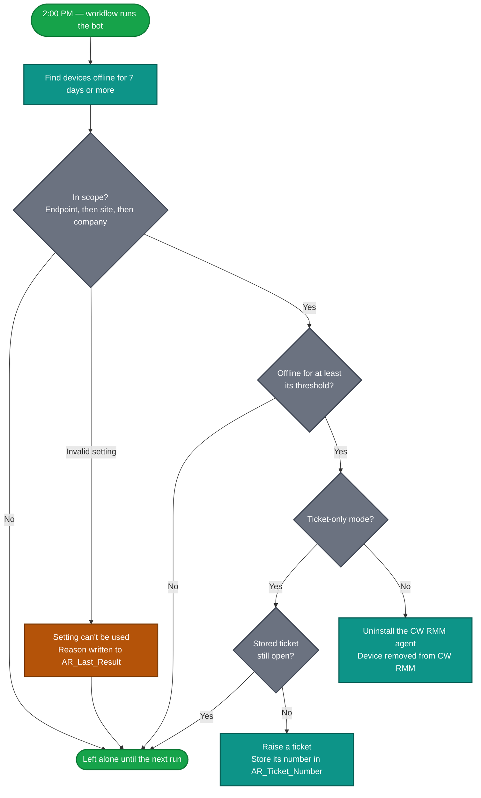
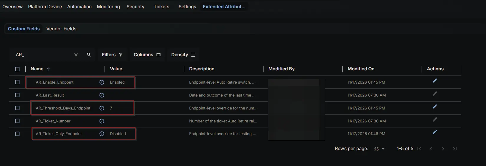
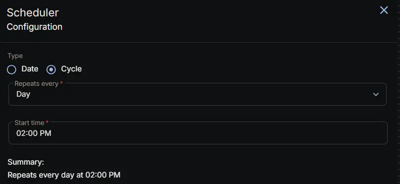
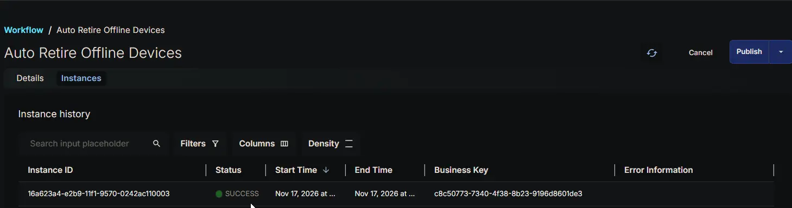

## Purpose

The **Auto Retire Offline Devices** solution keeps ConnectWise RMM clean by retiring devices that have been offline for longer than a set number of days. Retiring a device uninstalls its CW RMM agent, which removes the device from CW RMM.

Once a day at 2:00 PM, the [Auto Retire Offline Devices](/docs/a8e23aed-1111-4543-8f9c-8fbb24e73c99) workflow runs the [Auto Retire Offline Devices](/docs/6ae2e972-aa74-4fc8-b266-bf702722cb4b) bot. The bot checks each offline device against its AR_ custom fields: whether the device is in scope, how many days it may stay offline, and whether to retire it or only raise a ticket. Every setting can be made for the whole portal, a company, a site or a single device.

**Platform:** `ConnectWise RMM`

### Key Capabilities

- **Portal-Wide Defaults** – The default values of the company fields apply to every company that has no value of its own, so Auto Retire can be turned on everywhere without visiting each company.
- **Scope by OS Type** – Choose Windows workstations, Windows servers, macOS, or a mix of them. Servers can be left out everywhere with one setting.
- **Overrides at Every Level** – Company, site and endpoint fields, with the most specific value winning. A single device can be included or protected whatever its company says.
- **Ticket-Only Mode** – Raise one ticket per device instead of retiring it, to see what would be removed before anything is. It's used whenever the mode isn't set, so nothing is removed by surprise.
- **One Ticket per Device** – The ticket number is stored on the device, and no new ticket is raised while it's open.
- **Safe by Default** – Every company is `Disabled` out of the box. Thresholds under 7 days are refused, no more than 50 devices are retired in one run, and a setting the bot can't use leaves the device alone with the reason written to the device.
- **No API Keys** – The bot runs inside CW RMM with its built-in API access, so no API keys are created or stored.

### Important Caveats & Behavior

- **Retiring Is Permanent** – CW RMM removes a retired device from the portal straight away and uninstalls its agent the next time the device comes online. To bring it back, the agent has to be installed again.
- **Rarely Used Devices** – A device that's only switched on now and then, such as a laptop taken on site visits once a month, looks offline too. Protect these with [AR_Enable_Endpoint](/docs/13205a0e-1d98-45b6-9806-5278edde1459) set to `Disabled`, or give them a longer [AR_Threshold_Days_Endpoint](/docs/e078f89d-a405-471c-8b26-55a138657fdb).
- **Broken Agents** – A device whose CW RMM agent has stopped working, but that's still in use, also looks offline. Run in ticket-only mode first and use a long threshold, so technicians can catch these before they're retired.
- **Daily Run at 2:00 PM** – The workflow runs once a day, the most often a scheduled workflow can run. 2:00 PM keeps the run inside working hours, when a device that's caught offline is most likely truly offline, and a rarely used device is most likely to be switched on.
- **Offline Time** – Counted from the last time the device contacted CW RMM.
- **Limits** – Thresholds under 7 days are refused, and no more than 50 devices are retired in one run. Devices over the limit are retired at the following runs.
- **Tickets** – Ticket-only mode raises tickets on the `MSP` board, assigned to the `MSP` team, with `Medium` priority and the `Alerting` source. These must exist in your CW RMM ticketing settings.
- **Workflow Account** – The workflow runs under the account that created it. That account needs access to every device you want handled and must be allowed to uninstall agents.
- **Install Order** – The workflow calls a custom bot, so the bot must be installed and published **before** the workflow is imported. A workflow that references a bot that doesn't exist in the environment can't be saved.

## How It Works

1. At 2:00 PM, the [workflow](/docs/a8e23aed-1111-4543-8f9c-8fbb24e73c99) runs the [bot](/docs/6ae2e972-aa74-4fc8-b266-bf702722cb4b).
2. The bot finds every device that's been offline for 7 days or more. Online devices are never looked at.
3. For each device, it reads the AR_ fields of the device, its site and its company. The most specific level that holds a value wins.
4. A device that's out of scope, or hasn't been offline for its threshold yet, is left alone.
5. In ticket-only mode, a ticket is raised for the device unless its stored ticket is still open. Otherwise, the device's CW RMM agent is uninstalled.
6. A device whose settings can't be used is left alone, with the reason in [AR_Last_Result](/docs/b539484e-1f3b-4383-8ad7-4e37c19ef9eb), and is tried again at the next run.

## Ticket-Only and Retire Modes

| | Ticket-Only | Retire |
|---|---|---|
| **What happens** | One ticket per device past its threshold, with the device attached. Nothing is removed. | The device's CW RMM agent is uninstalled, and the device is removed from CW RMM. |
| **Later runs** | No new ticket while the stored one is open. A new one once it's Closed or Resolved and the device is still offline. | Nothing. The device is gone. |
| **How to set it** | [AR_Ticket_Only](/docs/7579b40b-c4f1-4f78-afce-7507516787c8), [AR_Ticket_Only_Site](/docs/5b330773-7b20-41a7-a3f7-8c542c876d63) or [AR_Ticket_Only_Endpoint](/docs/4b815d93-67d7-4071-ba16-e787f6b3174c) set to `Enabled`, or not set at any level | The same fields set to `Disabled` |
| **Best for** | Rolling out, testing, and companies that want someone to approve each removal | Companies whose tickets show only devices that are really gone |

**How to choose:**

- Pick **Ticket-Only** while you roll the solution out or test it, and for companies that want to review each device before it's removed.
- Pick **Retire** once the tickets show only devices that are really gone and the rarely used ones are protected.

## Prerequisites

- A CW RMM account, used to create the workflow, that has access to every device you want handled and is allowed to uninstall agents.
- For ticket-only mode: the `MSP` service board and team, the `Medium` priority and the `Alerting` source in your CW RMM ticketing settings.

## Associated Content

### Custom Fields: Scope

These fields set which devices Auto Retire handles. Leave the site and endpoint fields empty to use the level above.

| Name | Level | Type | Purpose |
|---|---|---|---|
| [AR_Enable](/docs/5563ad64-f1a5-4245-9c3f-ded7303a1ae1) | Company | Dropdown | Which devices are handled for the company, by OS type. Its default value is the portal-wide default. |
| [AR_Enable_Site](/docs/3bbf928b-d145-4fc9-9de4-16145479308d) | Site | Dropdown | Overrides AR_Enable for one site. |
| [AR_Enable_Endpoint](/docs/13205a0e-1d98-45b6-9806-5278edde1459) | Endpoint | Dropdown | Includes or protects a single device, whatever its OS, site and company. |

### Custom Fields: Threshold

These fields set how many days a device must be offline before it's handled.

| Name | Level | Type | Purpose |
|---|---|---|---|
| [AR_Threshold_Days](/docs/b0574e34-64f1-4c4f-9371-8c0a0b8a1b44) | Company | Text Box | Days offline before a device is handled. Its default value of 30 is the portal-wide default. |
| [AR_Threshold_Days_Site](/docs/3eb97aa2-def8-4c0d-a956-856a22c826a7) | Site | Text Box | Overrides AR_Threshold_Days for one site. |
| [AR_Threshold_Days_Endpoint](/docs/e078f89d-a405-471c-8b26-55a138657fdb) | Endpoint | Text Box | Overrides the threshold for a single device. |

### Custom Fields: Ticket-Only Mode

These fields choose between raising a ticket and retiring the device.

| Name | Level | Type | Purpose |
|---|---|---|---|
| [AR_Ticket_Only](/docs/7579b40b-c4f1-4f78-afce-7507516787c8) | Company | Dropdown | Turns ticket-only mode on or off for the company. Not set means ticket-only. |
| [AR_Ticket_Only_Site](/docs/5b330773-7b20-41a7-a3f7-8c542c876d63) | Site | Dropdown | Overrides AR_Ticket_Only for one site. |
| [AR_Ticket_Only_Endpoint](/docs/4b815d93-67d7-4071-ba16-e787f6b3174c) | Endpoint | Dropdown | Overrides ticket-only mode for a single device. |

### Custom Fields: Written by the Bot

| Name | Level | Type | Purpose |
|---|---|---|---|
| [AR_Ticket_Number](/docs/0fba3c3b-e142-43ce-9a28-5bdce021bd68) | Endpoint | Text Box | The number of the ticket raised for the device in ticket-only mode. |
| [AR_Last_Result](/docs/b539484e-1f3b-4383-8ad7-4e37c19ef9eb) | Endpoint | Text Box | The date and outcome of the last ticket raised, or the reason the device couldn't be handled. |

### Bot

| Name | Purpose |
|---|---|
| [Auto Retire Offline Devices](/docs/6ae2e972-aa74-4fc8-b266-bf702722cb4b) | Finds the devices offline for longer than their threshold, and retires them or raises a ticket for each one. Writes the reason for any problem to the device. Must be installed and published **before** the workflow is imported. |

### Workflow

| Name | Trigger | Purpose |
|---|---|---|
| [Auto Retire Offline Devices](/docs/a8e23aed-1111-4543-8f9c-8fbb24e73c99) | Built-in schedule, daily at 2:00 PM | Runs the bot once a day. |

## Implementation

Follow these steps in order. Steps 1 to 4 are done once per CW RMM environment.

### Step 1: Install the Custom Fields

Install the eleven custom fields from the `ProVal - Content` Community, selecting the **Custom Fields** repository.

- [Custom Field: AR_Enable](/docs/5563ad64-f1a5-4245-9c3f-ded7303a1ae1)
- [Custom Field: AR_Threshold_Days](/docs/b0574e34-64f1-4c4f-9371-8c0a0b8a1b44)
- [Custom Field: AR_Ticket_Only](/docs/7579b40b-c4f1-4f78-afce-7507516787c8)
- [Custom Field: AR_Enable_Site](/docs/3bbf928b-d145-4fc9-9de4-16145479308d)
- [Custom Field: AR_Threshold_Days_Site](/docs/3eb97aa2-def8-4c0d-a956-856a22c826a7)
- [Custom Field: AR_Ticket_Only_Site](/docs/5b330773-7b20-41a7-a3f7-8c542c876d63)
- [Custom Field: AR_Enable_Endpoint](/docs/13205a0e-1d98-45b6-9806-5278edde1459)
- [Custom Field: AR_Threshold_Days_Endpoint](/docs/e078f89d-a405-471c-8b26-55a138657fdb)
- [Custom Field: AR_Ticket_Only_Endpoint](/docs/4b815d93-67d7-4071-ba16-e787f6b3174c)
- [Custom Field: AR_Ticket_Number](/docs/0fba3c3b-e142-43ce-9a28-5bdce021bd68)
- [Custom Field: AR_Last_Result](/docs/b539484e-1f3b-4383-8ad7-4e37c19ef9eb)

### Step 2: Set the Portal-Wide Defaults

The default values of the company fields apply to every company that has no value of its own. Go to **SETTINGS** ➞ **Custom Fields** and set them to suit most of your companies.

- [AR_Enable](/docs/5563ad64-f1a5-4245-9c3f-ded7303a1ae1) is `Disabled` out of the box. Change it to, for example, `Windows Workstations Only` to cover workstations in every company and leave servers out. Or leave it `Disabled` and turn Auto Retire on company by company.
- [AR_Threshold_Days](/docs/b0574e34-64f1-4c4f-9371-8c0a0b8a1b44) is `30` out of the box. A longer threshold, such as `90`, is a safer place to start.
- [AR_Ticket_Only](/docs/7579b40b-c4f1-4f78-afce-7507516787c8) has no default value, which means ticket-only mode. Leave it that way until Step 7.

### Step 3: Install the Bot

Install the bot from the `ProVal - Content` Community, selecting the **Bots** repository, then publish it. Confirm the `MSP` board and team, the `Medium` priority and the `Alerting` source exist in your ticketing settings.

- [Bots: Auto Retire Offline Devices](/docs/6ae2e972-aa74-4fc8-b266-bf702722cb4b)

### Step 4: Install the Workflow

Install the workflow from the `ProVal - Content` Community, signed in with an account that has access to every device you want handled and is allowed to uninstall agents. Confirm the trigger is set to run every day at 2:00 PM.

- [Workflows: Auto Retire Offline Devices](/docs/a8e23aed-1111-4543-8f9c-8fbb24e73c99)

### Step 5: Set Up Companies, Sites and Devices

Change only what differs from the portal-wide defaults.

- Set [AR_Enable](/docs/5563ad64-f1a5-4245-9c3f-ded7303a1ae1) or [AR_Threshold_Days](/docs/b0574e34-64f1-4c4f-9371-8c0a0b8a1b44) on companies that need something different, for example `Windows Workstations and Servers` for a company whose servers should be handled too.
- Set [AR_Enable_Site](/docs/3bbf928b-d145-4fc9-9de4-16145479308d) or [AR_Threshold_Days_Site](/docs/3eb97aa2-def8-4c0d-a956-856a22c826a7) on sites that differ from their company.
- Set [AR_Enable_Endpoint](/docs/13205a0e-1d98-45b6-9806-5278edde1459) to `Disabled` on devices that are only used now and then, so they're never retired.

### Step 6: Run in Ticket-Only Mode

Let the workflow run for a few days with ticket-only mode on. Each device past its threshold gets one ticket and nothing is removed. Review the tickets: protect the devices that should stay, and adjust the thresholds where too many or too few devices were caught.

To see a run straight away, follow [Testing the Workflow](#testing-the-workflow).

### Step 7: Turn On Retire Mode

When the tickets show only devices that are really gone, set [AR_Ticket_Only](/docs/7579b40b-c4f1-4f78-afce-7507516787c8) to `Disabled` on the companies that are ready, or change its default value to `Disabled` to retire devices everywhere. Use [AR_Ticket_Only_Site](/docs/5b330773-7b20-41a7-a3f7-8c542c876d63) and [AR_Ticket_Only_Endpoint](/docs/4b815d93-67d7-4071-ba16-e787f6b3174c) for sites or devices that should stay in ticket-only mode. The tickets raised earlier aren't closed by the bot, so close them once their devices are retired.

You'll know it worked when devices past their threshold are gone from CW RMM after the next 2:00 PM run or, in ticket-only mode, have a ticket and a number in [AR_Ticket_Number](/docs/0fba3c3b-e142-43ce-9a28-5bdce021bd68). If a device is still there without a ticket, its [AR_Last_Result](/docs/b539484e-1f3b-4383-8ad7-4e37c19ef9eb) says why.

## Testing the Workflow

A workflow that runs a bot has no **Test** button, and the bot can't be run on its own like other actions. To see the solution work without waiting for 2:00 PM, move the workflow's trigger to a few minutes from now, let it run, then move it back. The same steps work for a one-off cleanup.

**Primary Note: A Test Run Is a Full Run**  
The bot handles every device in CW RMM under its own settings, not only the test device. Before testing, make sure no company or site is set to retire devices you don't want retired. Devices whose [AR_Ticket_Only](/docs/7579b40b-c4f1-4f78-afce-7507516787c8) fields are empty at every level only get tickets, so a test run removes nothing else unless a company, site or device has been set to `Disabled`.

### 1. Prepare a Test Device

Pick a device that's been offline for at least 7 days, and set these fields on it:

- [AR_Enable_Endpoint](/docs/13205a0e-1d98-45b6-9806-5278edde1459): `Enabled`
- [AR_Threshold_Days_Endpoint](/docs/e078f89d-a405-471c-8b26-55a138657fdb): `7`, or any whole number no higher than the number of days the device has been offline
- [AR_Ticket_Only_Endpoint](/docs/4b815d93-67d7-4071-ba16-e787f6b3174c): `Enabled` to raise a ticket only, or `Disabled` to retire the device

### 2. Move the Trigger

Open the [Auto Retire Offline Devices](/docs/a8e23aed-1111-4543-8f9c-8fbb24e73c99) workflow, select the **Trigger** node, and set the time to a few minutes after the current time. Publish the workflow.

### 3. Check the Run

Once that time has passed, open the workflow's **Instances** tab. The latest instance shows whether the bot ran successfully. Open the instance to see the bot's result message with the totals for the run, or its error if the run failed.

### 4. Check the Device

- **Ticket-only:** a ticket was raised with the device attached, and its number is in [AR_Ticket_Number](/docs/0fba3c3b-e142-43ce-9a28-5bdce021bd68).
- **Retire:** the device is gone from CW RMM.
- **Neither:** read [AR_Last_Result](/docs/b539484e-1f3b-4383-8ad7-4e37c19ef9eb) on the device. If it's empty, the device was out of scope or hadn't been offline for its threshold yet.

### 5. Move the Trigger Back

Set the trigger back to 2:00 PM, or the time you run the workflow at, and publish the workflow again.

## FAQ

### Q: How do I try the solution without removing anything?

> Use ticket-only mode. When [AR_Ticket_Only](/docs/7579b40b-c4f1-4f78-afce-7507516787c8) isn't set on a device, its site or its company, or is set to `Enabled`, the device gets one ticket when it passes its threshold, and nothing is removed. Nothing is retired until the field is set to `Disabled` at some level. To try it on one device straight away, follow [Testing the Workflow](#testing-the-workflow).

### Q: Can I run the workflow now instead of waiting for 2:00 PM?

> Yes, by moving its trigger time. A workflow that runs a bot has no **Test** button. Follow [Testing the Workflow](#testing-the-workflow), and remember to move the trigger back afterwards.

### Q: How do I turn Auto Retire on for every company at once?

> Change the default value of [AR_Enable](/docs/5563ad64-f1a5-4245-9c3f-ded7303a1ae1) under **SETTINGS** ➞ **Custom Fields**. Every company without its own value follows it. Companies with their own value keep it.

### Q: How do I keep servers out?

> Choose an option without servers, such as `Windows Workstations Only`, as the default value of [AR_Enable](/docs/5563ad64-f1a5-4245-9c3f-ded7303a1ae1). To include servers for one company or site, set its AR_Enable or [AR_Enable_Site](/docs/3bbf928b-d145-4fc9-9de4-16145479308d) to `Windows Workstations and Servers`.

### Q: How do I protect a device that's only used now and then?

> Set [AR_Enable_Endpoint](/docs/13205a0e-1d98-45b6-9806-5278edde1459) to `Disabled` on it, and it's never retired. To have it handled only if it's gone for a long time, give it a longer [AR_Threshold_Days_Endpoint](/docs/e078f89d-a405-471c-8b26-55a138657fdb) instead, such as `180`.

### Q: Why does the workflow run at 2:00 PM?

> To keep the run inside working hours. A device caught offline in the middle of the working day is far more likely to be truly offline, and a device that's only used now and then is most likely to be switched on during working hours, which gives it a few more hours to check in before it's retired. You can choose another time, but keep it to once a day and within working hours.

### Q: What threshold should I start with?

> Start long, such as 90 days, and in ticket-only mode. Lower it once the tickets show it's safe. The bot refuses anything under 7 days.

### Q: I closed a ticket, and the device got a new one. Why?

> The device is still offline past its threshold and still in ticket-only mode, so a new ticket is raised at the next run. To keep the device, set [AR_Enable_Endpoint](/docs/13205a0e-1d98-45b6-9806-5278edde1459) to `Disabled`. To have it retired, set [AR_Ticket_Only_Endpoint](/docs/4b815d93-67d7-4071-ba16-e787f6b3174c) to `Disabled`.

### Q: A device past its threshold is still in CW RMM. What should I check?

> Work through this list:
>
> 1. The device's [AR_Last_Result](/docs/b539484e-1f3b-4383-8ad7-4e37c19ef9eb). Its document lists the common reasons and how to fix each one.
> 2. Ticket-only mode. If [AR_Ticket_Only](/docs/7579b40b-c4f1-4f78-afce-7507516787c8) isn't set to `Disabled` on the device, its site or its company, the device only gets a ticket.
> 3. Scope. The device's OS must be covered by its site or company setting, or [AR_Enable_Endpoint](/docs/13205a0e-1d98-45b6-9806-5278edde1459) must be `Enabled`. Linux and other OSs need AR_Enable_Endpoint set to `Enabled`.
> 4. Threshold. The device must have been offline for at least the threshold set at the most specific level.
> 5. The bot's result message in the workflow's **Instances** tab. It says when devices were held back by the 50 device limit or weren't reached in time. Those are handled at the next run.
> 6. The account that created the workflow has access to the device and is allowed to uninstall agents.

### Q: What happens if a retired device comes back online?

> Its CW RMM agent uninstalls itself the first time it checks in. To keep managing the device, install the agent again. If it's a device that's only used now and then, set [AR_Enable_Endpoint](/docs/13205a0e-1d98-45b6-9806-5278edde1459) to `Disabled` on it once it's back.

### Q: Can the solution tell a broken agent from a device that's really gone?

> No. A device whose CW RMM agent has stopped working looks offline, just like a device that's gone. Ticket-only mode and a long threshold give technicians time to spot these before they're retired.

### Q: Why weren't all of the devices past their threshold retired in one run?

> No more than 50 devices are retired in one run, so a setting changed by mistake can't clear out a whole company at once. The rest are retired at the following runs. A very large environment can also run out of time, and the devices not reached are handled at the next run.

### Q: Does the solution remove devices from Intune or Entra?

> No. It only retires devices from CW RMM. To remove replaced devices from Intune and Entra as well, see [Device Offboarding [RMM, Intune and Entra]](/docs/02e3ba26-1e13-4485-8194-69cb7434c412).

## Changelog

### 2026-11-17

- Initial version of the document
