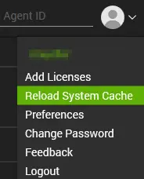
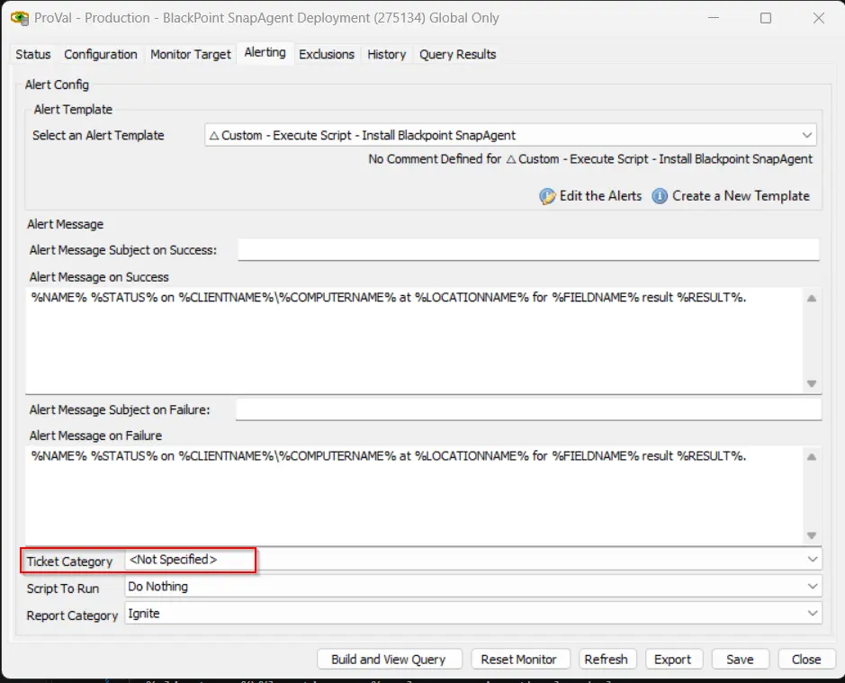

## Purpose

This solution automates the deployment of the BlackPoint SnapAgent on Windows and macOS machines through ConnectWise Automate. The internal monitor detects online agents where the SnapAgent is not installed and deployment is enabled for the client. The alert template then runs the deployment script on the detected agents. The script installs the SnapAgent with the BlackPoint Customer ID and Authentication Token stored in the client-level EDFs. If the installation fails, the script creates a ticket with the installation log.

## Associated Content

| Content | Type | Function |
|---------|------|----------|
| [BlackPoint - SnapAgent Deployment](/docs/202e2dde-5865-4035-8410-37dc6cb92a60) | Script | Installs the BlackPoint SnapAgent on Windows and macOS machines with the Customer ID and Authentication Token stored in the client-level EDFs. Creates a ticket with the installation log if the installation fails. |
| [BlackPoint SnapAgent Deployment](/docs/8dad86ab-7d59-43ef-b148-f4ab7df0b8f0) | Internal Monitor | Detects online Windows and macOS agents where the SnapAgent is not installed, the `BlackPoint SnapAgent Deploy` EDF is checked at the client level, and the agent is not excluded at the location or computer level. |
| `△ Custom - Execute Script - Install BlackPoint SnapAgent` | Alert Template | Runs the [Script - BlackPoint - SnapAgent Deployment](/docs/202e2dde-5865-4035-8410-37dc6cb92a60) on the agents detected by the [Monitor - BlackPoint SnapAgent Deployment](/docs/8dad86ab-7d59-43ef-b148-f4ab7df0b8f0). |

## Agnostic Content

| Content | Type | Function |
|---------|------|----------|
| [Install-BlackpointAgent](/docs/0cf14533-c145-4a77-8ea7-8c70476768a9) | Agnostic PowerShell Script | Used by the script on Windows machines to download the SnapAgent installer for the configured Customer ID, install it silently, and verify the installation. |

## EDFs

| Name | Level | Type | Required | Description |
|------|-------|------|----------|-------------|
| `BlackPoint SnapAgent Deploy` | Client | Check Box | Yes | Check this EDF to enable SnapAgent deployment for the client. The monitor only detects agents of clients where this EDF is checked. |
| `BlackPoint SnapAgent CustomerID` | Client | Text | Yes | The unique BlackPoint Customer ID (Account UID) used to download the installer and link the endpoints to the correct BlackPoint account. |
| `BlackPoint SnapAgent Authentication Token` | Client | Text | Yes | The BlackPoint Authentication Token used to authorize the installer download and register the agent. |
| `BlackPoint SnapAgent Exclude` | Location | Check Box | No | Check this EDF to exclude all agents of the location from the SnapAgent deployment. |
| `BlackPoint SnapAgent Exclude` | Computer | Check Box | No | Check this EDF to exclude the agent from the SnapAgent deployment. |

## Implementation

1. Import the following content using the `ProSync` plugin:
   - [Script - BlackPoint - SnapAgent Deployment](/docs/202e2dde-5865-4035-8410-37dc6cb92a60)
   - [Internal Monitor - BlackPoint SnapAgent Deployment](/docs/8dad86ab-7d59-43ef-b148-f4ab7df0b8f0)
   - Alert Template - `△ Custom - Execute Script - Install BlackPoint SnapAgent`

2. Reload the system cache:

   

3. Execute the [Script - BlackPoint - SnapAgent Deployment](/docs/202e2dde-5865-4035-8410-37dc6cb92a60) against any online Windows machine with the `Set_Environment` parameter set to `1` to create the EDFs used by the solution.

4. Reload the system cache again so the new EDFs are visible.

5. Configure the EDFs for each client that requires the SnapAgent:
   - Check the client-level EDF `BlackPoint SnapAgent Deploy`.
   - Fill the client-level EDF `BlackPoint SnapAgent CustomerID` with the client's BlackPoint Customer ID.
   - Fill the client-level EDF `BlackPoint SnapAgent Authentication Token` with the client's BlackPoint Authentication Token.
   - Optional: Check the location-level or computer-level `BlackPoint SnapAgent Exclude` EDF to exclude locations or computers from the deployment.

6. Configure the solution as outlined below:
   - Navigate to Automation → Monitors within the CWA Control Center and set up the following:
     - [Internal Monitor - BlackPoint SnapAgent Deployment](/docs/8dad86ab-7d59-43ef-b148-f4ab7df0b8f0)
       - Set up with the `△ Custom - Execute Script - Install BlackPoint SnapAgent` alert template.
       - Set the ticket category at the monitor level to enable ticket creation for failed installations:

         

       - Right-click and select `Run Now` to start the monitor.

## FAQ

**Q:** Which operating systems does this solution support?  
**A:** Windows and macOS. The monitor detects both Windows and macOS agents, and the script runs the correct installation method for each operating system.

**Q:** What happens if the `BlackPoint SnapAgent CustomerID` or `BlackPoint SnapAgent Authentication Token` EDF is empty?  
**A:** Both values are required to download the installer and register the agent. If either value is missing, the installation fails and the script creates a ticket if the ticket category is set at the monitor level.

**Q:** Does the solution still use the `BlackPoint SNAP URL` EDF?  
**A:** No. The `BlackPoint SNAP URL` EDF has been replaced by the `BlackPoint SnapAgent CustomerID` and `BlackPoint SnapAgent Authentication Token` EDFs. The installer is now downloaded for the configured Customer ID, so no installer URL needs to be maintained.

**Q:** How do I exclude a location or a single computer from the deployment?  
**A:** Check the `BlackPoint SnapAgent Exclude` EDF at the location level to exclude all agents of that location, or at the computer level to exclude a single agent.

**Q:** Why is no ticket created when the installation fails?  
**A:** Tickets are only created when a ticket category is set at the monitor level. Set the ticket category on the [Internal Monitor - BlackPoint SnapAgent Deployment](/docs/8dad86ab-7d59-43ef-b148-f4ab7df0b8f0) as shown in step 6 of the implementation.

**Q:** What happens if the SnapAgent is already installed?  
**A:** The monitor only detects agents where the SnapAgent is not installed, so the script will not run on machines that already have it.

**Q:** How can I confirm that the SnapAgent installed successfully?  
**A:** Review the script log for the machine and check that `BlackPoint Agent` appears in the installed applications. On Windows, the agent can take up to 5 minutes to register after the installation.

## Changelog

### 2026-11-10

- Initial version of the document
