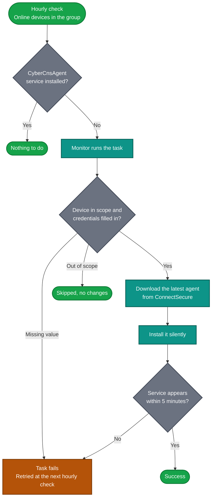

## Purpose

The **Deploy ConnectSecure Agent [Windows]** solution installs the ConnectSecure Vulnerability Scan Agent on Windows devices and puts it back when it goes missing. Which devices get the agent, and which ConnectSecure company they register to, are set in custom fields for the whole portal, a company, a site or a single device.

Every hour, the [Deploy ConnectSecure Agent [Windows]](/docs/1478e5e2-97a5-435e-aba4-970f33ef598b) monitor checks the online devices in the [Deploy ConnectSecure Agent [Windows]](/docs/762539d7-6380-4703-b3c7-5daccb53de7f) group for the agent. When it's missing, the monitor runs the [Deploy ConnectSecure Agent [Windows]](/docs/f525e770-2d55-4de5-af7e-0a95e8a825ce) task, which downloads the latest agent from ConnectSecure and installs it.

**Platform:** `ConnectWise RMM`

### Key Capabilities

- **Scope by OS Type** – Deploy to Windows workstations, Windows servers or both, per company or site. A single device can be included or excluded whatever its company says.
- **Settings at Every Level** – Company, site and endpoint fields, with the most specific value winning.
- **One ConnectSecure Company per Client** – Each client registers to its own ConnectSecure company. A site can register to a different one.
- **Set the Tenant Once** – The Tenant ID and User Secret are entered once, as the default values of their fields, and apply to every client.
- **Self-Healing** – A device that loses the agent gets it back within the hour, as long as it's in scope and online.
- **Latest Agent** – The installer is downloaded from ConnectSecure at every install, so new devices always get the current version.
- **Reinstall on Demand** – Run the task by hand with `Force` checked to reinstall the agent on a device.

### Important Caveats & Behavior

- **Windows Only** – The solution doesn't deploy the agent to macOS or Linux devices.
- **Online Devices Only** – The monitor checks online devices. An offline device gets the agent at its first check after it comes back online.
- **No Tickets** – A failed install isn't ticketed. The monitor runs the task again every hour until the problem is fixed, so check the task's history for devices that keep failing.
- **Credentials in Custom Fields** – The Tenant ID and User Secret are stored as plain text, and anyone who can see the custom fields can read them.
- **Removing the Agent** – While a device is in scope, the solution puts the agent back after it's uninstalled. Exclude the device with [CS_Deployment_Endpoint](/docs/63282970-5875-48da-bf3f-60639eb3006b) set to `Disabled` before you uninstall it.
- **Turning It Off Removes Nothing** – A device taken out of scope keeps its agent. The solution just stops checking it.
- **Existing Agents Aren't Moved** – A device that already has the agent is skipped, whichever ConnectSecure company it's registered to.

## How It Works

1. Every hour, the monitor checks each online device in the group for the `CyberCnsAgent` service. The group holds the Windows devices that the CS_Deployment fields put in scope.
2. When the service is there, nothing happens.
3. When it's missing, the monitor runs the task. The task checks the scope again, reads the Company ID from the site or company, and the Tenant ID and User Secret from the company.
4. It asks the ConnectSecure API for the latest Windows agent, downloads it and installs it silently.
5. It waits up to 5 minutes for the `CyberCnsAgent` service to appear, then reports the result in its Script Log.
6. At the next hourly check, the monitor finds the agent. When the install failed, the monitor runs the task again.

## Prerequisites

- A ConnectSecure environment, with a company created for each client that should get the agent.
- Your ConnectSecure Tenant ID and User Secret, and the Company ID of each client, from the ConnectSecure portal.
- Internet access from the devices to `configuration.myconnectsecure.com` and to the download link it returns.

## Associated Content

### Custom Fields: Scope

These fields set which devices get the agent. Leave the site and endpoint fields empty to use the level above.

| Name | Level | Type | Purpose |
|---|---|---|---|
| [CS_Deployment](/docs/a3fa2309-9ab8-476e-a684-25c17e7b0c0b) | Company | Dropdown | Which Windows devices get the agent for the company, by OS type. Its default value is the portal-wide default. |
| [CS_Deployment_Site](/docs/0b020b21-1a7b-4bb2-9e33-00549b632986) | Site | Dropdown | Overrides CS_Deployment for one site. |
| [CS_Deployment_Endpoint](/docs/63282970-5875-48da-bf3f-60639eb3006b) | Endpoint | Dropdown | Includes or excludes a single device, whatever its OS type, site and company. |

### Custom Fields: ConnectSecure Credentials

These fields register the agent with ConnectSecure. Each one needs a value.

| Name | Level | Type | Purpose |
|---|---|---|---|
| [CS_Company_ID](/docs/c93bfacb-1e95-42f1-88a2-358ef12de48e) | Company | Text Box | The client's Company ID in ConnectSecure. Required. |
| [CS_Company_ID_Site](/docs/0755e964-3e42-4132-900e-3889a8c4fc93) | Site | Text Box | Overrides CS_Company_ID for a site that maps to its own company in ConnectSecure. |
| [CS_Tenant_ID](/docs/5ce06a0b-16c7-4f91-9241-5bbba68c2ecd) | Company | Text Box | Your ConnectSecure Tenant ID. Set it once as the default value. Required. |
| [CS_User_Secret](/docs/261f8eb9-2d30-4f4b-816f-17e3de38e867) | Company | Text Box | Secret that registers the agent. Set it once as the default value. Stored as plain text. Required. |

### Group

| Name | Type | Purpose |
|---|---|---|
| [Deploy ConnectSecure Agent [Windows]](/docs/762539d7-6380-4703-b3c7-5daccb53de7f) | Dynamic Group | Windows devices where deployment is turned on through the CS_Deployment fields. |

### Monitor

| Name | Type | Purpose |
|---|---|---|
| [Deploy ConnectSecure Agent [Windows]](/docs/1478e5e2-97a5-435e-aba4-970f33ef598b) | Script | Checks the group's online devices every hour, and runs the task on devices without the agent. |

### Task

| Name | Purpose |
|---|---|
| [Deploy ConnectSecure Agent [Windows]](/docs/f525e770-2d55-4de5-af7e-0a95e8a825ce) | Downloads and installs the agent. Run by the monitor, or by hand with `Force` to reinstall. |

## Implementation

Follow these steps in order.

### Step 1: Install the Custom Fields

Install the 7 custom fields from the `ProVal - Content` Community, selecting the **Custom Fields** repository.

- [Custom Field: CS_Deployment](/docs/a3fa2309-9ab8-476e-a684-25c17e7b0c0b)
- [Custom Field: CS_Deployment_Site](/docs/0b020b21-1a7b-4bb2-9e33-00549b632986)
- [Custom Field: CS_Deployment_Endpoint](/docs/63282970-5875-48da-bf3f-60639eb3006b)
- [Custom Field: CS_Company_ID](/docs/c93bfacb-1e95-42f1-88a2-358ef12de48e)
- [Custom Field: CS_Company_ID_Site](/docs/0755e964-3e42-4132-900e-3889a8c4fc93)
- [Custom Field: CS_Tenant_ID](/docs/5ce06a0b-16c7-4f91-9241-5bbba68c2ecd)
- [Custom Field: CS_User_Secret](/docs/261f8eb9-2d30-4f4b-816f-17e3de38e867)

### Step 2: Enter the Tenant ID and User Secret

Under **SETTINGS** ➞ **Custom Fields**, set your ConnectSecure Tenant ID as the **Default Value** of [CS_Tenant_ID](/docs/5ce06a0b-16c7-4f91-9241-5bbba68c2ecd), and your User Secret as the **Default Value** of [CS_User_Secret](/docs/261f8eb9-2d30-4f4b-816f-17e3de38e867). They then apply to every company.

### Step 3: Enter the Company IDs

Set [CS_Company_ID](/docs/c93bfacb-1e95-42f1-88a2-358ef12de48e) on each company that should get the agent, to the Company ID of that client in ConnectSecure. Set [CS_Company_ID_Site](/docs/0755e964-3e42-4132-900e-3889a8c4fc93) on any site that registers to a different ConnectSecure company.

### Step 4: Install the Group

Install the group from the `ProVal - Content` Community, selecting the **Groups** repository.

- [Group: Deploy ConnectSecure Agent [Windows]](/docs/762539d7-6380-4703-b3c7-5daccb53de7f)

### Step 5: Create the Task

Create the task by hand, as described in its document. The task isn't scheduled. The monitor runs it.

- [Task: Deploy ConnectSecure Agent [Windows]](/docs/f525e770-2d55-4de5-af7e-0a95e8a825ce)

### Step 6: Install the Monitor

Install the monitor from the `ProVal - Content` Community, selecting the **Monitors** repository. Then open it and check that **Add Automation** runs the `Deploy ConnectSecure Agent [Windows]` task, as described in the monitor's document.

- [Monitor: Deploy ConnectSecure Agent [Windows]](/docs/1478e5e2-97a5-435e-aba4-970f33ef598b)

### Step 7: Try It on One Device

1. Set [CS_Deployment_Endpoint](/docs/63282970-5875-48da-bf3f-60639eb3006b) to `Enabled` on a test device without the agent, in a company whose Company ID is filled in.
2. Once the device shows in the [Deploy ConnectSecure Agent [Windows]](/docs/762539d7-6380-4703-b3c7-5daccb53de7f) group, run the [Deploy ConnectSecure Agent [Windows]](/docs/f525e770-2d55-4de5-af7e-0a95e8a825ce) task on it, or wait for the monitor's next check.
3. Check the task's Script Log, and that the device shows up under the right company in ConnectSecure.

You'll know it worked when the Script Log says the agent was installed and the `CyberCnsAgent` service is running.

### Step 8: Turn Deployment On

Set [CS_Deployment](/docs/a3fa2309-9ab8-476e-a684-25c17e7b0c0b) on the companies that should get the agent, for example `Windows Workstations and Servers`, or [CS_Deployment_Site](/docs/0b020b21-1a7b-4bb2-9e33-00549b632986) on single sites. To turn it on for every company at once, change the default value of CS_Deployment under **SETTINGS** ➞ **Custom Fields**. Fill in the Company IDs first, or the task fails on those companies' devices.

## FAQ

### Q: How do I try the solution on one device first?

> Fill in the company's Company ID, set [CS_Deployment_Endpoint](/docs/63282970-5875-48da-bf3f-60639eb3006b) to `Enabled` on the device, and run the [Deploy ConnectSecure Agent [Windows]](/docs/f525e770-2d55-4de5-af7e-0a95e8a825ce) task on it. See [Step 7](#step-7-try-it-on-one-device).

### Q: Where do I find the Company ID, Tenant ID and User Secret?

> In your ConnectSecure portal. Each client company has its own Company ID. The Tenant ID and User Secret belong to your ConnectSecure environment, so they're the same for every client.

### Q: Can one site register to a different ConnectSecure company?

> Yes. Set [CS_Company_ID_Site](/docs/0755e964-3e42-4132-900e-3889a8c4fc93) on that site.

### Q: How quickly does a new device get the agent?

> Within an hour of joining the [Deploy ConnectSecure Agent [Windows]](/docs/762539d7-6380-4703-b3c7-5daccb53de7f) group, as long as it's online. Run the [Deploy ConnectSecure Agent [Windows]](/docs/f525e770-2d55-4de5-af7e-0a95e8a825ce) task on it to install the agent straight away.

### Q: How do I reinstall the agent on a device?

> Run the [Deploy ConnectSecure Agent [Windows]](/docs/f525e770-2d55-4de5-af7e-0a95e8a825ce) task on the device with `Force` checked. The monitor never uses `Force`, so it doesn't reinstall agents that are already there.

### Q: How do I remove the agent from a device?

> Set [CS_Deployment_Endpoint](/docs/63282970-5875-48da-bf3f-60639eb3006b) to `Disabled` on the device first, then uninstall the agent. If you uninstall it while the device is still in scope, the monitor installs it again within the hour.

### Q: Does turning deployment off uninstall the agent?

> No. The device leaves the group and keeps its agent. Uninstall the agent on the device if it's no longer needed.

### Q: Does the solution create tickets?

> No. A failed install is retried every hour until the cause is fixed. Check the [Deploy ConnectSecure Agent [Windows]](/docs/f525e770-2d55-4de5-af7e-0a95e8a825ce) task's history to find devices that keep failing.

### Q: A device in scope doesn't have the agent. What should I check?

> Work through this list:
>
> 1. The device is in the [Deploy ConnectSecure Agent [Windows]](/docs/762539d7-6380-4703-b3c7-5daccb53de7f) group. Check its CS_Deployment fields at every level, and that it's a Windows device of a type its scope covers.
> 2. The device is online, and the [Deploy ConnectSecure Agent [Windows]](/docs/1478e5e2-97a5-435e-aba4-970f33ef598b) monitor is enabled with the task as its automation.
> 3. The task's Script Log on the device. The [Results](/docs/f525e770-2d55-4de5-af7e-0a95e8a825ce#results) table in the task's document explains each message.
> 4. The Company ID, Tenant ID and User Secret are correct for the device's company.
> 5. The device can reach `configuration.myconnectsecure.com`.

### Q: Does it work on macOS or Linux?

> No. This solution deploys the Windows agent only.

## Changelog

### 2026-11-27

- Initial version of the document
