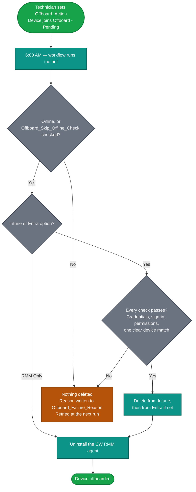

## Purpose

The **Device Offboarding [RMM, Intune and Entra]** solution removes replaced devices from ConnectWise RMM and, when asked to, from the client's Microsoft Intune and Microsoft Entra ID.

A technician marks the old device with the [Offboard_Action](/docs/e18f1709-6273-4086-b9f0-43bbb62c8644) dropdown. Once a day at 6:00 AM, a workflow runs the [Device Offboarding [RMM, Intune and Entra]](/docs/39a88b59-e48a-4c72-bba3-fbe5ff1839ab) bot, which checks everything it can, removes the device from Intune and Entra as set, and uninstalls the CW RMM agent last.

**Platform:** `ConnectWise RMM`

### Key Capabilities

- **One Dropdown per Device** – Choose `RMM Only`, `RMM and Intune` or `RMM Intune and Entra` on the old device. No script to run and nothing to fill in per device.
- **Check First, Delete Second** – The credentials, the sign-in to the client's tenant, the app registration's permissions and the device match are all checked before anything is deleted. If any check fails, nothing is deleted anywhere, CW RMM included.
- **Safe Matching for Reused Names** – Devices are matched in Intune by name and serial number, so a replacement that reuses the old name isn't touched. More than one match stops the bot from guessing.
- **CW RMM Removed Last** – A device that fails in Intune or Entra stays in CW RMM with the reason on it.
- **Self-Healing Retries** – The reason for every failure or skip is written to [Offboard_Failure_Reason](/docs/674f4c6d-b2e7-4ee8-a25a-d8674ec7e704) on the device, and the device is retried at each daily run until it succeeds.
- **Per-Client Microsoft Access** – Each client uses its own app registration, created in its own tenant. Clients that only need devices removed from CW RMM need no credentials at all.
- **Offline Device Handling** – Offline devices are skipped, unless [Offboard_Skip_Offline_Check](/docs/e767b472-e81b-44cf-9b80-dffbd039b090) is checked for devices that won't come back online.

### Important Caveats & Behavior

- **Daily Run** – The workflow runs once a day at 6:00 AM, the most often a scheduled workflow can run. A device marked for offboarding is handled at the next morning's run.
- **Client Secret in Plain Text** – CW RMM has no encrypted or masked custom field type, so the client secret is visible to anyone who can view the client's custom fields. The app registration can delete devices from the client's Intune and Entra, and anyone who has the secret can do the same. Limit who can view client custom fields, and rotate the secret regularly.
- **BitLocker Recovery Keys** – Deleting a device from Entra also deletes the BitLocker recovery keys stored on it. Back them up first if the old drive might still need to be read.
- **Hybrid Joined Devices** – Devices synced from on-premises Active Directory can't be deleted from Entra directly. The bot flags them without deleting anything. Delete the computer object from Active Directory instead.
- **Windows Autopilot** – The solution doesn't touch Autopilot, and an Autopilot registration can block the Entra deletion. Remove the device from Autopilot first if it's registered.
- **Workflow Account** – The workflow runs under the account that created it. That account needs access to every device you'll offboard and must be allowed to uninstall agents.
- **Install Order** – The workflow calls a custom bot, so the bot must be installed and published **before** the workflow is imported. A workflow that references a bot that doesn't exist in the environment can't be saved.

## How It Works

1. A technician sets [Offboard_Action](/docs/e18f1709-6273-4086-b9f0-43bbb62c8644) on the replaced device. The device joins the [Offboard - Pending](/docs/0208ca42-8ad2-4026-8c77-1eb5d23d7d15) group.
2. At 6:00 AM, the [workflow](/docs/d400b357-1c79-431a-a5b2-9de6a619bffe) runs the [bot](/docs/39a88b59-e48a-4c72-bba3-fbe5ff1839ab), which reads only the members of that group.
3. The bot checks each device and removes it from the systems its Offboard_Action names, CW RMM last.
4. A device that can't be offboarded stays in CW RMM and in the group, with the reason in [Offboard_Failure_Reason](/docs/674f4c6d-b2e7-4ee8-a25a-d8674ec7e704), and is retried at the next run.

## Prerequisites

- A CW RMM account, used to create the workflow, that has access to every device you'll offboard and is allowed to uninstall agents.
- For each client that uses `RMM and Intune` or `RMM Intune and Entra`:  
  - An admin of the client's tenant (Global Administrator, or Privileged Role Administrator plus Application Administrator) to create the app registration and grant admin consent.
  - An Intune licence in the client's tenant.

## Associated Content

### Custom Fields: Device

These fields mark a device for offboarding and report back on it.

| Name | Level | Type | Purpose |
|---|---|---|---|
| [Offboard_Action](/docs/e18f1709-6273-4086-b9f0-43bbb62c8644) | Endpoint | Dropdown | Marks a replaced device for offboarding and sets which systems it's removed from. |
| [Offboard_Skip_Offline_Check](/docs/e767b472-e81b-44cf-9b80-dffbd039b090) | Endpoint | Flag | Lets the bot offboard the device while it's offline. |
| [Offboard_Failure_Reason](/docs/674f4c6d-b2e7-4ee8-a25a-d8674ec7e704) | Endpoint | Text Area | Written by the bot. Holds the date and reason the last attempt failed or was skipped. |

### Custom Fields: Microsoft Credentials (Intune and Entra options only)

These fields hold the client's app registration details. Leave them empty for clients that only use `RMM Only`.

| Name | Level | Type | Purpose |
|---|---|---|---|
| [Offboard_Tenant_ID](/docs/7cd5a6d6-655c-4b39-8819-1122c799f24a) | Company | Text Box | The client's Microsoft Entra tenant (Directory) ID. |
| [Offboard_App_Client_ID](/docs/7857a579-d691-4a79-a959-211c45a09d8f) | Company | Text Box | The Application (client) ID of the app registration in the client's tenant. |
| [Offboard_App_Client_Secret](/docs/c51ae730-a3fd-4ad6-818f-25b5ec4e2936) | Company | Text Box | The client secret value of that app registration. Stored in plain text. |

### Group

| Name | Type | Purpose |
|---|---|---|
| [Offboard - Pending](/docs/0208ca42-8ad2-4026-8c77-1eb5d23d7d15) | Dynamic | Holds the devices queued for offboarding. The bot reads only this group and finds it by name. |

### Bot

| Name | Purpose |
|---|---|
| [Device Offboarding [RMM, Intune and Entra]](/docs/39a88b59-e48a-4c72-bba3-fbe5ff1839ab) | Checks each queued device, removes it from Intune and Entra as set, and uninstalls the CW RMM agent last. Writes the reason for any failure to the device. Must be installed and published **before** the workflow is imported. |

### Workflow

| Name | Trigger | Purpose |
|---|---|---|
| [Device Offboarding [RMM, Intune and Entra]](/docs/d400b357-1c79-431a-a5b2-9de6a619bffe) | Built-in schedule, daily at 6:00 AM | Runs the bot once a day. |

## Implementation

Follow these steps in order. Steps 1 to 5 are done once per CW RMM environment. Step 6 is done once for each client that uses the Intune or Entra options.

### Step 1: Create the Device Custom Fields

Create the three endpoint-level fields. They're required for every client.

- [Custom Field: Offboard_Action](/docs/e18f1709-6273-4086-b9f0-43bbb62c8644)
- [Custom Field: Offboard_Skip_Offline_Check](/docs/e767b472-e81b-44cf-9b80-dffbd039b090)
- [Custom Field: Offboard_Failure_Reason](/docs/674f4c6d-b2e7-4ee8-a25a-d8674ec7e704)

### Step 2: Create the Microsoft Credential Custom Fields

Create the three company-level fields. Create them now even if no client uses the Intune or Entra options yet, so they're ready when one does.

- [Custom Field: Offboard_Tenant_ID](/docs/7cd5a6d6-655c-4b39-8819-1122c799f24a)
- [Custom Field: Offboard_App_Client_ID](/docs/7857a579-d691-4a79-a959-211c45a09d8f)
- [Custom Field: Offboard_App_Client_Secret](/docs/c51ae730-a3fd-4ad6-818f-25b5ec4e2936)

### Step 3: Create the Group

Create the dynamic group, named exactly `Offboard - Pending`.

- [Group: Offboard - Pending](/docs/0208ca42-8ad2-4026-8c77-1eb5d23d7d15)

### Step 4: Install the Bot

Install the bot from the `ProVal - Content` Community, selecting the **Bots** repository, then publish it.

- [Bots: Device Offboarding [RMM, Intune and Entra]](/docs/39a88b59-e48a-4c72-bba3-fbe5ff1839ab)

### Step 5: Install the Workflow

Install the workflow from the `ProVal - Content` Community, signed in with an account that has access to every device you'll offboard and is allowed to uninstall agents. Confirm the trigger is set to run every day at 6:00 AM.

- [Workflows: Device Offboarding [RMM, Intune and Entra]](/docs/d400b357-1c79-431a-a5b2-9de6a619bffe)

### Step 6: Set Up Each Client That Uses Intune or Entra

Skip this step for clients that only use `RMM Only`.

1. Have an admin of the client's tenant create the app registration and grant it the two Microsoft Graph permissions, as described in [Create the Microsoft Entra App Registration](/docs/39a88b59-e48a-4c72-bba3-fbe5ff1839ab#3-create-the-microsoft-entra-app-registration).
2. Set the client's [Offboard_Tenant_ID](/docs/7cd5a6d6-655c-4b39-8819-1122c799f24a), [Offboard_App_Client_ID](/docs/7857a579-d691-4a79-a959-211c45a09d8f) and [Offboard_App_Client_Secret](/docs/c51ae730-a3fd-4ad6-818f-25b5ec4e2936).
3. Note the secret's expiry date, and plan to replace it before then.

### Step 7: Mark Replaced Devices

Set [Offboard_Action](/docs/e18f1709-6273-4086-b9f0-43bbb62c8644) on each replaced device. Check [Offboard_Skip_Offline_Check](/docs/e767b472-e81b-44cf-9b80-dffbd039b090) as well if the device won't come back online.

You'll know it worked when the device is gone from CW RMM after the next 6:00 AM run. If it's still there, its [Offboard_Failure_Reason](/docs/674f4c6d-b2e7-4ee8-a25a-d8674ec7e704) says why.

## FAQ

### Q: How soon is a device offboarded after I set Offboard_Action?

> At the next 6:00 AM run of the workflow. Once a day is the most often a scheduled workflow can run.

### Q: Which Offboard_Action option should I choose?

> - `RMM Only` for clients that don't use Intune, or when the device was already removed from Intune and Entra by hand.
> - `RMM and Intune` to keep the Entra device, for example to keep its BitLocker recovery keys, or for a hybrid joined device that has to be removed from Active Directory instead.
> - `RMM Intune and Entra` to remove the device everywhere.

### Q: A device I marked is still in CW RMM. What should I check?

> Work through this list:
>
> 1. The device's [Offboard_Failure_Reason](/docs/674f4c6d-b2e7-4ee8-a25a-d8674ec7e704). Its document lists the common reasons and how to fix each one.
> 2. The device is in the [Offboard - Pending](/docs/0208ca42-8ad2-4026-8c77-1eb5d23d7d15) group, and the group is named exactly `Offboard - Pending`.
> 3. The device is online, or [Offboard_Skip_Offline_Check](/docs/e767b472-e81b-44cf-9b80-dffbd039b090) is checked.
> 4. The account that created the workflow has access to the device and is allowed to uninstall agents.
> 5. The workflow ran. Check its run history for the bot's summary.

### Q: The new device reuses the old device's name. Will the bot remove the wrong one?

> No. Devices are matched in Intune by name and serial number, so the replacement isn't touched. If CW RMM has no serial number for the old device, or more than one Intune device matches, the bot stops and asks for a manual removal instead of guessing.

### Q: Why does the bot fail a device that's in Entra but not in Intune?

> Entra devices carry no serial number, so the bot finds the Entra device through the Intune record. Without it, the bot can't tell the old device from a replacement with the same name. Remove the device from Entra by hand, then set Offboard_Action to `RMM Only`.

### Q: If something fails halfway, is the device left half removed?

> Everything that can be checked is checked before anything is deleted, so most failures delete nothing at all. If a deletion itself fails, the device stays in CW RMM and the reason ends with what was already removed. When the Entra deletion fails after the device was removed from Intune, the next run can't find the Entra device, because the bot finds it through the Intune record. Remove it from Entra by hand (and from Autopilot if that's what blocked it), then set Offboard_Action to `RMM Only`.

### Q: Do clients that only use RMM Only need the app registration?

> No. Microsoft is never contacted for `RMM Only` devices, so the client's credential fields can stay empty.

### Q: Is it safe to store the client secret in CW RMM?

> CW RMM has no encrypted or masked custom field type, so the secret is stored in plain text and is visible to anyone who can view the client's custom fields. Anyone with the secret can delete the client's Intune and Entra devices. Limit who can view client custom fields in CW RMM, and rotate the secret regularly.

### Q: What happens when the client secret expires?

> The bot can't sign in to the client's tenant, and every queued device for that client fails with a sign-in error in Offboard_Failure_Reason. Nothing is deleted. Create a new secret, save it in [Offboard_App_Client_Secret](/docs/c51ae730-a3fd-4ad6-818f-25b5ec4e2936), and the devices are offboarded at the next run.

### Q: Does the solution remove devices from Windows Autopilot?

> No. The solution doesn't touch Autopilot, and an Autopilot registration can block the Entra deletion. Remove the device from Autopilot first if it's registered.

### Q: Can I change the time the workflow runs?

> Yes. Change the time on the workflow's **Trigger** node. Keep it to once a day.

## Changelog

### 2026-10-27

- Initial version of the document
