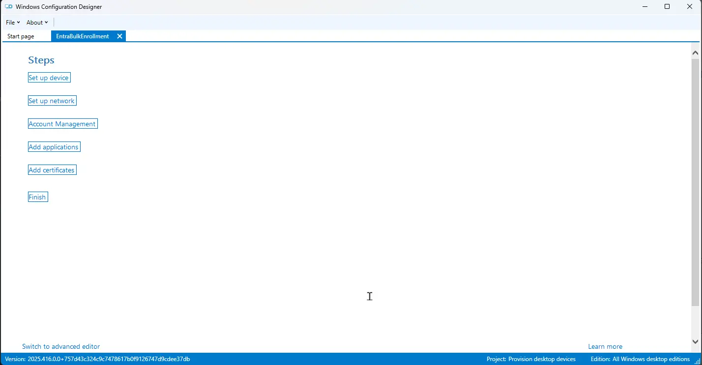
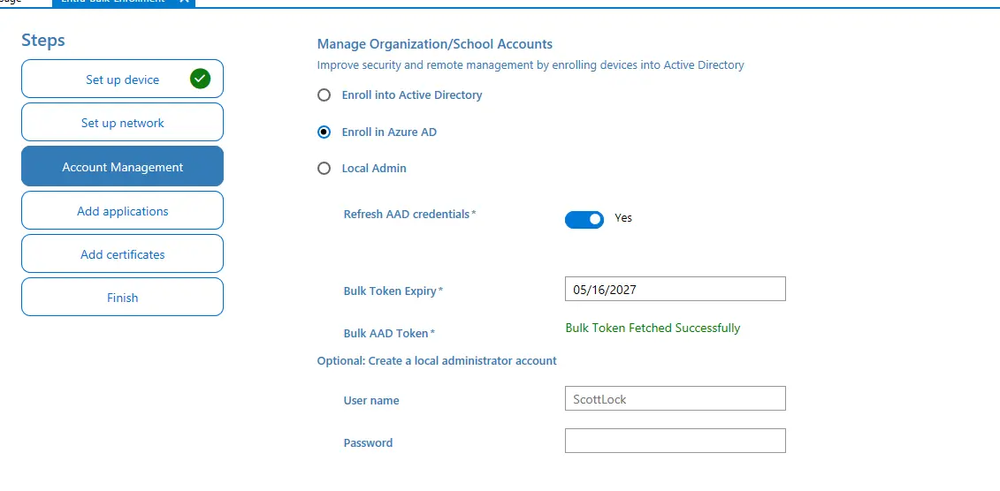

## Purpose

This solution moves Windows workstations from an on-premises Active Directory domain to Microsoft Entra ID, then enrolls them in Microsoft Intune. Every step runs from NinjaOne, so no one needs to visit the computer.

The [Local Machine - Domain - Remove](/docs/1e5fb8ca-bf85-447d-8add-f583af6b64d6) automation removes the computer from its domain. The [Entra Provisioning Package](/docs/0ad6a640-bcd2-4d87-8c7d-ace30dbf7044) file transfer copies an Entra ID bulk enrollment provisioning package (`.ppkg`), created in Windows Configuration Designer, to the computer. The [Join Computer to Entra](/docs/c6612702-1dff-47e5-91b7-9ad4fa237f22) automation applies the package to join the computer to the tenant. Computers that don't enroll in Intune during the join are enrolled with [Intune Enrollment for Entra Joined Devices](/docs/d2a82e06-3756-4c0e-a88c-ef4c80092cca).

**Platform:** `NinjaOne`

### Key Capabilities

- **Fully remote** – The NinjaOne agent doesn't depend on the domain, so the computer stays online and manageable in NinjaOne throughout the migration.
- **One package for many computers** – A single provisioning package joins every computer of a client to its tenant until the package's bulk token expires.
- **Nothing changes until the checks pass** – Before applying the package, the join automation confirms the Windows edition, that the computer has left the domain, that no rename is waiting on a restart and that Entra ID can be reached.
- **Safe to run again** – Domain removal does nothing on a computer that isn't joined to a domain. The join skips a computer that's already Entra joined and reports its tenant.
- **Protects the bulk token** – The join automation deletes its working copy of the package after every run and hides any query string, such as a SAS token, from its output.
- **Intune enrollment fallback** – A computer that didn't enroll in Intune during the join can be enrolled with one automation.

### Important Caveats & Behavior

- **User profiles aren't migrated** – The first Entra ID sign-in creates a new Windows profile. The old domain profile stays on disk under `C:\Users`, but its desktop, documents, browser data and app settings don't appear in the new profile. Move user data with OneDrive Known Folder Move or a profile migration tool before you start.
- **Domain sign-in stops after the first restart** – Once the computer leaves the domain, domain accounts, including cached logons, can't sign in. Users sign in with their Entra ID account, such as `user@contoso.com`, after the join.
- **A local administrator password is required** – Until the join finishes, a local administrator account is the only way to sign in at the computer. If LAPS manages that password in Active Directory, read it before you start, because it isn't updated after the computer leaves the domain.
- **Two restarts per computer** – One after the domain removal and one after the join. Agree a time with the user.
- **Group Policy stops applying** – Drive mappings, printers, security settings and software delivered by Group Policy stop with the domain. Recreate what's needed in Intune before you migrate.
- **Users are standard users** – Entra ID users who sign in to a computer joined with a bulk enrollment package aren't local administrators.
- **Bulk tokens expire** – A bulk token is valid for up to 90 days. After that, the package stops working. Create a new package and upload it to the file transfer.
- **Each package has a device limit** – Every computer joined with the package counts against the **Maximum number of devices per user** setting in Entra ID. When the package account reaches the limit, further joins fail.
- **One package per client tenant** – A package joins computers to the tenant it was created in. For more than one client, create a separate file transfer for each client's package.
- **Computer names are kept** – Entra ID registers the computer under its current name. If a computer needs a new name, rename it and restart before the join.
- **Workstations only** – Windows 10 and Windows 11 Pro, Enterprise and Education. Servers and Home editions can't be joined.
- **The Active Directory computer account is disabled, not deleted** – Delete it once the migrated computer is confirmed working.
- **On-premises resources** – Users whose accounts are synced from Active Directory with Microsoft Entra Connect can still open file shares and other on-premises resources with single sign-on, as long as the computer can reach a domain controller. Users with cloud-only accounts are asked for credentials.

## How It Works

1. Before the migration, a technician creates a bulk enrollment provisioning package in Windows Configuration Designer and uploads it to the [Entra Provisioning Package](/docs/0ad6a640-bcd2-4d87-8c7d-ace30dbf7044) file transfer.
2. [Local Machine - Domain - Remove](/docs/1e5fb8ca-bf85-447d-8add-f583af6b64d6) removes the computer from its domain, moves it to `WORKGROUP`, disables its computer account in Active Directory and restarts it.
3. The [Entra Provisioning Package](/docs/0ad6a640-bcd2-4d87-8c7d-ace30dbf7044) file transfer copies the package to `C:\ProgramData\_automation\script\Entra`.
4. [Join Computer to Entra](/docs/c6612702-1dff-47e5-91b7-9ad4fa237f22) runs its checks, applies the package and waits up to 5 minutes for the join. It deletes its working copy of the package and reports the tenant.
5. The computer is restarted and the user signs in with their Entra ID account. When Windows automatic enrollment is set up, the computer enrolls in Intune on its own.
6. If the computer doesn't appear in Intune, [Intune Enrollment for Entra Joined Devices](/docs/d2a82e06-3756-4c0e-a88c-ef4c80092cca) enrolls it with the signed-in user's Entra ID account.

## Prerequisites

### Licenses

- Microsoft Entra ID P1 or P2, which Windows automatic enrollment in Intune needs. It's included in Microsoft 365 Business Premium, E3 and E5.
- A Microsoft Intune license for every user.

### Microsoft Entra ID

- An Entra ID account for every user, synced from Active Directory or created in the cloud. Each user must know its password.
- In **Devices > Device settings**:
  - **Users may join devices to Microsoft Entra** set to **All**, or to a group you add the package account to after creating the package.
  - **Maximum number of devices per user** set to **Unlimited**, or higher than the number of computers you'll join with one package.
  - **Require Multifactor Authentication to register or join devices with Microsoft Entra** set to **No**.
- No Conditional Access policy requiring multifactor authentication (MFA) applies to the package account. Bulk enrollment doesn't support MFA, so add the package account as an exclusion after you create the package.

### Microsoft Intune

- Windows automatic enrollment turned on, with **MDM user scope** set to **All**, or to **Some** with a group that includes the users and the administrator account that creates the package.
- Windows (MDM) allowed in the **Default** device platform enrollment restriction. Bulk enrollment is userless, so only the default restriction applies.
- The `Microsoft.Azure.SyncFabric` service principal (App ID `00000014-0000-0000-c000-000000000000`) present in the tenant. Without it, Windows Configuration Designer can't create the bulk token.
- Intune configuration profiles, apps and compliance policies ready to replace what Group Policy did.

### Account and Computer to Create the Package

- An Entra ID account with the **Cloud Device Administrator**, **Intune Administrator** or **Password Administrator** role. The role must not be scoped to an administrative unit, and the account must be in the MDM user scope.
- The account signs in with a password or certificate-based authentication. Federated accounts in a staged rollout can't create a bulk token.
- A Windows 10 or Windows 11 computer with [Windows Configuration Designer](https://www.microsoft.com/p/windows-configuration-designer/9nblggh4tx22) installed from the Microsoft Store. Windows Server isn't supported for this task.

### Each Workstation

- Windows 10 or Windows 11 Pro, Enterprise or Education, joined to an Active Directory domain, with the NinjaOne agent online
- Windows PowerShell 5.1
- Network access to a domain controller for the domain removal
- Access on TCP port 443 to `login.microsoftonline.com`, `enterpriseregistration.windows.net` and `enrollment.manage.microsoft.com`
- A domain account allowed to remove computers from the domain
- The password of a local administrator account
- User data backed up or moved to OneDrive, and the BitLocker recovery key saved if BitLocker is on

## Associated Content

### Automations

| Name | Purpose |
|---|---|
| [Local Machine - Domain - Remove](/docs/1e5fb8ca-bf85-447d-8add-f583af6b64d6) | Removes the computer from its Active Directory domain, moves it to `WORKGROUP`, disables its computer account and restarts it when **Restart Computer** is selected. |
| [Join Computer to Entra](/docs/c6612702-1dff-47e5-91b7-9ad4fa237f22) | Checks the computer is ready, applies the provisioning package to join it to Entra ID and deletes its working copy of the package. |
| [Intune Enrollment for Entra Joined Devices](/docs/d2a82e06-3756-4c0e-a88c-ef4c80092cca) | Enrolls an Entra joined computer in Intune when it didn't enroll during the join. Needs a user signed in with an Entra ID account. |

### File Transfer

| Name | Purpose |
|---|---|
| [Entra Provisioning Package](/docs/0ad6a640-bcd2-4d87-8c7d-ace30dbf7044) | Copies the uploaded bulk enrollment provisioning package to `C:\ProgramData\_automation\script\Entra` for the join automation. |

## Implementation

Complete these steps once for each client. Then migrate each computer as described in [Migrate a Computer](#migrate-a-computer).

### Step 1: Prepare Microsoft Entra ID and Intune

Check every item under [Prerequisites](#prerequisites) in the client's tenant. Pay particular attention to the device settings, the MDM user scope and the default enrollment restriction, as these cause most join and enrollment failures.

### Step 2: Create the Provisioning Package

Create the package in Windows Configuration Designer, on the computer described in [Account and Computer to Create the Package](#account-and-computer-to-create-the-package).

1. Open **Windows Configuration Designer** and select **Provision desktop devices**.
2. Enter `EntraBulkEnrollment` as the **Name**. The package file takes this name. Choose a **Project folder** in a secure location, then select **Finish**.

3. On **Set up device**, use these values:

    | Setting | Value | Why |
    |---|---|---|
    | **Device name** | Leave empty | Each computer keeps its current name. A name here renames every computer the package is applied to. |
    | **Enter product key** | Leave empty | The computers already run a supported edition. |
    | **Configure devices for shared use** | **No** | **Yes** turns on shared PC mode. |
    | **Remove pre-installed software** | **No** | **Yes** removes software already installed on the computers. |

4. On **Set up network**, leave **Set up network** set to **Off**. The computers already have a network connection.
5. On **Account Management**, select **Enroll in Azure AD**.
6. Enable **Refresh AAD Credentials**, it will ask to join to your EntraID credentials. Fill in the credentials.
6. Set **Bulk Token Expiry** to a date that covers the migration, up to 90 days ahead.
7. Select **Get Bulk Token** and sign in with the administrator account, using its password or a certificate.

8. On **Stay signed in to all your apps**, select **No, sign in to this app only**. Otherwise, the computer you're using becomes managed by the client's organization.
9. When the page shows that the bulk token was fetched successfully, select **Next**.
10. On **Add applications** and **Add certificates**, add nothing and select **Next**.
11. On **Finish**, set **Protect your package** to **No**. The automation applies the package without user interaction, so it can't enter a password.
12. Select **Create**. When the package is built, select the link at the bottom of the page to open its folder. You only need `EntraBulkEnrollment.ppkg`.

:::warning
Windows Configuration Designer doesn't encrypt its project files, and the package contains the bulk token. Keep the project folder and the `.ppkg` file somewhere secure, and delete them when the migration is finished.
:::

### Step 3: Create the Automations

Create the three automations and set each to run as `System`.

- [Automation: Local Machine - Domain - Remove](/docs/1e5fb8ca-bf85-447d-8add-f583af6b64d6)
- [Automation: Join Computer to Entra](/docs/c6612702-1dff-47e5-91b7-9ad4fa237f22)
- [Automation: Intune Enrollment for Entra Joined Devices](/docs/d2a82e06-3756-4c0e-a88c-ef4c80092cca)

### Step 4: Create the File Transfer

Create the file transfer and upload `EntraBulkEnrollment.ppkg` from Step 2. For more than one client, create one file transfer per client, such as `Entra Provisioning Package - Contoso`, each with that client's package. When a token expires, upload the new package to the same file transfer.

- [File Transfer: Entra Provisioning Package](/docs/0ad6a640-bcd2-4d87-8c7d-ace30dbf7044)

## Migrate a Computer

Follow these steps for each computer. Migrate one test computer first, and confirm each step before moving on to the rest.

### Step 1: Prepare the Computer

- Agree a time with the user. The computer restarts twice, and the user's apps and settings need to be set up again in the new profile.
- Confirm the user's files are backed up or synced to OneDrive.
- Save the BitLocker recovery key if BitLocker is on.
- Confirm you can sign in with a local administrator account.
- Confirm the user can sign in to Microsoft 365 with their Entra ID account.
- If the computer needs a new name, rename it and restart now.

### Step 2: Remove the Computer from the Domain

Run the automation with a domain account that's allowed to remove computers, and select **Restart Computer**. Wait for the computer to come back online in NinjaOne.

- [Automation: Local Machine - Domain - Remove](/docs/1e5fb8ca-bf85-447d-8add-f583af6b64d6)

### Step 3: Copy the Provisioning Package

Run the file transfer on the computer. It places the package in `C:\ProgramData\_automation\script\Entra`.

- [File Transfer: Entra Provisioning Package](/docs/0ad6a640-bcd2-4d87-8c7d-ace30dbf7044)

### Step 4: Join the Computer to Entra ID

Run the automation with **Entra Provisioning Package Path** set to `C:\ProgramData\_automation\script\Entra\EntraBulkEnrollment.ppkg`. Activity Details should end with `Success: <computer> is joined to Microsoft Entra ID tenant '<tenant>'`.

- [Automation: Join Computer to Entra](/docs/c6612702-1dff-47e5-91b7-9ad4fa237f22)

### Step 5: Restart and Sign In with Entra ID

Restart the computer. At the sign-in screen, the user selects **Other user** and signs in with their Entra ID account, such as `user@contoso.com`. The first sign-in builds a new profile and can take a few minutes.

### Step 6: Confirm Intune Enrollment

Allow up to 15 minutes, then look for the computer in the Intune admin center under **Devices > Windows**. If it isn't there, run the automation while the user is signed in, and check the `Success:` or `Failure:` line in Activity Details. Restart the computer if it still doesn't appear after another 15 minutes.

- [Automation: Intune Enrollment for Entra Joined Devices](/docs/d2a82e06-3756-4c0e-a88c-ef4c80092cca)

You'll know it worked when `dsregcmd /status` on the computer shows `AzureAdJoined : YES` and `DomainJoined : NO`, the user signs in with their Entra ID account, and the computer appears in the Intune admin center under **Devices > Windows**.

## FAQ

### Q: Windows Configuration Designer shows an error when I select Get Bulk Token. What should I check?

> - The account has the **Cloud Device Administrator**, **Intune Administrator** or **Password Administrator** role, not scoped to an administrative unit.
> - The account is in the Intune MDM user scope.
> - The account signs in with a password or a certificate, and isn't a federated account in a staged rollout.
> - The `Microsoft.Azure.SyncFabric` service principal exists in the tenant.

### Q: The join automation fails with "The computer is still joined to the domain". Why?

> The domain removal hasn't taken effect yet. Check that [Local Machine - Domain - Remove](/docs/1e5fb8ca-bf85-447d-8add-f583af6b64d6) succeeded, restart the computer, and run the join again.

### Q: The join automation fails because a rename is waiting on a restart. What should I do?

> Restart the computer, then run the join again. Entra ID registers the computer under its current name, so the rename must finish first.

### Q: The package was applied, but the computer didn't report as Entra joined within 5 minutes. What should I check?

> - The bulk token hasn't expired and the `package_` account hasn't been deleted.
> - The package account isn't blocked by a Conditional Access policy that requires MFA.
> - **Users may join devices to Microsoft Entra** includes the package account.
> - The package account hasn't reached the **Maximum number of devices per user** limit.
>
> The failure message gives the path of the provisioning logs. In Event Viewer, the **Provisioning-Diagnostics-Provider** Admin log also shows which settings in the package failed.

### Q: The Intune automation says "Device is already enrolled in Intune", but the computer isn't in Intune. Why?

> The automation decides this from the MDM auto-enrollment policy on the computer, which an earlier attempt can leave behind even if it didn't finish. Check the MDM user scope, the user's Intune license and the default enrollment restriction. On the computer, **Settings > Accounts > Access work or school** shows the Entra ID connection and whether it's managed.

### Q: Where are the user's old files?

> They're still in the old profile folder under `C:\Users`, usually with the user's domain logon name. Copy what the user needs into the new profile, or let OneDrive restore the folders it synced.

### Q: The bulk token expired before the migration finished. What now?

> Create a new package as described in [Create the Provisioning Package](#step-2-create-the-provisioning-package), and upload it to the file transfer in place of the old one. Computers already joined aren't affected.

### Q: How do I stop the package from working before it expires?

> Delete the `package_` account from Entra ID. The package can't join any more computers after that.

### Q: Can users still open file shares on the old servers?

> Yes, if their Entra ID account is synced from Active Directory with Microsoft Entra Connect and the computer can reach a domain controller. Users with cloud-only accounts are asked for credentials.

### Q: How do I give a user local administrator rights on a migrated computer?

> Users joined with a bulk enrollment package are standard users. Grant rights through Intune, or give the user the **Microsoft Entra Joined Device Local Administrator** role in Entra ID, which applies to every Entra joined computer in the tenant.

## Changelog

### 2026-11-17

- Initial version of the document
