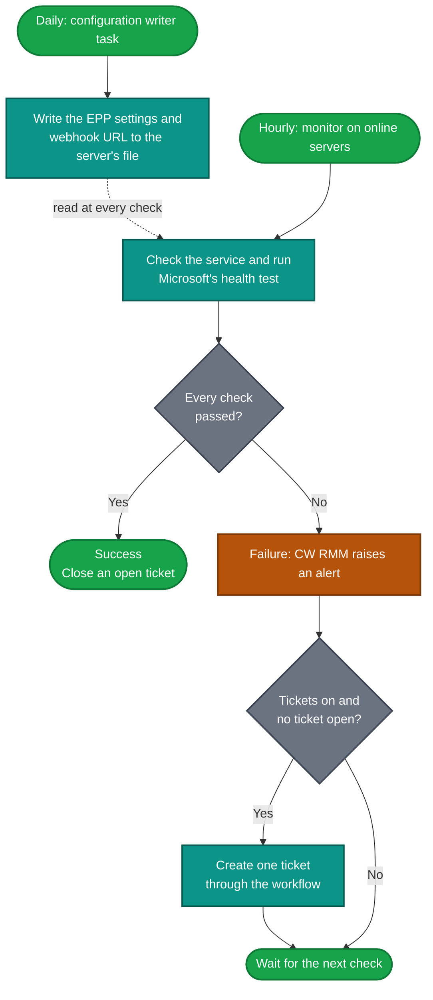

## Purpose

The **Entra Password Protection Proxy Health** solution checks the health of Entra Password Protection Proxy servers every hour, so a broken proxy is found before domain controllers stop receiving updated password policies. It checks that the proxy service is running, and runs Microsoft's own health test for the server's TLS configuration, the proxy's registration with Entra ID and its connection to Azure.

A failure raises an alert in CW RMM. When tickets are turned on, the solution also creates one ticket per incident through the [CWRMM Ticket Management for Monitors](/docs/57daa951-2acc-4be7-a025-0d0ca729ef57) workflow, and closes it once the proxy is healthy again. Monitoring and tickets are turned on in custom fields for the whole portal, a company, a site or a single server.

**Platform:** `ConnectWise RMM`

### Key Capabilities

- **Proxy Servers Only** – The [Entra Password Protection Proxy Health](/docs/c114a048-e3f7-4fdf-8cb5-047311bdb66c) group only takes Windows devices that have the proxy installed, so turning monitoring on for a whole company doesn't add its other devices.
- **Microsoft's Health Test** – Uses `Test-AzureADPasswordProtectionProxyHealth -TestAll`, which comes with the proxy, plus a check that the proxy service is running.
- **Settings at Every Level** – Company, site and endpoint fields, with the most specific value winning.
- **One Ticket per Incident** – A failing proxy gets one ticket, however many hourly checks fail. The ticket lists every failed check.
- **Automatic Ticket Closing** – The ticket closes once every check passes again.
- **Tickets Are Optional** – Without tickets, failures still raise an alert in CW RMM.

### Important Caveats & Behavior

- **Proxy Only** – The solution checks the proxy servers. It doesn't check the Entra Password Protection DC agent on domain controllers.
- **Software Inventory** – The group finds proxy servers through CW RMM's installed software inventory. A newly installed proxy joins the group once the inventory shows it.
- **Daily Settings Refresh** – A CW RMM monitor can't read custom fields, so the [Entra Password Protection Proxy Monitoring Configuration Writer](/docs/af137ce1-f349-4067-ae66-aebfaf5e08bd) task writes the settings to a file on the server once a day, and the monitor reads that file. A change to the custom fields reaches the monitor at the next daily run. Run the task on the server to apply it straight away.
- **No Configuration File Yet** – Until the task has run on a server, the monitor still checks it, but doesn't create tickets.
- **Turning Monitoring Off** – A server taken out of scope leaves the group, so the monitor stops checking it. Close any ticket that's still open for it by hand.
- **Ticketing Install Order** – The ticket workflow calls a custom bot, so the bot must be installed and published **before** the workflow is imported. A workflow that references a bot that doesn't exist in the environment can't be saved.
- **Workflow Account** – The ticket workflow runs under the account that created it. That account needs access to every server, or tickets silently fail for the servers it can't see.

## How It Works

1. Once a day, the [Entra Password Protection Proxy Monitoring Configuration Writer](/docs/af137ce1-f349-4067-ae66-aebfaf5e08bd) task runs on every server in the group. It reads the EPP fields, endpoint then site then company, and the ticket webhook URL, and writes them to a configuration file on the server.
2. Every hour, the [Entra Password Protection Proxy Health](/docs/de5d3a2a-085c-4150-8469-a9efdea0b3c2) monitor runs on the online servers in the group. It checks that the proxy service is running and runs Microsoft's health test.
3. When every check passes, the monitor returns `Success`. A ticket that's still open is closed.
4. When a check fails, the monitor returns `Failure:` with the failed checks, and CW RMM raises an alert.
5. When tickets are turned on in the configuration file and no ticket is open for the server, the monitor sends a `Create` request to the workflow, which raises the ticket with the server attached. Later failures of the same incident don't create more tickets.

## Prerequisites

- Entra Password Protection Proxy servers with the CW RMM agent installed. The proxy installs the AzureADPasswordProtection PowerShell module that the health test needs.
- Internet access from the proxy servers to Azure, and to the ticket webhook for tickets.
- For tickets: the [CWRMM Ticket Management for Monitors](/docs/57daa951-2acc-4be7-a025-0d0ca729ef57) workflow with its bot and form, the webhook URL of its trigger, and a CW RMM account with access to every server to create the workflow.

## Associated Content

### Custom Fields: Monitoring

These fields turn monitoring on or off. Leave the site and endpoint fields empty to use the level above.

| Name | Level | Type | Purpose |
|---|---|---|---|
| [EPP_Monitoring](/docs/bec78a0c-3524-45c2-8229-46daadacb5e6) | Company | Dropdown | Turns proxy health monitoring on or off for the company. Its default value is the portal-wide default. |
| [EPP_Monitoring_Site](/docs/f0aac000-1eb0-4f95-bf9a-d3d4b453e870) | Site | Dropdown | Overrides EPP_Monitoring for one site. |
| [EPP_Monitoring_Endpoint](/docs/4e7effaa-04ba-4d39-b386-db53b8a22d13) | Endpoint | Dropdown | Overrides EPP_Monitoring for a single server. |

### Custom Fields: Ticketing

Only needed for tickets.

| Name | Level | Type | Purpose |
|---|---|---|---|
| [EPP_Ticket](/docs/e39d54a4-ed93-4782-9ab1-81399a71ba15) | Company | Dropdown | Creates a ticket when a health check fails. Defaults to `Disabled`. |
| [EPP_Ticket_Site](/docs/96899194-d7e8-4302-aa6a-110ecc1b8cb9) | Site | Dropdown | Overrides EPP_Ticket for one site. |
| [EPP_Ticket_Endpoint](/docs/d80dd799-f481-4ae4-9a8f-85ef90dbe7c0) | Endpoint | Dropdown | Overrides tickets for a single server. |
| [Ticket_Mgmt_Webhook_Url](/docs/8e55deb6-bef8-4501-9e64-7b25e7fcd1ab) | Company | Text Box | The webhook URL of the ticket workflow, entered as the field's default value. Shared with other ProVal solutions that use the workflow. |

### Group

| Name | Type | Purpose |
|---|---|---|
| [Entra Password Protection Proxy Health](/docs/c114a048-e3f7-4fdf-8cb5-047311bdb66c) | Dynamic Group | Windows servers with the proxy installed, where monitoring is turned on through the EPP_Monitoring fields. |

### Task

| Name | Purpose |
|---|---|
| [Entra Password Protection Proxy Monitoring Configuration Writer](/docs/af137ce1-f349-4067-ae66-aebfaf5e08bd) | Writes the EPP settings and the webhook URL to the server's configuration file. Scheduled once a day against the group. |

### Monitor

| Name | Type | Purpose |
|---|---|---|
| [Entra Password Protection Proxy Health](/docs/de5d3a2a-085c-4150-8469-a9efdea0b3c2) | Script | Checks the proxy's health every hour. Alerts on a failure, and creates and closes tickets when they're turned on. |

### Trigger (Ticketing only)

| Name | Purpose |
|---|---|
| [CWRMM Ticket Management for Monitors](/docs/05c811e6-c6d0-4652-b4b6-2aa83f9605c7) | Webhook trigger that receives the monitor's `Create` and `Close` requests and starts the ticket workflow. |

### Workflow (Ticketing only)

| Name | Trigger | Purpose |
|---|---|---|
| [CWRMM Ticket Management for Monitors](/docs/57daa951-2acc-4be7-a025-0d0ca729ef57) | Webhook, [CWRMM Ticket Management for Monitors](/docs/05c811e6-c6d0-4652-b4b6-2aa83f9605c7) | Creates and closes the tickets. New tickets are raised by the bot, so the server is attached to them. |

### Bot (Ticketing only)

| Name | Purpose |
|---|---|
| [Create ticket with associated device](/docs/cf8a2c3d-456c-4567-8039-97e89f894ac5) | Raises the ticket with the server attached. Must be installed and published **before** the workflow is imported. |

### Form (Ticketing only)

| Name | Purpose |
|---|---|
| [Create ticket with associated device](/docs/8d147440-f887-4c21-8fc8-fb93c0d54c29) | The bot's input form. Installing the bot brings it in. |

## Implementation

Follow these steps in order. Step 4 is only needed for tickets.

### Step 1: Install the Custom Fields

Install the 6 custom fields from the `ProVal - Content` Community, selecting the **Custom Fields** repository.

- [Custom Field: EPP_Monitoring](/docs/bec78a0c-3524-45c2-8229-46daadacb5e6)
- [Custom Field: EPP_Monitoring_Site](/docs/f0aac000-1eb0-4f95-bf9a-d3d4b453e870)
- [Custom Field: EPP_Monitoring_Endpoint](/docs/4e7effaa-04ba-4d39-b386-db53b8a22d13)
- [Custom Field: EPP_Ticket](/docs/e39d54a4-ed93-4782-9ab1-81399a71ba15)
- [Custom Field: EPP_Ticket_Site](/docs/96899194-d7e8-4302-aa6a-110ecc1b8cb9)
- [Custom Field: EPP_Ticket_Endpoint](/docs/d80dd799-f481-4ae4-9a8f-85ef90dbe7c0)

### Step 2: Install the Group

Install the group from the `ProVal - Content` Community, selecting the **Groups** repository.

- [Group: Entra Password Protection Proxy Health](/docs/c114a048-e3f7-4fdf-8cb5-047311bdb66c)

### Step 3: Create and Schedule the Task

Create the task by hand, then schedule it to run once a day against the [Entra Password Protection Proxy Health](/docs/c114a048-e3f7-4fdf-8cb5-047311bdb66c) group, as described in its document.

- [Task: Entra Password Protection Proxy Monitoring Configuration Writer](/docs/af137ce1-f349-4067-ae66-aebfaf5e08bd)

### Step 4 (Optional): Set Up Ticketing

Skip this step if you don't want tickets. If the ticket content is already installed for another ProVal solution, such as [Enhanced Drive Space Monitoring](/docs/e9cf4ff0-4413-447b-97dd-b8b2abd59597), only check that [Ticket_Mgmt_Webhook_Url](/docs/8e55deb6-bef8-4501-9e64-7b25e7fcd1ab) holds the real webhook URL.

1. Install the [Create ticket with associated device](/docs/cf8a2c3d-456c-4567-8039-97e89f894ac5) bot from the `ProVal - Content` Community, selecting the **Bots** repository, then **publish the bot**. Installing the bot brings its [Create ticket with associated device](/docs/8d147440-f887-4c21-8fc8-fb93c0d54c29) form in with it.
2. Install the [CWRMM Ticket Management for Monitors](/docs/57daa951-2acc-4be7-a025-0d0ca729ef57) workflow from the `ProVal - Content` Community, signed in with an account that has access to every server. This also installs the [CWRMM Ticket Management for Monitors](/docs/05c811e6-c6d0-4652-b4b6-2aa83f9605c7) trigger.
3. In the workflow's **Trigger** node, create a webhook instance named `CWRMM Ticket Management for Monitors` and copy the URL it generates.
4. Install the [Ticket_Mgmt_Webhook_Url](/docs/8e55deb6-bef8-4501-9e64-7b25e7fcd1ab) custom field from the **Custom Fields** repository if it isn't there yet, and set the URL as its **Default Value**.
5. Open the **Bot** node on the workflow's `toCreate` branch and set **ServiceBoard**, **Priority** and **Team** to match your environment.

### Step 5: Install the Monitor

Install the monitor from the `ProVal - Content` Community, selecting the **Monitors** repository.

- [Monitor: Entra Password Protection Proxy Health](/docs/de5d3a2a-085c-4150-8469-a9efdea0b3c2)

### Step 6: Try It on One Server

1. Set [EPP_Monitoring_Endpoint](/docs/4e7effaa-04ba-4d39-b386-db53b8a22d13) to `Enabled` on one proxy server. For tickets, also set [EPP_Ticket_Endpoint](/docs/d80dd799-f481-4ae4-9a8f-85ef90dbe7c0) to `Enabled`.
2. Once the server shows in the [Entra Password Protection Proxy Health](/docs/c114a048-e3f7-4fdf-8cb5-047311bdb66c) group, run the [Entra Password Protection Proxy Monitoring Configuration Writer](/docs/af137ce1-f349-4067-ae66-aebfaf5e08bd) task on it, and check its Script Log.
3. Wait for the monitor's next check, and check that its output starts with `Success`.
4. To test tickets, stop the `AzureADPasswordProtectionProxy` service at a time when a short outage is acceptable. After the next check, a ticket is created. Start the service again, and the ticket closes at the check after that.

You'll know it worked when the monitor reports `Success` for a healthy proxy, and a stopped service creates one ticket that closes on its own.

### Step 7: Turn Monitoring On

Set [EPP_Monitoring](/docs/bec78a0c-3524-45c2-8229-46daadacb5e6) to `Enabled` on the companies to monitor, and [EPP_Ticket](/docs/e39d54a4-ed93-4782-9ab1-81399a71ba15) to `Enabled` on those that should get tickets. To turn either on for every company at once, change its default value under **SETTINGS** ➞ **Custom Fields**.

## FAQ

### Q: How do I try the solution on one server first?

> Set [EPP_Monitoring_Endpoint](/docs/4e7effaa-04ba-4d39-b386-db53b8a22d13) to `Enabled` on a proxy server and run the [Entra Password Protection Proxy Monitoring Configuration Writer](/docs/af137ce1-f349-4067-ae66-aebfaf5e08bd) task on it. See [Step 6](#step-6-try-it-on-one-server).

### Q: Which servers are monitored?

> Windows devices that have the Entra Password Protection Proxy installed, and where EPP_Monitoring is `Enabled` at the level that applies to them. Other devices of the same company stay out of the group.

### Q: What does the health check test?

> That the `AzureADPasswordProtectionProxy` service is running, and the three diagnostics of Microsoft's health test: the server's TLS configuration, the proxy's registration with Entra ID, and its connection to Azure.

### Q: A failed check came in. What should I do?

> The ticket and the monitor's output list each failed check. The [Ticketing](/docs/de5d3a2a-085c-4150-8469-a9efdea0b3c2#ticketing) section of the monitor's document explains what to do about each one.

### Q: Will I get a ticket every hour while the proxy is down?

> No. One ticket is created per incident, and it's closed once every check passes again. Later failures of the same incident don't create more tickets.

### Q: I changed EPP_Ticket. When does it take effect?

> At the next daily run of the [Entra Password Protection Proxy Monitoring Configuration Writer](/docs/af137ce1-f349-4067-ae66-aebfaf5e08bd) task. Run the task on the server to apply it straight away.

### Q: Does turning monitoring off close an open ticket?

> No. The server leaves the group, so the monitor stops checking it. Close the ticket by hand.

### Q: Does it monitor the DC agent on domain controllers?

> No. The solution checks the proxy servers only.

### Q: A proxy server isn't in the group. What should I check?

> Work through this list:
>
> 1. The server's installed software in CW RMM lists the proxy. The group looks for a name that contains `Password Protection Proxy`.
> 2. EPP_Monitoring is `Enabled` at the level that applies to the server, and no lower level sets it to `Disabled`.
> 3. The server runs Windows.

### Q: Tickets aren't being created. What should I check?

> Work through this list:
>
> 1. The monitor's output starts with `Failure:`. Tickets are only created for failures, and only one per server while it's open.
> 2. [EPP_Ticket](/docs/e39d54a4-ed93-4782-9ab1-81399a71ba15) is `Enabled` at the level that applies to the server.
> 3. [Ticket_Mgmt_Webhook_Url](/docs/8e55deb6-bef8-4501-9e64-7b25e7fcd1ab) has the real webhook URL as its default value, not the placeholder.
> 4. The [Entra Password Protection Proxy Monitoring Configuration Writer](/docs/af137ce1-f349-4067-ae66-aebfaf5e08bd) task has run since then. In the configuration file, `Ticket` is `Enabled` and `TicketWebhookUrl` holds the URL.
> 5. The [CWRMM Ticket Management for Monitors](/docs/57daa951-2acc-4be7-a025-0d0ca729ef57) workflow is published, and its bot node has **ServiceBoard**, **Priority** and **Team** set.
> 6. The account that created the workflow has access to the server.
> 7. The monitor's output for the check. A ticket request that didn't go through is logged there, and retried at the next check.

## Changelog

### 2026-11-27

- Initial version of the document
