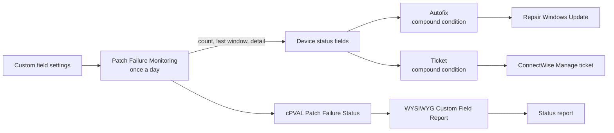
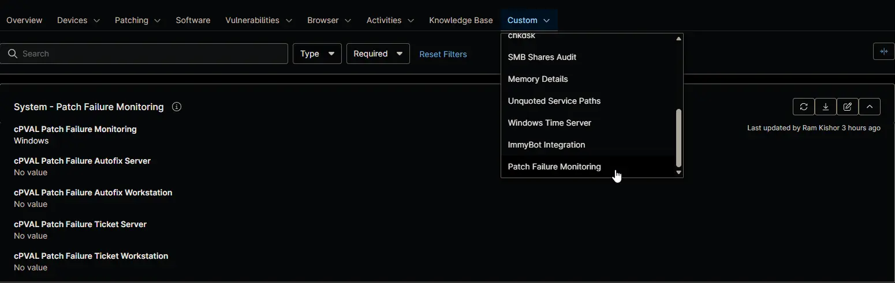
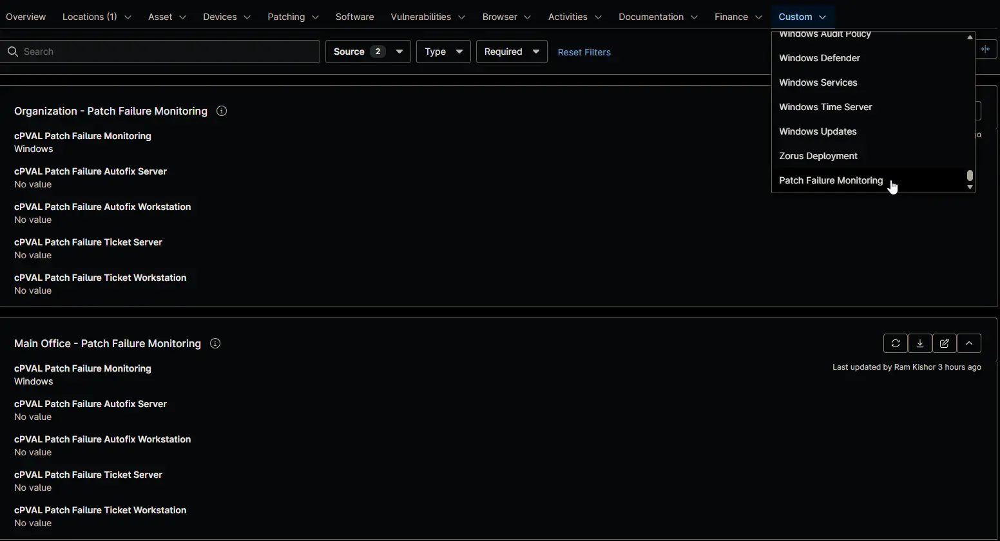
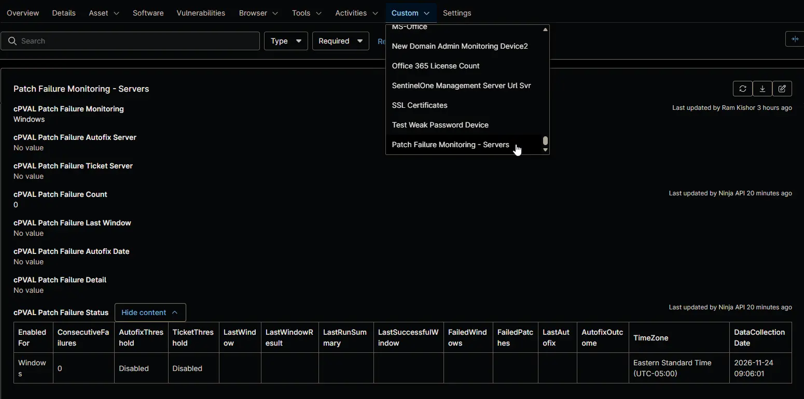
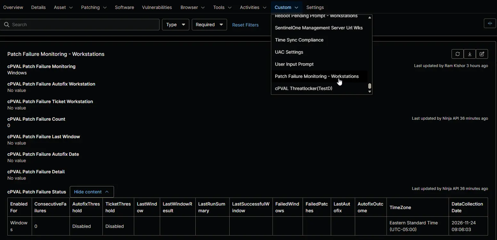
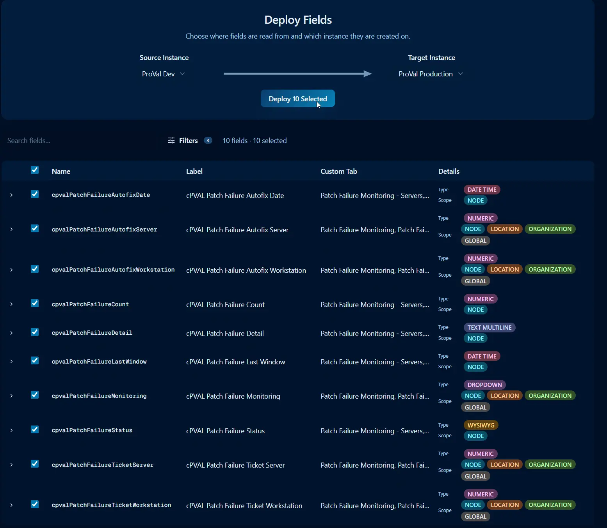

## Purpose

Patch Failure Monitoring watches the Windows patching that NinjaOne runs on workstations and servers, and acts when it keeps failing on the same device. It counts the patch windows in a row in which at least one update with a KB number failed. When the count reaches a threshold you set, it runs [Repair Windows Update](/docs/d7bb77e6-e7b8-45d2-9fa7-f109574aa887) on the device to reset Windows Update. If patching still fails at a higher threshold, it opens a ConnectWise Manage ticket that lists the failed updates and when the repair ran.

The [Patch Failure Monitoring](/docs/ffc02ba6-8c07-4075-9844-2e7327723023) scheduled task runs on one device once a day. Its first automation, [Patch Failure Monitoring](/docs/28302386-1560-4468-be5c-c9d683b99e65), reads the NinjaOne patch activity of every monitored device through the NinjaOne API, works out which patch windows failed, and records the count and the failed updates on each device. Compound conditions on each device compare the count with the thresholds, then run the repair or open the ticket. The task's second automation turns the status of every device into a report per client and for all clients.

**Platform:** `NinjaOne`

### Key Capabilities

- **Consecutive failure count** – Counts the patch windows in a row that failed and resets to 0 after a successful one, so a single bad night doesn't look like a broken device.
- **Automatic repair** – Runs [Repair Windows Update](/docs/d7bb77e6-e7b8-45d2-9fa7-f109574aa887) once per failed window when the count reaches the autofix threshold.
- **Tickets with detail** – Opens a ConnectWise Manage ticket at the ticket threshold, listing every failed window, the KB number and name of each failed update, and when the repair ran.
- **Automatic close** – The ticket closes when a later patch window succeeds.
- **Inherited settings** – Set everything once at the system level, and change it for a client, location or device where needed. The most specific value wins.
- **Separate server and workstation thresholds** – Servers and workstations each have their own autofix and ticket thresholds, and can be monitored separately.
- **Cross-client report** – A Knowledge Base article or CSV file per client and for all clients, with the count, thresholds, latest patch window and repair outcome of every monitored device.

### Important Caveats & Behavior

- **Only NinjaOne patching counts** – Only OS patch runs started by NinjaOne, scheduled or started by a technician, are counted. Updates installed by Windows Update itself, by a user or by another tool are ignored.
- **Only updates with a KB number count** – Drivers and other updates without a KB number never fail a patch window.
- **Counting starts with the solution** – The first run looks back 24 hours only. Failures from before the solution was set up never trigger a repair or a ticket.
- **Once a day** – The count is updated once a day, when the scheduled task runs. The repair and the ticket follow within about an hour of that run.
- **A patch window is 23 hours** – Patch runs that start within 23 hours of the first run of a window count as one window, so a retry on the same day isn't counted twice.
- **The repair runs without options** – [Repair Windows Update](/docs/d7bb77e6-e7b8-45d2-9fa7-f109574aa887) resets the Windows Update components and scans for updates again. It doesn't run SFC or DISM and doesn't restart the device.
- **The repair always comes first** – A ticket threshold equal to or lower than the autofix threshold is treated as the autofix threshold + 1, so the repair runs before a ticket is created.
- **Times show their time zone** – Patch windows, the status field and the report use the time zone of the primary machine that runs [Patch Failure Monitoring](/docs/28302386-1560-4468-be5c-c9d683b99e65). The repair time in a ticket uses the device's own time zone. Every time is shown with its time zone.
- **Windows only** – Macs and Linux devices are not monitored.

## How It Works

1. **Settings:** a technician sets [cPVAL Patch Failure Monitoring](/docs/b3797751-cb85-4d82-b943-3bde379d6481) and the autofix and ticket thresholds at the system, organization, location or device level.
2. **Count:** once a day, the [Patch Failure Monitoring](/docs/ffc02ba6-8c07-4075-9844-2e7327723023) scheduled task runs [Patch Failure Monitoring](/docs/28302386-1560-4468-be5c-c9d683b99e65), which reads the patch activity of every monitored device. It groups the patch runs into windows, decides whether each window failed, and writes the count to [cPVAL Patch Failure Count](/docs/02b8e35f-c8dd-4685-a00b-412fd0112c7c), the start of the latest failed window to [cPVAL Patch Failure Last Window](/docs/5b700551-2f69-4ac2-9489-bfa279c8d7ac) and the failed updates to [cPVAL Patch Failure Detail](/docs/b23a6da2-148f-4649-9233-c02170b5e72f). A successful window resets the count to 0 and clears the other two fields.
3. **Repair:** every hour, the Autofix compound conditions run [Patch Failure Monitoring - Detection](/docs/97aa8bfb-f376-4acf-8241-782c364d3d18) on devices with a failed window. When the count has reached the autofix threshold but not the ticket threshold, the detection script records the time in [cPVAL Patch Failure Autofix Date](/docs/6a454795-0de4-40c9-ab25-d016b42ccd7a), and the compound condition runs [Repair Windows Update](/docs/d7bb77e6-e7b8-45d2-9fa7-f109574aa887). It runs once per failed window.
4. **Ticket (optional):** every hour, the Ticket compound conditions run the same detection script. When the count reaches the ticket threshold, they open a ConnectWise Manage ticket with the [Consecutive Patch Failures](/docs/d5aaffa6-061b-4349-86f3-cf30b9a3cd14) template. The ticket lists the failed windows and updates and when the repair ran, and it closes when a later patch window succeeds.
5. **Report:** the same scheduled task then runs [WYSIWYG Custom Field Report - Organization and Global KB](/docs/67df14cd-3c20-4a40-bb7a-80caae242687), which publishes [cPVAL Patch Failure Status](/docs/6d0d7b7c-f71d-4db9-9767-e3b7cd4846cd) as the [Patch Failure Monitoring Status](/docs/e475c21b-05a9-40a5-bea2-efd7e0515930) report.

### Example

With the autofix threshold at `1` and the ticket threshold at `2`, a server that patches every Monday goes through these steps:

| Patch Window | Result | Count | What Happens |
| ------------ | ------ | ----- | ------------ |
| Week 1 | Failed | `1` | [Repair Windows Update](/docs/d7bb77e6-e7b8-45d2-9fa7-f109574aa887) runs on the server within about an hour of the next run of the scheduled task. |
| Week 2 | Failed | `2` | A ticket is created. It lists both failed windows and their updates, and says when the repair ran. |
| Week 3 | Succeeded | `0` | The count resets and the ticket closes. |

## Prerequisites

- An API application with the **Client Credentials** grant type and the **Monitoring** and **Management** scopes, with its credentials in [cPVAL Ninja API Client ID](/docs/32142af2-d352-4d0d-9ec3-9dae0a5fef88) and [cPVAL Ninja API Client Secret](/docs/58b01634-4e1a-4793-aafd-18526ea8c80e). The application created for [WYSIWYG Custom Field Report - Organization and Global KB](/docs/67df14cd-3c20-4a40-bb7a-80caae242687) can be reused.
- One Windows device that's always online, such as a server, to run the two scheduled automations.
- NinjaOne OS patch management on the monitored devices. Only patching run by NinjaOne is counted.
- The [Repair Windows Update](/docs/d7bb77e6-e7b8-45d2-9fa7-f109574aa887) automation, for the repair.
- The NinjaOne Documentation app, for the report as Knowledge Base articles. Without it, the report is saved as CSV files.
- ConnectWise Manage connected to NinjaOne, for tickets only.

## Associated Content

### Custom Fields: Settings

Set these at the system, organization, location or device level. They appear on the **Patch Failure Monitoring** tab of the system, organizations and locations. On devices, the **Patch Failure Monitoring - Servers** tab shows the server thresholds and the **Patch Failure Monitoring - Workstations** tab shows the workstation thresholds.

| Name | Level | Type | Purpose |
|---|---|---|---|
| [cPVAL Patch Failure Monitoring](/docs/b3797751-cb85-4d82-b943-3bde379d6481) | System, Organization, Location, Device | Drop-down | Which Windows devices are monitored: `Windows`, `Windows Workstations`, `Windows Servers` or `Disabled`. |
| [cPVAL Patch Failure Autofix Server](/docs/62bf3875-c734-48e8-b518-b53373a9137e) | System, Organization, Location, Device | Integer | Consecutive failed patch windows at which servers get the repair. |
| [cPVAL Patch Failure Autofix Workstation](/docs/04f87a60-2857-4253-bca8-f4addd2f71fe) | System, Organization, Location, Device | Integer | Consecutive failed patch windows at which workstations get the repair. |
| [cPVAL Patch Failure Ticket Server](/docs/3c54b72d-8fb2-49bd-a2a2-5c6b08833b12) | System, Organization, Location, Device | Integer | Consecutive failed patch windows at which a ticket is created for servers. |
| [cPVAL Patch Failure Ticket Workstation](/docs/4e93e558-3a43-4d58-b60b-e6391fb79e46) | System, Organization, Location, Device | Integer | Consecutive failed patch windows at which a ticket is created for workstations. |

### Custom Fields: Status

Written by the solution on each monitored device. They appear on both device tabs.

| Name | Level | Type | Purpose |
|---|---|---|---|
| [cPVAL Patch Failure Count](/docs/02b8e35f-c8dd-4685-a00b-412fd0112c7c) | Device | Integer | The number of consecutive failed patch windows. Read by the compound conditions. |
| [cPVAL Patch Failure Last Window](/docs/5b700551-2f69-4ac2-9489-bfa279c8d7ac) | Device | Date/Time | The start of the latest failed patch window. Read by the compound conditions. |
| [cPVAL Patch Failure Autofix Date](/docs/6a454795-0de4-40c9-ab25-d016b42ccd7a) | Device | Date/Time | When the repair was last requested. |
| [cPVAL Patch Failure Detail](/docs/b23a6da2-148f-4649-9233-c02170b5e72f) | Device | Multi-line | The failed patch windows and the KB number and name of each failed update. Added to the ticket. |
| [cPVAL Patch Failure Status](/docs/6d0d7b7c-f71d-4db9-9767-e3b7cd4846cd) | Device | WYSIWYG | The count, thresholds, latest patch windows and repair outcome, as a one-row table. |

### Custom Fields: API Credentials

These existing fields are shared with other ProVal reporting automations.

| Name | Level | Type | Purpose |
|---|---|---|---|
| [cPVAL Ninja API Client ID](/docs/32142af2-d352-4d0d-9ec3-9dae0a5fef88) | System | Secure | Client ID of the client credentials API application. |
| [cPVAL Ninja API Client Secret](/docs/58b01634-4e1a-4793-aafd-18526ea8c80e) | System | Secure | Client Secret of the client credentials API application. |

### Custom Field Tabs

The ten custom fields appear on these tabs, in this order.

#### System Tab

#### Organization and Location Tab

#### Device Tab [Windows Servers]

#### Device Tab [Windows Workstations]

### Automations

| Name | Purpose |
|---|---|
| [Patch Failure Monitoring](/docs/28302386-1560-4468-be5c-c9d683b99e65) | Counts the consecutive failed patch windows of every monitored device, and records the failed updates and the status. Run once a day by the scheduled task. |
| [WYSIWYG Custom Field Report - Organization and Global KB](/docs/67df14cd-3c20-4a40-bb7a-80caae242687) | Publishes [cPVAL Patch Failure Status](/docs/6d0d7b7c-f71d-4db9-9767-e3b7cd4846cd) as the status report. Run once a day by the scheduled task, right after [Patch Failure Monitoring](/docs/28302386-1560-4468-be5c-c9d683b99e65). |
| [Patch Failure Monitoring - Detection](/docs/97aa8bfb-f376-4acf-8241-782c364d3d18) | Detection script of the autofix and ticket compound conditions. |
| [Repair Windows Update](/docs/d7bb77e6-e7b8-45d2-9fa7-f109574aa887) | Resets the Windows Update components and scans for updates again. Run by the autofix compound conditions. |

### Scheduled Task

| Name | Purpose |
|---|---|
| [Patch Failure Monitoring](/docs/ffc02ba6-8c07-4075-9844-2e7327723023) | Runs [Patch Failure Monitoring](/docs/28302386-1560-4468-be5c-c9d683b99e65) and then [WYSIWYG Custom Field Report - Organization and Global KB](/docs/67df14cd-3c20-4a40-bb7a-80caae242687) once a day on one primary machine. |

### Monitors

| Name | Type | Purpose |
|---|---|---|
| [Patch Failure Monitoring - Autofix [Windows Servers]](/docs/ae7d3fd7-d4b4-4e0e-88a4-ed917a5dd402) | Compound Condition | Runs [Repair Windows Update](/docs/d7bb77e6-e7b8-45d2-9fa7-f109574aa887) on servers whose count reached the autofix threshold, once per failed window. Checks every hour. |
| [Patch Failure Monitoring - Autofix [Windows Workstations]](/docs/6da0c83e-d6bd-4b4a-985b-6b7b6b2d7774) | Compound Condition | Runs [Repair Windows Update](/docs/d7bb77e6-e7b8-45d2-9fa7-f109574aa887) on workstations whose count reached the autofix threshold, once per failed window. Checks every hour. |
| [Patch Failure Monitoring - Ticket [Windows Servers]](/docs/fafe75cc-3caa-4713-9f78-507ad9eec3b5) | Compound Condition | Opens a ticket for servers whose count reached the ticket threshold. Checks every hour. Optional. |
| [Patch Failure Monitoring - Ticket [Windows Workstations]](/docs/d4488df1-2292-4886-ab7a-46207ec6f856) | Compound Condition | Opens a ticket for workstations whose count reached the ticket threshold. Checks every hour. Optional. |

### Ticket Template

| Name | Purpose |
|---|---|
| [Consecutive Patch Failures](/docs/d5aaffa6-061b-4349-86f3-cf30b9a3cd14) | Sets how the ConnectWise Manage ticket for repeated patch failures is created and closed. Optional. |

### Audit Report

| Name | Purpose |
|---|---|
| [Patch Failure Monitoring Status](/docs/e475c21b-05a9-40a5-bea2-efd7e0515930) | Lists the count, thresholds, latest patch window and repair outcome of every monitored device, per client and for all clients. |

## Implementation

### Step 1: Set up the API application and credential fields

[Patch Failure Monitoring](/docs/28302386-1560-4468-be5c-c9d683b99e65) signs in to the NinjaOne API with a client credentials application. If [cPVAL Ninja API Client ID](/docs/32142af2-d352-4d0d-9ec3-9dae0a5fef88) and [cPVAL Ninja API Client Secret](/docs/58b01634-4e1a-4793-aafd-18526ea8c80e) are already filled for another ProVal reporting automation, reuse them and check that the application has the **Management** scope, which the solution needs to write custom fields. Otherwise, create the application and the two fields as described in Steps 2 to 4 of [WYSIWYG Custom Field Report - Organization and Global KB](/docs/67df14cd-3c20-4a40-bb7a-80caae242687).

- [Custom Field: cPVAL Ninja API Client ID](/docs/32142af2-d352-4d0d-9ec3-9dae0a5fef88)
- [Custom Field: cPVAL Ninja API Client Secret](/docs/58b01634-4e1a-4793-aafd-18526ea8c80e)

### Step 2: Create the custom fields

This solution uses **10 custom fields**. You can create them in either of two ways. The [cPVAL Ninja API Client ID](/docs/32142af2-d352-4d0d-9ec3-9dae0a5fef88) and [cPVAL Ninja API Client Secret](/docs/58b01634-4e1a-4793-aafd-18526ea8c80e) fields from Step 1 aren't part of these 10.

#### Option A: Import Them From the ProVal NinjaRMM Field Sync Portal

The [NinjaRMM Field Sync](https://ninjafields.provaltech.com/) portal creates every field in the target instance for you, with the correct type, scope, permissions, API access and custom tab already set. It's faster than creating 10 fields by hand and avoids the most common setup mistakes.

1. Sign in to the [NinjaRMM Field Sync](https://ninjafields.provaltech.com/) portal.
2. Set the **Source Instance** to `ProVal Dev`.
3. Open **Filters** and set the **Custom Tab** filter to these three tabs:
    - `Patch Failure Monitoring`
    - `Patch Failure Monitoring - Servers`
    - `Patch Failure Monitoring - Workstations`
4. Confirm the field count reads **10 fields**. If it doesn't, one of the three tab filters is missing.
5. Set the **Target Instance** to the partner instance you're implementing in.
6. Select all 10 fields and click **Deploy Selected**.

:::note
**Check the result before moving on.** Confirm that all 10 fields are present and that each tab matches its reference screenshot:

- [System Tab](#system-tab)
- [Organization and Location Tab](#organization-and-location-tab)
- [Device Tab [Windows Servers]](#device-tab-windows-servers)
- [Device Tab [Windows Workstations]](#device-tab-windows-workstations)

[cPVAL Patch Failure Monitoring](/docs/b3797751-cb85-4d82-b943-3bde379d6481) and the five status fields appear on both device tabs. A field on the wrong tab still works, but it makes the solution harder to configure later.
:::

#### Option B: Create the Fields Manually

If you'd rather create the fields by hand, or the portal is unavailable, create each one as described in its document, with the **Automation**, **API** and **Technician** permissions shown in its configuration. Add the fields to the tabs listed in each document: **Patch Failure Monitoring** for the system, organizations and locations, **Patch Failure Monitoring - Servers** for the Windows Server role and **Patch Failure Monitoring - Workstations** for the Windows Desktops and Laptops role.

- [Custom Field: cPVAL Patch Failure Monitoring](/docs/b3797751-cb85-4d82-b943-3bde379d6481)
- [Custom Field: cPVAL Patch Failure Autofix Server](/docs/62bf3875-c734-48e8-b518-b53373a9137e)
- [Custom Field: cPVAL Patch Failure Autofix Workstation](/docs/04f87a60-2857-4253-bca8-f4addd2f71fe)
- [Custom Field: cPVAL Patch Failure Ticket Server](/docs/3c54b72d-8fb2-49bd-a2a2-5c6b08833b12)
- [Custom Field: cPVAL Patch Failure Ticket Workstation](/docs/4e93e558-3a43-4d58-b60b-e6391fb79e46)
- [Custom Field: cPVAL Patch Failure Count](/docs/02b8e35f-c8dd-4685-a00b-412fd0112c7c)
- [Custom Field: cPVAL Patch Failure Last Window](/docs/5b700551-2f69-4ac2-9489-bfa279c8d7ac)
- [Custom Field: cPVAL Patch Failure Autofix Date](/docs/6a454795-0de4-40c9-ab25-d016b42ccd7a)
- [Custom Field: cPVAL Patch Failure Detail](/docs/b23a6da2-148f-4649-9233-c02170b5e72f)
- [Custom Field: cPVAL Patch Failure Status](/docs/6d0d7b7c-f71d-4db9-9767-e3b7cd4846cd)

### Step 3: Create the automations

Add the automations to the NinjaOne automation library with **Run as** set to `System`. Keep [Patch Failure Monitoring - Detection](/docs/97aa8bfb-f376-4acf-8241-782c364d3d18) and [Repair Windows Update](/docs/d7bb77e6-e7b8-45d2-9fa7-f109574aa887) under their exact names, because the compound conditions run them by name. Skip [Repair Windows Update](/docs/d7bb77e6-e7b8-45d2-9fa7-f109574aa887) and [WYSIWYG Custom Field Report - Organization and Global KB](/docs/67df14cd-3c20-4a40-bb7a-80caae242687) if they already exist.

- [Automation: Patch Failure Monitoring](/docs/28302386-1560-4468-be5c-c9d683b99e65)
- [Automation: Patch Failure Monitoring - Detection](/docs/97aa8bfb-f376-4acf-8241-782c364d3d18)
- [Automation: Repair Windows Update](/docs/d7bb77e6-e7b8-45d2-9fa7-f109574aa887)
- [Automation: WYSIWYG Custom Field Report - Organization and Global KB](/docs/67df14cd-3c20-4a40-bb7a-80caae242687)

### Step 4: Create the ticket template (optional)

If you want a ticket when patching keeps failing, create the ticket template. Set the board, ticket type and other ticket settings to match your ConnectWise Manage setup.

- [Ticket Template: Consecutive Patch Failures](/docs/d5aaffa6-061b-4349-86f3-cf30b9a3cd14)

### Step 5: Create the compound conditions

Add the autofix compound conditions to the agent policies your Windows servers and workstations use, such as **Windows Server Policy** and **Windows Workstation Policy**. Add the ticket compound conditions to the same policies if you created the ticket template. In each compound condition, the **Check** script variable of [Patch Failure Monitoring - Detection](/docs/97aa8bfb-f376-4acf-8241-782c364d3d18) is `Autofix` for the autofix conditions and `Ticket` for the ticket conditions.

- [Compound Condition: Patch Failure Monitoring - Autofix [Windows Servers]](/docs/ae7d3fd7-d4b4-4e0e-88a4-ed917a5dd402)
- [Compound Condition: Patch Failure Monitoring - Autofix [Windows Workstations]](/docs/6da0c83e-d6bd-4b4a-985b-6b7b6b2d7774)
- [Compound Condition: Patch Failure Monitoring - Ticket [Windows Servers]](/docs/fafe75cc-3caa-4713-9f78-507ad9eec3b5) (optional)
- [Compound Condition: Patch Failure Monitoring - Ticket [Windows Workstations]](/docs/d4488df1-2292-4886-ab7a-46207ec6f856) (optional)

### Step 6: Create the scheduled task

Create the scheduled task that runs the solution. It runs [Patch Failure Monitoring](/docs/28302386-1560-4468-be5c-c9d683b99e65) and then [WYSIWYG Custom Field Report - Organization and Global KB](/docs/67df14cd-3c20-4a40-bb7a-80caae242687), one after the other, once a day. Start it after the day's patch windows have finished, for example at 06:05 when patching runs overnight. Target **one** Windows device that's always online, such as a server: the primary machine. Every run covers the whole tenant, so one device is enough, and more devices would only repeat the work.

Set **Instance URL** in both automations to your NinjaOne instance, and set the report automation as described in [Patch Failure Monitoring Status](/docs/e475c21b-05a9-40a5-bea2-efd7e0515930). The task document explains each setting.

- [Scheduled Task: Patch Failure Monitoring](/docs/ffc02ba6-8c07-4075-9844-2e7327723023)
- [Audit Report: Patch Failure Monitoring Status](/docs/e475c21b-05a9-40a5-bea2-efd7e0515930)

### Step 7: Configure monitoring

Set [cPVAL Patch Failure Monitoring](/docs/b3797751-cb85-4d82-b943-3bde379d6481) and the thresholds at the system level to cover every client, or at the organization level for the clients that should be monitored, then add any location or device exceptions. For example, to repair servers after the first failed patch window and open a ticket if the next one fails too:

| Custom Field | Value |
| ------------ | ----- |
| [cPVAL Patch Failure Monitoring](/docs/b3797751-cb85-4d82-b943-3bde379d6481) | `Windows Servers` |
| [cPVAL Patch Failure Autofix Server](/docs/62bf3875-c734-48e8-b518-b53373a9137e) | `1` |
| [cPVAL Patch Failure Ticket Server](/docs/3c54b72d-8fb2-49bd-a2a2-5c6b08833b12) | `2` |

To try it first, set [cPVAL Patch Failure Monitoring](/docs/b3797751-cb85-4d82-b943-3bde379d6481) to `Windows` on a single test device and set its thresholds on the device.

You'll know it worked when [cPVAL Patch Failure Status](/docs/6d0d7b7c-f71d-4db9-9767-e3b7cd4846cd) shows the device's settings and a ConsecutiveFailures value after the next run of the scheduled task. After a patch window fails, [cPVAL Patch Failure Count](/docs/02b8e35f-c8dd-4685-a00b-412fd0112c7c) shows `1`, [cPVAL Patch Failure Detail](/docs/b23a6da2-148f-4649-9233-c02170b5e72f) lists the failed updates, and within about an hour the device's activities show [Repair Windows Update](/docs/d7bb77e6-e7b8-45d2-9fa7-f109574aa887) running and [cPVAL Patch Failure Autofix Date](/docs/6a454795-0de4-40c9-ab25-d016b42ccd7a) holds the time of the repair.

## FAQ

### Q: What does this solution do?

> It counts the NinjaOne patch windows in a row in which an update with a KB number failed on each Windows device. At the autofix threshold it runs [Repair Windows Update](/docs/d7bb77e6-e7b8-45d2-9fa7-f109574aa887) on the device, and at the ticket threshold it opens a ConnectWise Manage ticket with the failed updates. A report shows the status of every monitored device.

### Q: Which devices does it support?

> Windows workstations and Windows servers with the NinjaOne agent and NinjaOne OS patch management. Macs and Linux devices are never monitored.

### Q: Which patching does it count?

> Only OS patch runs started by NinjaOne: those run by a patch schedule in the policy, and those a technician starts from NinjaOne. Each of these runs leaves a patching activity in NinjaOne, which is what the solution reads.

### Q: Why aren't updates installed through Windows Update counted?

> Updates installed by Windows Update itself, by a user in Windows Settings or by another tool leave no NinjaOne patching activity, so the solution can't see whether they succeeded. Only patching run by NinjaOne is counted, so a failure always points to a NinjaOne patch run.

### Q: Does it count drivers or updates without a KB number?

> No. Only updates with a KB number count. A patch window in which only drivers or other updates without a KB number failed counts as successful.

### Q: What is a patch window?

> All the NinjaOne patch runs on a device that start within 23 hours of the first run of the window. A retry or a second run on the same day belongs to the same window, so it isn't counted twice. A device that patches every day has one window per day.

### Q: When does a patch window count as failed?

> When the last patch run of the window reports failed updates and at least one of them has a KB number. An earlier run in the window that failed doesn't count if the last run of the window succeeded.

### Q: When does the count go back to 0?

> When a patch window ends with no failed update that has a KB number. A patch window in which nothing needed installing leaves no activity and doesn't change the count.

### Q: Why didn't it count failures from before we set it up?

> The solution starts counting from its first run, which looks back 24 hours only. Older failures are ignored on purpose, so that turning the solution on doesn't trigger repairs and tickets for old problems all at once.

### Q: Do I have to create the 10 custom fields by hand?

> No. The [NinjaRMM Field Sync](https://ninjafields.provaltech.com/) portal can deploy all 10 into the target instance from the `ProVal Dev` source instance, with types, scopes, permissions and tabs already set. Creating them manually is still fully documented if you prefer it or the portal is unavailable. See [Step 2](#step-2-create-the-custom-fields).

### Q: After importing the fields from the portal, is there anything to check?

> Yes. Confirm the count is 10 and that each field is on the expected tab in the expected order, using the reference screenshots for the [System](#system-tab), [Organization and Location](#organization-and-location-tab), [Windows Servers](#device-tab-windows-servers) and [Windows Workstations](#device-tab-windows-workstations) tabs.

### Q: At which level should I set the settings?

> Set them at the system level to cover every client with one set of values, then change them for a client, location or device where needed. The most specific value wins, and each field inherits on its own. For example, set only [cPVAL Patch Failure Ticket Server](/docs/3c54b72d-8fb2-49bd-a2a2-5c6b08833b12) on one organization to give that client a different ticket threshold while keeping the system's other settings.

### Q: How do I monitor only servers?

> Set [cPVAL Patch Failure Monitoring](/docs/b3797751-cb85-4d82-b943-3bde379d6481) to `Windows Servers`. Workstations are then not monitored, whatever their thresholds hold.

### Q: How do I exclude a single device?

> Set [cPVAL Patch Failure Monitoring](/docs/b3797751-cb85-4d82-b943-3bde379d6481) to `Disabled` on the device. It's never monitored, whatever the levels above hold, and its status fields are cleared at the next run of the scheduled task.

### Q: How do I monitor a single device when its client isn't monitored?

> Set [cPVAL Patch Failure Monitoring](/docs/b3797751-cb85-4d82-b943-3bde379d6481) to `Windows` on the device, and set the autofix and ticket thresholds on it if the levels above don't.

### Q: What thresholds should I start with?

> An autofix threshold of `1` and a ticket threshold of `2` repair the device after the first failed patch window and open a ticket if the next window fails too. For workstations, higher values such as `2` and `3` leave room for a one-off failure before a ticket is created.

### Q: Why does the ticket threshold show as raised?

> A ticket threshold equal to or lower than the autofix threshold is treated as the autofix threshold + 1, so the repair always runs before a ticket. For example, an autofix threshold of `2` with a ticket threshold of `1` creates the ticket at `3`. [cPVAL Patch Failure Status](/docs/6d0d7b7c-f71d-4db9-9767-e3b7cd4846cd) shows the threshold used, for example `3 (set to 1, raised to autofix + 1)`.

### Q: How do I get tickets without the repair?

> Set the autofix threshold to `0` and the ticket threshold to the count you want. The ticket then says that the repair is disabled for the device.

### Q: How do I use the repair without tickets?

> Leave the ticket thresholds blank or at `0`, or don't create the ticket template and the ticket compound conditions. The repair still runs at the autofix threshold.

### Q: What does the repair do?

> The autofix compound conditions run [Repair Windows Update](/docs/d7bb77e6-e7b8-45d2-9fa7-f109574aa887) with no options. It removes old Windows Update backup folders, resets the Windows Update components and scans for updates again. It doesn't run SFC or DISM, and doesn't restart the device. The next NinjaOne patch window then shows whether the repair worked.

### Q: How often does the repair run on a device?

> Once per failed patch window, while the count is at or above the autofix threshold and below the ticket threshold. With an autofix threshold of `1` and a ticket threshold of `3`, the repair runs after the first and the second failed windows, and the third opens a ticket.

### Q: Can the repair also run SFC and DISM, or restart the device?

> [Repair Windows Update](/docs/d7bb77e6-e7b8-45d2-9fa7-f109574aa887) has **SfcScan**, **DISMRepair** and **Reboot** options, which the autofix compound conditions leave off so the repair is quick and never restarts a device. The ticket recommends running it with those options as the next step. If you turn them on in the autofix compound conditions, the ticket still describes the repair as run without options.

### Q: What's in the ticket?

> The device name, the number of consecutive failed patch windows and the threshold, every failed window of the current run of failures with the KB number and name of each failed update, when [Repair Windows Update](/docs/d7bb77e6-e7b8-45d2-9fa7-f109574aa887) was requested and whether the window after it still failed, and what to try next.

### Q: How is a ticket closed?

> When a later patch window succeeds, the count resets and [cPVAL Patch Failure Last Window](/docs/5b700551-2f69-4ac2-9489-bfa279c8d7ac) is cleared. The ticket compound condition then resets and the [Consecutive Patch Failures](/docs/d5aaffa6-061b-4349-86f3-cf30b9a3cd14) template closes the ticket. The ticket also closes when the device stops being monitored. While the ticket is open, further failures on the same device don't create a new ticket.

### Q: A failed window shows no KB numbers. Why?

> NinjaOne sometimes reports how many updates failed without naming them. The window still counts as failed, and [cPVAL Patch Failure Detail](/docs/b23a6da2-148f-4649-9233-c02170b5e72f) shows the number NinjaOne reported. For the latest window, it also lists the approved updates that are still not installed on the device, which usually include the failed ones.

### Q: How quickly does the solution react to a failed patch window?

> The count is updated at the next run of the [Patch Failure Monitoring](/docs/ffc02ba6-8c07-4075-9844-2e7327723023) scheduled task, once a day. The compound conditions check every hour, so the repair or the ticket follows within about an hour of that run.

### Q: When should the scheduled task run?

> Once a day, after the day's patch windows have finished, for example at 06:05 when patching runs overnight. A run during a patch window still works: the window is counted once, and a later run updates its result.

### Q: Which time zone are the times in?

> Patch windows, [cPVAL Patch Failure Status](/docs/6d0d7b7c-f71d-4db9-9767-e3b7cd4846cd), [cPVAL Patch Failure Detail](/docs/b23a6da2-148f-4649-9233-c02170b5e72f) and the report use the time zone of the primary machine that runs [Patch Failure Monitoring](/docs/28302386-1560-4468-be5c-c9d683b99e65). The **TimeZone** column and each detail line show it, for example `Eastern Standard Time (UTC-05:00)`. The repair time in a ticket is in the device's own time zone, shown next to it.

### Q: What do the AutofixOutcome values mean?

> | Value | Meaning |
> | ----- | ------- |
> | `Awaiting Window` | The repair ran and no patch window has finished since. |
> | `Failed Again` | A patch window after the repair still failed. |
> | `Resolved` | A patch window after the repair succeeded and the count was reset. |

### Q: Can I reset the count by hand?

> No. The status fields are read only for technicians and are kept by the solution. The count resets by itself after the next successful patch window. To stop the repair or tickets for a device, set its thresholds to `0`, or set [cPVAL Patch Failure Monitoring](/docs/b3797751-cb85-4d82-b943-3bde379d6481) to `Disabled` to stop monitoring it.

### Q: What happens when I stop monitoring a device?

> At the next run of the scheduled task, its patch failure fields are cleared, so the compound conditions reset and an open ticket closes. If you monitor it again later, counting starts afresh from the last 24 hours.

### Q: Where do I see the status of all devices?

> In the [Patch Failure Monitoring Status](/docs/e475c21b-05a9-40a5-bea2-efd7e0515930) report: a Knowledge Base article per client and one for all clients, or CSV files on the primary machine. The [Patch Failure Monitoring](/docs/ffc02ba6-8c07-4075-9844-2e7327723023) scheduled task refreshes it once a day, right after the count is updated.

### Q: Do I need the NinjaOne Documentation app?

> Only for the report as Knowledge Base articles. Without it, set **Report Output** to **Local CSV Files** in the report automation of the [Patch Failure Monitoring](/docs/ffc02ba6-8c07-4075-9844-2e7327723023) scheduled task. Counting, the repair and tickets don't need it.

### Q: What happens if the primary machine is offline?

> The run it misses doesn't happen, and the next run catches up, because every run reads the last 48 hours of patch activity. If the primary machine is offline for more than a day, patch windows older than 48 hours at the next run aren't counted. Use an always-on server as the primary machine, and alert on failed runs of [Patch Failure Monitoring](/docs/28302386-1560-4468-be5c-c9d683b99e65).

### Q: Does the solution change patch settings or approve updates?

> No. It only reads NinjaOne patch activity and writes its own custom fields. Patch policies, approvals and schedules stay as they are. The only change on a device is the repair, when the autofix threshold is reached.

### Q: The automation fails at authentication. What should I check?

> Check that both credential fields are filled, that **Instance URL** matches your NinjaOne region, and that the API application has the **Client Credentials** grant type and the **Monitoring** and **Management** scopes. If the secret was regenerated, update [cPVAL Ninja API Client Secret](/docs/58b01634-4e1a-4793-aafd-18526ea8c80e).

### Q: The automation fails with a custom field error. What should I check?

> One of the ten custom fields is missing, has a different name or type, or doesn't allow API access. The five status fields need **Read/Write** API access, and the five settings fields need at least **Read Only**. Compare the field with its document, then run the automation again.

### Q: The repair or the ticket doesn't happen. What should I check?

> Check these:
>
> 1. [cPVAL Patch Failure Count](/docs/02b8e35f-c8dd-4685-a00b-412fd0112c7c) has reached the threshold, and [cPVAL Patch Failure Last Window](/docs/5b700551-2f69-4ac2-9489-bfa279c8d7ac) has a value.
> 2. The device's agent policy includes the autofix or ticket compound condition for its type.
> 3. [Patch Failure Monitoring - Detection](/docs/97aa8bfb-f376-4acf-8241-782c364d3d18) and [Repair Windows Update](/docs/d7bb77e6-e7b8-45d2-9fa7-f109574aa887) exist under those exact names and run as `System`.
> 4. The **Check** script variable is `Autofix` in the autofix compound conditions and `Ticket` in the ticket compound conditions.
> 5. The custom fields allow **Automations** to read them, and [cPVAL Patch Failure Autofix Date](/docs/6a454795-0de4-40c9-ab25-d016b42ccd7a) allows them to write it.
> 6. The device's activity log shows the result of [Patch Failure Monitoring - Detection](/docs/97aa8bfb-f376-4acf-8241-782c364d3d18), which says why no action was needed.

## Changelog

### 2026-11-23

- Initial version of the document
