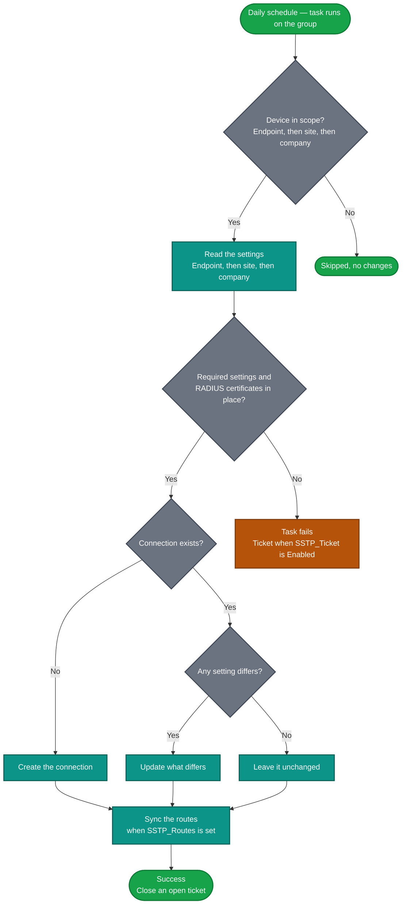

## Purpose

The **SSTP VPN Deployment** solution creates the SSTP VPN connection on Windows devices and keeps it set up the way you want, without anyone visiting the device. The VPN server, the authentication method, the RADIUS servers, split tunneling and routes are set in custom fields for the whole portal, a company, a site or a single device.

Once a day, the [SSTP VPN Deployment](/docs/11eb7169-75d8-456d-a28d-fe9aff517ac7) task runs against the [SSTP VPN Deployment](/docs/9848ce15-c56b-4ccd-a80f-95b21e5a4f75) group. It creates the all-user connection where it's missing, and corrects it where a setting no longer matches the custom fields.

**Platform:** `ConnectWise RMM`

### Key Capabilities

- **Settings at Every Level** – Company, site and endpoint fields, with the most specific value winning. A site can use its own VPN server, and a single device can have its own routes.
- **Scope by OS Type** – Deploy to Windows workstations, Windows servers or both, per company or site. A single device can be included or excluded whatever its company says.
- **Two Authentication Methods** – `PEAP with Server Validation` checks the RADIUS server's certificate before credentials are sent, with up to two RADIUS servers. `EAP-MSCHAPv2` is there for VPNs without a RADIUS certificate.
- **Windows Sign-In for Domain Devices** – Devices joined to the company's domain connect with their Windows sign-in. Other devices ask for a user name and password, and remember them.
- **Split Tunneling and Routes** – Send only your internal networks through the VPN. The route list is kept in sync, so a network removed from the field is removed from the devices.
- **Changes Only What Differs** – The task compares the connection with the custom fields, and leaves it alone when nothing has changed.
- **Optional Tickets** – One ticket per device when the deployment fails, through the [CWRMM Ticket Management for Monitors](/docs/57daa951-2acc-4be7-a025-0d0ca729ef57) workflow. It closes after the next successful run.

### Important Caveats & Behavior

- **RADIUS Certificates Aren't Installed** – For `PEAP with Server Validation`, each device needs a valid certificate for every RADIUS server in its Local Machine Trusted Root store, with the server's name as its common name (CN). Deploy the certificates with Group Policy or another tool first. Without them, the task fails on the device.
- **All-User Connection Only** – The task creates and manages one connection for all users of the device. A connection that a user created in their own profile isn't changed, so a device can end up with two connections of the same name.
- **Renaming Creates a New Connection** – Changing [SSTP_Connection](/docs/d3fcba13-20f4-4371-a743-937868c9e8b3) creates a connection with the new name. The old one stays on the device until it's removed by hand.
- **Turning It Off Removes Nothing** – A device taken out of scope keeps its connection. The task just stops maintaining it. The task also stops running on the device, so close any ticket that's still open for it by hand.
- **Daily Run** – A change to the custom fields reaches the devices at the next daily run. Run the task on a device to apply it straight away.
- **VPN Server Name** – SSTP checks the VPN server's certificate, so [SSTP_Server](/docs/74c3c252-1d85-4860-8e89-4c4e7d2804d7) must be the name on that certificate.
- **Fixed Settings** – The connection always uses SSTP, maximum encryption, EAP authentication and remembered credentials.
- **Single Quotes** – Type a single quote twice in any SSTP field, for example `Contoso''s VPN`.
- **Ticketing Install Order** – The ticket workflow calls a custom bot, so the bot must be installed and published **before** the workflow is imported. A workflow that references a bot that doesn't exist in the environment can't be saved.
- **Workflow Account** – The ticket workflow runs under the account that created it. That account needs access to every device, or tickets silently fail for the devices it can't see.

## How It Works

1. Once a day, the task runs on every device in the group. The group holds the Windows devices that the SSTP_Enable fields put in scope.
2. The task reads the device's SSTP fields, then its site's, then its company's. The most specific level that holds a value wins.
3. For `PEAP with Server Validation`, it finds each RADIUS server's certificate in the device's Trusted Root store.
4. It creates the connection, or compares the existing one with the settings and corrects what differs.
5. When SSTP_Routes is set, it adds the missing routes and removes any others.
6. A failure fails the task. With SSTP_Ticket set to `Enabled`, one ticket is created for the device, and it's closed after the next successful run.

## Authentication Options

| | PEAP with Server Validation | EAP-MSCHAPv2 |
|---|---|---|
| **What it does** | PEAP-MSCHAPv2. Windows checks the RADIUS server's certificate before it sends credentials. | EAP-MSCHAPv2, without a RADIUS certificate check. |
| **Certificates checked** | The VPN server's and the RADIUS servers' | The VPN server's only |
| **Needs** | [SSTP_RADIUS_1](/docs/ba58573e-5e74-4241-a036-a1519acf426d), optionally [SSTP_RADIUS_2](/docs/42062995-a0d7-45b7-a6b7-f9aeeb952cfb), and a valid certificate for each RADIUS server in every device's Trusted Root store | Nothing extra |
| **How to set it** | [SSTP_Auth](/docs/dd2b757e-651a-4ccc-bfb1-48e32eed9675) set to `PEAP with Server Validation`, or not set at any level | [SSTP_Auth](/docs/dd2b757e-651a-4ccc-bfb1-48e32eed9675) set to `EAP-MSCHAPv2` |
| **Best for** | VPNs that sign users in through a RADIUS (NPS) server with a certificate | VPNs without a RADIUS certificate |

**How to choose:**

- Pick **PEAP with Server Validation** whenever the VPN uses a RADIUS server with a certificate. It stops devices from sending credentials to a server pretending to be yours.
- Pick **EAP-MSCHAPv2** only for VPNs that have no RADIUS certificate to check.

## Prerequisites

- An SSTP VPN server, such as Windows Routing and Remote Access, reachable from the internet, with a certificate for the name the devices connect to.
- For `PEAP with Server Validation`: the certificate of each RADIUS server in the Local Machine Trusted Root Certification Authorities store of every device in scope.
- For tickets: the [CWRMM Ticket Management for Monitors](/docs/57daa951-2acc-4be7-a025-0d0ca729ef57) workflow with its bot and form, the webhook URL of its trigger, and a CW RMM account with access to every device to create the workflow.

## Associated Content

### Custom Fields: Scope

These fields set which devices get the connection. Leave the site and endpoint fields empty to use the level above.

| Name | Level | Type | Purpose |
|---|---|---|---|
| [SSTP_Enable](/docs/57f97be2-e027-413f-919e-b6984ce6fba1) | Company | Dropdown | Which Windows devices get the connection for the company, by OS type. Its default value is the portal-wide default. |
| [SSTP_Enable_Site](/docs/48e518b7-2a64-42a1-9d00-8e46136a86d2) | Site | Dropdown | Overrides SSTP_Enable for one site. |
| [SSTP_Enable_Endpoint](/docs/2e5a736d-431a-46ba-a157-e6f7e6740843) | Endpoint | Dropdown | Includes or excludes a single device, whatever its OS type, site and company. |

### Custom Fields: Connection

These fields set the connection's name, VPN server and DNS suffix. Each one needs a value at some level.

| Name | Level | Type | Purpose |
|---|---|---|---|
| [SSTP_Connection](/docs/d3fcba13-20f4-4371-a743-937868c9e8b3) | Company | Text Box | Name of the VPN connection. Required. |
| [SSTP_Connection_Site](/docs/942398eb-d14a-4cea-aee8-f392bad853b2) | Site | Text Box | Overrides SSTP_Connection for one site. |
| [SSTP_Connection_Endpoint](/docs/0d156eb8-142a-48a5-bbc7-00cab392c9c1) | Endpoint | Text Box | Overrides the connection name for a single device. |
| [SSTP_Server](/docs/74c3c252-1d85-4860-8e89-4c4e7d2804d7) | Company | Text Box | Public host name of the VPN server. Required. |
| [SSTP_Server_Site](/docs/89c2001e-dfce-43fd-b622-23a6e0f9703f) | Site | Text Box | Overrides SSTP_Server for one site. |
| [SSTP_Server_Endpoint](/docs/ee49791e-8522-4665-a2c1-f302db20d2fc) | Endpoint | Text Box | Overrides the VPN server for a single device. |
| [SSTP_DNS_Suffix](/docs/ff024303-4ef0-4f07-826e-a3913095299c) | Company | Text Box | Internal DNS suffix. Also decides which devices use their Windows sign-in, and completes short RADIUS server names. Required. |
| [SSTP_DNS_Suffix_Site](/docs/968485ea-c81e-4a03-b72b-b25a7bca424c) | Site | Text Box | Overrides SSTP_DNS_Suffix for one site. |
| [SSTP_DNS_Suffix_Endpoint](/docs/2a2f7930-d975-4d1b-9b93-808992ddd76c) | Endpoint | Text Box | Overrides the DNS suffix for a single device. |

### Custom Fields: Authentication

| Name | Level | Type | Purpose |
|---|---|---|---|
| [SSTP_Auth](/docs/dd2b757e-651a-4ccc-bfb1-48e32eed9675) | Company | Dropdown | `PEAP with Server Validation` or `EAP-MSCHAPv2`. Defaults to `PEAP with Server Validation`. |
| [SSTP_Auth_Site](/docs/698120a1-a717-4e8c-9fb1-3953922a513b) | Site | Dropdown | Overrides SSTP_Auth for one site. |
| [SSTP_Auth_Endpoint](/docs/42272ef7-d912-464b-9d05-cb4d53e36467) | Endpoint | Dropdown | Overrides the authentication method for a single device. |
| [SSTP_RADIUS_1](/docs/ba58573e-5e74-4241-a036-a1519acf426d) | Company | Text Box | Primary RADIUS server, for `PEAP with Server Validation`. |
| [SSTP_RADIUS_1_Site](/docs/e3fc5254-1fcd-4f1c-b98e-8c6f5335a120) | Site | Text Box | Overrides SSTP_RADIUS_1 for one site. |
| [SSTP_RADIUS_1_Endpoint](/docs/b4a4ebdd-1ae4-4539-87d9-3d723126664b) | Endpoint | Text Box | Overrides the primary RADIUS server for a single device. |
| [SSTP_RADIUS_2](/docs/42062995-a0d7-45b7-a6b7-f9aeeb952cfb) | Company | Text Box | Secondary RADIUS server. Empty or `None` for no secondary server. |
| [SSTP_RADIUS_2_Site](/docs/6e6ea744-fb29-4980-9da2-5ac322367933) | Site | Text Box | Overrides SSTP_RADIUS_2 for one site. `None` for no secondary server. |
| [SSTP_RADIUS_2_Endpoint](/docs/3e97136c-12d2-4a09-8712-b80b3ae55edc) | Endpoint | Text Box | Overrides the secondary RADIUS server for a single device. |

### Custom Fields: Split Tunneling and Routes

| Name | Level | Type | Purpose |
|---|---|---|---|
| [SSTP_Split](/docs/bafcaae5-8322-4ff2-9ace-26f27aa5df81) | Company | Dropdown | Turns split tunneling on or off. Defaults to `Disabled`. |
| [SSTP_Split_Site](/docs/52919877-7d53-49a4-becf-cee8f59fd697) | Site | Dropdown | Overrides SSTP_Split for one site. |
| [SSTP_Split_Endpoint](/docs/4c605b55-44bf-436f-8530-333aeb2f0045) | Endpoint | Dropdown | Overrides split tunneling for a single device. |
| [SSTP_Routes](/docs/5e860000-83c9-49fa-87fa-f046fe1a793f) | Company | Text Box | Networks sent through the VPN. `None` removes all routes, and empty leaves them as they are. |
| [SSTP_Routes_Site](/docs/096bae7a-48e6-4a36-8339-e1ce79e573e4) | Site | Text Box | Overrides SSTP_Routes for one site. |
| [SSTP_Routes_Endpoint](/docs/9210fae1-36ed-4210-86a8-b69f117ca50b) | Endpoint | Text Box | Overrides the routes for a single device. |

### Custom Fields: Ticketing

Only needed for tickets.

| Name | Level | Type | Purpose |
|---|---|---|---|
| [SSTP_Ticket](/docs/9525e584-65f9-4540-bab4-d968878b5df9) | Company | Dropdown | Creates a ticket when the deployment fails on a device. Defaults to `Disabled`. |
| [SSTP_Ticket_Site](/docs/5cca5370-e9c6-4c17-83dc-89d8f028de2f) | Site | Dropdown | Overrides SSTP_Ticket for one site. |
| [SSTP_Ticket_Endpoint](/docs/9dc62dce-b999-40ad-adea-b1cfd9d6808f) | Endpoint | Dropdown | Overrides tickets for a single device. |
| [Ticket_Mgmt_Webhook_Url](/docs/8e55deb6-bef8-4501-9e64-7b25e7fcd1ab) | Company | Text Box | The webhook URL of the ticket workflow, entered as the field's default value. Shared with other ProVal solutions that use the workflow. |

### Group

| Name | Type | Purpose |
|---|---|---|
| [SSTP VPN Deployment](/docs/9848ce15-c56b-4ccd-a80f-95b21e5a4f75) | Dynamic Group | Windows devices where deployment is turned on through the SSTP_Enable fields. |

### Task

| Name | Purpose |
|---|---|
| [SSTP VPN Deployment](/docs/11eb7169-75d8-456d-a28d-fe9aff517ac7) | Creates or updates the connection from the custom fields. Scheduled once a day against the group. |

### Trigger (Ticketing only)

| Name | Purpose |
|---|---|
| [CWRMM Ticket Management for Monitors](/docs/05c811e6-c6d0-4652-b4b6-2aa83f9605c7) | Webhook trigger that receives the task's `Create` and `Close` requests and starts the ticket workflow. |

### Workflow (Ticketing only)

| Name | Trigger | Purpose |
|---|---|---|
| [CWRMM Ticket Management for Monitors](/docs/57daa951-2acc-4be7-a025-0d0ca729ef57) | Webhook, [CWRMM Ticket Management for Monitors](/docs/05c811e6-c6d0-4652-b4b6-2aa83f9605c7) | Creates and closes the tickets. New tickets are raised by the bot, so the device is attached to them. |

### Bot (Ticketing only)

| Name | Purpose |
|---|---|
| [Create ticket with associated device](/docs/cf8a2c3d-456c-4567-8039-97e89f894ac5) | Raises the ticket with the device attached. Must be installed and published **before** the workflow is imported. |

### Form (Ticketing only)

| Name | Purpose |
|---|---|
| [Create ticket with associated device](/docs/8d147440-f887-4c21-8fc8-fb93c0d54c29) | The bot's input form. Installing the bot brings it in. |

## Implementation

Follow these steps in order. Step 5 is only needed for tickets.

### Step 1: Install the Custom Fields

Install the 30 custom fields from the `ProVal - Content` Community, selecting the **Custom Fields** repository.

- [Custom Field: SSTP_Enable](/docs/57f97be2-e027-413f-919e-b6984ce6fba1)
- [Custom Field: SSTP_Enable_Site](/docs/48e518b7-2a64-42a1-9d00-8e46136a86d2)
- [Custom Field: SSTP_Enable_Endpoint](/docs/2e5a736d-431a-46ba-a157-e6f7e6740843)
- [Custom Field: SSTP_Connection](/docs/d3fcba13-20f4-4371-a743-937868c9e8b3)
- [Custom Field: SSTP_Connection_Site](/docs/942398eb-d14a-4cea-aee8-f392bad853b2)
- [Custom Field: SSTP_Connection_Endpoint](/docs/0d156eb8-142a-48a5-bbc7-00cab392c9c1)
- [Custom Field: SSTP_Server](/docs/74c3c252-1d85-4860-8e89-4c4e7d2804d7)
- [Custom Field: SSTP_Server_Site](/docs/89c2001e-dfce-43fd-b622-23a6e0f9703f)
- [Custom Field: SSTP_Server_Endpoint](/docs/ee49791e-8522-4665-a2c1-f302db20d2fc)
- [Custom Field: SSTP_DNS_Suffix](/docs/ff024303-4ef0-4f07-826e-a3913095299c)
- [Custom Field: SSTP_DNS_Suffix_Site](/docs/968485ea-c81e-4a03-b72b-b25a7bca424c)
- [Custom Field: SSTP_DNS_Suffix_Endpoint](/docs/2a2f7930-d975-4d1b-9b93-808992ddd76c)
- [Custom Field: SSTP_Auth](/docs/dd2b757e-651a-4ccc-bfb1-48e32eed9675)
- [Custom Field: SSTP_Auth_Site](/docs/698120a1-a717-4e8c-9fb1-3953922a513b)
- [Custom Field: SSTP_Auth_Endpoint](/docs/42272ef7-d912-464b-9d05-cb4d53e36467)
- [Custom Field: SSTP_RADIUS_1](/docs/ba58573e-5e74-4241-a036-a1519acf426d)
- [Custom Field: SSTP_RADIUS_1_Site](/docs/e3fc5254-1fcd-4f1c-b98e-8c6f5335a120)
- [Custom Field: SSTP_RADIUS_1_Endpoint](/docs/b4a4ebdd-1ae4-4539-87d9-3d723126664b)
- [Custom Field: SSTP_RADIUS_2](/docs/42062995-a0d7-45b7-a6b7-f9aeeb952cfb)
- [Custom Field: SSTP_RADIUS_2_Site](/docs/6e6ea744-fb29-4980-9da2-5ac322367933)
- [Custom Field: SSTP_RADIUS_2_Endpoint](/docs/3e97136c-12d2-4a09-8712-b80b3ae55edc)
- [Custom Field: SSTP_Split](/docs/bafcaae5-8322-4ff2-9ace-26f27aa5df81)
- [Custom Field: SSTP_Split_Site](/docs/52919877-7d53-49a4-becf-cee8f59fd697)
- [Custom Field: SSTP_Split_Endpoint](/docs/4c605b55-44bf-436f-8530-333aeb2f0045)
- [Custom Field: SSTP_Routes](/docs/5e860000-83c9-49fa-87fa-f046fe1a793f)
- [Custom Field: SSTP_Routes_Site](/docs/096bae7a-48e6-4a36-8339-e1ce79e573e4)
- [Custom Field: SSTP_Routes_Endpoint](/docs/9210fae1-36ed-4210-86a8-b69f117ca50b)
- [Custom Field: SSTP_Ticket](/docs/9525e584-65f9-4540-bab4-d968878b5df9)
- [Custom Field: SSTP_Ticket_Site](/docs/5cca5370-e9c6-4c17-83dc-89d8f028de2f)
- [Custom Field: SSTP_Ticket_Endpoint](/docs/9dc62dce-b999-40ad-adea-b1cfd9d6808f)

### Step 2: Install the Group

Install the group from the `ProVal - Content` Community, selecting the **Groups** repository.

- [Group: SSTP VPN Deployment](/docs/9848ce15-c56b-4ccd-a80f-95b21e5a4f75)

### Step 3: Create the Task

Create the task by hand, as described in its document.

- [Task: SSTP VPN Deployment](/docs/11eb7169-75d8-456d-a28d-fe9aff517ac7)

### Step 4: Schedule the Task

Schedule the task to run once a day against the [SSTP VPN Deployment](/docs/9848ce15-c56b-4ccd-a80f-95b21e5a4f75) group, as described in the [Schedule Task](/docs/11eb7169-75d8-456d-a28d-fe9aff517ac7#schedule-task) section of the task's document.

### Step 5 (Optional): Set Up Ticketing

Skip this step if you don't want tickets. If the ticket content is already installed for another ProVal solution, such as [Enhanced Drive Space Monitoring](/docs/e9cf4ff0-4413-447b-97dd-b8b2abd59597), only check that [Ticket_Mgmt_Webhook_Url](/docs/8e55deb6-bef8-4501-9e64-7b25e7fcd1ab) holds the real webhook URL.

1. Install the [Create ticket with associated device](/docs/cf8a2c3d-456c-4567-8039-97e89f894ac5) bot from the `ProVal - Content` Community, selecting the **Bots** repository, then **publish the bot**. Installing the bot brings its [Create ticket with associated device](/docs/8d147440-f887-4c21-8fc8-fb93c0d54c29) form in with it.
2. Install the [CWRMM Ticket Management for Monitors](/docs/57daa951-2acc-4be7-a025-0d0ca729ef57) workflow from the `ProVal - Content` Community, signed in with an account that has access to every device. This also installs the [CWRMM Ticket Management for Monitors](/docs/05c811e6-c6d0-4652-b4b6-2aa83f9605c7) trigger.
3. In the workflow's **Trigger** node, create a webhook instance named `CWRMM Ticket Management for Monitors` and copy the URL it generates.
4. Install the [Ticket_Mgmt_Webhook_Url](/docs/8e55deb6-bef8-4501-9e64-7b25e7fcd1ab) custom field from the **Custom Fields** repository if it isn't there yet, and set the URL as its **Default Value**.
5. Open the **Bot** node on the workflow's `toCreate` branch and set **ServiceBoard**, **Priority** and **Team** to match your environment.

### Step 6: Prepare the RADIUS Certificates

For `PEAP with Server Validation`, deploy the certificate of each RADIUS server to the Local Machine **Trusted Root Certification Authorities** store of every device in scope, for example with Group Policy. Skip this step for `EAP-MSCHAPv2`.

### Step 7: Set Up Companies, Sites and Devices

Fill in the connection settings before you turn deployment on, so no device runs the task with a setting missing.

- For each company, set [SSTP_Connection](/docs/d3fcba13-20f4-4371-a743-937868c9e8b3), [SSTP_Server](/docs/74c3c252-1d85-4860-8e89-4c4e7d2804d7), [SSTP_DNS_Suffix](/docs/ff024303-4ef0-4f07-826e-a3913095299c) and [SSTP_RADIUS_1](/docs/ba58573e-5e74-4241-a036-a1519acf426d), plus [SSTP_RADIUS_2](/docs/42062995-a0d7-45b7-a6b7-f9aeeb952cfb), [SSTP_Split](/docs/bafcaae5-8322-4ff2-9ace-26f27aa5df81), [SSTP_Routes](/docs/5e860000-83c9-49fa-87fa-f046fe1a793f) and [SSTP_Ticket](/docs/9525e584-65f9-4540-bab4-d968878b5df9) as needed.
- Use the `_Site` fields for sites that differ from their company, and the `_Endpoint` fields for single devices.
- Then set [SSTP_Enable](/docs/57f97be2-e027-413f-919e-b6984ce6fba1) on the companies that should get the connection, for example `Windows Workstations Only`, or [SSTP_Enable_Site](/docs/48e518b7-2a64-42a1-9d00-8e46136a86d2) on single sites.

The default values of the company fields apply to every company without its own value: `Disabled` for SSTP_Enable, SSTP_Split and SSTP_Ticket, and `PEAP with Server Validation` for SSTP_Auth. Change a default value under **SETTINGS** ➞ **Custom Fields** to change it for every company at once.

### Step 8: Try It on One Device

1. Set [SSTP_Enable_Endpoint](/docs/2e5a736d-431a-46ba-a157-e6f7e6740843) to `Enabled` on a test device in a company whose settings are filled in.
2. Once the device shows in the [SSTP VPN Deployment](/docs/9848ce15-c56b-4ccd-a80f-95b21e5a4f75) group, run the [SSTP VPN Deployment](/docs/11eb7169-75d8-456d-a28d-fe9aff517ac7) task on it.
3. Check the task's Script Log, then check the connection under **Settings** ➞ **Network & internet** ➞ **VPN** on the device, and connect.
4. Run the task again. The Script Log now says the connection already matched the configured settings.

You'll know it worked when the device has the connection, it connects, and the second run changes nothing.

## FAQ

### Q: How do I try the solution on one device first?

> Fill in the company's connection settings, set [SSTP_Enable_Endpoint](/docs/2e5a736d-431a-46ba-a157-e6f7e6740843) to `Enabled` on the device, and run the [SSTP VPN Deployment](/docs/11eb7169-75d8-456d-a28d-fe9aff517ac7) task on it. See [Step 8](#step-8-try-it-on-one-device).

### Q: Which authentication method should I use?

> `PEAP with Server Validation`, whenever the VPN signs users in through a RADIUS server with a certificate. It's the default. See [Authentication Options](#authentication-options).

### Q: The task fails with "No valid certificate for the RADIUS server". What should I check?

> Work through this list on the device:
>
> 1. The certificate is in the **Local Machine** ➞ **Trusted Root Certification Authorities** store, not in a user store or the Personal store.
> 2. Its common name (CN) is the RADIUS server's name, either the short name or the full name ending in the DNS suffix.
> 3. It hasn't expired.
> 4. [SSTP_RADIUS_1](/docs/ba58573e-5e74-4241-a036-a1519acf426d) and [SSTP_RADIUS_2](/docs/42062995-a0d7-45b7-a6b7-f9aeeb952cfb) hold the right names, and [SSTP_DNS_Suffix](/docs/ff024303-4ef0-4f07-826e-a3913095299c) completes the short names correctly.

### Q: How do I use split tunneling?

> Set [SSTP_Split](/docs/bafcaae5-8322-4ff2-9ace-26f27aa5df81) to `Enabled`, and list your internal networks in [SSTP_Routes](/docs/5e860000-83c9-49fa-87fa-f046fe1a793f), for example `10.10.0.0/16,192.168.20.0/24`. Without routes, Windows only routes the network that the VPN address belongs to.

### Q: How do I remove a route from every device?

> Take it out of [SSTP_Routes](/docs/5e860000-83c9-49fa-87fa-f046fe1a793f). The next run removes it from the devices. Enter `None` to remove every route. Leaving the field empty at every level leaves the routes as they are.

### Q: Can one site use a different VPN server?

> Yes. Set [SSTP_Server_Site](/docs/89c2001e-dfce-43fd-b622-23a6e0f9703f) on that site. Every SSTP setting has a site and an endpoint field.

### Q: Do users have to enter a user name and password?

> Devices joined to the domain in [SSTP_DNS_Suffix](/docs/ff024303-4ef0-4f07-826e-a3913095299c), or one of its child domains, connect with their Windows sign-in. Other devices ask the first time, then remember the credentials.

### Q: I changed a setting. When does it reach the devices?

> At the next daily run. To apply it straight away, run the [SSTP VPN Deployment](/docs/11eb7169-75d8-456d-a28d-fe9aff517ac7) task on the devices. The task only changes what differs.

### Q: Will the daily run disrupt connected users?

> The task leaves an up-to-date connection alone, so a normal daily run doesn't touch it. It only changes the connection after a setting has changed, so plan setting changes for a quiet time.

### Q: Does turning deployment off remove the connection?

> No. The device leaves the group and keeps its connection. Remove the connection on the device if it's no longer needed.

### Q: Why does a device show two connections with the same name?

> A user created a connection with that name in their own profile. The task only manages the all-user connection, so remove the user's copy.

### Q: A device in scope doesn't have the connection. What should I check?

> Work through this list:
>
> 1. The device is in the [SSTP VPN Deployment](/docs/9848ce15-c56b-4ccd-a80f-95b21e5a4f75) group. Check its SSTP_Enable fields at every level, and that it's a Windows device of a type its scope covers.
> 2. The task is scheduled against the group, and has run since the device joined it.
> 3. The task's Script Log on the device. The [Results](/docs/11eb7169-75d8-456d-a28d-fe9aff517ac7#results) table in the task's document explains each message.

### Q: Tickets aren't being created. What should I check?

> Work through this list:
>
> 1. The task actually failed. Tickets are only created for failures, and only one per device while it's open.
> 2. [SSTP_Ticket](/docs/9525e584-65f9-4540-bab4-d968878b5df9) is `Enabled` at the level that applies to the device.
> 3. [Ticket_Mgmt_Webhook_Url](/docs/8e55deb6-bef8-4501-9e64-7b25e7fcd1ab) has the real webhook URL as its default value, not the placeholder.
> 4. The [CWRMM Ticket Management for Monitors](/docs/57daa951-2acc-4be7-a025-0d0ca729ef57) workflow is published, and its bot node has **ServiceBoard**, **Priority** and **Team** set.
> 5. The account that created the workflow has access to the device.
> 6. The task's Script Log. A ticket request that didn't go through is logged there, and retried at the next run.

## Changelog

### 2026-11-27

- Initial version of the document
