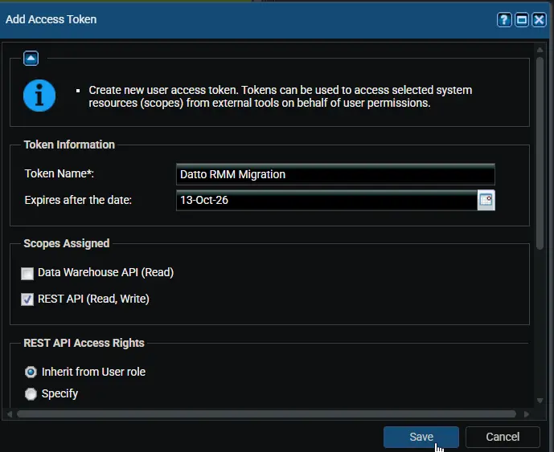
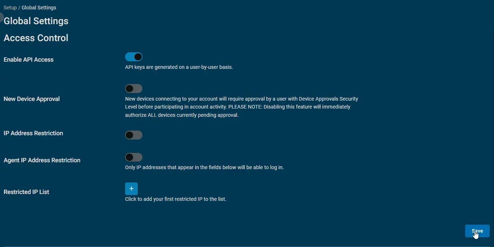
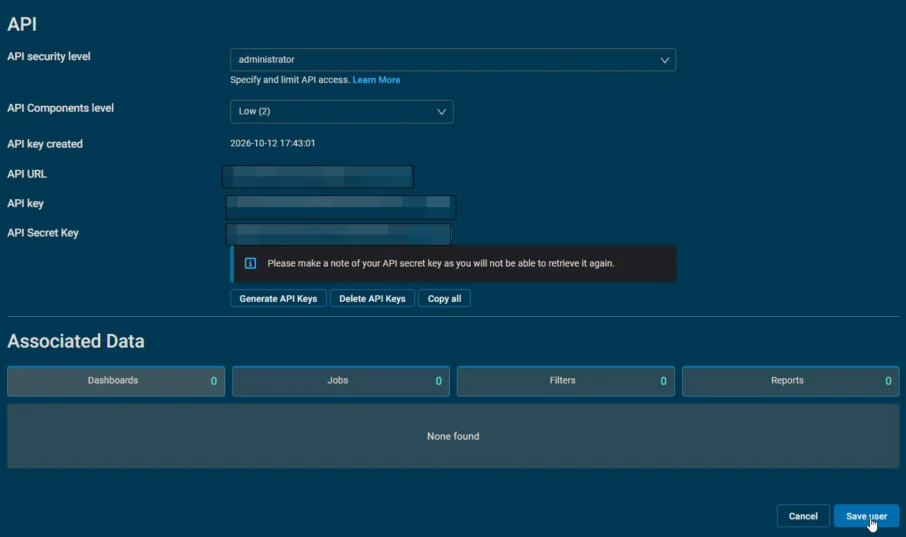
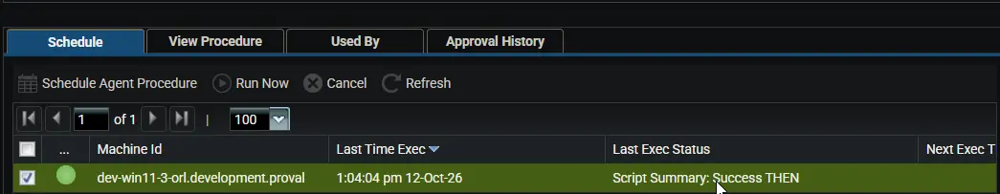
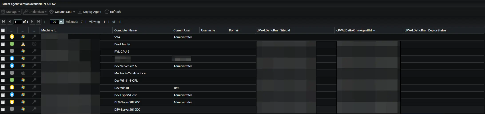
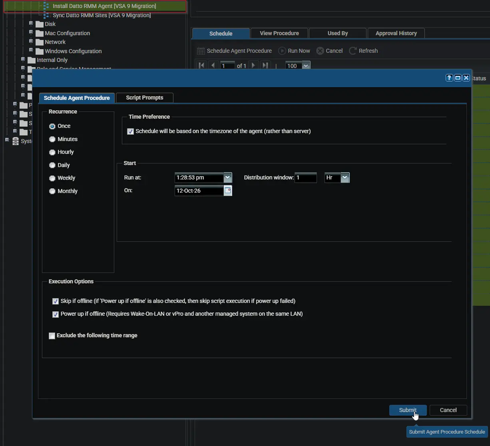
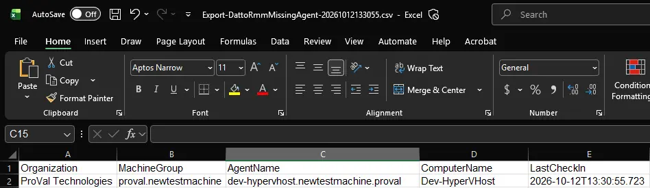
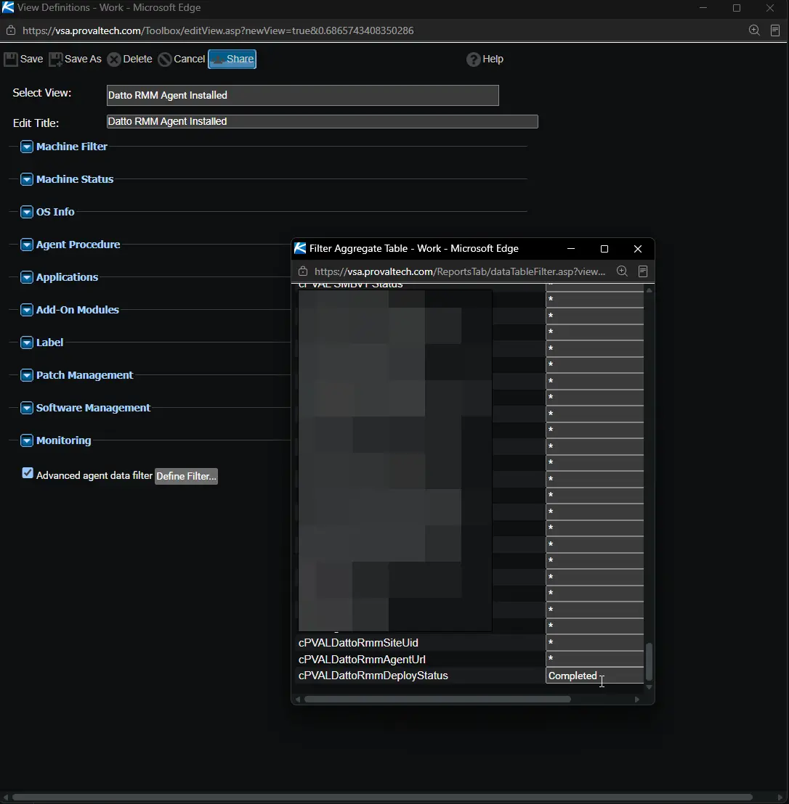

## Purpose

The **VSA 9 to Datto RMM Migration** solution moves your managed devices from Kaseya VSA 9 to Datto RMM from inside VSA 9. It recreates your VSA 9 structure as Datto RMM sites, installs the Datto RMM agent into the right site on every device, and shows which devices still need attention.

## How It Works

1. **Prepare:** One agent procedure creates a Datto RMM site for each VSA 9 machine group. It saves the site and the agent download address on every VSA 9 agent.
2. **Install:** A second agent procedure runs on every device. It installs the Datto RMM agent into the saved site and records the result in VSA 9.
3. **Verify:** A third agent procedure lists the VSA 9 agents that are not in Datto RMM yet. Repeat the install for those devices until the list is empty.

## Key Capabilities

* **Automatic site creation:** Datto RMM sites are named after your VSA 9 organizations and machine groups. Existing sites with the same name are reused.
* **Cross-platform install:** Installs the Datto RMM agent on Windows, Linux, and macOS devices.
* **Safe to repeat:** Devices that already have the Datto RMM agent are skipped. Every procedure can run again without side effects.
* **Progress tracking in VSA 9:** Each device records `Completed` or `Failed` in a custom field, ready for VSA 9 views.
* **Gap report:** A CSV report lists every device that has not enrolled in Datto RMM yet.
* **No stored credentials:** API credentials are entered at run time and removed from the device when the run ends.

## Associated Content

### Custom Fields

All three fields are created automatically by the Sync Datto RMM Sites [VSA 9 Migration] agent procedure. Manual creation is needed only if that procedure cannot create them.

| Name | Default | Example | Level | Managed By | Function |
| :--- | :--- | :--- | :--- | :--- | :--- |
| [cPVALDattoRmmSiteUid](/docs/bfb2c75f-75e2-44a1-90eb-eb0740e23aab) | *(blank)* | `5b0e4f8a-2c1d-4e6b-9a7f-3d2c1b0a9e8f` | Machine | Agent Procedure (Auto) | Datto RMM site the device joins. |
| [cPVALDattoRmmAgentUrl](/docs/2fe9acfb-f1ef-4a4e-9d91-5725fb271da6) | *(blank)* | `https://merlot.rmm.datto.com/download-agent/` | Machine | Agent Procedure (Auto) | Address the Datto RMM agent is downloaded from. |
| [cPVALDattoRmmDeployStatus](/docs/96ff33e8-e893-421a-981c-5af9fa6a798e) | *(blank)* | `Completed - Datto RMM agent installed` | Machine | Agent Procedure (Auto) | Result of the latest install attempt. |

### Agent Procedures

| Name | Run Against | Function |
| :--- | :--- | :--- |
| [Sync Datto RMM Sites [VSA 9 Migration]](/docs/4ba42f91-1ffb-4e9c-b704-2238bb02beb6) | One Windows machine, once | Creates the Datto RMM sites and fills in the custom fields on every agent. |
| [Install Datto RMM Agent [VSA 9 Migration]](/docs/7a1f0dda-b650-40c1-bedb-277ccd373b10) | All machines | Installs the Datto RMM agent and records the result. |
| [Export Datto RMM Missing Agents [VSA 9 Migration]](/docs/9a09b0ad-8799-4366-993a-74b9a3cf3af9) | One Windows machine, after each install round | Lists the agents that are not in Datto RMM yet. |

---

## Implementation

### What You Need

- A provisioned Datto RMM instance. If you do not have one yet, contact your Kaseya account manager.
- A VSA 9 user with the **System** role (SaaS) or the **Master** role (on premises).
- A Datto RMM user with administrator rights.
- One Windows machine managed by VSA 9 with internet access, to run the Sync and Export procedures.

### Step 1: Create a VSA 9 Personal Access Token

1. Sign in to VSA 9 and go to `System` > `User Security` > `Users`.
2. Select your user name to open the user record.
3. Open the **Access Tokens** tab.
4. Select **New** and enter a token name, for example `Datto RMM Migration`.
5. Under **Scopes Assigned**, select **REST API (Read, Write)**.
6. Under **REST API Access Rights**, select **Inherit from User Role**.
7. Select **Save** and copy the token value.

:::warning  
Copy the token immediately. VSA 9 does not show it again once the screen is closed.  
:::

:::note  
The token has the same permissions as its user. Delete the token when the migration is complete.  
:::

### Step 2: Create the Datto RMM API Keys

**Turn on API access (one-time):**

1. Sign in to Datto RMM as an administrator.
2. Go to `Setup` > `Global Settings`.
3. Under **Access Control**, turn on **Enable API Access** and select **Save**.

**Generate the keys:**

1. Go to `Setup` > `Users` and open your user record.
2. In the **API** section, select **Generate API Keys**.
3. Set API Security level to **Administrator**.
4. Copy the **API URL**, **API Key**, and **API Secret Key**.
5. Click **Save User**.

:::warning  
The API Secret Key is shown only once. Generating new keys replaces the old secret, and the old one stops working.  
:::

:::note  
The API URL has the form `https://servername-api.centrastage.net`. Enter it exactly as shown. The agent download address is built from it.  
:::

### Step 3: Import the Agent Procedures

Import the three agent procedures and map the PowerShell files as described in each document:

* [Agent Procedure: Sync Datto RMM Sites [VSA 9 Migration]](/docs/4ba42f91-1ffb-4e9c-b704-2238bb02beb6)
* [Agent Procedure: Install Datto RMM Agent [VSA 9 Migration]](/docs/7a1f0dda-b650-40c1-bedb-277ccd373b10)
* [Agent Procedure: Export Datto RMM Missing Agents [VSA 9 Migration]](/docs/9a09b0ad-8799-4366-993a-74b9a3cf3af9)

### Step 4: Create the Sites and Fill In the Custom Fields

1. Run **[Sync Datto RMM Sites [VSA 9 Migration]](/docs/4ba42f91-1ffb-4e9c-b704-2238bb02beb6)** against one Windows machine.
2. Enter the VSA 9 and Datto RMM credentials from Steps 1 and 2.
3. Review the Agent Procedure Log. It ends with `Success:` when every site and agent was updated.

To see the new custom fields, go to `Agent` > `Manage Agents`, open the column menu, and add `cPVALDattoRmmSiteUid`, `cPVALDattoRmmAgentUrl`, and `cPVALDattoRmmDeployStatus`.

:::note  
Machine groups without agents get no site by default. Set `CreateEmptyGroupSite` to `True` to create them too. If the log reports that a custom field could not be confirmed, create it manually as described in its document.  
:::

### Step 5: Install the Datto RMM Agent

1. Add the Datto RMM agent to the allow list of your antivirus or EDR product. See [Datto RMM allow list requirements](https://rmm.datto.com/help/en/Content/1INTRODUCTION/Requirements/AllowListRequirements.htm).
2. Run **[Install Datto RMM Agent [VSA 9 Migration]](/docs/7a1f0dda-b650-40c1-bedb-277ccd373b10)** against one or two test devices.
3. Confirm that the test devices appear in the expected Datto RMM site.
4. Schedule the procedure against all remaining devices.

### Step 6: Find Devices That Still Need the Agent

1. Run **[Export Datto RMM Missing Agents [VSA 9 Migration]](/docs/9a09b0ad-8799-4366-993a-74b9a3cf3af9)** against the same Windows machine as Step 4.
2. Open the report CSV from the path shown in the Agent Procedure Log.
3. Run the install again on the listed devices.

Repeat Steps 5 and 6 until the report is empty.

### Step 7 (Optional): Track Progress with VSA 9 Views

Create two views to filter devices by install result:

| View Name | Filter on `cPVALDattoRmmDeployStatus` |
| :--- | :--- |
| `Datto RMM Agent Installed` | `*Completed*` |
| `Datto RMM Agent Failed` | `*Failed*` |

1. In the **View** section at the top of the VSA 9 window, select **+ New**.
2. Enter the view name and select **Save As**.
3. Select **Advanced agent data filter**, then **Define Filter**.
4. Find `cPVALDattoRmmDeployStatus` and enter the filter value from the table.
5. Select **Apply**, close the filter window, and save the view.

Select a view from the **View** list on any agent page to filter the device list.

---

## FAQs

**Q. Do I run the Sync procedure on every device?**  
**A:** No. Run it once against a single Windows machine. It covers your whole VSA 9 tenant.

**Q. Can I run the procedures again?**  
**A:** Yes. Existing sites are reused, devices with the Datto RMM agent are skipped, and the custom fields are refreshed. Run Sync again after adding agents or machine groups to VSA 9.

**Q. Why was no site created for one of my machine groups?**  
**A:** The group has no agents. Run Sync again with `CreateEmptyGroupSite` set to `True`, or create the site in Datto RMM manually.

**Q. A device shows `Failed`, but it appears in Datto RMM later. Why?**  
**A:** The agent took longer to register than the procedure waited. Run the install again; the device then reports `Completed`.

**Q. A device shows `Completed` but is still in the missing agents report. Why?**  
**A:** Its computer name in VSA 9 differs from its hostname in Datto RMM, for example after a rename. Check the device manually.

**Q. Where are my credentials stored?**  
**A:** Only on the machine running the procedure, for the length of the run. The procedure deletes them as soon as the script finishes.

**Q. Which devices are supported?**  
**A:** The install procedure supports Windows, Linux, and macOS. The Sync and Export procedures need a Windows machine.

---

## Changelog

### 2026-10-12

- Initial version of the document.
