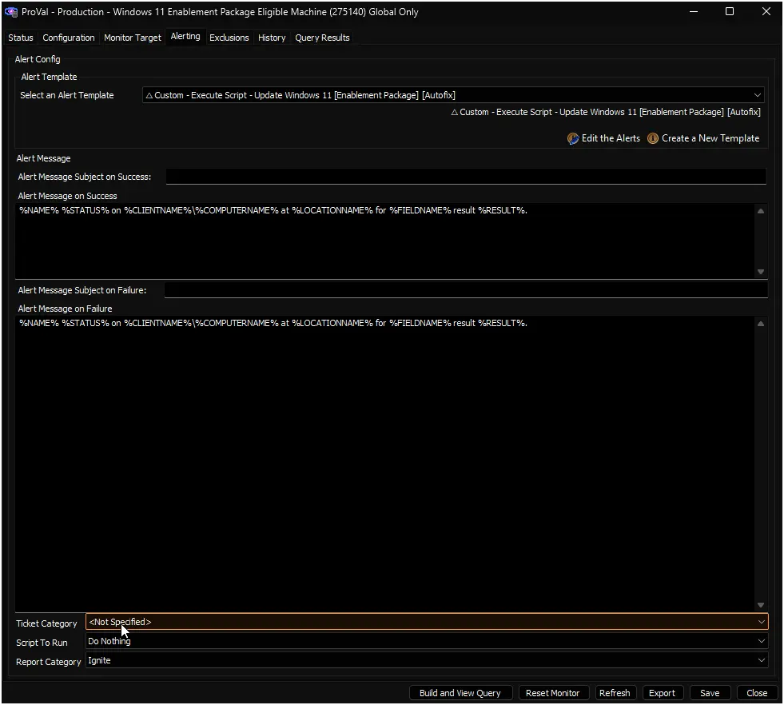

## Purpose

Keeps Windows 11 devices on a supported version by upgrading them automatically with Microsoft's enablement packages. Devices on 24H2 move to 25H2, and devices on 25H2 move to 26H2. Each upgrade needs one restart, and apps, files, and settings stay in place.

Every hour, the [Windows 11 Enablement Package Eligible Machine](/docs/475a45ea-c16f-4772-bb15-868d5a51fe6f) internal monitor finds devices that are ready to upgrade. It runs the [Update Windows 11 [Enablement Package] [Autofix]](/docs/451e5dc2-dc40-11f1-90d7-92000234cfc2) script on them, which runs the right upgrade script and records the result. The [Windows 11 Upgrade Audit [Enablement Package]](/docs/1488c8ab-6719-4b0b-987a-a2e163a0b26a) dataview tracks progress.

**Platform:** `ConnectWise Automate`

### Key Capabilities

- **Two upgrade paths** – Moves 24H2 devices to 25H2 and 25H2 devices to 26H2, one version per run.
- **Approved hours only** – Starts upgrades only inside each device's installation window. The default is 9:00 PM to 5:00 AM.
- **Nightly limit per client** – Upgrades up to a set number of devices per client in any 24 hours. The default is 20.
- **Settings at every level** – Set defaults for all clients, then override them per client, location, or computer.
- **Restart control** – Choose the restart delay, skip the restart, or prompt users to restart.
- **Failure tickets** – Creates a ticket with the upgrade output when an install fails.
- **Progress tracking** – A dataview shows each device's version, whether its upgrades are on, and its last result.

### Important Caveats & Behavior

- **Windows 11 Compatibility Audit is required** – The monitor only detects devices that the [Windows 11 Compatibility Audit](/docs/f0bb3ffc-60cb-484c-b7fa-27a386ac664c) solution marks as compatible. Devices without compatibility data are never upgraded.
- **The installation window uses the server's clock** – Times are checked in the Automate server's time zone, not the device's. Adjust the window for clients in other time zones.
- **A checked box can't be unchecked at a lower level** – A check-box setting checked at any level, or with its system property set to `1`, applies to every device below it. To block an upgrade, use the Disable EDFs, which always win.
- **No Reboot does not keep the device up** – `EP_NoReboot` only stops this solution from restarting the device. Windows Update, patch policies, or users can still restart it, and any restart completes the upgrade.
- **Reboot prompts need User Prompt for Reboot** – Without the [User Prompt for Reboot](/docs/32d2254e-c2a4-4f2d-a029-b74f6d3c8b1a) solution, `EP_Reboot_Prompts` has no effect. That solution's `Disable Reboot Prompt` EDF still applies.
- **One version at a time** – A 24H2 device needs the 25H2 upgrade turned on first. Turning on only the 26H2 upgrade does not upgrade 24H2 devices.
- **Avoid overlap with Windows 11 Installation and Feature Update** – The feature update phase of [Windows 11 Installation and Feature Update](/docs/00b08a60-f202-42db-9f67-a76ea29289fa) can target the same Windows 11 devices. Use only one of the two solutions for feature updates on a client.

## How It Works

1. Every hour, the internal monitor checks Windows 11 24H2 and 25H2 devices against their settings.
2. It detects devices that are compatible, online, turned on for their next upgrade, inside their installation window, and not processed in the last 7 days. It stops at each client's nightly limit.
3. The alert template runs the autofix script on each detected device, with that device's settings.
4. The autofix script runs the matching upgrade script: 24H2 devices go to 25H2, and 25H2 devices go to 26H2.
5. The script records the result on the device. The device restarts after the delay, unless `EP_NoReboot` is on. With `EP_Reboot_Prompts` on, the user is prompted to restart.
6. If the upgrade fails, the script logs the output and can create a ticket. The monitor tries the device again after 7 days.

## Prerequisites

- The [Windows 11 Compatibility Audit](/docs/f0bb3ffc-60cb-484c-b7fa-27a386ac664c) solution, configured and enabled for Windows 11 devices.
- The [User Prompt for Reboot](/docs/32d2254e-c2a4-4f2d-a029-b74f6d3c8b1a) solution. Recommended, and required if you plan to use reboot prompts.
- Devices on Windows 11 24H2 with the August 29, 2025 update (KB5064081) or later, or on 25H2 with the September 2026 update (KB5124010) or later.
- Internet access from devices to Microsoft's download servers.

## Associated Content

### Scripts

| Name | Purpose |
|---|---|
| [Update Windows 11 [Enablement Package] [Autofix]](/docs/451e5dc2-dc40-11f1-90d7-92000234cfc2) | Runs the matching upgrade script on devices detected by the monitor, records the result, and handles tickets and reboot prompts. Also creates the solution's EDFs and system properties on its first run. |
| [Update Windows 11 24H2 To 25H2 [Enablement Package]](/docs/39e0c09c-9219-4c86-acb5-b2c34b7e95fc) | Upgrades Windows 11 24H2 devices to 25H2. |
| [Update Windows 11 25H2 To 26H2 [Enablement Package]](/docs/7d8e9f0a-1b2c-4d3e-8f9a-0b1c2d3e4f5a) | Upgrades Windows 11 25H2 devices to 26H2. |

### Monitor

| Name | Type | Purpose |
|---|---|---|
| [Windows 11 Enablement Package Eligible Machine](/docs/475a45ea-c16f-4772-bb15-868d5a51fe6f) | Internal Monitor | Runs every hour, detects devices ready to upgrade, and runs the autofix script on them through the alert template. |

### Alert Template

| Name | Purpose |
|---|---|
| `△ Custom - Execute Script - Update Windows 11 [Enablement Package] [Autofix]` | Runs the autofix script on devices detected by the monitor. |

### System Properties

System properties set the defaults for all clients. For on/off settings, enter `1` for on and `0` for off.

| Name | Default | Purpose |
|---|---|---|
| `EP_Install_25H2` | `0` | Turns on the 25H2 upgrade for eligible 24H2 devices. |
| `EP_Install_26H2` | `0` | Turns on the 26H2 upgrade for eligible 25H2 devices. |
| `EP_NoReboot` | `0` | Installs the upgrade without restarting the device. |
| `EP_RebootDelaySeconds` | `120` | Seconds to wait before restarting, from 60 to 86400. |
| `EP_IgnoreSafeguardHold` | `0` | Installs the upgrade even when Microsoft has placed a safeguard hold on the device. |
| `EP_Installation_Window` | `2100-0500` | Hours when upgrades can start, in 24-hour `HHMM-HHMM` format. |
| `EP_Failure_Tickets` | `0` | Creates a ticket when an upgrade fails. |
| `EP_Machines_Per_Night` | `20` | Maximum number of devices per client to upgrade in any 24 hours. |
| `EP_Reboot_Prompts` | `0` | Prompts users to restart when `EP_NoReboot` is on. |

### Extra Data Fields (EDFs): Settings

These EDFs override the system properties. All are in the **Enablement Package** section. See [How Settings Are Applied](/docs/451e5dc2-dc40-11f1-90d7-92000234cfc2#how-settings-are-applied) for full details.

| Name | Level | Type | Purpose |
|---|---|---|---|
| `EP_Install_25H2` | Client, Location, Computer | Check-Box | Turns on the 25H2 upgrade. |
| `EP_Install_26H2` | Client, Location, Computer | Check-Box | Turns on the 26H2 upgrade. |
| `EP_Disable_25H2_Install` | Client, Location, Computer | Check-Box | Blocks the 25H2 upgrade, even if it is turned on at another level. |
| `EP_Disable_26H2_Install` | Client, Location, Computer | Check-Box | Blocks the 26H2 upgrade, even if it is turned on at another level. |
| `EP_NoReboot` | Client, Location, Computer | Check-Box | Installs the upgrade without restarting. |
| `EP_RebootDelaySeconds` | Client, Location, Computer | Text | Restart delay in seconds. |
| `EP_IgnoreSafeguardHold` | Client, Location, Computer | Check-Box | Installs the upgrade even when a safeguard hold applies. |
| `EP_Installation_Window` | Client, Location, Computer | Text | Installation window in `HHMM-HHMM` format. |
| `EP_Failure_Tickets` | Client, Location, Computer | Check-Box | Creates a ticket when an upgrade fails. |
| `EP_Reboot_Prompts` | Client, Location, Computer | Check-Box | Prompts users to restart when `EP_NoReboot` is on. |
| `EP_Machines_Per_Night` | Client | Text | Maximum number of devices in the client to upgrade in any 24 hours. |

### Extra Data Fields (EDFs): Status

The autofix script updates these read-only EDFs after each run.

| Name | Level | Type | Purpose |
|---|---|---|---|
| `EP_Autofix_RunTime` | Computer | Text | Date and time the script last ran on the device. |
| `EP_Autofix_Result` | Computer | Text | Result of the last run: `Success`, `Reboot Pending`, or `Failed`. |
| `EP_Autofix_SourceVersion` | Computer | Text | Windows 11 version the device had when the script last ran. |

### Dataview

| Name | Purpose |
|---|---|
| [Windows 11 Upgrade Audit [Enablement Package]](/docs/1488c8ab-6719-4b0b-987a-a2e163a0b26a) | Shows Windows 11 24H2, 25H2, and 26H2 devices, whether their upgrades are turned on, and their last result. |

## Implementation

### Step 1: Set up Windows 11 Compatibility Audit

Implement the [Windows 11 Compatibility Audit](/docs/f0bb3ffc-60cb-484c-b7fa-27a386ac664c) solution and make sure it runs on Windows 11 devices. This solution only upgrades devices it marks as compatible.

### Step 2: Set up User Prompt for Reboot

Implement the [User Prompt for Reboot](/docs/32d2254e-c2a4-4f2d-a029-b74f6d3c8b1a) solution. This step is recommended, and required if you plan to turn on reboot prompts.

### Step 3: Import the content

Import the following content using the ProSync Plugin:

- [Script: Update Windows 11 [Enablement Package] [Autofix]](/docs/451e5dc2-dc40-11f1-90d7-92000234cfc2)
- [Script: Update Windows 11 24H2 To 25H2 [Enablement Package]](/docs/39e0c09c-9219-4c86-acb5-b2c34b7e95fc)
- [Script: Update Windows 11 25H2 To 26H2 [Enablement Package]](/docs/7d8e9f0a-1b2c-4d3e-8f9a-0b1c2d3e4f5a)
- [Internal Monitor: Windows 11 Enablement Package Eligible Machine](/docs/475a45ea-c16f-4772-bb15-868d5a51fe6f)
- Alert Template: `△ Custom - Execute Script - Update Windows 11 [Enablement Package] [Autofix]`
- [Dataview: Windows 11 Upgrade Audit [Enablement Package]](/docs/1488c8ab-6719-4b0b-987a-a2e163a0b26a)

Then reload the system cache.

### Step 4: Create the EDFs and system properties

Run [Update Windows 11 [Enablement Package] [Autofix]](/docs/451e5dc2-dc40-11f1-90d7-92000234cfc2) once against any online Windows 11 device with `Set_Environment` set to `1`. This creates all EDFs and system properties with their default values. The device is not upgraded.

Then reload the system cache.

### Step 5: Choose your settings

Both upgrades start turned off, so no device is upgraded until you turn one on.

- To upgrade one client at a time, check `EP_Install_25H2` or `EP_Install_26H2` on the client's **Enablement Package** tab.
- To upgrade all clients, set the `EP_Install_25H2` or `EP_Install_26H2` system property to `1`.
- Review the installation window, nightly limit, restart, and ticket settings. See [How Settings Are Applied](/docs/451e5dc2-dc40-11f1-90d7-92000234cfc2#how-settings-are-applied).

### Step 6: Configure the monitor

In the CWA Control Center, go to **Automation > Monitors** and open [Windows 11 Enablement Package Eligible Machine](/docs/475a45ea-c16f-4772-bb15-868d5a51fe6f):

- Alert Template: `△ Custom - Execute Script - Update Windows 11 [Enablement Package] [Autofix]`
- Ticket Category: optional. See [How do I control the board and priority of failure tickets?](#q-how-do-i-control-the-board-and-priority-of-failure-tickets)
- Right-click the monitor and select **Run Now** to start it.

You'll know it worked when the monitor's **Query Results** tab lists eligible devices during their installation window, and the dataview shows an Upgrade Status for them after the script runs.

## FAQ

### Q: How do I control the board and priority of failure tickets?

> Set the **Ticket Category** on the **Alerting** tab of the [Windows 11 Enablement Package Eligible Machine](/docs/475a45ea-c16f-4772-bb15-868d5a51fe6f) monitor. Tickets created by the script use this category, so the category's settings control the board, priority, and other ticket details.

### Q: Why wasn't a device upgraded?

> Check these points in order:
>
> 1. The device runs Windows 11 24H2 or 25H2, and not an LTSC edition.
> 2. The Windows 11 Compatibility Audit solution marks it as compatible.
> 3. The device was online during its installation window.
> 4. The upgrade to its next version is turned on, and no Disable EDF is checked at any level. A 24H2 device needs the 25H2 upgrade turned on.
> 5. The script has not run on it in the last 7 days. Check `EP_Autofix_RunTime` on the device.
> 6. Its client has not reached its nightly limit.

### Q: Why is a setting still on after I unchecked it on a computer?

> Check-box settings apply when they are checked at any level. Uncheck the setting at the location and client level, and make sure its system property is `0`. To block an upgrade for one device, check `EP_Disable_25H2_Install` or `EP_Disable_26H2_Install` on it instead.

### Q: What happens when an upgrade fails?

> The device's Upgrade Status shows `Failed`, and a ticket is created if `EP_Failure_Tickets` is on. The ticket includes the upgrade output to help find the cause. The monitor tries the device again after 7 days.

### Q: Can I run the autofix script manually?

> No. It only works when the monitor runs it, except for the first run with `Set_Environment`. To upgrade a single device right away, run [Update Windows 11 24H2 To 25H2 [Enablement Package]](/docs/39e0c09c-9219-4c86-acb5-b2c34b7e95fc) or [Update Windows 11 25H2 To 26H2 [Enablement Package]](/docs/7d8e9f0a-1b2c-4d3e-8f9a-0b1c2d3e4f5a) on it directly. These manual runs are not recorded in the solution's status EDFs.

### Q: Why does EP_Autofix_Result still show Reboot Pending after the device restarted?

> `EP_Autofix_Result` keeps its value until the script runs again. The dataview's **Upgrade Status** column shows `Success` once the device reports the new version.

### Q: Which time zone does the installation window use?

> The Automate server's time zone. For clients in a different time zone, set `EP_Installation_Window` on the client so it matches their local hours.

### Q: How is the nightly limit counted?

> The limit applies per client, over the last 24 hours. Every device the script ran on in that time counts, whatever the result.

## Changelog

### 2026-11-09

- Initial version of the document.
