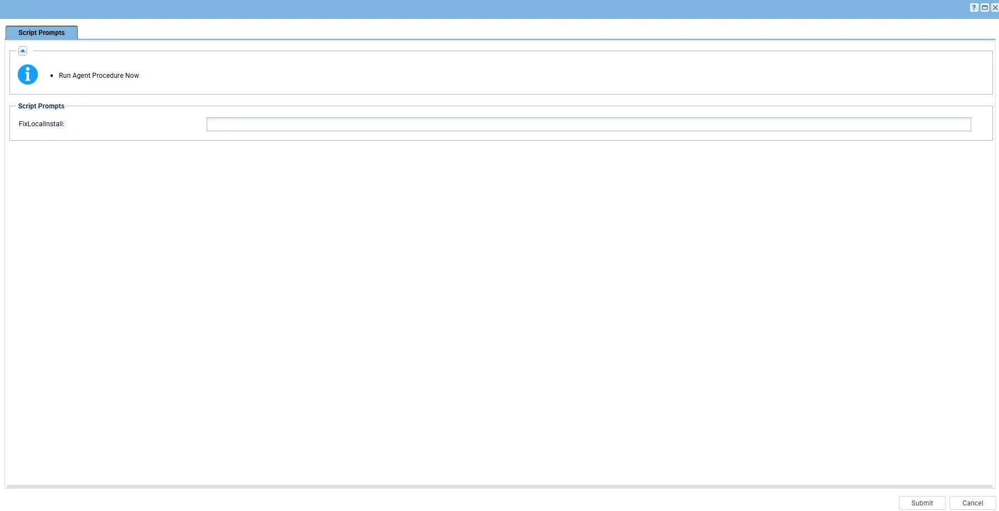
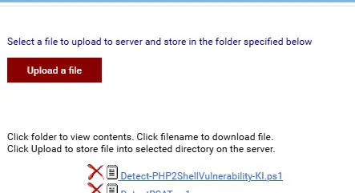

---
id: '76404ce0-b294-4332-a5a6-26beb98f619e'
slug: /76404ce0-b294-4332-a5a6-26beb98f619e
title: 'Detect PHP2Shell Vulnerability'
title_meta: 'Detect PHP2Shell Vulnerability'
keywords: ['php', 'php2shell', 'cve-2026-109618', 'cve-2026-109619', 'vulnerability', 'iis', 'xampp', 'winget', 'remediation']
description: 'Detects and counts PHP installations affected by PHP2Shell vulnerabilities (CVE-2026-109618 and CVE-2026-109619). Identifies installations that are vulnerable, end-of-life, or have an unknown status, and optionally updates vulnerable standalone PHP installations to patched releases. Saves detailed vulnerability findings locally to support investigation and remediation.'
tags: ['update', 'windows', 'automation']
draft: false
unlisted: false
last_update:
  date: 2026-10-27
 --- 

## Summary

Detects and counts PHP installations affected by PHP2Shell vulnerabilities (CVE-2026-109618 and CVE-2026-109619). Identifies installations that are vulnerable, end-of-life, or have an unknown status, and optionally updates vulnerable standalone PHP installations to patched releases. Saves detailed vulnerability findings locally to support investigation and remediation.

## Sample Run

## Dependencies

- [Custom Field: cPVAL PHP2Shell Vuln Count](/docs/3edfe5ad-01bb-4edc-b85a-2e06f049afb5)
- [Solution: Detect PHP2Shell Vulnerability](/docs/4c058cfc-2c83-41d0-8100-e7a19ef768f0)

### Parameter

| Variable | Type | Default | Description |
| -------- | ---- | ------- | ----------- |
| `FixLocalInstall` | Switch | `False` | When enabled, automatically updates vulnerable standalone PHP installations to a patched release. If an updated PHP installation is used by IIS, the script restarts IIS as required. `Accepted values: 1, Yes, True` |

## Implementation

1. Export the agent procedure from ProVal's VSA RMM instance.   
   **Name:** `Detect PHP2Shell Vulnerability` 

   The export will download the necessary XML file.   
   
2. Import this XML file into the partner's VSA RMM instance.   

3. Export the `Detect PHP2Shell Vulnerability` from the ProVal's Internal VSA. This is also placed under the below path:  
`Manage Files` > `Shared Files` > `PVAL` > `Detect-PHP2ShellVulnerability-KI.ps1`  

   

4. Map the `Detect-PHP2ShellVulnerability-KI.ps1` into the `28th` step of the script in the client's environment.

## Output

- Script Log
- [Custom Field: cPVAL PHP2Shell Vuln Count](/docs/3edfe5ad-01bb-4edc-b85a-2e06f049afb5)

## Changelog

### 2026-10-27

- Initial version of the document
