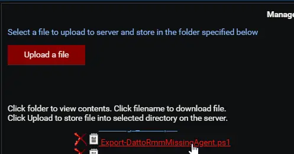
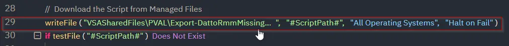
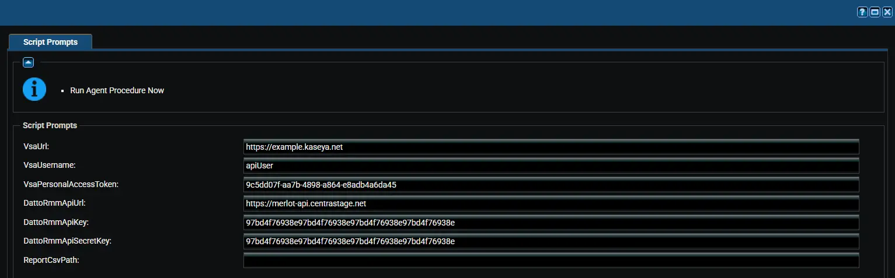

## Summary

Lists every VSA 9 agent that has not enrolled in Datto RMM yet and saves the list to a CSV report. Use it to track migration progress and to find devices that still need the Datto RMM agent.

An agent counts as enrolled when any Datto RMM device, in any site, has the same computer name. Letter case is ignored. The procedure makes no changes in VSA 9 or Datto RMM.

:::warning  
Run this agent procedure against a single Windows machine, not against all machines. It compares the whole VSA 9 tenant with the whole Datto RMM account through their APIs, so running it on more machines only produces identical reports. Run it after each round of the [Install Datto RMM Agent [VSA 9 Migration]](/docs/7a1f0dda-b650-40c1-bedb-277ccd373b10) agent procedure.  
:::

## Dependencies

- [Solution: VSA 9 to Datto RMM Migration](/docs/38446fc5-ce0a-4319-9471-ce7e327d8a8d)
- [Agent Procedure: Install Datto RMM Agent [VSA 9 Migration]](/docs/7a1f0dda-b650-40c1-bedb-277ccd373b10)
- [Custom Field: cPVALDattoRmmDeployStatus](/docs/96ff33e8-e893-421a-981c-5af9fa6a798e)
- A VSA 9 personal access token. See [Create a VSA 9 Personal Access Token](/docs/38446fc5-ce0a-4319-9471-ce7e327d8a8d#step-1-create-a-vsa-9-personal-access-token).
- Datto RMM API keys. See [Create the Datto RMM API Keys](/docs/38446fc5-ce0a-4319-9471-ce7e327d8a8d#step-2-create-the-datto-rmm-api-keys).

## Implementation

1. Export the agent procedure from ProVal's VSA RMM instance.  
   **Name:** `Export Datto RMM Missing Agents [VSA 9 Migration]`  

   The export will download the necessary XML file.  
2. Import this XML file into the partner's VSA RMM instance.  
3. Export the `Export-DattoRmmMissingAgent.ps1` from ProVal's Internal VSA. This is also placed under the below path:  
`Manage Files` > `Shared Files` > `PVAL` > `Export-DattoRmmMissingAgent.ps1`  
    
4. Map the `Export-DattoRmmMissingAgent.ps1` into the procedure's writeFile step (Step 29) in the client's environment.  
    

## Sample Run

## Variables

| Variable | Type | Default | Description |
|----------|------|---------|-------------|
| `VsaUrl` | String | *(required)* | Web address used to sign in to VSA 9, for example `https://example.kaseya.net`. |
| `VsaUsername` | String | *(required)* | VSA 9 user that owns the personal access token. Letter case matters. |
| `VsaPersonalAccessToken` | String | *(required)* | VSA 9 personal access token with the `REST API (Read, Write)` scope. |
| `DattoRmmApiUrl` | String | *(required)* | Datto RMM API URL from your user record, for example `https://merlot-api.centrastage.net`. |
| `DattoRmmApiKey` | String | *(required)* | Datto RMM API key. |
| `DattoRmmApiSecretKey` | String | *(required)* | Datto RMM API secret key. |
| `ReportCsvPath` | String | `C:\ProgramData\_Automation\Script\Export-DattoRmmMissingAgent\Export-DattoRmmMissingAgent-yyyyMMddHHmmss.csv` | Full path of the report CSV. By default each run creates a new, time-stamped report. |

:::note  
Use the same credentials as the Sync Datto RMM Sites [VSA 9 Migration] agent procedure. Avoid apostrophes (single quotes) in variable values; an apostrophe breaks the command that saves the values on the device.  
:::

:::note  
The values are saved to a temporary file on the device for the run only. The procedure deletes the file as soon as the script finishes, because it holds the credentials.  
:::

## Report

The report is sorted by computer name. The first 20 agents also appear in the Agent Procedure Log.

| Column | Description |
|--------|-------------|
| `Organization` | VSA 9 organization of the agent. |
| `MachineGroup` | VSA 9 machine group of the agent. |
| `AgentName` | Agent name in VSA 9. |
| `ComputerName` | Computer name that was not found in Datto RMM. |
| `LastCheckIn` | Last time the agent checked in to VSA 9. |

## What to Do Next

| Situation | Action |
|-----------|--------|
| Agent is in the report | Run the Install Datto RMM Agent [VSA 9 Migration] agent procedure on it again. |
| `cPVALDattoRmmDeployStatus` shows `Failed` | Fix the cause shown in the value, then install again. |
| Agent or machine group added to VSA 9 after the sync | Run the Sync Datto RMM Sites [VSA 9 Migration] agent procedure first, then install. |
| Status shows `Completed` but the agent is still reported | The computer name in VSA 9 differs from the hostname in Datto RMM, for example after a rename. Check the device manually. |

## Output

- Agent Procedure Log
- Report CSV on the device:
  - `C:\ProgramData\_Automation\Script\Export-DattoRmmMissingAgent\Export-DattoRmmMissingAgent-yyyyMMddHHmmss.csv`

## Changelog

### 2026-10-12

- Initial version of the document.
