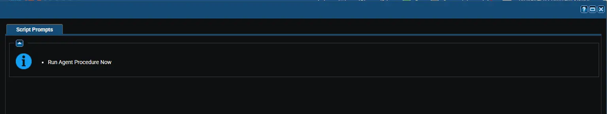

## Summary

Installs the Datto RMM agent on Windows, Linux, and macOS devices managed by VSA 9. Each device joins the Datto RMM site stored in [cPVALDattoRmmSiteUid](/docs/bfb2c75f-75e2-44a1-90eb-eb0740e23aab). The installer is downloaded from the address stored in [cPVALDattoRmmAgentUrl](/docs/2fe9acfb-f1ef-4a4e-9d91-5725fb271da6).

Devices that already have the Datto RMM agent are left unchanged. The result for each device is saved in [cPVALDattoRmmDeployStatus](/docs/96ff33e8-e893-421a-981c-5af9fa6a798e).

:::note  
Schedule this agent procedure against all machines that move to Datto RMM. Run the [Sync Datto RMM Sites [VSA 9 Migration]](/docs/4ba42f91-1ffb-4e9c-b704-2238bb02beb6) agent procedure first, so that the custom fields are filled in.  
:::

:::warning  
Endpoint security can block or remove the Datto RMM agent. Before running this procedure at scale, add the Datto RMM agent to the allow list of your antivirus or EDR product. See [Datto RMM allow list requirements](https://rmm.datto.com/help/en/Content/1INTRODUCTION/Requirements/AllowListRequirements.htm).  
:::

## Dependencies

- [Solution: VSA 9 to Datto RMM Migration](/docs/38446fc5-ce0a-4319-9471-ce7e327d8a8d)
- [Agent Procedure: Sync Datto RMM Sites [VSA 9 Migration]](/docs/4ba42f91-1ffb-4e9c-b704-2238bb02beb6)
- [Custom Field: cPVALDattoRmmSiteUid](/docs/bfb2c75f-75e2-44a1-90eb-eb0740e23aab)
- [Custom Field: cPVALDattoRmmAgentUrl](/docs/2fe9acfb-f1ef-4a4e-9d91-5725fb271da6)
- [Custom Field: cPVALDattoRmmDeployStatus](/docs/96ff33e8-e893-421a-981c-5af9fa6a798e)

## Implementation

1. Export the agent procedure from ProVal's VSA RMM instance.  
   **Name:** `Install Datto RMM Agent [VSA 9 Migration]`  

   The export will download the necessary XML file.  
2. Import this XML file into the partner's VSA RMM instance.  
3. Run the agent procedure against one or two test devices. Confirm that each device appears in the expected Datto RMM site.  
4. Schedule the agent procedure against the remaining devices.  

## Sample Run

## Variables

This agent procedure has no variables. It reads its settings from the [cPVALDattoRmmSiteUid](/docs/bfb2c75f-75e2-44a1-90eb-eb0740e23aab) and [cPVALDattoRmmAgentUrl](/docs/2fe9acfb-f1ef-4a4e-9d91-5725fb271da6) custom fields.

## Results by Device

| Device | Result | `cPVALDattoRmmDeployStatus` |
|--------|--------|-----------------------------|
| Datto RMM agent already installed | No changes. | `Completed - Datto RMM agent already present` |
| Agent installed and detected | Installed. | `Completed - Datto RMM agent installed` |
| Agent not detected after the install | Failure. | `Failed - Datto RMM agent not detected after install` |
| No Datto RMM site UID stored | Failure. No changes. | `Failed - cPVALDattoRmmSiteUid is empty` |
| No download address stored | Failure. No changes. | `Failed - cPVALDattoRmmAgentUrl is empty` |

:::note  
The procedure waits 30 seconds on Windows and macOS, and 120 seconds on Linux, before it checks for the agent. A slow device can report `Failed` and still finish the install later. Run the procedure again on that device; it reports `Completed` once the agent is present.  
:::

## How the Agent Is Detected

| Platform | Detected by |
|----------|-------------|
| Windows | Registry value `HKEY_LOCAL_MACHINE\SOFTWARE\CentraStage\DeviceID` |
| Linux | File `/opt/CentraStage/uninstall.sh` |
| macOS | File `/Applications/AEM Agent.app/Contents/Resources/uninstall.sh` |

:::note  
Linux devices need `wget` and `sudo`. macOS devices need `curl`. Both are present on most systems by default.  
:::

## Output

- Agent Procedure Log
- `cPVALDattoRmmDeployStatus` custom field on each device

## Changelog

### 2026-10-12

- Initial version of the document.
