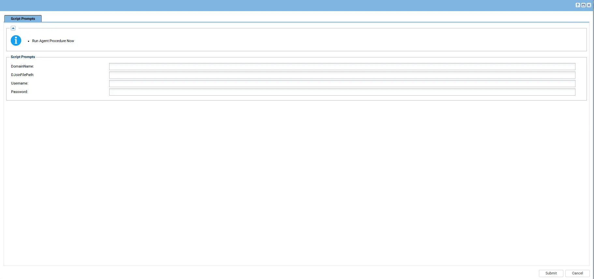
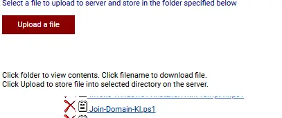

## Summary

The **Join Domain [Online/Offline]** automation is used to join a Windows computer to an Active Directory domain using either the online credential-based method or the offline domain join method.

The automation uses a Kaseya VSA agent procedure to collect the required parameters, create a JSON configuration file, and execute the `Join-Domain-KI.ps1` wrapper script. The wrapper retrieves the agnostic `Join-Domain.ps1` script from the ProVal Content Repository, validates its code signature, and executes it with the configured parameters.

The automation supports the following methods:

- **Online Domain Join:** Uses the domain name and domain credentials to join the computer to the domain.
- **Offline Domain Join:** Uses a previously generated offline domain join file to join the computer to the domain.

## Sample Run

**Note:** The computer must have the required network connectivity and DNS configuration to locate the domain controller when using the online method. The offline method requires a valid offline domain join file.

## Dependencies

- Agnostic PowerShell script: `Join-Domain.ps1`.
- [Agnostic script - Join Domain](/docs/fb3e4906-6520-4b5b-bc35-db7b79b45f7d)
- For the offline method, an offline domain join file generated using the [Generate DJoin File [Domain Controller]](/docs/d1313948-cbd2-420e-b5af-f633b894edeb)

## Variables

| Variable | Description |
|---|---|
| `DomainName` | Specifies the Active Directory domain to join. |
| `DJoinFilePath` | Specifies the path to the offline domain join file. |
| `Username` | Specifies the username used for the online domain join. |
| `Password` | Specifies the password associated with the domain join account. |

The VSA procedure collects these parameters and writes the available values to `Join-Domain-Param.Json`. The wrapper converts the username and password into a `PSCredential` object before passing the parameters to the agnostic script.

**Working paths:**

- Working directory: `C:\ProgramData\_Automation\Script\Join-Domain`
- Wrapper script: `C:\ProgramData\_Automation\Script\Join-Domain\Join-Domain-KI.ps1`
- Parameter file: `C:\ProgramData\_Automation\Script\Join-Domain\Join-Domain-Param.Json`
- Downloaded script: `C:\ProgramData\_Automation\Script\Join-Domain\Join-Domain.ps1`

## Implementation

1. Export the agent procedure from ProVal's VSA RMM instance.

   **Name:** `Join Domain [Online/Offline]`

   The export downloads the required XML file.

2. Import the XML file into the partner's VSA RMM instance.

3. Export the `Join-Domain-KI.ps1` wrapper script from ProVal's Internal VSA.

   The script is available under:

   `Manage Files` > `Shared Files` > `PVAL` > `Join-Domain-KI.ps1`

   

4. Ensure that `Join-Domain-KI.ps1` is mapped to the appropriate file path in the client's VSA environment.

   The agent procedure writes this file to:

   `C:\ProgramData\_Automation\Script\Join-Domain\Join-Domain-KI.ps1`

5. Configure the parameters according to the selected domain-join method.

   **For Online Domain Join:**

   - Provide `DomainName`.
   - Provide `Username` and `Password` for the domain account.
   - Ensure the target computer has network connectivity and DNS configured to locate a domain controller.

   **For Offline Domain Join:**

   1. Run the [Generate DJoin File [Domain Controller]](/docs/d1313948-cbd2-420e-b5af-f633b894edeb) agent procedure on the Domain Controller.
   2. Provide the target computer name for which the offline domain join file needs to be generated.
   3. Review the procedure output and locate the generated offline domain join file.
   4. Make the generated file accessible from the target computer and note its full path.
   5. Run the `Join Domain [Online/Offline]` procedure on the target computer.
   6. Provide `DomainName` and set `DJoinFilePath` to the full path of the offline domain join file.
   7. Execute the procedure and review the VSA procedure log to verify the result.

   For detailed instructions, refer to the [Generate DJoin File [Domain Controller]](/docs/d1313948-cbd2-420e-b5af-f633b894edeb).

6. Run the `Join Domain [Online/Offline]` agent procedure against the target Windows computer.

7. Verify the execution results in the VSA procedure log. If the domain join fails, review the logged error and check domain controller discovery, DNS configuration, network connectivity, credentials, and the offline join file path as applicable.

## Output

Procedure logs

## Changelog

### 2026-10-22

- Initial version of the document.