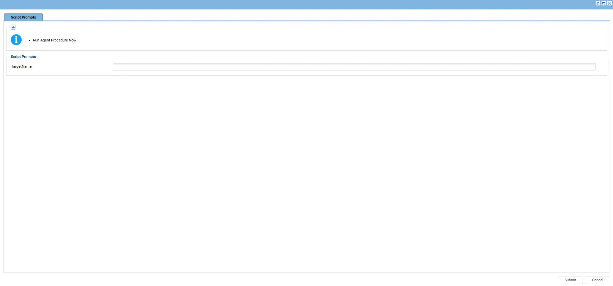
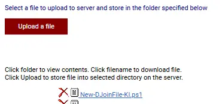

## Summary

The **Generate DJoin File [Domain Controller]** automation generates an offline domain join file for a specified target computer on a Domain Controller.

The automation uses a Kaseya VSA agent procedure to collect the target computer name, create a JSON configuration file, and execute the `New-DJoinFile-KI.ps1` wrapper script. The wrapper downloads the agnostic `New-DJoinFile.ps1` script from the ProVal Content Repository, validates its code signature, and executes it with the configured target computer name.

The generated offline domain join file can then be used by the **Join Domain [Online/Offline]** automation to join the target computer to the Active Directory domain without performing a conventional online domain join.

## Sample Run

**Note:** Run this procedure on a Domain Controller. Provide the target computer name for which the offline domain join file needs to be generated.

## Dependencies

- [Agnostic script - New DJoin File](/docs/e0acd656-10bc-48d6-9182-41d1ff78007a)

## Variables

| Variable | Description |
|---|---|
| `TargetName` | Specifies the target computer name for which the offline domain join file will be generated. |

The VSA procedure collects `TargetName` and writes the available value to `New-DJoinFile-Param.Json`. The wrapper reads this configuration and passes `TargetName` to the agnostic PowerShell script.

**Working paths:**

- Working directory: `C:\ProgramData\_Automation\Script\New-DJoinFile`
- Wrapper script: `C:\ProgramData\_Automation\Script\New-DJoinFile\New-DJoinFile-KI.ps1`
- Parameter file: `C:\ProgramData\_Automation\Script\New-DJoinFile\New-DJoinFile-Param.Json`
- Downloaded script: `C:\ProgramData\_Automation\Script\New-DJoinFile\New-DJoinFile.ps1`

## Implementation

1. Export the agent procedure from ProVal's VSA RMM instance.

   **Name:** `Generate DJoin File [Domain Controller]`

   The export downloads the required XML file.

2. Import the XML file into the partner's VSA RMM instance.

3. Export the `New-DJoinFile-KI.ps1` wrapper script from ProVal's Internal VSA.

   The script is available under:

   `Manage Files` > `Shared Files` > `PVAL` > `New-DJoinFile-KI.ps1`

   

4. Ensure that `New-DJoinFile-KI.ps1` is mapped to the appropriate file path in the client's VSA environment.

   The agent procedure writes the wrapper to:

   `C:\ProgramData\_Automation\Script\New-DJoinFile\New-DJoinFile-KI.ps1`

5. Run the `Generate DJoin File [Domain Controller]` agent procedure on the Domain Controller and provide the `TargetName` parameter.

6. Review the VSA procedure log for the execution output.

7. Verify that the offline domain join file was generated successfully and identify its output location before using it with the domain-join procedure.

## Output

Procedure log.

## Changelog

### 2026-10-22

- Initial version of the document.