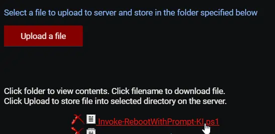
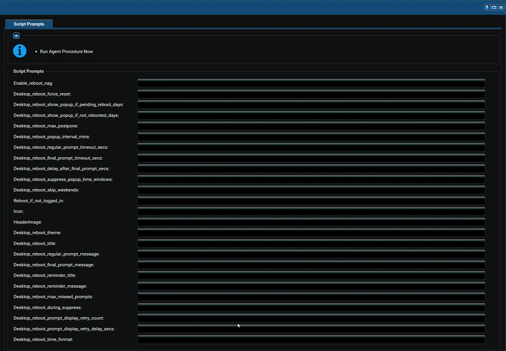
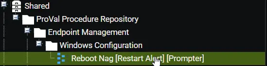
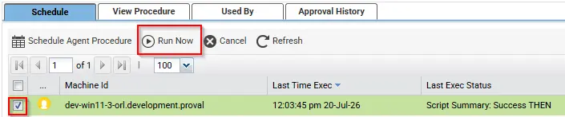
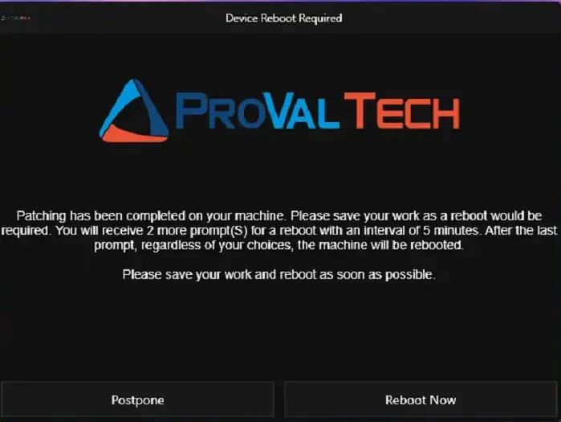
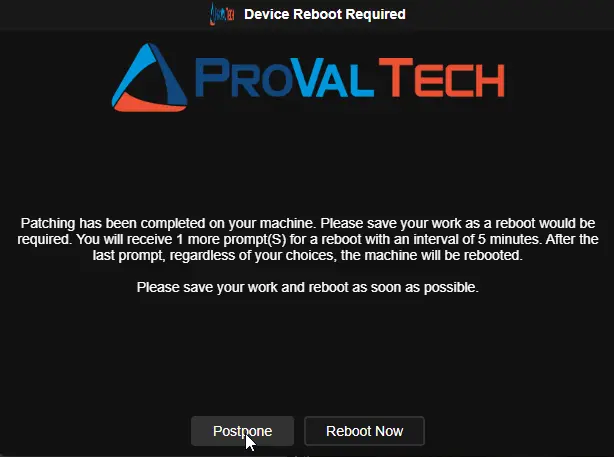
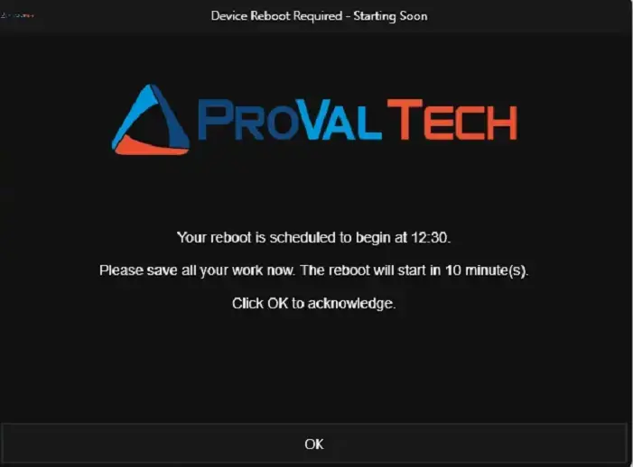
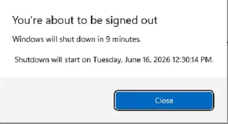
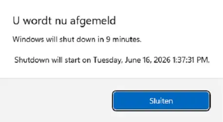

## Overview

This automated procedure ensures that managed workstations are rebooted in a timely manner after system updates or after extended periods of uptime. Regular reboots are essential for applying security patches, maintaining system stability, and ensuring optimal performance. 

To minimize disruption to end-users, this procedure uses a friendly, customizable prompt that allows users to postpone the reboot around their schedule, while still guaranteeing the reboot eventually happens.

## How It Works

1. **Configuration Generation:** When the procedure runs, it first checks which settings were provided by your IT administrator (such as how long to wait before prompting, custom messages, or suppression windows). It safely writes these specific settings into a temporary configuration file (JSON format) on the local machine.

2. **Script Execution:** The procedure then launches a secure, pre-approved PowerShell script.

3. **Smart Defaults:** The script reads the configuration file created in step one. If a specific setting was not provided by the IT administrator, the script automatically falls back to built-in, best-practice default values so the process never fails.

4. **User Interaction:** If the criteria for a reboot are met, the script displays a user-friendly prompt. The end-user can choose to reboot immediately or postpone.

5. **Autonomous Management:** Once the initial prompt is shown, the script manages its own schedule in the background. It will continue to remind the user at the defined intervals. If the user ignores the final prompt, the system shows one last reminder and automatically schedules and executes a forced reboot to ensure compliance.

## Key Benefits & Behaviors

* **Non-Disruptive:** Prompts can be suppressed during specified off-hours (e.g., overnight) and on weekends.

* **Intelligent Skipping:** The script automatically delays prompting if it detects that no user is currently logged in, or if the computer screen is locked. It can also detect if Windows Updates or software installations are currently running in the background and will hold off the reboot until they finish.

* **Reliable Prompting:** If a prompt fails to appear, the script retries it automatically. A prompt that could not be displayed never counts against the user — no postponement or missed prompt is consumed — and the cycle simply resumes at the next interval if every attempt fails.

* **Self-Cleaning:** After the machine is successfully rebooted, the script automatically detects the fresh boot, cleans up its temporary scheduled tasks and files, and exits silently without leaving any clutter behind.

### Default Prompt Flow (5 prompts, 4 hours apart)

| Prompt | Type | User Options | What Happens If Ignored |
|--------|------|--------------|------------------------|
| 1st – 4th | Regular | `Postpone` or `Reboot Now` | Treated as postpone; script reschedules for next interval |
| 5th | Final (scheduling) | Date/time picker (24-hour clock by default) + `Schedule Reboot` | A reminder appears and the reboot is forced after the configured delay (`0` = immediately) |

`Desktop_reboot_max_postpone` controls the **total** number of prompts in the cycle (regular + final). With the default of `5`: 4 regular prompts + 1 final = 5 total.

### After the final prompt

- If the user picks a time 10+ minutes in the future → reboot is scheduled, and a reminder appears 10 minutes before.
- If the user picks a time less than 10 minutes away → the reminder is shown immediately and the machine reboots at the selected time.
- If the user picks a time that is invalid or already passed → the machine reboots immediately.
- If the prompt times out → a reminder appears and the reboot is forced after `Desktop_reboot_delay_after_final_prompt_secs` (`0` = immediately).

### Automatic Behaviours

| Scenario | What Happens |
|----------|--------------|
| **User reboots on their own** | On the next scheduled run, the script detects either fresh uptime (less than the interval) OR that `LastBootUpTime` is newer than the last prompt timestamp, cleans up all tasks and state, and exits. No further prompts. |
| **User reboots after reminder / during shutdown countdown** | Windows automatically cancels the pending `shutdown /r` timer. All tasks and state were already cleaned up when the shutdown was scheduled, so nothing remains to trigger a second reboot. |
| **Reboot scheduled on the final prompt** | Runs at the selected time even during suppress windows or weekends, and even while the machine is locked; the reminder is only shown when a user is active at an unlocked desktop. If the machine is rebooted manually first, the pending restart is cancelled and the cycle is cleaned up. |
| **Machine is locked** | Prompt is skipped; script reschedules for the next interval. If `Desktop_reboot_max_missed_prompts` is set, skipped prompts increment a counter until a forced reboot is triggered. |
| **No user logged in** | Prompt is skipped and rescheduled — unless `Reboot_if_not_logged_in` is enabled, in which case the machine reboots directly. |
| **No user + install in progress** | Even with auto-reboot enabled, the script defers if it detects an active installation (Windows Update, MSI, BITS, winget, etc.) and reschedules. |
| **Weekend / Suppress window active** | Prompt is skipped; script reschedules. If `Desktop_reboot_during_suppress` is enabled, unattended or forced reboots will bypass this restriction and proceed. A reboot scheduled on the final prompt is exempt. |
| **Prompt fails to display** | The prompt is retried automatically. No postponement or missed prompt is counted and stored state is preserved; if every attempt fails, the script reschedules itself for the next interval. |
| **No internet** | Script reschedules itself rather than failing; components already on disk are used when the download source is unreachable. |
| **Component run again while cycle is active** | Exits without changes unless `Desktop_reboot_force_reset` is set. |
| **Dutch-language user** | Prompts automatically appear in Dutch for `nl-NL` and `nl-BE` display languages, including the built-in messages and button labels. |

## Dependencies

- [Invoke-RebootWithPrompt](/docs/1ff05046-df36-4692-80a7-36458aa43392)
- [OmniPrompt](/docs/8ead1ffd-dade-4e17-9958-3313da9a7aa8)
- [SilentLauncher](/docs/b0b9f423-eee3-4148-b8a0-e99400c45698)

## Implementation

1. Export the agent procedure from ProVal's VSA RMM instance.  
   **Name:** `Reboot Nag [Restart Alert] [Prompter]`  

   The export will download the necessary XML file.  

2. Import this XML file into the partner's VSA RMM instance.  

3. Export the `Invoke-RebootWithPrompt-KI.ps1` from the ProVal's Internal VSA. This is also placed under the below path:  
`Manage Files` > `Shared Files` > `PVAL` > `Invoke-RebootWithPrompt-KI.ps1`  

  

4. Map the `Invoke-RebootWithPrompt-KI.ps1` into the `107th` step of the script in the client's environment.

## Sample Run

To execute the component on a specific machine:

1. Select the machine you want to run the script on from Kaseya RMM.

2. Search the script `Reboot Nag [Restart Alert] [Prompter]` and click on `Select`.  

3. Click on the `Run Now` button.  

4. After selecting the component, configure the variables as described below.

### Configuring the Variables

**Enablement & Overrides:**

5. Set `Enable_reboot_nag` to `True` to bypass all enablement checks and immediately start prompting.  
6. Set `Desktop_reboot_force_reset` to `True` to clear stored state and scheduled tasks, then restart the prompt cycle from the beginning.  

**Enablement Conditions:**

7. Set `Desktop_reboot_show_popup_if_pending_reboot_days` — if a pending reboot is detected, prompts start after this many uptime days. Set to `0` to disable this condition.
8. Set `Desktop_reboot_show_popup_if_not_rebooted_days` — prompts start if uptime exceeds this many days, regardless of pending reboot. Set to `0` to disable this condition.  

**Prompt Scheduling:**

9. Set `Desktop_reboot_max_postpone` — total number of prompts in the cycle (regular + final). Regular prompts = value - 1.
10. Set `Desktop_reboot_popup_interval_mins` — minutes between successive prompt attempts.
11. Set `Desktop_reboot_regular_prompt_timeout_secs` — seconds before a regular prompt auto-closes (treated as postponed).
12. Set `Desktop_reboot_final_prompt_timeout_secs` — seconds before the final scheduling prompt auto-closes (a reminder is shown and the reboot follows the configured delay).
13. Set `Desktop_reboot_delay_after_final_prompt_secs` — seconds between the final prompt timing out and the forced reboot. A reminder with the restart time is shown for that period so the user can save their work; `0` reboots as soon as the final prompt times out.

**Behaviour Switches:**

14. Set `Desktop_reboot_suppress_popup_time_windows` — time range when prompts are suppressed (for example, `1800-0900` for 6 PM to 9 AM).  
15. Set `Desktop_reboot_skip_weekends` to `True` to skip prompts on Saturdays and Sundays.
16. Set `Reboot_if_not_logged_in` to `True` to auto-reboot when no user is logged in (guarded by install-in-progress checks).
17. Set `Desktop_reboot_max_missed_prompts` — number of consecutive skipped prompts (e.g., locked screen) before forcing a reboot without the GUI. Set to `0` to disable. The counter resets when a user is active at an unlocked desktop, and a prompt that failed to display does not count.
18. Set `Desktop_reboot_during_suppress` to `True` to allow unattended or forced reboots to proceed during suppress windows or weekends.
19. Set `Desktop_reboot_prompt_display_retry_count` — extra attempts to display the prompt when it fails to appear or returns unreadable output. Set to `0` to give up after the first failure.
20. Set `Desktop_reboot_prompt_display_retry_delay_secs` — seconds to wait between prompt display attempts.

**Branding:**

21. Set `Icon` — URL or local path for the prompt window icon.
22. Set `HeaderImage` — URL or local path for the prompt header image.
23. Set `Desktop_reboot_theme` — prompt window theme (`Dark` or `Light`). Default is `Dark`.  
24. Set `Desktop_reboot_time_format` — clock format for the final prompt's date/time picker and the scheduled reboot time shown on the reminder: `24Hour` (default), `12Hour`, or `Auto`, which follows each user's Windows short-time setting.

**Custom Messages (Optional):**

25. Set `Desktop_reboot_title` — custom window title (leave blank for language-appropriate default).
26. Set `Desktop_reboot_regular_prompt_message` — custom message for regular prompts.
27. Set `Desktop_reboot_final_prompt_message` — custom message for the final scheduling prompt.
28. Set `Desktop_reboot_reminder_title` — custom title for the reminder before a scheduled reboot.
29. Set `Desktop_reboot_reminder_message` — custom message for the reminder prompt.  
30. Click on `Submit` to initiate the component.

### Sample Prompts (English)

**Regular prompt (Postpone or Reboot Now):**  

**Regular prompt (Postpone or Reboot Now):**  

**Final scheduling prompt (date/time picker):**  

**Reminder prompt (10 minutes before scheduled reboot):**  

**Windows Shutdown Warning:**  

> **Note:** The Windows shutdown warning says **"shut down"** — this is standard Windows behavior. Despite the wording, the machine will **restart** (not power off) because the script uses `shutdown /r` (restart flag). This is a cosmetic quirk of the Windows notification and does not affect functionality.

### Sample Prompts (Dutch)

**Regular prompt (Postpone or Reboot Now):**  

**Regular prompt (Postpone or Reboot Now):**  

**Final scheduling prompt (date/time picker):**  

**Reminder prompt (10 minutes before scheduled reboot):**  

**Windows Shutdown Warning:**  

> **Note:** The Windows shutdown warning says **"shut down"** — this is standard Windows behavior. Despite the wording, the machine will **restart** (not power off) because the script uses `shutdown /r` (restart flag). This is a cosmetic quirk of the Windows notification and does not affect functionality.

## Variables

### Enablement & Overrides

| Variable | Type | Default | Description |
|----------|------|---------|-------------|
| `Enable_reboot_nag` | String | `False` | Enable to bypass all enablement checks and immediately start prompting. `Accepted values: 1, Yes, True`|
| `Desktop_reboot_force_reset` | String | `False` | Enable to clear stored state and scheduled tasks, restarting the prompt cycle from the beginning. `Accepted values: 1, Yes, True` |

### Enablement Conditions

| Variable | Type | Default | Description |
|----------|------|---------|-------------|
| `Desktop_reboot_show_popup_if_pending_reboot_days` | String | `2` | If a pending reboot is detected (Windows Update or CBS registry keys), start prompting after this many days of uptime. Set to `0` to disable this condition. |
| `Desktop_reboot_show_popup_if_not_rebooted_days` | String | `30` | Start prompting if system uptime exceeds this many days, regardless of pending reboot status. Set to `0` to disable. |

### Prompt Scheduling

| Variable | Type | Default | Description |
|----------|------|---------|-------------|
| `Desktop_reboot_max_postpone` | String | `5` | Total number of prompts in the cycle (regular + final). Regular prompts = value - 1. Default gives 4 regular + 1 final. |
| `Desktop_reboot_popup_interval_mins` | String | `240` | Minutes between successive prompt attempts. |
| `Desktop_reboot_regular_prompt_timeout_secs` | String | `600` | Timeout in seconds for regular prompts. When it expires, the prompt is treated as postponed. |
| `Desktop_reboot_final_prompt_timeout_secs` | String | `900` | Timeout in seconds for the final scheduling prompt. When it expires, a reminder is shown and the machine reboots after the configured delay. |
| `Desktop_reboot_delay_after_final_prompt_secs` | String | `600` | Seconds between the final prompt timing out and the forced restart. A reminder with the restart time is shown for that period so the user can save their work. `0` restarts as soon as the final prompt times out. |

### Behavior Switches

| Variable | Type | Default | Description |
|----------|------|---------|-------------|
| `Desktop_reboot_suppress_popup_time_windows` | String | *(not set)* | Time window during which prompts are suppressed, in `HHmm-HHmm` 24-hour format. Example: `1800-0900` suppresses from 6 PM to 9 AM. Spans midnight. Does not apply to a reboot the user scheduled on the final prompt. |
| `Desktop_reboot_skip_weekends` | String | `False` | Enable to skip prompts on Saturdays and Sundays. Does not apply to a reboot the user scheduled on the final prompt. `Accepted values: 1, Yes, True` |
| `Reboot_if_not_logged_in` | String | `False` | Enable to reboot immediately if no user is logged in. Guarded by install-in-progress check — if an update or installer is running, the reboot is deferred to the next interval. `Accepted values: 1, Yes, True`|
| `Desktop_reboot_max_missed_prompts` | String | `0` | Number of consecutive skipped prompt attempts (due to locked screen or no user logged in) before the GUI is bypassed and the reboot is forced. Set to `0` to disable forcing. The counter resets when a user is active at an unlocked desktop, and a prompt that failed to display does not count. |
| `Desktop_reboot_during_suppress` | String | `False` | Enable to allow an unattended or forced reboot to proceed inside a suppress time window or on a weekend. Interactive prompts are never shown during suppression. A reboot the user scheduled on the final prompt always proceeds at the selected time, regardless of this setting. `Accepted values: 1, Yes, True` |
| `Desktop_reboot_prompt_display_retry_count` | String | `1` | Extra attempts to display the prompt when it fails to appear or returns unreadable output. `0` gives up after the first failure. A prompt that could not be displayed never consumes a postponement or counts as missed. |
| `Desktop_reboot_prompt_display_retry_delay_secs` | String | `30` | Seconds to wait between prompt display attempts. |

### Branding

| Variable | Type | Default | Description |
|----------|------|---------|-------------|
| `Icon` | String | *(not set)* | URL or local path to an icon file for the prompt window. URLs are downloaded automatically and verified as images before use. |
| `HeaderImage` | String | *(not set)* | URL or local path to a header image for the prompt window. URLs are downloaded automatically and verified as images before use. |
| `Desktop_reboot_theme` | Selection | `Dark` | Prompt window theme. Valid values: `Dark`, `Light`. |
| `Desktop_reboot_time_format` | Selection | `24Hour` | Clock format for the final prompt's date/time picker and the scheduled reboot time on the reminder. Valid values: `24Hour`, `12Hour`, `Auto` (follows the logged-on user's Windows short-time setting and falls back to 24-hour time when it cannot be read). Log files always use the 24-hour clock. |

### Custom Messages

All message variables support substitution variables (see table below) and `\n` for line breaks.

| Variable | Type | Default | Description |
|----------|------|---------|-------------|
| `Desktop_reboot_title` | String | *(language-appropriate default)* | Custom title for the prompt window (default is defined in the PowerShell script). |
| `Desktop_reboot_regular_prompt_message` | String | *(language-appropriate default)* | Message body for regular prompts (default is defined in the PowerShell script). |
| `Desktop_reboot_final_prompt_message` | String | *(language-appropriate default)* | Message body for the final scheduling prompt (default is defined in the PowerShell script). |
| `Desktop_reboot_reminder_title` | String | *(language-appropriate default)* | Title for the reminder shown 10 minutes before a scheduled reboot (default is defined in the PowerShell script). |
| `Desktop_reboot_reminder_message` | String | *(language-appropriate default)* | Message body for the reminder prompt (default is defined in the PowerShell script). |

---

## Substitution Variables

Use these in any custom message. They are replaced with live values when the prompt is displayed.

| Variable | Description | Example Value |
|----------|-------------|---------------|
| `%PromptsToSend%` | Total number of prompts the user will receive | `5` |
| `%PromptsSent%` | Number of prompts already shown | `2` |
| `%PromptsLeft%` | Remaining prompts before the final one | `3` |
| `%PromptIntervalMinutes%` | Interval between prompts in minutes | `240` |
| `%PromptIntervalHours%` | Same interval in hours | `4` |
| `%RegularTimeoutSeconds%` | Regular prompt timeout in seconds | `600` |
| `%RegularTimeoutMinutes%` | Same timeout in minutes | `10` |
| `%FinalTimeoutSeconds%` | Final prompt timeout in seconds | `900` |
| `%FinalTimeoutMinutes%` | Same timeout in minutes | `15` |
| `%DelayAfterFinalSeconds%` | Delay after final prompt in seconds | `600` |
| `%DelayAfterFinalMinutes%` | Same delay in minutes | `10` |
| `%ScheduledRebootTime%` | User-selected reboot time, in the format set by `Desktop_reboot_time_format` | `14:30` |
| `%MinutesUntilReboot%` | Minutes until scheduled reboot | `10` |
| `%ComputerName%` | Machine name | `PC-OFFICE-01` |
| `%UserName%` | Logged-in username | `jsmith` |

**Notes:**

- Variables that don't apply in a given context (e.g. `%ScheduledRebootTime%` during a regular prompt) are replaced with an empty string.
- Use `\n` in any message to insert a line break in the prompt.
- Unit conversion is automatic — `Desktop_reboot_popup_interval_mins` is in minutes so `%PromptIntervalHours%` divides by 60; timeout/delay values are in seconds so the `Minutes` variants divide by 60.

---

## Default Messages

When no custom message is set via site variables, the component uses language-aware defaults. Language is auto-detected from the logged-on user's UI language or the system locale. Custom messages set via variables are shown as-is in every language.

### Default English Messages

| Field | Default Text |
|-------|-------------|
| **Window Title** | `Device Reboot Required` |
| **Regular Prompt** | `A required reboot is pending for your computer. Please save your work before continuing. You will receive %PromptsLeft% more prompt(s) with an interval of %PromptIntervalMinutes% minutes. After the last prompt the reboot will proceed automatically.\n\nPlease save your work and click Reboot Now to proceed.` |
| **Final Prompt** | `A required reboot is pending on your computer. This is the final prompt. Please select a time within the next 48 hours for the reboot to begin. If no action is taken within %FinalTimeoutMinutes% minutes, the reboot will proceed automatically.\n\nChoose a time and click Schedule Reboot.` |
| **Reminder Title** | `Device Reboot Required - Starting Soon` |
| **Reminder Message** | `Your reboot is scheduled to begin at %ScheduledRebootTime%.\n\nPlease save all your work now. The reboot will start in %MinutesUntilReboot% minute(s).\n\nClick OK to acknowledge.` |

### Default Dutch Messages

Applied automatically when the user's UI language matches `nl-NL` or `nl-BE`.

| Field | Default Text |
|-------|-------------|
| **Window Title** | `Herstart van apparaat vereist` |
| **Regular Prompt** | `Er staat een vereiste herstart klaar voor uw computer. Sla uw werk op voordat u verdergaat. U ontvangt nog %PromptsLeft% herinnering(en) met een interval van %PromptIntervalMinutes% minuten. Na de laatste herinnering wordt de computer automatisch opnieuw opgestart.\n\nSla uw werk op en klik op Nu opnieuw opstarten om door te gaan.` |
| **Final Prompt** | `Er staat een vereiste herstart klaar op uw computer. Dit is de laatste herinnering. Selecteer een tijdstip binnen de komende 48 uur waarop de herstart moet beginnen. Als er binnen %FinalTimeoutMinutes% minuten geen actie wordt ondernomen, wordt de computer automatisch opnieuw opgestart.\n\nKies een tijdstip en klik op Herstart plannen.` |
| **Reminder Title** | `Herstart van apparaat vereist - Start binnenkort` |
| **Reminder Message** | `De herstart van uw computer staat gepland om %ScheduledRebootTime%.\n\nSla nu al uw werk op. De herstart begint over %MinutesUntilReboot% minuten.\n\nKlik op OK om te bevestigen.` |

Button labels follow the same language: `Postpone` → `Uitstellen`, `Reboot Now` → `Nu opnieuw opstarten`, `Schedule Reboot` → `Herstart plannen`.

---

## Real-Life Scenarios

### Scenario 1: Default Configuration

**Settings:** All defaults (5 total prompts, 4 hours apart, pending reboot + 2 days or 30 days uptime).

**What the user experiences:**

- Machine has a pending Windows Update reboot and has been up for 3 days.
- **9:00 AM** — Prompt 1 appears: "Please save your work... You will receive 3 more prompts." User clicks Postpone.
- **1:00 PM** — Prompt 2 appears. User clicks Postpone.
- **5:00 PM** — Prompt 3 appears. User clicks Reboot Now. Machine reboots. Cycle ends.

If the user had postponed all 4 regular prompts:

- **9:00 AM next day** — Prompt 5 (final) appears with a date/time picker.
- User selects tomorrow at 8:00 AM → reboot is scheduled.
- **7:50 AM next day** — Reminder appears: "Your reboot will start in 10 minutes."
- **8:00 AM** — Machine reboots automatically.

### Scenario 2: Quick Cycle for Critical Patches

**Settings:**

- `Desktop_reboot_max_postpone` = `2`
- `Desktop_reboot_popup_interval_mins` = `60`
- `Desktop_reboot_final_prompt_timeout_secs` = `600`
- `Enable_reboot_nag` = `True`

**What the user experiences:**

- **10:00 AM** — Prompt 1 (regular) appears. User postpones.
- **11:00 AM** — Prompt 2 (final) appears with date/time picker. If ignored for 10 minutes, a reminder appears and the machine reboots 10 minutes later, at 11:20 AM.

### Scenario 3: Overnight Suppression with Weekend Skip

**Settings:**

- `Desktop_reboot_suppress_popup_time_windows` = `1800-0800`
- `Desktop_reboot_skip_weekends` = `True`

**What the user experiences:**

- Prompts only appear between 8:00 AM and 6:00 PM, Monday through Friday.
- If a prompt is due at 7:00 PM Friday, it is skipped and rescheduled. The user won't see it until Monday morning after 8:00 AM.

### Scenario 4: Unattended Machines (Kiosks, Shared PCs)

**Settings:**

- `Reboot_if_not_logged_in` = `True`
- `Desktop_reboot_popup_mins` = `120`

**What happens:**

- If no user is logged in when the script runs, the machine reboots immediately.
- **Exception:** If Windows Update, an MSI installer, winget, BITS transfer, or similar is actively running, the reboot is deferred by 2 hours and checked again.
- If a user IS logged in, the normal prompt flow is used.

### Scenario 5: User Reboots on Their Own

**Settings:** Any configuration.

**What happens:**

- Component runs at 10:00 AM. Prompt 1 shown. User postpones.
- User manually restarts the computer at 1:00 PM.
- Scheduled task fires at 2:00 PM. Script detects uptime (1 hour) is less than the interval (4 hours), concludes the machine was rebooted, removes all tasks and state, exits silently.
- **No further prompts are shown.**

### Scenario 6: Custom Messages with Substitution Variables

**Settings:**

- `Desktop_reboot_regular_prompt_message` = `Hi %UserName%, your PC %ComputerName% needs a restart.\n\nYou have %PromptsLeft% reminders left.\nNext reminder in %PromptIntervalHours% hours.`

**What the user sees:**

> Hi jsmith, your PC PC-OFFICE-01 needs a restart.
>
> You have 3 reminders left.
> Next reminder in 4 hours.

### Scenario 7: User Reboots After Reminder or During Shutdown Countdown

**Settings:** Any configuration. User received the final prompt and scheduled a reboot.

**What happens:**

- **7:50 AM** — Reminder prompt appears: "Your reboot will start in 10 minutes."
- The restart is scheduled for 8:00 AM with `shutdown /r /f /t 600`, and the reminder stays open for the countdown.
- **7:55 AM** — User saves work and manually restarts before the countdown expires.
- Windows automatically cancels the pending shutdown timer.
- All scheduled tasks and state were already cleaned up when the shutdown was issued — nothing remains to trigger a second reboot.
- **Machine boots cleanly with no leftover artifacts.**

### Scenario 8: Forced Reboot After Missed Prompts

**Settings:**

- `Desktop_reboot_max_missed_prompts` = `3`
- `Desktop_reboot_during_suppress` = `True`

**What happens:**

- The user leaves their machine locked or logged off for multiple prompt cycles.
- The script skips the prompt 3 consecutive times, incrementing the missed prompt counter.
- On the 3rd missed attempt, the threshold is met. Because `Desktop_reboot_during_suppress` is enabled, the script bypasses any active weekend or after-hours suppress windows and forces the reboot immediately (provided no installations are running).

### Scenario 9: 12-Hour Clock on the Final Prompt

**Settings:**

- `Desktop_reboot_time_format` = `12Hour`

**What the user experiences:**

- The final prompt's date/time picker shows times like `2:30 PM` instead of `14:30`.
- The reminder shows the scheduled reboot time in the same 12-hour format (for example, "Your reboot is scheduled to begin at 2:30 PM.").
- Use `Auto` instead to follow each user's own Windows short-time setting. Log files always use the 24-hour clock.

## Output

- Script log

## Changelog

### 2026-10-24

- Added `Desktop_reboot_time_format` to choose the clock format of the final prompt's date/time picker and the scheduled reboot time shown on the reminder: `24Hour` (default), `12Hour`, or `Auto`, which follows the logged-on user's Windows short-time setting. The setting is carried across the whole prompt cycle; log files always use the 24-hour clock.
- Added `Desktop_reboot_prompt_display_retry_count` and `Desktop_reboot_prompt_display_retry_delay_secs`. A prompt that fails to display — the task never started, the prompt never appeared, or the output was unreadable — is retried automatically. Failed attempts never consume a postponement or count as missed prompts.
- **Behavior change:** when the final prompt times out, a reminder is shown and the reboot happens after `Desktop_reboot_delay_after_final_prompt_secs` (`0` = immediately) instead of rebooting the machine directly. Selections less than 10 minutes away now show the reminder immediately and reboot at the selected time; invalid or past selections reboot immediately.
- A reboot scheduled on the final prompt now runs at the selected time even during suppress windows or weekends, and even while the machine is locked; the reminder is only shown when a user is active at an unlocked desktop.
- SilentLauncher now uses the same shared location as the OEM update component, so both components share a single copy; the previous location is left in place for tasks registered by earlier versions.
- Updated the built-in default messages: Dutch users now see fully localized wording and button labels, and titles or messages left blank use the built-in text for the detected language.
- When the download source is unreachable, components already on disk are used and the cycle continues instead of failing.

### 2026-08-13

- Updated the implementation with the latest template.
- Replaced the .NET-based prompter with **OmniPrompt**, a native binary that requires no desktop runtime.
- Replaced legacy wrappers with **SilentLauncher** to eliminate console window flashing and bypass EDR/AV blocks.
- Added `Desktop_reboot_max_missed_prompts` to force a reboot if a machine repeatedly misses prompts.
- Added `Desktop_reboot_during_suppress` to allow unattended or forced reboots to bypass suppress windows and weekends.

### 2026-07-29

- Initial version of the document
