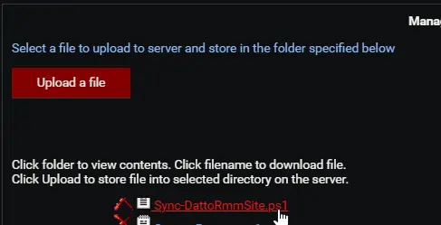
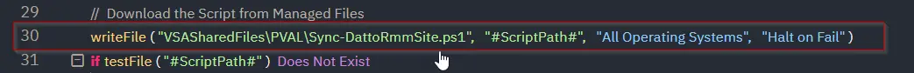
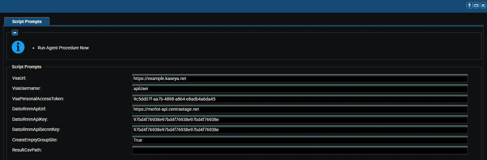

## Summary

Prepares VSA 9 for the move to Datto RMM. The agent procedure:

- Creates a Datto RMM site for every VSA 9 machine group that does not have one yet.
- Stores the Datto RMM site UID of each agent in [cPVALDattoRmmSiteUid](/docs/bfb2c75f-75e2-44a1-90eb-eb0740e23aab).
- Stores the Datto RMM agent download address in [cPVALDattoRmmAgentUrl](/docs/2fe9acfb-f1ef-4a4e-9d91-5725fb271da6).
- Creates the three custom fields of the solution in VSA 9 when they are missing.

The [Install Datto RMM Agent [VSA 9 Migration]](/docs/7a1f0dda-b650-40c1-bedb-277ccd373b10) agent procedure then uses these fields to install the agent into the correct site.

:::warning  
Run this agent procedure once, against a single Windows machine. It works on the whole VSA 9 tenant and Datto RMM account through their APIs, so running it on more machines only repeats the same work. Do not schedule it against all machines.  
:::

## Dependencies

- [Solution: VSA 9 to Datto RMM Migration](/docs/38446fc5-ce0a-4319-9471-ce7e327d8a8d)
- [Custom Field: cPVALDattoRmmSiteUid](/docs/bfb2c75f-75e2-44a1-90eb-eb0740e23aab)
- [Custom Field: cPVALDattoRmmAgentUrl](/docs/2fe9acfb-f1ef-4a4e-9d91-5725fb271da6)
- [Custom Field: cPVALDattoRmmDeployStatus](/docs/96ff33e8-e893-421a-981c-5af9fa6a798e)
- A VSA 9 personal access token. See [Create a VSA 9 Personal Access Token](/docs/38446fc5-ce0a-4319-9471-ce7e327d8a8d#step-1-create-a-vsa-9-personal-access-token).
- Datto RMM API keys. See [Create the Datto RMM API Keys](/docs/38446fc5-ce0a-4319-9471-ce7e327d8a8d#step-2-create-the-datto-rmm-api-keys).

## Implementation

1. Export the agent procedure from ProVal's VSA RMM instance.  
   **Name:** `Sync Datto RMM Sites [VSA 9 Migration]`  

   The export will download the necessary XML file.  
2. Import this XML file into the partner's VSA RMM instance.  
3. Export the `Sync-DattoRmmSite.ps1` from ProVal's Internal VSA. This is also placed under the below path:  
`Manage Files` > `Shared Files` > `PVAL` > `Sync-DattoRmmSite.ps1`  
    
4. Map the `Sync-DattoRmmSite.ps1` into the procedure's writeFile step (Step 30) in the client's environment.  
    

## Sample Run

## Variables

| Variable | Type | Default | Description |
|----------|------|---------|-------------|
| `VsaUrl` | String | *(required)* | Web address used to sign in to VSA 9, for example `https://example.kaseya.net`. |
| `VsaUsername` | String | *(required)* | VSA 9 user that owns the personal access token. Letter case matters. |
| `VsaPersonalAccessToken` | String | *(required)* | VSA 9 personal access token with the `REST API (Read, Write)` scope. |
| `DattoRmmApiUrl` | String | *(required)* | Datto RMM API URL from your user record, for example `https://merlot-api.centrastage.net`. |
| `DattoRmmApiKey` | String | *(required)* | Datto RMM API key. |
| `DattoRmmApiSecretKey` | String | *(required)* | Datto RMM API secret key. |
| `CreateEmptyGroupSite` | String | `False` | Also creates sites for machine groups that have no agents. `Accepted values: 1, Yes, True` |
| `ResultCsvPath` | String | `C:\ProgramData\_Automation\Script\Sync-DattoRmmSite\Sync-DattoRmmSite.csv` | Full path of the result CSV. |

:::note  
Avoid apostrophes (single quotes) in variable values. An apostrophe breaks the command that saves the values on the device.  
:::

:::note  
The values are saved to a temporary file on the device for the run only. The procedure deletes the file as soon as the script finishes, because it holds the credentials.  
:::

## Site Naming

| VSA 9 setup | Datto RMM site name | Example |
|-------------|---------------------|---------|
| Organization with only its root machine group | Organization name | `Contoso` |
| Any other machine group | Organization name - group name | `Contoso - branch` |

The group name is the part of the machine group name after the first dot. A Datto RMM site that already has the name is reused, ignoring letter case.

## Results by Agent

The result CSV has one row per VSA 9 agent.

| Result | Meaning |
|--------|---------|
| `Updated` | The site UID and download address were saved on the agent. |
| `NoDattoRmmSite` | No Datto RMM site exists for the agent, usually because creating its site failed. Fix the cause and run again. |
| `Failed` | VSA 9 rejected the update. The `Detail` column shows the reason. |

:::note  
The procedure reports a failure when any site could not be created or any agent could not be updated. Running it again is safe: existing sites are reused and the custom fields are overwritten. Run it again whenever agents or machine groups are added to VSA 9.  
:::

:::warning  
Enter the Datto RMM API URL exactly as shown on your Datto RMM user record. When it does not have the form `https://servername-api.centrastage.net`, the download address is not saved and the agent install fails.  
:::

## Output

- Agent Procedure Log
- New sites in Datto RMM
- Custom fields on each VSA 9 agent
- Result CSV on the device:
  - `C:\ProgramData\_Automation\Script\Sync-DattoRmmSite\Sync-DattoRmmSite.csv`

## Changelog

### 2026-10-12

- Initial version of the document.
