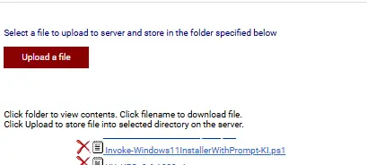
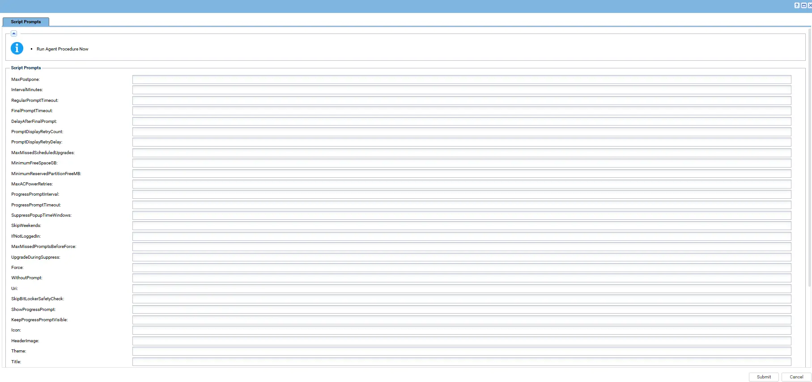

## Overview

This is a VSA implementation of the agnostic [Invoke-Windows11InstallerWithPrompt](/docs/b2f20f90-99f9-4bb1-ac7a-a3939f73ccec).

The script upgrades compatible Windows 10 and older Windows 11 devices to Windows 11 24H2 (build 26100). Users can postpone the upgrade a configured number of times and then select a time for it. Before the scheduled upgrade begins, the user receives a reminder to save their work. After the restart, the upgrade is confirmed and the user sees a completion message.

Run the agent procedure once per device. Scheduled tasks on the device handle the remaining workflow. Devices that cannot run Windows 11 should not be prompted to upgrade.

## Dependencies

- [Invoke-Windows11InstallerWithPrompt](/docs/b2f20f90-99f9-4bb1-ac7a-a3939f73ccec)

## Implementation

1. Export the **Windows 11 Upgrade With Prompt** agent procedure from ProVal's internal VSA RMM instance.

   The export downloads the agent procedure XML file.

2. Import the exported XML file into the target VSA RMM instance.

3. Export the PowerShell script used by the agent procedure from ProVal's internal VSA instance. The script is available under the following path:

   `Manage Files` > `Shared Files` > `PVAL` > `Invoke-Windows11InstallerWithPrompt-KI`

   

4. Upload or map the PowerShell script to the corresponding step in the imported agent procedure. Ensure that the script file reference matches the target VSA environment.

5. Configure the supported script parameters according to the deployment requirements, including prompt timing, postponement limits, and any required safety settings.

6. Run the agent procedure on a compatible test device and verify that the initial user prompt is displayed correctly.

7. Confirm that the user can postpone the upgrade, select a scheduled time, and receive the appropriate reminder.

8. Verify that the upgrade starts at the selected time, the device restarts as required, and the completion prompt appears after the upgrade finishes.

For additional guidance, refer to the internal VSA implementation workflow.

## Sample Run

Add a screenshot of the VSA agent procedure execution.

   

## Examples

### Scenario 1: Standard Deployment

Run the agent procedure with all supported parameters left at their defaults.

Expected behavior:

- The user receives five prompts at four-hour intervals, followed by a final prompt to schedule the upgrade.
- The user can postpone the upgrade during the regular prompt cycle.
- On the final prompt, the user selects a time for the upgrade.
- A reminder is displayed before the scheduled upgrade begins.
- The device is upgraded to Windows 11 24H2, restarts as required, and displays a completion message.

### Scenario 2: WithoutPrompt

Run with `WithoutPrompt = True`.

Expected behavior:

- Any existing prompt cycle is cancelled.
- Compatibility and safety checks run.
- The upgrade starts through the configured scheduled task.
- No user prompts are displayed.

### Scenario 3: IfNotLoggedIn

Run with `IfNotLoggedIn = True`.

Expected behavior:

- If no user is logged in, the upgrade starts without prompting.
- If a user is logged in, the normal prompt cycle continues.

### Scenario 4: Force

Run with `Force = True`.

Expected behavior:

- Existing scheduled tasks and stored prompt state are cleared.
- The prompt cycle starts again from the beginning.
- The operation is refused while an upgrade is running.

### Scenario 5: SkipWeekends and SuppressPopupTimeWindows

Run with `SkipWeekends = True` and `SuppressPopupTimeWindows = 1800-0900`.

Expected behavior:

- Prompts are suppressed on Saturdays, Sundays, and between 6 PM and 9 AM.
- A time already selected by the user is still honored, even during those hours.
- Upgrade execution during suppressed periods depends on the configured safety and scheduling settings.

### Scenario 6: MaxMissedScheduledUpgrades

Run with `MaxMissedScheduledUpgrades = 1`.

Expected behavior:

- If the device is off at the selected time, the upgrade does not start unexpectedly later.
- The user is asked to select a new time.
- A second missed or unanswered scheduled time ends the cycle as a failure.

### Scenario 7: ShowProgressPrompt

Run with `ShowProgressPrompt = True`, `ProgressPromptInterval = 10`, and `ProgressPromptTimeout = 300`.

Expected behavior:

- A notice appears for five minutes every ten minutes while the upgrade runs.
- The notice appears only while a user is logged in and the session is unlocked.
- The notice informs the user that the upgrade is running in the background.

### Scenario 8: KeepProgressPromptVisible

Run with `KeepProgressPromptVisible = True`.

Expected behavior:

- The notice appears when the upgrade starts and remains visible until the restart.
- If dismissed, the notice reappears during the next check.
- Interval mode is not required.

### Scenario 9: Custom URI

Run with a valid `Uri` parameter pointing to a custom Windows 11 ISO or ZIP file.

Expected behavior:

- The custom installation file is used instead of the default ProVal image.
- An invalid URL stops the operation with an error.
- **ProVal is not responsible for issues caused by a custom ISO or ZIP file.**

### Scenario 10: Custom Icon and Header Image

Configure the `Icon` and `HeaderImage` parameters.

Expected behavior:

- The configured images are displayed in the prompt dialogs.
- Supported URL, local path, or UNC path sources are handled according to the implementation.
- The required images are made available to the prompt process.

## If the Device Was Off at the Selected Time

The upgrade should not start more than 30 minutes after its planned time, according to the agnostic implementation.

1. When the device comes back online, the missed upgrade does not start automatically.
2. The user is asked to select a new time.
3. If the prompt is unanswered, it is presented again after the configured interval.
4. After the configured number of missed or unanswered scheduled times, the cycle ends as a failure.

## While the Upgrade Runs

The upgrade runs in the background and may take an hour or longer. Two optional modes can keep the user informed.

- **Interval mode (`ShowProgressPrompt = True`):** Displays a notice at the configured interval for the configured duration.
- **Stay mode (`KeepProgressPromptVisible = True`):** Keeps the notice visible until the restart and brings it back if dismissed.

Stay mode takes precedence when both settings are enabled. The notice appears only while a user is logged in and the session is unlocked.

## Prompt Display Retry

If a prompt fails to display, the script retries according to `PromptDisplayRetryCount` and `PromptDisplayRetryDelay`.

A failed display attempt does not count as a user postponement. If all attempts fail, the script retries at the next configured interval.

## Customize the Prompt Text

The prompt titles and messages can be customized through the corresponding script parameters.

When message parameters are left empty, the built-in wording is used in the supported display language. Custom text is displayed as entered.

Live values such as `ComputerName`, `UserName`, `PromptsLeft`, and `ScheduledUpgradeTime` can be inserted into messages where supported. Use `\n` to create a line break.

### Default Messages

The following messages describe the default prompt workflow. Confirm the exact wording and language support against the agnostic script before publishing customized text.

#### Titles

| Parameter | English | Dutch |
| --- | --- | --- |
| `Title` | Windows 11 Upgrade | Windows 11-upgrade |
| `ReminderPromptTitle` | Windows 11 Upgrade - Starting Soon | Windows 11-upgrade - Start binnenkort |
| `CompletionPromptTitle` | Windows 11 Upgrade - Complete | Windows 11-upgrade - Voltooid |
| `ProgressPromptTitle` | Windows 11 Upgrade - In Progress | Windows 11-upgrade - Bezig |

#### Regular Prompt

Parameter: `RegularPromptMessage`

English:

```text
An upgrade to Windows 11 24H2 is available for your computer. The upgrade can take an hour or more and restarts your computer, so please save your work first. You will receive PromptsLeft more prompt(s) with an interval of PromptIntervalMinutes minutes. After the last prompt the upgrade will proceed automatically.

Please save your work and click Upgrade Now to proceed.
```

Dutch:

```text
Er is een upgrade naar Windows 11 24H2 beschikbaar voor uw computer. De upgrade kan een uur of langer duren en start uw computer opnieuw op, dus sla eerst uw werk op. U ontvangt nog PromptsLeft herinnering(en) met een interval van PromptIntervalMinutes minuten. Na de laatste herinnering wordt de upgrade automatisch uitgevoerd.

Sla uw werk op en klik op Nu upgraden om door te gaan.
```

#### Final Prompt

Parameter: `FinalPromptMessage`

English:

```text
An upgrade to Windows 11 24H2 is required on your computer. This is the final prompt. Please select a time within the next 48 hours for the upgrade to begin. If no action is taken within FinalTimeoutMinutes minutes the upgrade will proceed automatically in DelayAfterFinalMinutes minutes.

Choose a time and click Schedule Upgrade.
```

Dutch:

```text
Er is een upgrade naar Windows 11 24H2 vereist op uw computer. Dit is de laatste herinnering. Selecteer een tijdstip binnen de komende 48 uur voor de upgrade. Als er geen actie wordt ondernomen binnen FinalTimeoutMinutes minuten, wordt de upgrade automatisch uitgevoerd na DelayAfterFinalMinutes minuten.

Kies een tijdstip en klik op Upgrade plannen.
```

#### Missed Upgrade Prompt

Parameter: `MissedUpgradePromptMessage`

English:

```text
Your Windows 11 upgrade was planned for MissedUpgradeTime, but it could not start because your computer was turned off or not connected at that time. Please select a new time within the next 48 hours for the upgrade to begin. If no time is selected, you will be asked again in PromptIntervalMinutes minutes.

Choose a time and click Schedule Upgrade.
```

Dutch:

```text
Uw Windows 11-upgrade stond gepland voor MissedUpgradeTime, maar kon niet starten omdat uw computer op dat moment uit stond of niet verbonden was. Selecteer een nieuw tijdstip binnen de komende 48 uur voor de upgrade. Als er geen tijdstip wordt gekozen, wordt het u over PromptIntervalMinutes minuten opnieuw gevraagd.

Kies een tijdstip en klik op Upgrade plannen.
```

#### Reminder Prompt

Parameter: `ReminderPromptMessage`

English:

```text
Your Windows 11 upgrade is scheduled to begin at ScheduledUpgradeTime.

Please save all your work now. The upgrade will start in MinutesUntilUpgrade minute(s).

Click OK to acknowledge.
```

Dutch:

```text
Uw Windows 11-upgrade staat gepland om te beginnen om ScheduledUpgradeTime.

Sla al uw werk nu op. De upgrade begint over MinutesUntilUpgrade minuten.

Klik op OK om te bevestigen.
```

#### Completion Prompt

Parameter: `CompletionPromptMessage`

English:

```text
Your computer has been upgraded to Windows 11 24H2 successfully.

Your computer is ready to use.

Click OK to acknowledge.
```

Dutch:

```text
Uw computer is succesvol bijgewerkt naar Windows 11 24H2.

Uw computer is klaar voor gebruik.

Klik op OK om te bevestigen.
```

#### In-Progress Notice

Parameter: `ProgressPromptMessage`

English:

```text
Windows 11 24H2 is being downloaded and installed on your computer. The upgrade is running in the background.

Your computer will restart automatically, possibly more than once, so please save your work and leave the computer switched on.

No action is needed from you.
```

Dutch:

```text
De upgrade naar Windows 11 24H2 wordt op uw computer gedownload en uitgevoerd. De upgrade loopt op de achtergrond.

Uw computer wordt automatisch opnieuw opgestart, mogelijk meerdere keren. Sla uw werk op en laat de computer ingeschakeld.

U hoeft verder niets te doen.
```

### Insert Live Values

The following placeholders can be used in custom messages where supported by the implementation.

| Name | Description |
| --- | --- |
| `PromptsToSend` | Total number of prompts the user will receive. |
| `PromptsSent` | Number of prompts shown so far, including the current prompt. |
| `PromptsLeft` | Number of prompts remaining after the current prompt. |
| `PromptIntervalMinutes` / `PromptIntervalHours` | Time between prompts. |
| `RegularTimeoutSeconds` / `RegularTimeoutMinutes` | Regular prompt timeout. |
| `FinalTimeoutSeconds` / `FinalTimeoutMinutes` | Final prompt timeout. |
| `DelayAfterFinalSeconds` / `DelayAfterFinalMinutes` | Delay before the upgrade starts after the final prompt is ignored. |
| `ScheduledUpgradeTime` | Scheduled upgrade start time. |
| `MinutesUntilUpgrade` | Minutes remaining before the upgrade starts. |
| `MissedUpgradeTime` | Time the missed upgrade was originally scheduled for. |
| `ProgressIntervalMinutes` | Minutes between in-progress notices. |
| `ProgressTimeoutSeconds` / `ProgressTimeoutMinutes` | Duration of each in-progress notice. |
| `UpgradeElapsedMinutes` | Minutes the upgrade has been running. |
| `ComputerName` | Device name. |
| `UserName` | Logged-in username. |

Use `\n` to create a line break.

Example:

```text
IT will upgrade ComputerName to Windows 11 24H2. You have PromptsLeft reminder(s) left, one every PromptIntervalHours hour(s).

Save your work and click Upgrade Now.
```

Example with an in-progress notice:

```text
IT is upgrading ComputerName to Windows 11. This has been running for UpgradeElapsedMinutes minute(s).

Please leave the machine switched on.
```

### Things to Know

- Placeholder names are reserved words. Reword messages if you need to display one of these words literally.
- Button labels follow the user's supported language and may not be customizable.
- The in-progress notice includes an OK button. In stay mode, dismissing it hides the notice only until the next check.
- Custom text is not automatically translated.
- If custom messages replace the built-in wording, include any required laptop power instructions yourself.

## VSA Script Parameters

Configure the supported parameters according to the VSA implementation. The following table describes the parameter set used by the agnostic implementation; verify that each parameter is exposed and supported by the VSA script before deployment.

| Parameter | Default | Type | Description |
| --- | --- | --- | --- |
| `MaxPostpone` | `5` | String | Maximum number of times the upgrade can be postponed before the final prompt appears. Total prompts equal `MaxPostpone + 1`. |
| `IntervalMinutes` | `240` | String | Minutes between prompts and the wait before a retry. |
| `RegularPromptTimeout` | `600` | String | Seconds before a regular prompt closes and counts as missed. Also used for the completion prompt. |
| `FinalPromptTimeout` | `900` | String | Seconds before the final or missed-upgrade prompt closes. |
| `DelayAfterFinalPrompt` | `600` | String | Seconds to wait before the upgrade starts if the final prompt is ignored. |
| `MaxMissedScheduledUpgrades` | `3` | String | Number of missed or unanswered scheduled upgrade times allowed before the cycle fails. |
| `PromptDisplayRetryCount` | `1` | String | Additional attempts to display a prompt after a display failure. |
| `PromptDisplayRetryDelay` | `30` | String | Seconds between prompt display attempts. |
| `SkipWeekends` | `False` | Switch | Prevents prompts on Saturdays and Sundays. |
| `IfNotLoggedIn` | `False` | Switch | Starts the upgrade without prompting when no user is logged in. |
| `Force` | `False` | Switch | Clears scheduled tasks and stored state to restart the prompt cycle. Refused while an upgrade is running. |
| `WithoutPrompt` | `True` | Switch | Skips prompts and starts the upgrade through the configured scheduled task. |
| `SuppressPopupTimeWindows` | Empty | String | Time window in 24-hour format during which prompts are suppressed, such as `1800-0900`. |
| `MaxMissedPromptsBeforeForce` | `0` | String | Number of consecutive missed prompts before the upgrade starts without prompting. `0` disables this behavior. |
| `UpgradeDuringSuppress` | `False` | Switch | Allows eligible unattended or forced upgrades during a suppression window or weekend. `UpdateDuringSuppress` is also accepted by the agnostic implementation. |
| `Uri` | Empty | String | Direct HTTPS link to a custom Windows 11 ISO or ZIP file. Blank uses the default ProVal image. |
| `MinimumFreeSpaceGB` | `24` | String | Required free space on the system drive, in GB. |
| `MinimumReservedPartitionFreeMB` | `15` | String | Required free space on the system reserved partition, in MB. |
| `SkipBitLockerSafetyCheck` | `False` | Switch | Continues when BitLocker lacks the recommended protectors or cannot be suspended. |
| `MaxACPowerRetries` | `3` | String | Number of attempts to wait for a laptop to be connected to power before the cycle fails. |
| `Icon` | Empty | String | URL, local path, or UNC path for the prompt icon. |
| `HeaderImage` | Empty | String | URL, local path, or UNC path for the prompt header image. |
| `ShowProgressPrompt` | `False` | Switch | Displays periodic notices while the upgrade runs. |
| `ProgressPromptInterval` | `10` | String | Minutes between in-progress notices. `0` disables interval notices. |
| `ProgressPromptTimeout` | `300` | String | Seconds each in-progress notice stays visible. |
| `KeepProgressPromptVisible` | `False` | Switch | Keeps the in-progress notice visible until the restart and restores it if dismissed. |
| `Theme` | `Dark` | Selection | Prompt theme. Supported values are `Dark` and `Light`. |
| `Title` | Empty | String | Title for the regular, final, and missed-upgrade prompts. |
| `RegularPromptMessage` | Empty | String | Message shown in regular prompts. |
| `FinalPromptMessage` | Empty | String | Message shown in the final scheduling prompt. |
| `MissedUpgradePromptMessage` | Empty | String | Message shown after a scheduled upgrade is missed. |
| `ReminderPromptTitle` | Empty | String | Title for the scheduled-upgrade reminder. |
| `ReminderPromptMessage` | Empty | String | Message for the scheduled-upgrade reminder. |
| `CompletionPromptTitle` | Empty | String | Title for the completion confirmation. |
| `CompletionPromptMessage` | Empty | String | Message for the completion confirmation. |
| `ProgressPromptTitle` | Empty | String | Title for the in-progress notice. |
| `ProgressPromptMessage` | Empty | String | Message for the in-progress notice. |

## Output

Review the VSA agent procedure execution results and the script's available logs.

The output documentation should identify the actual success and failure messages produced by the VSA implementation. Confirm the final Windows version and build after the upgrade completes.

- **Success:** The script reports the verified success status according to its implementation.
- **Failure:** The script reports a failure status when an error prevents the requested operation from completing.

## Changelog

### 2026-10-16

- Initial version of the VSA documentation.
